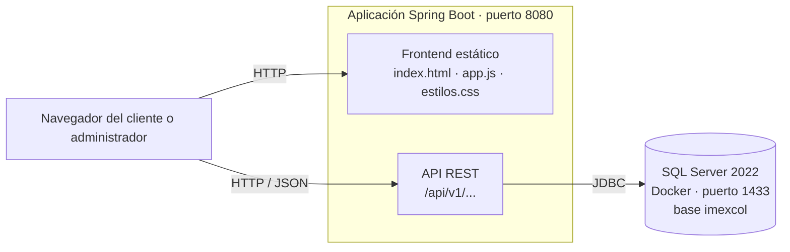
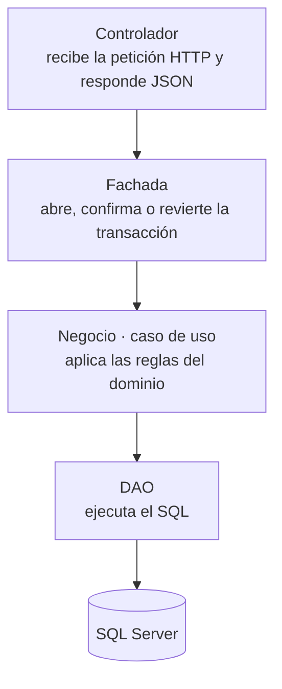
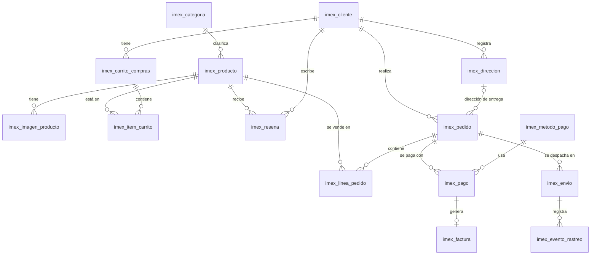
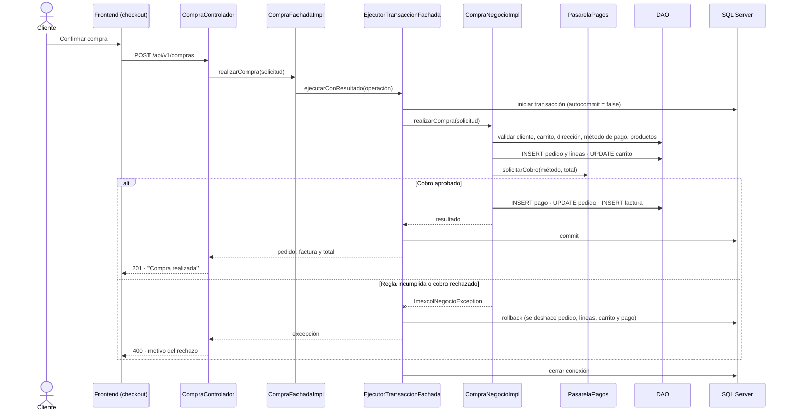
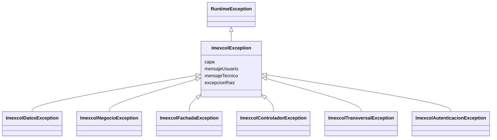

# Imexcol

**Proyecto académico — Universidad Católica de Oriente (UCO)**
**Materia:** Diseño Orientado a Objetos — 2026-II

**Imexcol** es una plataforma de comercio electrónico para una comercializadora de productos importados. Permite a los clientes explorar el catálogo, administrar su carrito y sus direcciones, realizar compras y consultar sus pedidos, envíos y facturas. Permite a los administradores gestionar clientes, pedidos, pagos y envíos.

El sistema atiende a dos actores:

- **Cliente:** se registra, inicia sesión, compra y consulta su historial.
- **Administrador:** gestiona la operación desde el panel administrativo.

La arquitectura adoptada es **Layered N-capas** con el patrón **DAO Factory** para el acceso a datos, transacciones **JDBC manuales** y una **capa de negocio basada en reglas**, donde cada política del dominio es una clase independiente que lanza una excepción cuando no se cumple.

Esta documentación describe:

- **Despliegue:** los componentes de la solución y cómo se comunican.
- **Componentes:** los módulos del backend y del frontend.
- **Paquetes:** la organización del código por capas.
- **Modelo de dominio y de datos:** agregados, entidades y tablas.
- **Transacción principal:** el flujo de la compra y su manejo de errores.
- **API REST:** los servicios que expone el backend.

---

## 1. Tecnologías

| Componente | Tecnología | Uso |
|---|---|---|
| Lenguaje | Java 25 | Backend |
| Framework | Spring Boot 4 (Web MVC, JDBC) | Servicios REST y arranque de la aplicación |
| Acceso a datos | JDBC manual (`PreparedStatement`, `ResultSet`), sin ORM | Consultas SQL explícitas y control de transacciones |
| Base de datos | SQL Server 2022 en Docker | Persistencia |
| Frontend | HTML5, CSS3 y JavaScript sin frameworks | SPA servida por la misma aplicación |
| Construcción | Maven (`mvnw`) | Compilación y dependencias |
| Calidad | SonarQube Cloud | Análisis estático en cada pull request |

---

## 2. Diagrama de despliegue

El frontend y el backend se despliegan en una sola aplicación Spring Boot. El navegador descarga la interfaz y consume la API REST desde el mismo origen, por lo que no se requiere configuración de CORS. La aplicación se conecta a SQL Server por JDBC.



| Componente | Tipo | Descripción |
|---|---|---|
| Frontend | Desarrollo propio | Interfaz de una sola página con las vistas de tienda, carrito, checkout, pedidos y panel administrativo. |
| API REST | Desarrollo propio | Controladores que reciben las peticiones y delegan en la capa de negocio. |
| SQL Server | Componente adoptado | Motor relacional con transacciones ACID. Corre en un contenedor Docker. |

La conexión se configura con las variables de entorno `DB_URL`, `DB_USERNAME` y `DB_PASSWORD`. El código no contiene credenciales.

---

## 3. Arquitectura en capas

Cada petición recorre las capas en un solo sentido. Ninguna capa salta a otra que no sea la inmediatamente inferior.



| Capa | Responsabilidad | Ejemplo |
|---|---|---|
| Controlador | Recibir la petición, llamar a la fachada y construir la respuesta. No contiene lógica de negocio. | `CompraControlador` |
| Fachada | Convertir DTO a dominio y controlar la transacción: iniciar, confirmar, revertir y cerrar la conexión. | `CompraFachadaImpl` |
| Negocio | Ejecutar el caso de uso como una secuencia de reglas. Recibe la `FabricaDAO` ya abierta. | `CompraNegocioImpl` |
| Datos | Traducir entidades a SQL y resultados a entidades. | `PedidoSqlServerDAO` |
| Transversal | Utilitarios antinulos, catálogo de mensajes y excepciones. | `UtilObjeto`, `MensajesEnum` |

### Objetos por capa

| Objeto | Capa | Propósito |
|---|---|---|
| `XxxDTO` | Controlador ↔ Fachada | Transportar datos desde y hacia el cliente HTTP. |
| `XxxDominio` | Negocio | Representar el concepto del dominio sobre el que se aplican las reglas. |
| `XxxEntidad` | Datos | Representar una fila de la tabla. |
| `XxxDTOAssembler`, `XxxEntidadAssembler` | Fachada y Negocio | Convertir entre DTO, dominio y entidad. Son singleton (`obtenerInstancia()`). |

---

## 4. Diagrama de componentes

### 4.1 Componentes del backend

Los componentes se agrupan según los agregados del dominio. Cada uno tiene su controlador, fachada, negocio, reglas y DAO.

| Componente | Entidades | Funciones principales |
|---|---|---|
| Clientes | Cliente, Dirección | Registro, actualización, direcciones de envío |
| Administradores | Administrador | Gestión de cuentas administrativas |
| Autenticación | Cliente, Administrador | Inicio de sesión de clientes y administradores, registro de clientes |
| Catálogo | Categoría, Producto, ImagenProducto, Reseña | Productos por categoría, galería de imágenes, reseñas de compra verificada |
| Carrito | CarritoCompras, ItemCarrito | Carrito activo del cliente y sus productos |
| Compra | Pedido, LineaPedido, Pago, Factura | Transacción "realizar compra" |
| Pedidos y pagos | Pedido, LineaPedido, Pago, MetodoPago | Consulta y cambio de estado de pedidos y pagos |
| Facturación | Factura | Factura de un pedido pagado |
| Logística | Envío, EventoRastreo | Despacho del pedido y seguimiento del envío |

### 4.2 Componentes del frontend

| Vista | Actor | Función |
|---|---|---|
| Bienvenida, Tienda, Categorías, Productos | Cliente | Explorar el catálogo |
| Registro, Inicio de sesión | Cliente | Crear cuenta y autenticarse |
| Carrito, Checkout | Cliente | Preparar y confirmar la compra |
| Mis pedidos, Mis direcciones | Cliente | Consultar pedidos y administrar direcciones |
| Inicio de sesión administrativo | Administrador | Autenticarse |
| Clientes, Pedidos, Pagos, Envíos | Administrador | Gestionar la operación |

---

## 5. Diagrama de paquetes

Paquete base: `co.edu.uco.imexcol`.

```
co.edu.uco.imexcol
├── controlador                 Endpoints REST y manejador global de excepciones
│   └── dto                     Respuesta estándar de la API
├── negocio
│   ├── fachada (+ impl)        Fachadas y ejecutor de transacciones
│   ├── casouso (+ impl)        Casos de uso (XxxNegocio / XxxNegocioImpl)
│   │   ├── regla/<entidad>     Una clase por política de negocio
│   │   └── validador/<entidad> Validadores que delegan en las reglas
│   ├── assembler
│   │   ├── dto (+ impl)        DTO ↔ Dominio
│   │   └── entidad (+ impl)    Dominio ↔ Entidad
│   ├── dominio (+ enums)       Objetos de dominio y estados
│   └── pasarela (+ impl)       Pasarela de pagos
├── datos
│   └── dao                     Interfaces DAO y ejecución común de consultas
│       ├── fabrica (+ sqlserver)  DAO Factory
│       └── impl
│           ├── sql             Sentencias SQL como constantes
│           ├── sqlserver       Implementaciones para SQL Server
│           └── mapper          ResultSet → Entidad
├── dto                         Objetos de transferencia
├── entidad                     Entidades de persistencia
├── transversal                 Utilitarios y catálogo de mensajes
│   └── excepcion (+ enums)     Jerarquía de excepciones
└── inicializador               Clase principal de Spring Boot
```

### Patrones aplicados

| Patrón | Dónde | Para qué |
|---|---|---|
| DAO | `datos/dao` | Aislar el acceso a datos del negocio. |
| Abstract Factory | `FabricaDAO` → `SqlServerFabricaDAO` | Crear los DAO de un motor de base de datos concreto. La clase abstracta solo declara contratos; la concreta abre la conexión. |
| Facade | `negocio/fachada` | Ofrecer al controlador una sola operación por transacción. |
| Caso de uso | `negocio/casouso` | Encapsular las operaciones de negocio de cada entidad, separadas de la transacción y del acceso a datos. |
| Assembler | `negocio/assembler` | Convertir objetos entre capas. |
| Singleton | Assemblers, reglas y validadores | Reutilizar una única instancia sin estado. |
| Strategy | `PasarelaPagos` → `PasarelaPagosSimulada` | Cambiar la pasarela de pagos sin modificar el caso de uso. |

---

## 6. Modelo de dominio

El dominio tiene 16 entidades organizadas en agregados. Los miembros internos de un agregado solo se modifican a través de su raíz.

| Agregado (raíz) | Miembros internos |
|---|---|
| Cliente | Dirección |
| CarritoCompras | ItemCarrito |
| Pedido | LineaPedido |
| Producto | ImagenProducto |
| Envío | EventoRastreo |
| Independientes | Pago, Factura, Reseña, Administrador, Categoría, MetodoPago |

### Estados del dominio

| Entidad | Estados |
|---|---|
| CarritoCompras | Activo → Convertido · Abandonado |
| Pedido | PENDIENTE → CONFIRMADO → PREPARANDO → ENVIADO → ENTREGADO · CANCELADO (solo desde PENDIENTE o CONFIRMADO) |
| Pago | PENDIENTE · EN_PROCESO · APROBADO · RECHAZADO · REEMBOLSADO |
| Envío | PREPARANDO → EN_TRANSITO → ENTREGADO · DEVUELTO · EXTRAVIADO |
| EventoRastreo | Recibido · En tránsito · En reparto · Entregado · Novedad |

El estado de un pedido solo avanza un paso a la vez; nunca retrocede.

---

## 7. Modelo de datos

Base de datos relacional con 16 tablas. Todas las llaves primarias son `UNIQUEIDENTIFIER` (UUID).



`imex_administrador` no tiene relaciones con otras tablas.

El script de creación está en `src/main/resources/schema.sql` y el de datos de demostración en `src/main/resources/datos-demo.sql`.

---

## 8. Reglas de negocio

Cada política del dominio documentada en las hojas **P-** del muestreo es una clase propia:

```
negocio/casouso/regla/<entidad>/XxxRegla       Lanza ImexcolNegocioException si la política no se cumple
negocio/casouso/validador/<entidad>/ValidarXxx Punto de entrada que usa el caso de uso
```

Los casos de uso se leen como una secuencia de reglas. Por ejemplo, eliminar una categoría:

```
asegurar que la categoría exista  →  asegurar que no tenga productos  →  eliminar
```

Reglas genéricas reutilizables (`regla/genericas`): texto obligatorio, longitud válida, número positivo, número mayor a cero, número en rango, estado válido, id y fecha distintos del valor por defecto.

Ninguna regla devuelve un objeto de resultado ni `null`: cuando la política no se cumple, lanza una excepción con un mensaje del catálogo `MensajesEnum`.

---

## 9. Transacción principal: realizar compra

`POST /api/v1/compras` convierte el carrito activo del cliente en un pedido pagado y facturado, en una única transacción.

### 9.1 Pasos y políticas

| Paso | Política | Si no se cumple |
|---|---|---|
| 1 | Datos de la solicitud completos (cliente, carrito, dirección, método de pago) | Excepción de negocio |
| 2 | El cliente existe | Excepción de negocio |
| 3 | El carrito existe, pertenece al cliente, está activo y tiene productos (CAR-POL-04, CAR-POL-09) | Excepción de negocio |
| 4 | La dirección existe y pertenece al cliente | Excepción de negocio |
| 5 | El método de pago existe y está activo | Excepción de negocio |
| 6 | Cada producto existe y está activo | Excepción de negocio |
| 7 | Se registra el pedido PENDIENTE y una línea por producto, copiando el precio actual del producto (LIN-POL-03, precio congelado) | — |
| 8 | El carrito pasa a Convertido | — |
| 9 | La pasarela de pagos aprueba el cobro | Excepción de negocio: pago rechazado |
| 10 | Se registra el pago APROBADO, el pedido pasa a CONFIRMADO y se genera la factura (FAC-POL-02) | — |

La pasarela de pagos es simulada: aprueba si el método de pago está activo y el total no supera $1.000.000.

### 9.2 Diagrama de secuencia



### 9.3 Control de la transacción

La fachada es la dueña de la transacción. `EjecutorTransaccionFachada` concentra el bloque que comparten todas las fachadas:

1. Obtener la `FabricaDAO`, que abre una conexión.
2. Iniciar la transacción.
3. Ejecutar el caso de uso con esa misma fábrica.
4. Confirmar si no hubo excepciones.
5. Revertir si cualquier capa lanzó una excepción, y relanzarla.
6. Cerrar la conexión siempre.

Todos los DAO que participan en la compra usan la misma conexión, por lo que el commit y el rollback afectan a todas las operaciones a la vez.

---

## 10. Manejo de excepciones



- Las excepciones del proyecto son **no chequeadas**: suben por las capas hasta la fachada, que revierte la transacción, sin obligar a cada interfaz a declarar `throws`.
- Las excepciones chequeadas de Java (`SQLException`, `IOException`) se capturan donde se originan y se traducen a la excepción de su capa.
- Cada excepción guarda un mensaje para el usuario y uno técnico. Ambos provienen de `MensajesEnum`.

`ManejadorExcepcionesControlador` (`@RestControllerAdvice`) traduce las excepciones a respuestas HTTP:

| Excepción | Código HTTP |
|---|---|
| `ImexcolNegocioException` y validaciones | 400 |
| `ImexcolAutenticacionException` | 401 |
| Ruta inexistente | 404 |
| Método HTTP no soportado | 405 |
| Tipo de contenido no soportado | 415 |
| `ImexcolDatosException`, `ImexcolFachadaException` y errores inesperados | 500 |

Todas las respuestas usan el mismo formato JSON: `{ "mensajes": [...], "datos": [...], "exitosa": true|false }`.

---

## 11. Buenas prácticas aplicadas

- **Cero nulos:** los objetos se inicializan con valores por defecto y las comparaciones pasan por los utilitarios `UtilObjeto`, `UtilTexto`, `UtilFecha`, `UtilNumerico` y `UtilUUID`.
- **Sin valores quemados:** límites y nombres como constantes con nombre; todos los textos en `MensajesEnum`; estados como enumeraciones.
- **Métodos pequeños:** cada caso de uso se lee como una receta de pasos con nombres que expresan la intención.
- **Código autoexplicativo:** sin comentarios; los nombres de clases y métodos describen lo que hacen.
- **Credenciales fuera del código:** conexión configurada por variables de entorno.

---

## 12. API REST

Prefijo común: `/api/v1`.

| Recurso | Ruta | Operaciones |
|---|---|---|
| Autenticación | `/auth/cliente`, `/auth/administrador`, `/auth/cliente/registro` | POST |
| Compras | `/compras` | POST |
| Clientes | `/clientes` | GET, GET `/{id}`, POST, PUT `/{id}`, DELETE `/{id}` |
| Direcciones | `/direcciones` | GET, GET `/{id}`, POST, PUT `/{id}`, DELETE `/{id}` |
| Administradores | `/administradores` | GET, GET `/{id}`, POST, PUT `/{id}`, DELETE `/{id}` |
| Categorías | `/categorias` | GET, GET `/{id}`, POST, PUT `/{id}`, DELETE `/{id}` |
| Productos | `/productos` | GET, GET `/{id}`, POST, PUT `/{id}`, DELETE `/{id}` |
| Imágenes de producto | `/productos/{idProducto}/imagenes` | GET, POST, PUT `/{id}`, DELETE `/{id}` |
| Reseñas | `/resenas` | GET, GET `/{id}`, GET `/producto/{idProducto}`, POST, DELETE `/{id}/cliente/{idCliente}`, DELETE `/{id}/administrador/{idAdministrador}` |
| Carritos | `/carritos-compras` | GET, GET `/{id}`, POST, PUT `/{id}`, DELETE `/{id}` |
| Ítems de carrito | `/items-carrito` | GET, GET `/{id}`, POST, PUT `/{id}`, DELETE `/{id}` |
| Pedidos | `/pedidos` | GET, GET `/{id}`, POST, PUT `/{id}`, DELETE `/{id}` |
| Líneas de pedido | `/lineas-pedido` | GET, GET `/{id}`, POST, PUT `/{id}`, DELETE `/{id}` |
| Métodos de pago | `/metodos-pago` | GET, GET `/{id}`, POST, PUT `/{id}`, DELETE `/{id}` |
| Pagos | `/pagos` | GET, GET `/{id}`, POST, PUT `/{id}`, DELETE `/{id}` |
| Facturas | `/facturas` | GET, GET `/{id}`, GET `/pedido/{idPedido}/cliente/{idCliente}`, POST |
| Envíos | `/envios` | GET, GET `/{id}`, POST, PUT `/{id}`, DELETE `/{id}` |
| Eventos de rastreo | `/envios/{idEnvio}/eventos-rastreo` | GET, GET `/cliente/{idCliente}`, POST |

---

## 13. Documentación de diseño

La documentación de diseño está en la carpeta `docs/`:

| Documento | Contenido |
|---|---|
| `MuestreoDatosModeloDominio_Imexcol_Sep20.xlsx` | Modelo de dominio anémico y enriquecido, caracterización (C-), políticas (P-) y muestreo de datos (M-) por entidad |
| `DocumentacionClases_Imexcol.xlsx` | Diagrama de clases: atributos, relaciones y métodos |
| `MER_Imexcol_II_2026.xlsx` | Modelo entidad-relación: tablas, columnas, tipos y llaves |
| `ModeloDominioEnriquecido_Guia_Clase.xlsx` | Ejemplo de referencia de la clase |
| `*.md` e `img/` | Versión en texto de los documentos y sus diagramas |
