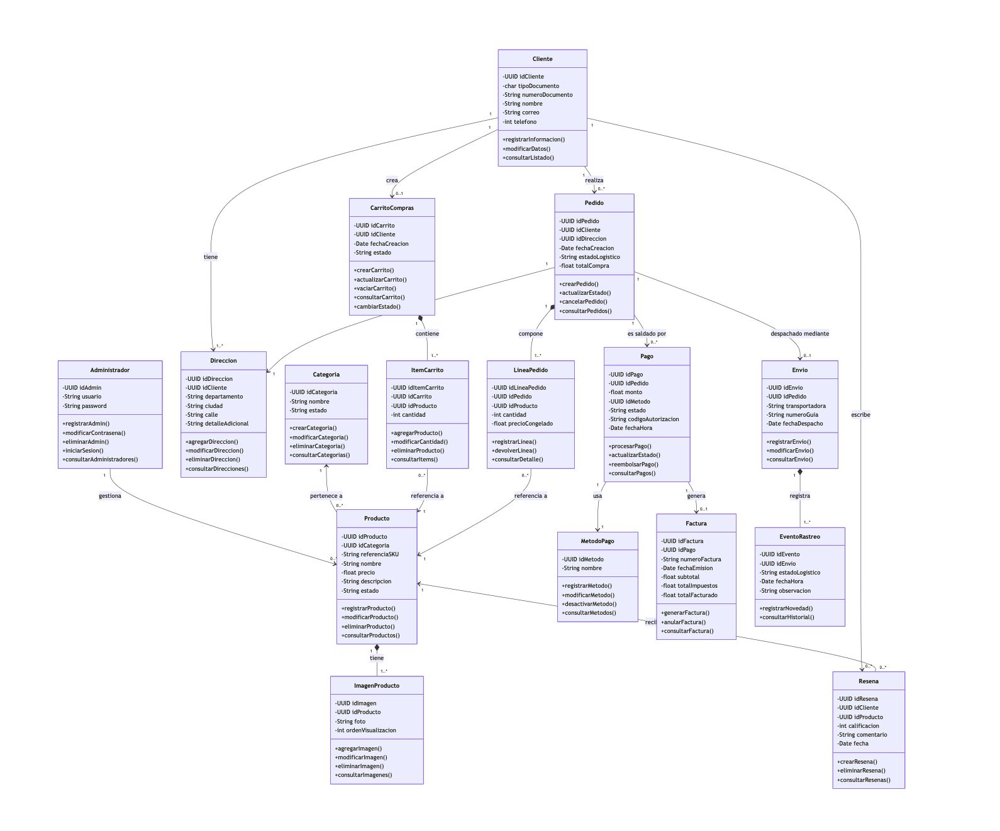

# DocumentacionClases_Imexcol

Fuente: `95608897-DocumentacionClases_Imexcol.xlsx` · 19 hojas

## Índice de hojas

- Diagrama de clases
- Clases
- Cliente
- Administrador
- Direccion
- Categoria
- Producto
- ImagenProducto
- Resena
- CarritoCompras
- ItemCarrito
- Pedido
- LineaPedido
- Pago
- MetodoPago
- Factura
- Envio
- EventoRastreo
- Valores

---

## Hoja: Diagrama de clases

- En esta hoja se ubica la imagen del modelo, asegurando que sea clara y legible

---

## Hoja: Clases

| Clase | Estereotipo | Desripción |
|---|---|---|
| Cliente | class | Objeto de dominio que representa a cada uno de los usuarios registrados que realizan compras en la plataforma de Imexcol. |
| Administrador | class | Objeto de dominio que representa al personal interno encargado de gestionar el catálogo, los pedidos y la operación general del sistema. |
| Direccion | class | Objeto de dominio que representa la ubicación física y estructurada que registra un cliente para la entrega de sus productos o propósitos de facturación. |
| Categoria | class | Objeto de dominio que representa a cada una de las agrupaciones taxonómicas en las que se organizan los productos del catálogo de Imexcol. |
| Producto | class | Objeto de dominio que representa a cada uno de los artículos de importación (bolsos, juguetes, etc.) que están disponibles para la venta en la tienda. |
| ImagenProducto | class | Objeto de dominio que representa a cada uno de los recursos visuales o fotografías asociadas a un producto para su exhibición. |
| Resena | class | Objeto de dominio que representa a cada una de las calificaciones y comentarios dejados por un cliente sobre un producto específico que ya ha comprado. |
| CarritoCompras | class | Objeto de dominio que representa la sesión temporal donde un cliente agrupa los productos que tiene intención de adquirir antes de formalizar la transacción. |
| ItemCarrito | class | Objeto de dominio que representa a cada una de las selecciones individuales (producto específico y cantidad) dentro del carrito activo de un cliente. |
| Pedido | class | Objeto de dominio que representa la confirmación formal, transaccional y definitiva de una compra realizada por un cliente en Imexcol. |
| LineaPedido | class | Objeto de dominio que representa el detalle individual de un pedido, permitiendo registrar de forma histórica cada producto adquirido, su cantidad y su valor al momento de confirmar la compra. (Evidencia histórica de la compra) |
| Pago | class | Objeto de dominio que representa el registro de la transacción financiera procesada a través de la pasarela de pagos para saldar un pedido. |
| MetodoPago | class | Objeto de dominio que representa el instrumento financiero o forma transaccional utilizada por el cliente (tarjeta de crédito, PSE, etc.) para realizar el pago. |
| Factura | class | Objeto de dominio que representa el comprobante legal y contable emitido al cliente con el desglose de impuestos una vez el pago ha sido exitoso. |
| Envio | class | Objeto de dominio que representa el proceso logístico y de despacho de un pedido aprobado hacia la dirección de entrega del cliente. |
| EventoRastreo | class | Objeto de dominio que representa a cada una de las actualizaciones o hitos temporales (ej. en preparación, en tránsito, entregado) que ocurren durante el ciclo de vida de un envío. |

---

## Hoja: Cliente

| Clase | Cliente |  |  |  |  |  |  |  |  |  |  |  |  |
|---|---|---|---|---|---|---|---|---|---|---|---|---|---|
| Estereotipo | class |  |  |  |  |  |  |  |  |  |  |  |  |
| Descripción | Objeto de dominio que representa a cada uno de los usuarios registrados que realizan compras en la plataforma de Imexcol. |  |  |  |  |  |  |  |  |  |  |  |  |
| Modificador acceso: | public |  |  |  |  |  |  |  |  |  |  |  |  |
| Tipo clase: | no final |  |  |  |  |  |  |  |  |  |  |  |  |
| Relaciones |  |  |  |  |  |  |  |  |  |  |  |  |  |
| Relación | Tipo relación |  |  | Estructura |  |  |  |  |  |  |  |  |  |
| Es usada por | Asociación |  |  | Direccion |  |  |  |  |  |  |  |  |  |
| Es usada por | Asociación |  |  | Resena |  |  |  |  |  |  |  |  |  |
| Es usada por | Asociación |  |  | CarritoCompras |  |  |  |  |  |  |  |  |  |
| Es usada por | Asociación |  |  | Pedido |  |  |  |  |  |  |  |  |  |
| Atributos |  |  |  |  |  |  |  |  |  |  |  |  |  |
| Modificador de aceso | Nombre | Tipo de dato |  | Tipo modificación atributo | Tipo acceso atributo | Valor por defecto |  |  | Descripción atributo |  |  |  |  |
|  |  | Tipo de dato | ¿Cuál? |  |  |  |  |  |  |  |  |  |  |
| private | idCliente | String |  | final | no static |  |  |  | Identificador único del cliente generado por el sistema. |  |  |  |  |
| private | tipoDocumento | String |  | no final | no static |  |  |  | Tipo de documento de identidad del cliente. |  |  |  |  |
| private | numeroDocumento | String |  | no final | no static |  |  |  | Número del documento de identidad. |  |  |  |  |
| private | nombre | String |  | no final | no static |  |  |  | Nombre completo del cliente. |  |  |  |  |
| private | correo | String |  | no final | no static |  |  |  | Correo electrónico principal de contacto. |  |  |  |  |
| private | telefono | String |  | no final | no static |  |  |  | Número de teléfono celular del cliente. |  |  |  |  |
| Constructores |  |  |  |  |  |  |  |  |  |  |  |  |  |
| Modificador de aceso | Nombre | Tipo constructor | Descripción | Parámetros |  |  |  |  |  |  |  | Excepciones |  |
|  |  |  |  | Nombre | Tipo de dato | ¿Cuál? | Tipo parámetro | Tipo modificación atributo | Descripción |  |  |  |  |
| public | Cliente | Defecto | Constructor por defecto de la clase Cliente. |  |  |  |  |  |  |  |  |  |  |
| public | Cliente | Parametrizado | Constructor parametrizado de la clase Cliente. | idCliente | String |  | Por valor | no final | Parámetro del constructor correspondiente al atributo idCliente. |  |  |  |  |
|  |  |  |  | tipoDocumento | String |  | Por valor | no final | Parámetro del constructor correspondiente al atributo tipoDocumento. |  |  |  |  |
|  |  |  |  | numeroDocumento | String |  | Por valor | no final | Parámetro del constructor correspondiente al atributo numeroDocumento. |  |  |  |  |
|  |  |  |  | nombre | String |  | Por valor | no final | Parámetro del constructor correspondiente al atributo nombre. |  |  |  |  |
|  |  |  |  | correo | String |  | Por valor | no final | Parámetro del constructor correspondiente al atributo correo. |  |  |  |  |
|  |  |  |  | telefono | String |  | Por valor | no final | Parámetro del constructor correspondiente al atributo telefono. |  |  |  |  |
| Métodos accesores |  |  |  |  |  |  |  |  |  |  |  |  |  |
| Modificador de aceso | Nombre | Tipo método accesor | Tipo modificación método | Descripción | Parámetros |  |  |  |  |  | Tipo dato de retorno |  | Excepciones |
|  |  |  |  |  | Nombre | Tipo de dato | ¿Cuál? | Tipo parámetro | Tipo modificación atributo | Descripción | Tipo de dato | ¿Cuál? |  |
| public | getIdCliente | getter | no final | Obtiene el valor del atributo idCliente. |  |  |  |  |  |  | String |  |  |
| public | setIdCliente | setter | no final | Asigna un valor al atributo idCliente. | valorIdCliente | String |  | Por valor | no final | Parámetro para actualizar el atributo IdCliente. | void |  |  |
| public | getTipoDocumento | getter | no final | Obtiene el valor del atributo tipoDocumento. |  |  |  |  |  |  | String |  |  |
| public | setTipoDocumento | setter | no final | Asigna un valor al atributo tipoDocumento. | valorTipoDocumento | String |  | Por valor | no final | Parámetro para actualizar el atributo TipoDocumento. | void |  |  |
| public | getNumeroDocumento | getter | no final | Obtiene el valor del atributo numeroDocumento. |  |  |  |  |  |  | String |  |  |
| public | setNumeroDocumento | setter | no final | Asigna un valor al atributo numeroDocumento. | valorNumeroDocumento | String |  | Por valor | no final | Parámetro para actualizar el atributo NumeroDocumento. | void |  |  |
| public | getNombre | getter | no final | Obtiene el valor del atributo nombre. |  |  |  |  |  |  | String |  |  |
| public | setNombre | setter | no final | Asigna un valor al atributo nombre. | valorNombre | String |  | Por valor | no final | Parámetro para actualizar el atributo Nombre. | void |  |  |
| public | getCorreo | getter | no final | Obtiene el valor del atributo correo. |  |  |  |  |  |  | String |  |  |
| public | setCorreo | setter | no final | Asigna un valor al atributo correo. | valorCorreo | String |  | Por valor | no final | Parámetro para actualizar el atributo Correo. | void |  |  |
| public | getTelefono | getter | no final | Obtiene el valor del atributo telefono. |  |  |  |  |  |  | String |  |  |
| public | setTelefono | setter | no final | Asigna un valor al atributo telefono. | valorTelefono | String |  | Por valor | no final | Parámetro para actualizar el atributo Telefono. | void |  |  |
| Métodos |  |  |  |  |  |  |  |  |  |  |  |  |  |
| Modificador de aceso | Nombre | Tipo acceso método | Tipo modificación método | Descripción | Parámetros |  |  |  |  |  | Tipo dato de retorno |  | Excepciones |
|  |  |  |  |  | Nombre | Tipo de dato | ¿Cuál? | Tipo parámetro | Tipo modificación atributo | Descripción | Tipo de dato | ¿Cuál? |  |
| public | registrarCliente | no static | no final | Registra un nuevo cliente en la plataforma. | clienteNuevo | Otro | Cliente | Por valor | no final | Parámetro de entrada del método registrarCliente. | void |  |  |
| public | modificarDatos | no static | no final | Actualiza la información personal y de contacto del cliente. | clienteModificado | Otro | Cliente | Por valor | no final | Parámetro de entrada del método modificarDatos. | void |  |  |
| public | consultarClientes | no static | no final | Consulta el listado de clientes registrados. | filtros | String |  | Por valor | no final | Parámetro de entrada del método consultarClientes. | void |  |  |

---

## Hoja: Administrador

| Clase | Administrador |  |  |  |  |  |  |  |  |  |  |  |  |
|---|---|---|---|---|---|---|---|---|---|---|---|---|---|
| Estereotipo | class |  |  |  |  |  |  |  |  |  |  |  |  |
| Descripción | Objeto de dominio que representa al personal interno encargado de gestionar el catálogo, los pedidos y la operación general del sistema. |  |  |  |  |  |  |  |  |  |  |  |  |
| Modificador acceso: | public |  |  |  |  |  |  |  |  |  |  |  |  |
| Tipo clase: | no final |  |  |  |  |  |  |  |  |  |  |  |  |
| Relaciones |  |  |  |  |  |  |  |  |  |  |  |  |  |
| Relación | Tipo relación |  |  | Estructura |  |  |  |  |  |  |  |  |  |
| Atributos |  |  |  |  |  |  |  |  |  |  |  |  |  |
| Modificador de aceso | Nombre | Tipo de dato |  | Tipo modificación atributo | Tipo acceso atributo | Valor por defecto |  |  | Descripción atributo |  |  |  |  |
|  |  | Tipo de dato | ¿Cuál? |  |  |  |  |  |  |  |  |  |  |
| private | idAdmin | int/Integer |  | final | no static |  |  |  | Identificador único del administrador. |  |  |  |  |
| private | usuario | String |  | no final | no static |  |  |  | Nombre de usuario para autenticación. |  |  |  |  |
| private | password | String |  | no final | no static |  |  |  | Contraseña encriptada del administrador. |  |  |  |  |
| Constructores |  |  |  |  |  |  |  |  |  |  |  |  |  |
| Modificador de aceso | Nombre | Tipo constructor | Descripción | Parámetros |  |  |  |  |  |  |  | Excepciones |  |
|  |  |  |  | Nombre | Tipo de dato | ¿Cuál? | Tipo parámetro | Tipo modificación atributo | Descripción |  |  |  |  |
| public | Administrador | Defecto | Constructor por defecto de la clase Administrador. |  |  |  |  |  |  |  |  |  |  |
| public | Administrador | Parametrizado | Constructor parametrizado de la clase Administrador. | idAdmin | int/Integer |  | Por valor | no final | Parámetro del constructor correspondiente al atributo idAdmin. |  |  |  |  |
|  |  |  |  | usuario | String |  | Por valor | no final | Parámetro del constructor correspondiente al atributo usuario. |  |  |  |  |
|  |  |  |  | password | String |  | Por valor | no final | Parámetro del constructor correspondiente al atributo password. |  |  |  |  |
| Métodos accesores |  |  |  |  |  |  |  |  |  |  |  |  |  |
| Modificador de aceso | Nombre | Tipo método accesor | Tipo modificación método | Descripción | Parámetros |  |  |  |  |  | Tipo dato de retorno |  | Excepciones |
|  |  |  |  |  | Nombre | Tipo de dato | ¿Cuál? | Tipo parámetro | Tipo modificación atributo | Descripción | Tipo de dato | ¿Cuál? |  |
| public | getIdAdmin | getter | no final | Obtiene el valor del atributo idAdmin. |  |  |  |  |  |  | int/Integer |  |  |
| public | setIdAdmin | setter | no final | Asigna un valor al atributo idAdmin. | valorIdAdmin | int/Integer |  | Por valor | no final | Parámetro para actualizar el atributo IdAdmin. | void |  |  |
| public | getUsuario | getter | no final | Obtiene el valor del atributo usuario. |  |  |  |  |  |  | String |  |  |
| public | setUsuario | setter | no final | Asigna un valor al atributo usuario. | valorUsuario | String |  | Por valor | no final | Parámetro para actualizar el atributo Usuario. | void |  |  |
| public | getPassword | getter | no final | Obtiene el valor del atributo password. |  |  |  |  |  |  | String |  |  |
| public | setPassword | setter | no final | Asigna un valor al atributo password. | valorPassword | String |  | Por valor | no final | Parámetro para actualizar el atributo Password. | void |  |  |
| Métodos |  |  |  |  |  |  |  |  |  |  |  |  |  |
| Modificador de aceso | Nombre | Tipo acceso método | Tipo modificación método | Descripción | Parámetros |  |  |  |  |  | Tipo dato de retorno |  | Excepciones |
|  |  |  |  |  | Nombre | Tipo de dato | ¿Cuál? | Tipo parámetro | Tipo modificación atributo | Descripción | Tipo de dato | ¿Cuál? |  |
| public | registrarAdministrador | no static | no final | Crea un nuevo administrador para el panel de control. | adminNuevo | Otro | Administrador | Por valor | no final | Parámetro de entrada del método registrarAdministrador. | void |  |  |
| public | modificarContrasena | no static | no final | Actualiza la contraseña de un administrador existente. | adminModificado | Otro | Administrador | Por valor | no final | Parámetro de entrada del método modificarContrasena. | void |  |  |
| public | eliminarAdministrador | no static | no final | Revoca el acceso de un administrador del sistema. | idAdmin | int/Integer |  | Por valor | no final | Parámetro de entrada del método eliminarAdministrador. | void |  |  |
| public | autenticar | no static | no final | Valida las credenciales de acceso del administrador. | credenciales | Otro | Administrador | Por valor | no final | Parámetro de entrada del método autenticar. | void |  |  |
| public | consultarAdministradores | no static | no final | Consulta el listado de administradores registrados. | filtros | String |  | Por valor | no final | Parámetro de entrada del método consultarAdministradores. | void |  |  |

---

## Hoja: Direccion

| Clase | Direccion |  |  |  |  |  |  |  |  |  |  |  |  |
|---|---|---|---|---|---|---|---|---|---|---|---|---|---|
| Estereotipo | class |  |  |  |  |  |  |  |  |  |  |  |  |
| Descripción | Objeto de dominio que representa la ubicación física y estructurada que registra un cliente para la entrega de sus productos o propósitos de facturación. |  |  |  |  |  |  |  |  |  |  |  |  |
| Modificador acceso: | public |  |  |  |  |  |  |  |  |  |  |  |  |
| Tipo clase: | no final |  |  |  |  |  |  |  |  |  |  |  |  |
| Relaciones |  |  |  |  |  |  |  |  |  |  |  |  |  |
| Relación | Tipo relación |  |  | Estructura |  |  |  |  |  |  |  |  |  |
| Necesita de | Asociación |  |  | Cliente |  |  |  |  |  |  |  |  |  |
| Es usada por | Asociación |  |  | Pedido |  |  |  |  |  |  |  |  |  |
| Atributos |  |  |  |  |  |  |  |  |  |  |  |  |  |
| Modificador de aceso | Nombre | Tipo de dato |  | Tipo modificación atributo | Tipo acceso atributo | Valor por defecto |  |  | Descripción atributo |  |  |  |  |
|  |  | Tipo de dato | ¿Cuál? |  |  |  |  |  |  |  |  |  |  |
| private | idDireccion | String |  | final | no static |  |  |  | Identificador interno de la dirección. |  |  |  |  |
| private | cliente | Otro | Cliente | no final | no static |  |  |  | Cliente propietario de la dirección. |  |  |  |  |
| private | departamento | String |  | no final | no static |  |  |  | Departamento o estado. |  |  |  |  |
| private | ciudad | String |  | no final | no static |  |  |  | Ciudad o municipio. |  |  |  |  |
| private | calle | String |  | no final | no static |  |  |  | Nomenclatura exacta de la ubicación. |  |  |  |  |
| private | detalleAdicional | String |  | no final | no static |  |  |  | Información complementaria de la dirección. |  |  |  |  |
| Constructores |  |  |  |  |  |  |  |  |  |  |  |  |  |
| Modificador de aceso | Nombre | Tipo constructor | Descripción | Parámetros |  |  |  |  |  |  |  | Excepciones |  |
|  |  |  |  | Nombre | Tipo de dato | ¿Cuál? | Tipo parámetro | Tipo modificación atributo | Descripción |  |  |  |  |
| public | Direccion | Defecto | Constructor por defecto de la clase Direccion. |  |  |  |  |  |  |  |  |  |  |
| public | Direccion | Parametrizado | Constructor parametrizado de la clase Direccion. | idDireccion | String |  | Por valor | no final | Parámetro del constructor correspondiente al atributo idDireccion. |  |  |  |  |
|  |  |  |  | cliente | Otro | Cliente | Por valor | no final | Parámetro del constructor correspondiente al atributo cliente. |  |  |  |  |
|  |  |  |  | departamento | String |  | Por valor | no final | Parámetro del constructor correspondiente al atributo departamento. |  |  |  |  |
|  |  |  |  | ciudad | String |  | Por valor | no final | Parámetro del constructor correspondiente al atributo ciudad. |  |  |  |  |
|  |  |  |  | calle | String |  | Por valor | no final | Parámetro del constructor correspondiente al atributo calle. |  |  |  |  |
|  |  |  |  | detalleAdicional | String |  | Por valor | no final | Parámetro del constructor correspondiente al atributo detalleAdicional. |  |  |  |  |
| Métodos accesores |  |  |  |  |  |  |  |  |  |  |  |  |  |
| Modificador de aceso | Nombre | Tipo método accesor | Tipo modificación método | Descripción | Parámetros |  |  |  |  |  | Tipo dato de retorno |  | Excepciones |
|  |  |  |  |  | Nombre | Tipo de dato | ¿Cuál? | Tipo parámetro | Tipo modificación atributo | Descripción | Tipo de dato | ¿Cuál? |  |
| public | getIdDireccion | getter | no final | Obtiene el valor del atributo idDireccion. |  |  |  |  |  |  | String |  |  |
| public | setIdDireccion | setter | no final | Asigna un valor al atributo idDireccion. | valorIdDireccion | String |  | Por valor | no final | Parámetro para actualizar el atributo IdDireccion. | void |  |  |
| public | getCliente | getter | no final | Obtiene el valor del atributo cliente. |  |  |  |  |  |  | Otro | Cliente |  |
| public | setCliente | setter | no final | Asigna un valor al atributo cliente. | valorCliente | Otro | Cliente | Por valor | no final | Parámetro para actualizar el atributo Cliente. | void |  |  |
| public | getDepartamento | getter | no final | Obtiene el valor del atributo departamento. |  |  |  |  |  |  | String |  |  |
| public | setDepartamento | setter | no final | Asigna un valor al atributo departamento. | valorDepartamento | String |  | Por valor | no final | Parámetro para actualizar el atributo Departamento. | void |  |  |
| public | getCiudad | getter | no final | Obtiene el valor del atributo ciudad. |  |  |  |  |  |  | String |  |  |
| public | setCiudad | setter | no final | Asigna un valor al atributo ciudad. | valorCiudad | String |  | Por valor | no final | Parámetro para actualizar el atributo Ciudad. | void |  |  |
| public | getCalle | getter | no final | Obtiene el valor del atributo calle. |  |  |  |  |  |  | String |  |  |
| public | setCalle | setter | no final | Asigna un valor al atributo calle. | valorCalle | String |  | Por valor | no final | Parámetro para actualizar el atributo Calle. | void |  |  |
| public | getDetalleAdicional | getter | no final | Obtiene el valor del atributo detalleAdicional. |  |  |  |  |  |  | String |  |  |
| public | setDetalleAdicional | setter | no final | Asigna un valor al atributo detalleAdicional. | valorDetalleAdicional | String |  | Por valor | no final | Parámetro para actualizar el atributo DetalleAdicional. | void |  |  |
| Métodos |  |  |  |  |  |  |  |  |  |  |  |  |  |
| Modificador de aceso | Nombre | Tipo acceso método | Tipo modificación método | Descripción | Parámetros |  |  |  |  |  | Tipo dato de retorno |  | Excepciones |
|  |  |  |  |  | Nombre | Tipo de dato | ¿Cuál? | Tipo parámetro | Tipo modificación atributo | Descripción | Tipo de dato | ¿Cuál? |  |
| public | agregarDireccion | no static | no final | Registra una nueva dirección para un cliente. | direccionNueva | Otro | Direccion | Por valor | no final | Parámetro de entrada del método agregarDireccion. | void |  |  |
| public | modificarDireccion | no static | no final | Actualiza una dirección existente. | direccionModificada | Otro | Direccion | Por valor | no final | Parámetro de entrada del método modificarDireccion. | void |  |  |
| public | eliminarDireccion | no static | no final | Elimina o inactiva una dirección registrada. | idDireccion | String |  | Por valor | no final | Parámetro de entrada del método eliminarDireccion. | void |  |  |
| public | consultarDirecciones | no static | no final | Consulta las direcciones asociadas a un cliente. | idCliente | String |  | Por valor | no final | Parámetro de entrada del método consultarDirecciones. | void |  |  |

---

## Hoja: Categoria

| Clase | Categoria |  |  |  |  |  |  |  |  |  |  |  |  |
|---|---|---|---|---|---|---|---|---|---|---|---|---|---|
| Estereotipo | class |  |  |  |  |  |  |  |  |  |  |  |  |
| Descripción | Objeto de dominio que representa a cada una de las agrupaciones taxonómicas en las que se organizan los productos del catálogo de Imexcol. |  |  |  |  |  |  |  |  |  |  |  |  |
| Modificador acceso: | public |  |  |  |  |  |  |  |  |  |  |  |  |
| Tipo clase: | no final |  |  |  |  |  |  |  |  |  |  |  |  |
| Relaciones |  |  |  |  |  |  |  |  |  |  |  |  |  |
| Relación | Tipo relación |  |  | Estructura |  |  |  |  |  |  |  |  |  |
| Es usada por | Asociación |  |  | Producto |  |  |  |  |  |  |  |  |  |
| Atributos |  |  |  |  |  |  |  |  |  |  |  |  |  |
| Modificador de aceso | Nombre | Tipo de dato |  | Tipo modificación atributo | Tipo acceso atributo | Valor por defecto |  |  | Descripción atributo |  |  |  |  |
|  |  | Tipo de dato | ¿Cuál? |  |  |  |  |  |  |  |  |  |  |
| private | idCategoria | String |  | final | no static |  |  |  | Identificador único de la categoría. |  |  |  |  |
| private | nombre | String |  | no final | no static |  |  |  | Nombre visible de la categoría. |  |  |  |  |
| private | estado | String |  | no final | no static |  |  |  | Estado de visibilidad o disponibilidad. |  |  |  |  |
| Constructores |  |  |  |  |  |  |  |  |  |  |  |  |  |
| Modificador de aceso | Nombre | Tipo constructor | Descripción | Parámetros |  |  |  |  |  |  |  | Excepciones |  |
|  |  |  |  | Nombre | Tipo de dato | ¿Cuál? | Tipo parámetro | Tipo modificación atributo | Descripción |  |  |  |  |
| public | Categoria | Defecto | Constructor por defecto de la clase Categoria. |  |  |  |  |  |  |  |  |  |  |
| public | Categoria | Parametrizado | Constructor parametrizado de la clase Categoria. | idCategoria | String |  | Por valor | no final | Parámetro del constructor correspondiente al atributo idCategoria. |  |  |  |  |
|  |  |  |  | nombre | String |  | Por valor | no final | Parámetro del constructor correspondiente al atributo nombre. |  |  |  |  |
|  |  |  |  | estado | String |  | Por valor | no final | Parámetro del constructor correspondiente al atributo estado. |  |  |  |  |
| Métodos accesores |  |  |  |  |  |  |  |  |  |  |  |  |  |
| Modificador de aceso | Nombre | Tipo método accesor | Tipo modificación método | Descripción | Parámetros |  |  |  |  |  | Tipo dato de retorno |  | Excepciones |
|  |  |  |  |  | Nombre | Tipo de dato | ¿Cuál? | Tipo parámetro | Tipo modificación atributo | Descripción | Tipo de dato | ¿Cuál? |  |
| public | getIdCategoria | getter | no final | Obtiene el valor del atributo idCategoria. |  |  |  |  |  |  | String |  |  |
| public | setIdCategoria | setter | no final | Asigna un valor al atributo idCategoria. | valorIdCategoria | String |  | Por valor | no final | Parámetro para actualizar el atributo IdCategoria. | void |  |  |
| public | getNombre | getter | no final | Obtiene el valor del atributo nombre. |  |  |  |  |  |  | String |  |  |
| public | setNombre | setter | no final | Asigna un valor al atributo nombre. | valorNombre | String |  | Por valor | no final | Parámetro para actualizar el atributo Nombre. | void |  |  |
| public | getEstado | getter | no final | Obtiene el valor del atributo estado. |  |  |  |  |  |  | String |  |  |
| public | setEstado | setter | no final | Asigna un valor al atributo estado. | valorEstado | String |  | Por valor | no final | Parámetro para actualizar el atributo Estado. | void |  |  |
| Métodos |  |  |  |  |  |  |  |  |  |  |  |  |  |
| Modificador de aceso | Nombre | Tipo acceso método | Tipo modificación método | Descripción | Parámetros |  |  |  |  |  | Tipo dato de retorno |  | Excepciones |
|  |  |  |  |  | Nombre | Tipo de dato | ¿Cuál? | Tipo parámetro | Tipo modificación atributo | Descripción | Tipo de dato | ¿Cuál? |  |
| public | crearCategoria | no static | no final | Crea una nueva categoría en el catálogo. | categoriaNueva | Otro | Categoria | Por valor | no final | Parámetro de entrada del método crearCategoria. | void |  |  |
| public | modificarCategoria | no static | no final | Actualiza una categoría existente. | categoriaModificada | Otro | Categoria | Por valor | no final | Parámetro de entrada del método modificarCategoria. | void |  |  |
| public | eliminarCategoria | no static | no final | Elimina o desactiva una categoría del catálogo. | idCategoria | String |  | Por valor | no final | Parámetro de entrada del método eliminarCategoria. | void |  |  |
| public | consultarCategorias | no static | no final | Consulta las categorías disponibles. | filtros | String |  | Por valor | no final | Parámetro de entrada del método consultarCategorias. | void |  |  |

---

## Hoja: Producto

| Clase | Producto |  |  |  |  |  |  |  |  |  |  |  |  |
|---|---|---|---|---|---|---|---|---|---|---|---|---|---|
| Estereotipo | class |  |  |  |  |  |  |  |  |  |  |  |  |
| Descripción | Objeto de dominio que representa a cada uno de los artículos de importación (bolsos, juguetes, etc.) que están disponibles para la venta en la tienda. |  |  |  |  |  |  |  |  |  |  |  |  |
| Modificador acceso: | public |  |  |  |  |  |  |  |  |  |  |  |  |
| Tipo clase: | no final |  |  |  |  |  |  |  |  |  |  |  |  |
| Relaciones |  |  |  |  |  |  |  |  |  |  |  |  |  |
| Relación | Tipo relación |  |  | Estructura |  |  |  |  |  |  |  |  |  |
| Necesita de | Asociación |  |  | Categoria |  |  |  |  |  |  |  |  |  |
| Es usada por | Asociación |  |  | ImagenProducto |  |  |  |  |  |  |  |  |  |
| Es usada por | Asociación |  |  | Resena |  |  |  |  |  |  |  |  |  |
| Es usada por | Asociación |  |  | ItemCarrito |  |  |  |  |  |  |  |  |  |
| Es usada por | Asociación |  |  | LineaPedido |  |  |  |  |  |  |  |  |  |
| Atributos |  |  |  |  |  |  |  |  |  |  |  |  |  |
| Modificador de aceso | Nombre | Tipo de dato |  | Tipo modificación atributo | Tipo acceso atributo | Valor por defecto |  |  | Descripción atributo |  |  |  |  |
|  |  | Tipo de dato | ¿Cuál? |  |  |  |  |  |  |  |  |  |  |
| private | idProducto | String |  | final | no static |  |  |  | Identificador único del producto. |  |  |  |  |
| private | categoria | Otro | Categoria | no final | no static |  |  |  | Categoría a la que pertenece el producto. |  |  |  |  |
| private | referenciaSku | String |  | no final | no static |  |  |  | Código SKU o referencia del producto. |  |  |  |  |
| private | nombre | String |  | no final | no static |  |  |  | Nombre comercial del producto. |  |  |  |  |
| private | precio | double/Double |  | no final | no static |  |  |  | Precio del producto en COP. |  |  |  |  |
| private | descripcion | String |  | no final | no static |  |  |  | Descripción técnica del producto. |  |  |  |  |
| private | estado | String |  | no final | no static |  |  |  | Estado de disponibilidad o visibilidad del producto. |  |  |  |  |
| Constructores |  |  |  |  |  |  |  |  |  |  |  |  |  |
| Modificador de aceso | Nombre | Tipo constructor | Descripción | Parámetros |  |  |  |  |  |  |  | Excepciones |  |
|  |  |  |  | Nombre | Tipo de dato | ¿Cuál? | Tipo parámetro | Tipo modificación atributo | Descripción |  |  |  |  |
| public | Producto | Defecto | Constructor por defecto de la clase Producto. |  |  |  |  |  |  |  |  |  |  |
| public | Producto | Parametrizado | Constructor parametrizado de la clase Producto. | idProducto | String |  | Por valor | no final | Parámetro del constructor correspondiente al atributo idProducto. |  |  |  |  |
|  |  |  |  | categoria | Otro | Categoria | Por valor | no final | Parámetro del constructor correspondiente al atributo categoria. |  |  |  |  |
|  |  |  |  | referenciaSku | String |  | Por valor | no final | Parámetro del constructor correspondiente al atributo referenciaSku. |  |  |  |  |
|  |  |  |  | nombre | String |  | Por valor | no final | Parámetro del constructor correspondiente al atributo nombre. |  |  |  |  |
|  |  |  |  | precio | double/Double |  | Por valor | no final | Parámetro del constructor correspondiente al atributo precio. |  |  |  |  |
|  |  |  |  | descripcion | String |  | Por valor | no final | Parámetro del constructor correspondiente al atributo descripcion. |  |  |  |  |
|  |  |  |  | estado | String |  | Por valor | no final | Parámetro del constructor correspondiente al atributo estado. |  |  |  |  |
| Métodos accesores |  |  |  |  |  |  |  |  |  |  |  |  |  |
| Modificador de aceso | Nombre | Tipo método accesor | Tipo modificación método | Descripción | Parámetros |  |  |  |  |  | Tipo dato de retorno |  | Excepciones |
|  |  |  |  |  | Nombre | Tipo de dato | ¿Cuál? | Tipo parámetro | Tipo modificación atributo | Descripción | Tipo de dato | ¿Cuál? |  |
| public | getIdProducto | getter | no final | Obtiene el valor del atributo idProducto. |  |  |  |  |  |  | String |  |  |
| public | setIdProducto | setter | no final | Asigna un valor al atributo idProducto. | valorIdProducto | String |  | Por valor | no final | Parámetro para actualizar el atributo IdProducto. | void |  |  |
| public | getCategoria | getter | no final | Obtiene el valor del atributo categoria. |  |  |  |  |  |  | Otro | Categoria |  |
| public | setCategoria | setter | no final | Asigna un valor al atributo categoria. | valorCategoria | Otro | Categoria | Por valor | no final | Parámetro para actualizar el atributo Categoria. | void |  |  |
| public | getReferenciaSku | getter | no final | Obtiene el valor del atributo referenciaSku. |  |  |  |  |  |  | String |  |  |
| public | setReferenciaSku | setter | no final | Asigna un valor al atributo referenciaSku. | valorReferenciaSku | String |  | Por valor | no final | Parámetro para actualizar el atributo ReferenciaSku. | void |  |  |
| public | getNombre | getter | no final | Obtiene el valor del atributo nombre. |  |  |  |  |  |  | String |  |  |
| public | setNombre | setter | no final | Asigna un valor al atributo nombre. | valorNombre | String |  | Por valor | no final | Parámetro para actualizar el atributo Nombre. | void |  |  |
| public | getPrecio | getter | no final | Obtiene el valor del atributo precio. |  |  |  |  |  |  | double/Double |  |  |
| public | setPrecio | setter | no final | Asigna un valor al atributo precio. | valorPrecio | double/Double |  | Por valor | no final | Parámetro para actualizar el atributo Precio. | void |  |  |
| public | getDescripcion | getter | no final | Obtiene el valor del atributo descripcion. |  |  |  |  |  |  | String |  |  |
| public | setDescripcion | setter | no final | Asigna un valor al atributo descripcion. | valorDescripcion | String |  | Por valor | no final | Parámetro para actualizar el atributo Descripcion. | void |  |  |
| public | getEstado | getter | no final | Obtiene el valor del atributo estado. |  |  |  |  |  |  | String |  |  |
| public | setEstado | setter | no final | Asigna un valor al atributo estado. | valorEstado | String |  | Por valor | no final | Parámetro para actualizar el atributo Estado. | void |  |  |
| Métodos |  |  |  |  |  |  |  |  |  |  |  |  |  |
| Modificador de aceso | Nombre | Tipo acceso método | Tipo modificación método | Descripción | Parámetros |  |  |  |  |  | Tipo dato de retorno |  | Excepciones |
|  |  |  |  |  | Nombre | Tipo de dato | ¿Cuál? | Tipo parámetro | Tipo modificación atributo | Descripción | Tipo de dato | ¿Cuál? |  |
| public | registrarProducto | no static | no final | Añade un nuevo producto al catálogo. | productoNuevo | Otro | Producto | Por valor | no final | Parámetro de entrada del método registrarProducto. | void |  |  |
| public | modificarProducto | no static | no final | Actualiza información de un producto existente. | productoModificado | Otro | Producto | Por valor | no final | Parámetro de entrada del método modificarProducto. | void |  |  |
| public | eliminarProducto | no static | no final | Desactiva o elimina un producto del catálogo. | idProducto | String |  | Por valor | no final | Parámetro de entrada del método eliminarProducto. | void |  |  |
| public | consultarProductos | no static | no final | Consulta el listado de productos disponibles. | filtros | String |  | Por valor | no final | Parámetro de entrada del método consultarProductos. | void |  |  |

---

## Hoja: ImagenProducto

| Clase | ImagenProducto |  |  |  |  |  |  |  |  |  |  |  |  |
|---|---|---|---|---|---|---|---|---|---|---|---|---|---|
| Estereotipo | class |  |  |  |  |  |  |  |  |  |  |  |  |
| Descripción | Objeto de dominio que representa a cada uno de los recursos visuales o fotografías asociadas a un producto para su exhibición. |  |  |  |  |  |  |  |  |  |  |  |  |
| Modificador acceso: | public |  |  |  |  |  |  |  |  |  |  |  |  |
| Tipo clase: | no final |  |  |  |  |  |  |  |  |  |  |  |  |
| Relaciones |  |  |  |  |  |  |  |  |  |  |  |  |  |
| Relación | Tipo relación |  |  | Estructura |  |  |  |  |  |  |  |  |  |
| Necesita de | Asociación |  |  | Producto |  |  |  |  |  |  |  |  |  |
| Atributos |  |  |  |  |  |  |  |  |  |  |  |  |  |
| Modificador de aceso | Nombre | Tipo de dato |  | Tipo modificación atributo | Tipo acceso atributo | Valor por defecto |  |  | Descripción atributo |  |  |  |  |
|  |  | Tipo de dato | ¿Cuál? |  |  |  |  |  |  |  |  |  |  |
| private | idImagen | String |  | final | no static |  |  |  | Identificador único de la imagen del producto. |  |  |  |  |
| private | producto | Otro | Producto | no final | no static |  |  |  | Producto al que pertenece la imagen. |  |  |  |  |
| private | foto | String |  | no final | no static |  |  |  | Ruta o URL donde está almacenada la imagen. |  |  |  |  |
| private | ordenVisualizacion | int/Integer |  | no final | no static |  |  |  | Orden en el que se visualiza la imagen en la galería. |  |  |  |  |
| Constructores |  |  |  |  |  |  |  |  |  |  |  |  |  |
| Modificador de aceso | Nombre | Tipo constructor | Descripción | Parámetros |  |  |  |  |  |  |  | Excepciones |  |
|  |  |  |  | Nombre | Tipo de dato | ¿Cuál? | Tipo parámetro | Tipo modificación atributo | Descripción |  |  |  |  |
| public | ImagenProducto | Defecto | Constructor por defecto de la clase ImagenProducto. |  |  |  |  |  |  |  |  |  |  |
| public | ImagenProducto | Parametrizado | Constructor parametrizado de la clase ImagenProducto. | idImagen | String |  | Por valor | no final | Parámetro del constructor correspondiente al atributo idImagen. |  |  |  |  |
|  |  |  |  | producto | Otro | Producto | Por valor | no final | Parámetro del constructor correspondiente al atributo producto. |  |  |  |  |
|  |  |  |  | foto | String |  | Por valor | no final | Parámetro del constructor correspondiente al atributo foto. |  |  |  |  |
|  |  |  |  | ordenVisualizacion | int/Integer |  | Por valor | no final | Parámetro del constructor correspondiente al atributo ordenVisualizacion. |  |  |  |  |
| Métodos accesores |  |  |  |  |  |  |  |  |  |  |  |  |  |
| Modificador de aceso | Nombre | Tipo método accesor | Tipo modificación método | Descripción | Parámetros |  |  |  |  |  | Tipo dato de retorno |  | Excepciones |
|  |  |  |  |  | Nombre | Tipo de dato | ¿Cuál? | Tipo parámetro | Tipo modificación atributo | Descripción | Tipo de dato | ¿Cuál? |  |
| public | getIdImagen | getter | no final | Obtiene el valor del atributo idImagen. |  |  |  |  |  |  | String |  |  |
| public | setIdImagen | setter | no final | Asigna un valor al atributo idImagen. | valorIdImagen | String |  | Por valor | no final | Parámetro para actualizar el atributo IdImagen. | void |  |  |
| public | getProducto | getter | no final | Obtiene el valor del atributo producto. |  |  |  |  |  |  | Otro | Producto |  |
| public | setProducto | setter | no final | Asigna un valor al atributo producto. | valorProducto | Otro | Producto | Por valor | no final | Parámetro para actualizar el atributo Producto. | void |  |  |
| public | getFoto | getter | no final | Obtiene el valor del atributo foto. |  |  |  |  |  |  | String |  |  |
| public | setFoto | setter | no final | Asigna un valor al atributo foto. | valorFoto | String |  | Por valor | no final | Parámetro para actualizar el atributo Foto. | void |  |  |
| public | getOrdenVisualizacion | getter | no final | Obtiene el valor del atributo ordenVisualizacion. |  |  |  |  |  |  | int/Integer |  |  |
| public | setOrdenVisualizacion | setter | no final | Asigna un valor al atributo ordenVisualizacion. | valorOrdenVisualizacion | int/Integer |  | Por valor | no final | Parámetro para actualizar el atributo OrdenVisualizacion. | void |  |  |
| Métodos |  |  |  |  |  |  |  |  |  |  |  |  |  |
| Modificador de aceso | Nombre | Tipo acceso método | Tipo modificación método | Descripción | Parámetros |  |  |  |  |  | Tipo dato de retorno |  | Excepciones |
|  |  |  |  |  | Nombre | Tipo de dato | ¿Cuál? | Tipo parámetro | Tipo modificación atributo | Descripción | Tipo de dato | ¿Cuál? |  |
| public | agregarImagen | no static | no final | Asocia una nueva imagen a un producto. | imagenNueva | Otro | ImagenProducto | Por valor | no final | Parámetro de entrada del método agregarImagen. | void |  |  |
| public | modificarImagen | no static | no final | Actualiza la ruta o el orden de visualización de una imagen. | imagenModificada | Otro | ImagenProducto | Por valor | no final | Parámetro de entrada del método modificarImagen. | void |  |  |
| public | eliminarImagen | no static | no final | Elimina una imagen asociada a un producto. | idImagen | String |  | Por valor | no final | Parámetro de entrada del método eliminarImagen. | void |  |  |
| public | consultarImagenes | no static | no final | Consulta la galería de imágenes de un producto. | idProducto | String |  | Por valor | no final | Parámetro de entrada del método consultarImagenes. | void |  |  |

---

## Hoja: Resena

| Clase | Resena |  |  |  |  |  |  |  |  |  |  |  |  |
|---|---|---|---|---|---|---|---|---|---|---|---|---|---|
| Estereotipo | class |  |  |  |  |  |  |  |  |  |  |  |  |
| Descripción | Objeto de dominio que representa a cada una de las calificaciones y comentarios dejados por un cliente sobre un producto específico que ya ha comprado. |  |  |  |  |  |  |  |  |  |  |  |  |
| Modificador acceso: | public |  |  |  |  |  |  |  |  |  |  |  |  |
| Tipo clase: | no final |  |  |  |  |  |  |  |  |  |  |  |  |
| Relaciones |  |  |  |  |  |  |  |  |  |  |  |  |  |
| Relación | Tipo relación |  |  | Estructura |  |  |  |  |  |  |  |  |  |
| Necesita de | Asociación |  |  | Cliente |  |  |  |  |  |  |  |  |  |
| Necesita de | Asociación |  |  | Producto |  |  |  |  |  |  |  |  |  |
| Atributos |  |  |  |  |  |  |  |  |  |  |  |  |  |
| Modificador de aceso | Nombre | Tipo de dato |  | Tipo modificación atributo | Tipo acceso atributo | Valor por defecto |  |  | Descripción atributo |  |  |  |  |
|  |  | Tipo de dato | ¿Cuál? |  |  |  |  |  |  |  |  |  |  |
| private | idResena | String |  | final | no static |  |  |  | Identificador único de la reseña. |  |  |  |  |
| private | cliente | Otro | Cliente | no final | no static |  |  |  | Cliente que realiza la reseña. |  |  |  |  |
| private | producto | Otro | Producto | no final | no static |  |  |  | Producto calificado por el cliente. |  |  |  |  |
| private | calificacion | int/Integer |  | no final | no static |  |  |  | Puntuación otorgada al producto. |  |  |  |  |
| private | comentario | String |  | no final | no static |  |  |  | Comentario opcional sobre la experiencia de compra. |  |  |  |  |
| private | fecha | Date |  | no final | no static |  |  |  | Fecha y hora de creación de la reseña. |  |  |  |  |
| Constructores |  |  |  |  |  |  |  |  |  |  |  |  |  |
| Modificador de aceso | Nombre | Tipo constructor | Descripción | Parámetros |  |  |  |  |  |  |  | Excepciones |  |
|  |  |  |  | Nombre | Tipo de dato | ¿Cuál? | Tipo parámetro | Tipo modificación atributo | Descripción |  |  |  |  |
| public | Resena | Defecto | Constructor por defecto de la clase Resena. |  |  |  |  |  |  |  |  |  |  |
| public | Resena | Parametrizado | Constructor parametrizado de la clase Resena. | idResena | String |  | Por valor | no final | Parámetro del constructor correspondiente al atributo idResena. |  |  |  |  |
|  |  |  |  | cliente | Otro | Cliente | Por valor | no final | Parámetro del constructor correspondiente al atributo cliente. |  |  |  |  |
|  |  |  |  | producto | Otro | Producto | Por valor | no final | Parámetro del constructor correspondiente al atributo producto. |  |  |  |  |
|  |  |  |  | calificacion | int/Integer |  | Por valor | no final | Parámetro del constructor correspondiente al atributo calificacion. |  |  |  |  |
|  |  |  |  | comentario | String |  | Por valor | no final | Parámetro del constructor correspondiente al atributo comentario. |  |  |  |  |
|  |  |  |  | fecha | Date |  | Por valor | no final | Parámetro del constructor correspondiente al atributo fecha. |  |  |  |  |
| Métodos accesores |  |  |  |  |  |  |  |  |  |  |  |  |  |
| Modificador de aceso | Nombre | Tipo método accesor | Tipo modificación método | Descripción | Parámetros |  |  |  |  |  | Tipo dato de retorno |  | Excepciones |
|  |  |  |  |  | Nombre | Tipo de dato | ¿Cuál? | Tipo parámetro | Tipo modificación atributo | Descripción | Tipo de dato | ¿Cuál? |  |
| public | getIdResena | getter | no final | Obtiene el valor del atributo idResena. |  |  |  |  |  |  | String |  |  |
| public | setIdResena | setter | no final | Asigna un valor al atributo idResena. | valorIdResena | String |  | Por valor | no final | Parámetro para actualizar el atributo IdResena. | void |  |  |
| public | getCliente | getter | no final | Obtiene el valor del atributo cliente. |  |  |  |  |  |  | Otro | Cliente |  |
| public | setCliente | setter | no final | Asigna un valor al atributo cliente. | valorCliente | Otro | Cliente | Por valor | no final | Parámetro para actualizar el atributo Cliente. | void |  |  |
| public | getProducto | getter | no final | Obtiene el valor del atributo producto. |  |  |  |  |  |  | Otro | Producto |  |
| public | setProducto | setter | no final | Asigna un valor al atributo producto. | valorProducto | Otro | Producto | Por valor | no final | Parámetro para actualizar el atributo Producto. | void |  |  |
| public | getCalificacion | getter | no final | Obtiene el valor del atributo calificacion. |  |  |  |  |  |  | int/Integer |  |  |
| public | setCalificacion | setter | no final | Asigna un valor al atributo calificacion. | valorCalificacion | int/Integer |  | Por valor | no final | Parámetro para actualizar el atributo Calificacion. | void |  |  |
| public | getComentario | getter | no final | Obtiene el valor del atributo comentario. |  |  |  |  |  |  | String |  |  |
| public | setComentario | setter | no final | Asigna un valor al atributo comentario. | valorComentario | String |  | Por valor | no final | Parámetro para actualizar el atributo Comentario. | void |  |  |
| public | getFecha | getter | no final | Obtiene el valor del atributo fecha. |  |  |  |  |  |  | Date |  |  |
| public | setFecha | setter | no final | Asigna un valor al atributo fecha. | valorFecha | Date |  | Por valor | no final | Parámetro para actualizar el atributo Fecha. | void |  |  |
| Métodos |  |  |  |  |  |  |  |  |  |  |  |  |  |
| Modificador de aceso | Nombre | Tipo acceso método | Tipo modificación método | Descripción | Parámetros |  |  |  |  |  | Tipo dato de retorno |  | Excepciones |
|  |  |  |  |  | Nombre | Tipo de dato | ¿Cuál? | Tipo parámetro | Tipo modificación atributo | Descripción | Tipo de dato | ¿Cuál? |  |
| public | crearResena | no static | no final | Publica una nueva reseña de producto. | resenaNueva | Otro | Resena | Por valor | no final | Parámetro de entrada del método crearResena. | void |  |  |
| public | eliminarResena | no static | no final | Elimina una reseña existente. | idResena | String |  | Por valor | no final | Parámetro de entrada del método eliminarResena. | void |  |  |
| public | consultarResenas | no static | no final | Consulta las reseñas de un producto. | idProducto | String |  | Por valor | no final | Parámetro de entrada del método consultarResenas. | void |  |  |

---

## Hoja: CarritoCompras

| Clase | CarritoCompras |  |  |  |  |  |  |  |  |  |  |  |  |
|---|---|---|---|---|---|---|---|---|---|---|---|---|---|
| Estereotipo | class |  |  |  |  |  |  |  |  |  |  |  |  |
| Descripción | Objeto de dominio que representa la sesión temporal donde un cliente agrupa los productos que tiene intención de adquirir antes de formalizar la transacción. |  |  |  |  |  |  |  |  |  |  |  |  |
| Modificador acceso: | public |  |  |  |  |  |  |  |  |  |  |  |  |
| Tipo clase: | no final |  |  |  |  |  |  |  |  |  |  |  |  |
| Relaciones |  |  |  |  |  |  |  |  |  |  |  |  |  |
| Relación | Tipo relación |  |  | Estructura |  |  |  |  |  |  |  |  |  |
| Necesita de | Asociación |  |  | Cliente |  |  |  |  |  |  |  |  |  |
| Es usada por | Composición |  |  | ItemCarrito |  |  |  |  |  |  |  |  |  |
| Es usada por | Dependencia |  |  | Pedido |  |  |  |  |  |  |  |  |  |
| Atributos |  |  |  |  |  |  |  |  |  |  |  |  |  |
| Modificador de aceso | Nombre | Tipo de dato |  | Tipo modificación atributo | Tipo acceso atributo | Valor por defecto |  |  | Descripción atributo |  |  |  |  |
|  |  | Tipo de dato | ¿Cuál? |  |  |  |  |  |  |  |  |  |  |
| private | idCarrito | String |  | final | no static |  |  |  | Identificador interno del carrito. |  |  |  |  |
| private | cliente | Otro | Cliente | no final | no static |  |  |  | Cliente dueño del carrito activo. |  |  |  |  |
| private | fechaCreacion | Date |  | no final | no static |  |  |  | Fecha de creación del carrito. |  |  |  |  |
| private | estado | String |  | no final | no static |  |  |  | Estado actual del carrito. |  |  |  |  |
| Constructores |  |  |  |  |  |  |  |  |  |  |  |  |  |
| Modificador de aceso | Nombre | Tipo constructor | Descripción | Parámetros |  |  |  |  |  |  |  | Excepciones |  |
|  |  |  |  | Nombre | Tipo de dato | ¿Cuál? | Tipo parámetro | Tipo modificación atributo | Descripción |  |  |  |  |
| public | CarritoCompras | Defecto | Constructor por defecto de la clase CarritoCompras. |  |  |  |  |  |  |  |  |  |  |
| public | CarritoCompras | Parametrizado | Constructor parametrizado de la clase CarritoCompras. | idCarrito | String |  | Por valor | no final | Parámetro del constructor correspondiente al atributo idCarrito. |  |  |  |  |
|  |  |  |  | cliente | Otro | Cliente | Por valor | no final | Parámetro del constructor correspondiente al atributo cliente. |  |  |  |  |
|  |  |  |  | fechaCreacion | Date |  | Por valor | no final | Parámetro del constructor correspondiente al atributo fechaCreacion. |  |  |  |  |
|  |  |  |  | estado | String |  | Por valor | no final | Parámetro del constructor correspondiente al atributo estado. |  |  |  |  |
| Métodos accesores |  |  |  |  |  |  |  |  |  |  |  |  |  |
| Modificador de aceso | Nombre | Tipo método accesor | Tipo modificación método | Descripción | Parámetros |  |  |  |  |  | Tipo dato de retorno |  | Excepciones |
|  |  |  |  |  | Nombre | Tipo de dato | ¿Cuál? | Tipo parámetro | Tipo modificación atributo | Descripción | Tipo de dato | ¿Cuál? |  |
| public | getIdCarrito | getter | no final | Obtiene el valor del atributo idCarrito. |  |  |  |  |  |  | String |  |  |
| public | setIdCarrito | setter | no final | Asigna un valor al atributo idCarrito. | valorIdCarrito | String |  | Por valor | no final | Parámetro para actualizar el atributo IdCarrito. | void |  |  |
| public | getCliente | getter | no final | Obtiene el valor del atributo cliente. |  |  |  |  |  |  | Otro | Cliente |  |
| public | setCliente | setter | no final | Asigna un valor al atributo cliente. | valorCliente | Otro | Cliente | Por valor | no final | Parámetro para actualizar el atributo Cliente. | void |  |  |
| public | getFechaCreacion | getter | no final | Obtiene el valor del atributo fechaCreacion. |  |  |  |  |  |  | Date |  |  |
| public | setFechaCreacion | setter | no final | Asigna un valor al atributo fechaCreacion. | valorFechaCreacion | Date |  | Por valor | no final | Parámetro para actualizar el atributo FechaCreacion. | void |  |  |
| public | getEstado | getter | no final | Obtiene el valor del atributo estado. |  |  |  |  |  |  | String |  |  |
| public | setEstado | setter | no final | Asigna un valor al atributo estado. | valorEstado | String |  | Por valor | no final | Parámetro para actualizar el atributo Estado. | void |  |  |
| Métodos |  |  |  |  |  |  |  |  |  |  |  |  |  |
| Modificador de aceso | Nombre | Tipo acceso método | Tipo modificación método | Descripción | Parámetros |  |  |  |  |  | Tipo dato de retorno |  | Excepciones |
|  |  |  |  |  | Nombre | Tipo de dato | ¿Cuál? | Tipo parámetro | Tipo modificación atributo | Descripción | Tipo de dato | ¿Cuál? |  |
| public | crearCarrito | no static | no final | Inicia un carrito de compras para un cliente. | carritoNuevo | Otro | CarritoCompras | Por valor | no final | Parámetro de entrada del método crearCarrito. | void |  |  |
| public | actualizarCarrito | no static | no final | Actualiza el carrito al agregar o modificar ítems. | carritoModificado | Otro | CarritoCompras | Por valor | no final | Parámetro de entrada del método actualizarCarrito. | void |  |  |
| public | vaciarCarrito | no static | no final | Elimina todos los ítems del carrito. | idCarrito | String |  | Por valor | no final | Parámetro de entrada del método vaciarCarrito. | void |  |  |
| public | consultarCarrito | no static | no final | Obtiene el carrito activo de un cliente. | idCliente | String |  | Por valor | no final | Parámetro de entrada del método consultarCarrito. | void |  |  |
| public | cambiarEstado | no static | no final | Cambia el estado del carrito cuando se convierte en pedido. | idCarrito | String |  | Por valor | no final | Parámetro de entrada del método cambiarEstado. | void |  |  |

---

## Hoja: ItemCarrito

| Clase | ItemCarrito |  |  |  |  |  |  |  |  |  |  |  |  |
|---|---|---|---|---|---|---|---|---|---|---|---|---|---|
| Estereotipo | class |  |  |  |  |  |  |  |  |  |  |  |  |
| Descripción | Objeto de dominio que representa a cada una de las selecciones individuales (producto específico y cantidad) dentro del carrito activo de un cliente. |  |  |  |  |  |  |  |  |  |  |  |  |
| Modificador acceso: | public |  |  |  |  |  |  |  |  |  |  |  |  |
| Tipo clase: | no final |  |  |  |  |  |  |  |  |  |  |  |  |
| Relaciones |  |  |  |  |  |  |  |  |  |  |  |  |  |
| Relación | Tipo relación |  |  | Estructura |  |  |  |  |  |  |  |  |  |
| Necesita de | Asociación |  |  | CarritoCompras |  |  |  |  |  |  |  |  |  |
| Necesita de | Asociación |  |  | Producto |  |  |  |  |  |  |  |  |  |
| Atributos |  |  |  |  |  |  |  |  |  |  |  |  |  |
| Modificador de aceso | Nombre | Tipo de dato |  | Tipo modificación atributo | Tipo acceso atributo | Valor por defecto |  |  | Descripción atributo |  |  |  |  |
|  |  | Tipo de dato | ¿Cuál? |  |  |  |  |  |  |  |  |  |  |
| private | idItemCarrito | String |  | final | no static |  |  |  | Identificador del ítem del carrito. |  |  |  |  |
| private | carritoCompras | Otro | CarritoCompras | no final | no static |  |  |  | Carrito al que pertenece el ítem. |  |  |  |  |
| private | producto | Otro | Producto | no final | no static |  |  |  | Producto seleccionado por el cliente. |  |  |  |  |
| private | cantidad | int/Integer |  | no final | no static |  |  |  | Cantidad solicitada del producto. |  |  |  |  |
| Constructores |  |  |  |  |  |  |  |  |  |  |  |  |  |
| Modificador de aceso | Nombre | Tipo constructor | Descripción | Parámetros |  |  |  |  |  |  |  | Excepciones |  |
|  |  |  |  | Nombre | Tipo de dato | ¿Cuál? | Tipo parámetro | Tipo modificación atributo | Descripción |  |  |  |  |
| public | ItemCarrito | Defecto | Constructor por defecto de la clase ItemCarrito. |  |  |  |  |  |  |  |  |  |  |
| public | ItemCarrito | Parametrizado | Constructor parametrizado de la clase ItemCarrito. | idItemCarrito | String |  | Por valor | no final | Parámetro del constructor correspondiente al atributo idItemCarrito. |  |  |  |  |
|  |  |  |  | carritoCompras | Otro | CarritoCompras | Por valor | no final | Parámetro del constructor correspondiente al atributo carritoCompras. |  |  |  |  |
|  |  |  |  | producto | Otro | Producto | Por valor | no final | Parámetro del constructor correspondiente al atributo producto. |  |  |  |  |
|  |  |  |  | cantidad | int/Integer |  | Por valor | no final | Parámetro del constructor correspondiente al atributo cantidad. |  |  |  |  |
| Métodos accesores |  |  |  |  |  |  |  |  |  |  |  |  |  |
| Modificador de aceso | Nombre | Tipo método accesor | Tipo modificación método | Descripción | Parámetros |  |  |  |  |  | Tipo dato de retorno |  | Excepciones |
|  |  |  |  |  | Nombre | Tipo de dato | ¿Cuál? | Tipo parámetro | Tipo modificación atributo | Descripción | Tipo de dato | ¿Cuál? |  |
| public | getIdItemCarrito | getter | no final | Obtiene el valor del atributo idItemCarrito. |  |  |  |  |  |  | String |  |  |
| public | setIdItemCarrito | setter | no final | Asigna un valor al atributo idItemCarrito. | valorIdItemCarrito | String |  | Por valor | no final | Parámetro para actualizar el atributo IdItemCarrito. | void |  |  |
| public | getCarritoCompras | getter | no final | Obtiene el valor del atributo carritoCompras. |  |  |  |  |  |  | Otro | CarritoCompras |  |
| public | setCarritoCompras | setter | no final | Asigna un valor al atributo carritoCompras. | valorCarritoCompras | Otro | CarritoCompras | Por valor | no final | Parámetro para actualizar el atributo CarritoCompras. | void |  |  |
| public | getProducto | getter | no final | Obtiene el valor del atributo producto. |  |  |  |  |  |  | Otro | Producto |  |
| public | setProducto | setter | no final | Asigna un valor al atributo producto. | valorProducto | Otro | Producto | Por valor | no final | Parámetro para actualizar el atributo Producto. | void |  |  |
| public | getCantidad | getter | no final | Obtiene el valor del atributo cantidad. |  |  |  |  |  |  | int/Integer |  |  |
| public | setCantidad | setter | no final | Asigna un valor al atributo cantidad. | valorCantidad | int/Integer |  | Por valor | no final | Parámetro para actualizar el atributo Cantidad. | void |  |  |
| Métodos |  |  |  |  |  |  |  |  |  |  |  |  |  |
| Modificador de aceso | Nombre | Tipo acceso método | Tipo modificación método | Descripción | Parámetros |  |  |  |  |  | Tipo dato de retorno |  | Excepciones |
|  |  |  |  |  | Nombre | Tipo de dato | ¿Cuál? | Tipo parámetro | Tipo modificación atributo | Descripción | Tipo de dato | ¿Cuál? |  |
| public | agregarProductoAlCarrito | no static | no final | Agrega un producto al carrito activo. | itemNuevo | Otro | ItemCarrito | Por valor | no final | Parámetro de entrada del método agregarProductoAlCarrito. | void |  |  |
| public | modificarCantidad | no static | no final | Modifica la cantidad de un ítem dentro del carrito. | itemModificado | Otro | ItemCarrito | Por valor | no final | Parámetro de entrada del método modificarCantidad. | void |  |  |
| public | eliminarProductoDelCarrito | no static | no final | Retira un producto del carrito. | idItemCarrito | String |  | Por valor | no final | Parámetro de entrada del método eliminarProductoDelCarrito. | void |  |  |
| public | consultarItemsDelCarrito | no static | no final | Consulta los ítems asociados a un carrito. | idCarrito | String |  | Por valor | no final | Parámetro de entrada del método consultarItemsDelCarrito. | void |  |  |

---

## Hoja: Pedido

| Clase | Pedido |  |  |  |  |  |  |  |  |  |  |  |  |
|---|---|---|---|---|---|---|---|---|---|---|---|---|---|
| Estereotipo | class |  |  |  |  |  |  |  |  |  |  |  |  |
| Descripción | Objeto de dominio que representa la confirmación formal, transaccional y definitiva de una compra realizada por un cliente en Imexcol. |  |  |  |  |  |  |  |  |  |  |  |  |
| Modificador acceso: | public |  |  |  |  |  |  |  |  |  |  |  |  |
| Tipo clase: | no final |  |  |  |  |  |  |  |  |  |  |  |  |
| Relaciones |  |  |  |  |  |  |  |  |  |  |  |  |  |
| Relación | Tipo relación |  |  | Estructura |  |  |  |  |  |  |  |  |  |
| Necesita de | Asociación |  |  | Cliente |  |  |  |  |  |  |  |  |  |
| Necesita de | Asociación |  |  | Direccion |  |  |  |  |  |  |  |  |  |
| Es usada por | Composición |  |  | LineaPedido |  |  |  |  |  |  |  |  |  |
| Es usada por | Agregación |  |  | Pago |  |  |  |  |  |  |  |  |  |
| Es usada por | Agregación |  |  | Envio |  |  |  |  |  |  |  |  |  |
| Atributos |  |  |  |  |  |  |  |  |  |  |  |  |  |
| Modificador de aceso | Nombre | Tipo de dato |  | Tipo modificación atributo | Tipo acceso atributo | Valor por defecto |  |  | Descripción atributo |  |  |  |  |
|  |  | Tipo de dato | ¿Cuál? |  |  |  |  |  |  |  |  |  |  |
| private | idPedido | String |  | final | no static |  |  |  | Identificador único del pedido. |  |  |  |  |
| private | cliente | Otro | Cliente | no final | no static |  |  |  | Cliente que realiza la compra. |  |  |  |  |
| private | direccion | Otro | Direccion | no final | no static |  |  |  | Dirección de entrega del pedido. |  |  |  |  |
| private | fechaCreacion | Date |  | no final | no static |  |  |  | Fecha de confirmación del pedido. |  |  |  |  |
| private | estadoLogistico | String |  | no final | no static |  |  |  | Estado logístico y financiero del pedido. |  |  |  |  |
| private | totalCompra | double/Double |  | no final | no static |  |  |  | Total congelado a cobrar al cliente. |  |  |  |  |
| Constructores |  |  |  |  |  |  |  |  |  |  |  |  |  |
| Modificador de aceso | Nombre | Tipo constructor | Descripción | Parámetros |  |  |  |  |  |  |  | Excepciones |  |
|  |  |  |  | Nombre | Tipo de dato | ¿Cuál? | Tipo parámetro | Tipo modificación atributo | Descripción |  |  |  |  |
| public | Pedido | Defecto | Constructor por defecto de la clase Pedido. |  |  |  |  |  |  |  |  |  |  |
| public | Pedido | Parametrizado | Constructor parametrizado de la clase Pedido. | idPedido | String |  | Por valor | no final | Parámetro del constructor correspondiente al atributo idPedido. |  |  |  |  |
|  |  |  |  | cliente | Otro | Cliente | Por valor | no final | Parámetro del constructor correspondiente al atributo cliente. |  |  |  |  |
|  |  |  |  | direccion | Otro | Direccion | Por valor | no final | Parámetro del constructor correspondiente al atributo direccion. |  |  |  |  |
|  |  |  |  | fechaCreacion | Date |  | Por valor | no final | Parámetro del constructor correspondiente al atributo fechaCreacion. |  |  |  |  |
|  |  |  |  | estadoLogistico | String |  | Por valor | no final | Parámetro del constructor correspondiente al atributo estadoLogistico. |  |  |  |  |
|  |  |  |  | totalCompra | double/Double |  | Por valor | no final | Parámetro del constructor correspondiente al atributo totalCompra. |  |  |  |  |
| Métodos accesores |  |  |  |  |  |  |  |  |  |  |  |  |  |
| Modificador de aceso | Nombre | Tipo método accesor | Tipo modificación método | Descripción | Parámetros |  |  |  |  |  | Tipo dato de retorno |  | Excepciones |
|  |  |  |  |  | Nombre | Tipo de dato | ¿Cuál? | Tipo parámetro | Tipo modificación atributo | Descripción | Tipo de dato | ¿Cuál? |  |
| public | getIdPedido | getter | no final | Obtiene el valor del atributo idPedido. |  |  |  |  |  |  | String |  |  |
| public | setIdPedido | setter | no final | Asigna un valor al atributo idPedido. | valorIdPedido | String |  | Por valor | no final | Parámetro para actualizar el atributo IdPedido. | void |  |  |
| public | getCliente | getter | no final | Obtiene el valor del atributo cliente. |  |  |  |  |  |  | Otro | Cliente |  |
| public | setCliente | setter | no final | Asigna un valor al atributo cliente. | valorCliente | Otro | Cliente | Por valor | no final | Parámetro para actualizar el atributo Cliente. | void |  |  |
| public | getDireccion | getter | no final | Obtiene el valor del atributo direccion. |  |  |  |  |  |  | Otro | Direccion |  |
| public | setDireccion | setter | no final | Asigna un valor al atributo direccion. | valorDireccion | Otro | Direccion | Por valor | no final | Parámetro para actualizar el atributo Direccion. | void |  |  |
| public | getFechaCreacion | getter | no final | Obtiene el valor del atributo fechaCreacion. |  |  |  |  |  |  | Date |  |  |
| public | setFechaCreacion | setter | no final | Asigna un valor al atributo fechaCreacion. | valorFechaCreacion | Date |  | Por valor | no final | Parámetro para actualizar el atributo FechaCreacion. | void |  |  |
| public | getEstadoLogistico | getter | no final | Obtiene el valor del atributo estadoLogistico. |  |  |  |  |  |  | String |  |  |
| public | setEstadoLogistico | setter | no final | Asigna un valor al atributo estadoLogistico. | valorEstadoLogistico | String |  | Por valor | no final | Parámetro para actualizar el atributo EstadoLogistico. | void |  |  |
| public | getTotalCompra | getter | no final | Obtiene el valor del atributo totalCompra. |  |  |  |  |  |  | double/Double |  |  |
| public | setTotalCompra | setter | no final | Asigna un valor al atributo totalCompra. | valorTotalCompra | double/Double |  | Por valor | no final | Parámetro para actualizar el atributo TotalCompra. | void |  |  |
| Métodos |  |  |  |  |  |  |  |  |  |  |  |  |  |
| Modificador de aceso | Nombre | Tipo acceso método | Tipo modificación método | Descripción | Parámetros |  |  |  |  |  | Tipo dato de retorno |  | Excepciones |
|  |  |  |  |  | Nombre | Tipo de dato | ¿Cuál? | Tipo parámetro | Tipo modificación atributo | Descripción | Tipo de dato | ¿Cuál? |  |
| public | crearPedido | no static | no final | Genera un pedido a partir del checkout del cliente. | pedidoNuevo | Otro | Pedido | Por valor | no final | Parámetro de entrada del método crearPedido. | void |  |  |
| public | actualizarEstadoPedido | no static | no final | Actualiza el estado logístico del pedido. | pedidoModificado | Otro | Pedido | Por valor | no final | Parámetro de entrada del método actualizarEstadoPedido. | void |  |  |
| public | cancelarPedido | no static | no final | Cancela un pedido antes del despacho físico. | idPedido | String |  | Por valor | no final | Parámetro de entrada del método cancelarPedido. | void |  |  |
| public | consultarPedidos | no static | no final | Consulta el historial de pedidos. | filtros | String |  | Por valor | no final | Parámetro de entrada del método consultarPedidos. | void |  |  |

---

## Hoja: LineaPedido

| Clase | LineaPedido |  |  |  |  |  |  |  |  |  |  |  |  |
|---|---|---|---|---|---|---|---|---|---|---|---|---|---|
| Estereotipo | class |  |  |  |  |  |  |  |  |  |  |  |  |
| Descripción | Objeto de dominio que representa el detalle individual de un pedido, permitiendo registrar de forma histórica cada producto adquirido, su cantidad y su valor al momento de confirmar la compra. (Evidencia histórica de la compra) |  |  |  |  |  |  |  |  |  |  |  |  |
| Modificador acceso: | public |  |  |  |  |  |  |  |  |  |  |  |  |
| Tipo clase: | no final |  |  |  |  |  |  |  |  |  |  |  |  |
| Relaciones |  |  |  |  |  |  |  |  |  |  |  |  |  |
| Relación | Tipo relación |  |  | Estructura |  |  |  |  |  |  |  |  |  |
| Necesita de | Asociación |  |  | Pedido |  |  |  |  |  |  |  |  |  |
| Necesita de | Asociación |  |  | Producto |  |  |  |  |  |  |  |  |  |
| Atributos |  |  |  |  |  |  |  |  |  |  |  |  |  |
| Modificador de aceso | Nombre | Tipo de dato |  | Tipo modificación atributo | Tipo acceso atributo | Valor por defecto |  |  | Descripción atributo |  |  |  |  |
|  |  | Tipo de dato | ¿Cuál? |  |  |  |  |  |  |  |  |  |  |
| private | idLineaPedido | String |  | final | no static |  |  |  | Identificador de la línea del pedido. |  |  |  |  |
| private | pedido | Otro | Pedido | no final | no static |  |  |  | Pedido al que pertenece la línea. |  |  |  |  |
| private | producto | Otro | Producto | no final | no static |  |  |  | Producto comprado en la línea. |  |  |  |  |
| private | cantidad | int/Integer |  | no final | no static |  |  |  | Cantidad adquirida del producto. |  |  |  |  |
| private | precioCongelado | double/Double |  | no final | no static |  |  |  | Precio del producto al momento de la compra. |  |  |  |  |
| Constructores |  |  |  |  |  |  |  |  |  |  |  |  |  |
| Modificador de aceso | Nombre | Tipo constructor | Descripción | Parámetros |  |  |  |  |  |  |  | Excepciones |  |
|  |  |  |  | Nombre | Tipo de dato | ¿Cuál? | Tipo parámetro | Tipo modificación atributo | Descripción |  |  |  |  |
| public | LineaPedido | Defecto | Constructor por defecto de la clase LineaPedido. |  |  |  |  |  |  |  |  |  |  |
| public | LineaPedido | Parametrizado | Constructor parametrizado de la clase LineaPedido. | idLineaPedido | String |  | Por valor | no final | Parámetro del constructor correspondiente al atributo idLineaPedido. |  |  |  |  |
|  |  |  |  | pedido | Otro | Pedido | Por valor | no final | Parámetro del constructor correspondiente al atributo pedido. |  |  |  |  |
|  |  |  |  | producto | Otro | Producto | Por valor | no final | Parámetro del constructor correspondiente al atributo producto. |  |  |  |  |
|  |  |  |  | cantidad | int/Integer |  | Por valor | no final | Parámetro del constructor correspondiente al atributo cantidad. |  |  |  |  |
|  |  |  |  | precioCongelado | double/Double |  | Por valor | no final | Parámetro del constructor correspondiente al atributo precioCongelado. |  |  |  |  |
| Métodos accesores |  |  |  |  |  |  |  |  |  |  |  |  |  |
| Modificador de aceso | Nombre | Tipo método accesor | Tipo modificación método | Descripción | Parámetros |  |  |  |  |  | Tipo dato de retorno |  | Excepciones |
|  |  |  |  |  | Nombre | Tipo de dato | ¿Cuál? | Tipo parámetro | Tipo modificación atributo | Descripción | Tipo de dato | ¿Cuál? |  |
| public | getIdLineaPedido | getter | no final | Obtiene el valor del atributo idLineaPedido. |  |  |  |  |  |  | String |  |  |
| public | setIdLineaPedido | setter | no final | Asigna un valor al atributo idLineaPedido. | valorIdLineaPedido | String |  | Por valor | no final | Parámetro para actualizar el atributo IdLineaPedido. | void |  |  |
| public | getPedido | getter | no final | Obtiene el valor del atributo pedido. |  |  |  |  |  |  | Otro | Pedido |  |
| public | setPedido | setter | no final | Asigna un valor al atributo pedido. | valorPedido | Otro | Pedido | Por valor | no final | Parámetro para actualizar el atributo Pedido. | void |  |  |
| public | getProducto | getter | no final | Obtiene el valor del atributo producto. |  |  |  |  |  |  | Otro | Producto |  |
| public | setProducto | setter | no final | Asigna un valor al atributo producto. | valorProducto | Otro | Producto | Por valor | no final | Parámetro para actualizar el atributo Producto. | void |  |  |
| public | getCantidad | getter | no final | Obtiene el valor del atributo cantidad. |  |  |  |  |  |  | int/Integer |  |  |
| public | setCantidad | setter | no final | Asigna un valor al atributo cantidad. | valorCantidad | int/Integer |  | Por valor | no final | Parámetro para actualizar el atributo Cantidad. | void |  |  |
| public | getPrecioCongelado | getter | no final | Obtiene el valor del atributo precioCongelado. |  |  |  |  |  |  | double/Double |  |  |
| public | setPrecioCongelado | setter | no final | Asigna un valor al atributo precioCongelado. | valorPrecioCongelado | double/Double |  | Por valor | no final | Parámetro para actualizar el atributo PrecioCongelado. | void |  |  |
| Métodos |  |  |  |  |  |  |  |  |  |  |  |  |  |
| Modificador de aceso | Nombre | Tipo acceso método | Tipo modificación método | Descripción | Parámetros |  |  |  |  |  | Tipo dato de retorno |  | Excepciones |
|  |  |  |  |  | Nombre | Tipo de dato | ¿Cuál? | Tipo parámetro | Tipo modificación atributo | Descripción | Tipo de dato | ¿Cuál? |  |
| public | registrarLineaPedido | no static | no final | Registra una línea de detalle del pedido. | lineaNueva | Otro | LineaPedido | Por valor | no final | Parámetro de entrada del método registrarLineaPedido. | void |  |  |
| public | devolverLineaPedido | no static | no final | Gestiona una devolución o cancelación parcial. | idLineaPedido | String |  | Por valor | no final | Parámetro de entrada del método devolverLineaPedido. | void |  |  |
| public | consultarDetallePedido | no static | no final | Consulta las líneas asociadas a un pedido. | idPedido | String |  | Por valor | no final | Parámetro de entrada del método consultarDetallePedido. | void |  |  |

---

## Hoja: Pago

| Clase | Pago |  |  |  |  |  |  |  |  |  |  |  |  |
|---|---|---|---|---|---|---|---|---|---|---|---|---|---|
| Estereotipo | class |  |  |  |  |  |  |  |  |  |  |  |  |
| Descripción | Objeto de dominio que representa el registro de la transacción financiera procesada a través de la pasarela de pagos para saldar un pedido. |  |  |  |  |  |  |  |  |  |  |  |  |
| Modificador acceso: | public |  |  |  |  |  |  |  |  |  |  |  |  |
| Tipo clase: | no final |  |  |  |  |  |  |  |  |  |  |  |  |
| Relaciones |  |  |  |  |  |  |  |  |  |  |  |  |  |
| Relación | Tipo relación |  |  | Estructura |  |  |  |  |  |  |  |  |  |
| Necesita de | Asociación |  |  | Pedido |  |  |  |  |  |  |  |  |  |
| Necesita de | Asociación |  |  | MetodoPago |  |  |  |  |  |  |  |  |  |
| Es usada por | Asociación |  |  | Factura |  |  |  |  |  |  |  |  |  |
| Atributos |  |  |  |  |  |  |  |  |  |  |  |  |  |
| Modificador de aceso | Nombre | Tipo de dato |  | Tipo modificación atributo | Tipo acceso atributo | Valor por defecto |  |  | Descripción atributo |  |  |  |  |
|  |  | Tipo de dato | ¿Cuál? |  |  |  |  |  |  |  |  |  |  |
| private | idPago | String |  | final | no static |  |  |  | Identificador único del pago. |  |  |  |  |
| private | pedido | Otro | Pedido | no final | no static |  |  |  | Pedido que se intenta saldar. |  |  |  |  |
| private | monto | double/Double |  | no final | no static |  |  |  | Monto enviado a la pasarela de pagos. |  |  |  |  |
| private | metodoPago | Otro | MetodoPago | no final | no static |  |  |  | Método de pago utilizado por el cliente. |  |  |  |  |
| private | estado | String |  | no final | no static |  |  |  | Estado del intento de pago. |  |  |  |  |
| private | codigoAutorizacion | String |  | no final | no static |  |  |  | Código devuelto por la pasarela. |  |  |  |  |
| private | fechaHora | Date |  | no final | no static |  |  |  | Fecha y hora de respuesta del pago. |  |  |  |  |
| Constructores |  |  |  |  |  |  |  |  |  |  |  |  |  |
| Modificador de aceso | Nombre | Tipo constructor | Descripción | Parámetros |  |  |  |  |  |  |  | Excepciones |  |
|  |  |  |  | Nombre | Tipo de dato | ¿Cuál? | Tipo parámetro | Tipo modificación atributo | Descripción |  |  |  |  |
| public | Pago | Defecto | Constructor por defecto de la clase Pago. |  |  |  |  |  |  |  |  |  |  |
| public | Pago | Parametrizado | Constructor parametrizado de la clase Pago. | idPago | String |  | Por valor | no final | Parámetro del constructor correspondiente al atributo idPago. |  |  |  |  |
|  |  |  |  | pedido | Otro | Pedido | Por valor | no final | Parámetro del constructor correspondiente al atributo pedido. |  |  |  |  |
|  |  |  |  | monto | double/Double |  | Por valor | no final | Parámetro del constructor correspondiente al atributo monto. |  |  |  |  |
|  |  |  |  | metodoPago | Otro | MetodoPago | Por valor | no final | Parámetro del constructor correspondiente al atributo metodoPago. |  |  |  |  |
|  |  |  |  | estado | String |  | Por valor | no final | Parámetro del constructor correspondiente al atributo estado. |  |  |  |  |
|  |  |  |  | codigoAutorizacion | String |  | Por valor | no final | Parámetro del constructor correspondiente al atributo codigoAutorizacion. |  |  |  |  |
|  |  |  |  | fechaHora | Date |  | Por valor | no final | Parámetro del constructor correspondiente al atributo fechaHora. |  |  |  |  |
| Métodos accesores |  |  |  |  |  |  |  |  |  |  |  |  |  |
| Modificador de aceso | Nombre | Tipo método accesor | Tipo modificación método | Descripción | Parámetros |  |  |  |  |  | Tipo dato de retorno |  | Excepciones |
|  |  |  |  |  | Nombre | Tipo de dato | ¿Cuál? | Tipo parámetro | Tipo modificación atributo | Descripción | Tipo de dato | ¿Cuál? |  |
| public | getIdPago | getter | no final | Obtiene el valor del atributo idPago. |  |  |  |  |  |  | String |  |  |
| public | setIdPago | setter | no final | Asigna un valor al atributo idPago. | valorIdPago | String |  | Por valor | no final | Parámetro para actualizar el atributo IdPago. | void |  |  |
| public | getPedido | getter | no final | Obtiene el valor del atributo pedido. |  |  |  |  |  |  | Otro | Pedido |  |
| public | setPedido | setter | no final | Asigna un valor al atributo pedido. | valorPedido | Otro | Pedido | Por valor | no final | Parámetro para actualizar el atributo Pedido. | void |  |  |
| public | getMonto | getter | no final | Obtiene el valor del atributo monto. |  |  |  |  |  |  | double/Double |  |  |
| public | setMonto | setter | no final | Asigna un valor al atributo monto. | valorMonto | double/Double |  | Por valor | no final | Parámetro para actualizar el atributo Monto. | void |  |  |
| public | getMetodoPago | getter | no final | Obtiene el valor del atributo metodoPago. |  |  |  |  |  |  | Otro | MetodoPago |  |
| public | setMetodoPago | setter | no final | Asigna un valor al atributo metodoPago. | valorMetodoPago | Otro | MetodoPago | Por valor | no final | Parámetro para actualizar el atributo MetodoPago. | void |  |  |
| public | getEstado | getter | no final | Obtiene el valor del atributo estado. |  |  |  |  |  |  | String |  |  |
| public | setEstado | setter | no final | Asigna un valor al atributo estado. | valorEstado | String |  | Por valor | no final | Parámetro para actualizar el atributo Estado. | void |  |  |
| public | getCodigoAutorizacion | getter | no final | Obtiene el valor del atributo codigoAutorizacion. |  |  |  |  |  |  | String |  |  |
| public | setCodigoAutorizacion | setter | no final | Asigna un valor al atributo codigoAutorizacion. | valorCodigoAutorizacion | String |  | Por valor | no final | Parámetro para actualizar el atributo CodigoAutorizacion. | void |  |  |
| public | getFechaHora | getter | no final | Obtiene el valor del atributo fechaHora. |  |  |  |  |  |  | Date |  |  |
| public | setFechaHora | setter | no final | Asigna un valor al atributo fechaHora. | valorFechaHora | Date |  | Por valor | no final | Parámetro para actualizar el atributo FechaHora. | void |  |  |
| Métodos |  |  |  |  |  |  |  |  |  |  |  |  |  |
| Modificador de aceso | Nombre | Tipo acceso método | Tipo modificación método | Descripción | Parámetros |  |  |  |  |  | Tipo dato de retorno |  | Excepciones |
|  |  |  |  |  | Nombre | Tipo de dato | ¿Cuál? | Tipo parámetro | Tipo modificación atributo | Descripción | Tipo de dato | ¿Cuál? |  |
| public | procesarPago | no static | no final | Inicia el procesamiento del pago en la pasarela. | pagoNuevo | Otro | Pago | Por valor | no final | Parámetro de entrada del método procesarPago. | void |  |  |
| public | actualizarEstadoPago | no static | no final | Actualiza el estado del pago según respuesta bancaria. | pagoActualizado | Otro | Pago | Por valor | no final | Parámetro de entrada del método actualizarEstadoPago. | void |  |  |
| public | reembolsarPago | no static | no final | Emite el reembolso de un pago aprobado. | idPago | String |  | Por valor | no final | Parámetro de entrada del método reembolsarPago. | void |  |  |
| public | consultarPagos | no static | no final | Consulta el historial de pagos. | filtros | String |  | Por valor | no final | Parámetro de entrada del método consultarPagos. | void |  |  |

---

## Hoja: MetodoPago

| Clase | MetodoPago |  |  |  |  |  |  |  |  |  |  |  |  |
|---|---|---|---|---|---|---|---|---|---|---|---|---|---|
| Estereotipo | class |  |  |  |  |  |  |  |  |  |  |  |  |
| Descripción | Objeto de dominio que representa el instrumento financiero o forma transaccional utilizada por el cliente (tarjeta de crédito, PSE, etc.) para realizar el pago. |  |  |  |  |  |  |  |  |  |  |  |  |
| Modificador acceso: | public |  |  |  |  |  |  |  |  |  |  |  |  |
| Tipo clase: | no final |  |  |  |  |  |  |  |  |  |  |  |  |
| Relaciones |  |  |  |  |  |  |  |  |  |  |  |  |  |
| Relación | Tipo relación |  |  | Estructura |  |  |  |  |  |  |  |  |  |
| Es usada por | Asociación |  |  | Pago |  |  |  |  |  |  |  |  |  |
| Atributos |  |  |  |  |  |  |  |  |  |  |  |  |  |
| Modificador de aceso | Nombre | Tipo de dato |  | Tipo modificación atributo | Tipo acceso atributo | Valor por defecto |  |  | Descripción atributo |  |  |  |  |
|  |  | Tipo de dato | ¿Cuál? |  |  |  |  |  |  |  |  |  |  |
| private | idMetodo | String |  | final | no static |  |  |  | Identificador del método de pago. |  |  |  |  |
| private | nombre | String |  | no final | no static |  |  |  | Nombre comercial visible del método de pago. |  |  |  |  |
| Constructores |  |  |  |  |  |  |  |  |  |  |  |  |  |
| Modificador de aceso | Nombre | Tipo constructor | Descripción | Parámetros |  |  |  |  |  |  |  | Excepciones |  |
|  |  |  |  | Nombre | Tipo de dato | ¿Cuál? | Tipo parámetro | Tipo modificación atributo | Descripción |  |  |  |  |
| public | MetodoPago | Defecto | Constructor por defecto de la clase MetodoPago. |  |  |  |  |  |  |  |  |  |  |
| public | MetodoPago | Parametrizado | Constructor parametrizado de la clase MetodoPago. | idMetodo | String |  | Por valor | no final | Parámetro del constructor correspondiente al atributo idMetodo. |  |  |  |  |
|  |  |  |  | nombre | String |  | Por valor | no final | Parámetro del constructor correspondiente al atributo nombre. |  |  |  |  |
| Métodos accesores |  |  |  |  |  |  |  |  |  |  |  |  |  |
| Modificador de aceso | Nombre | Tipo método accesor | Tipo modificación método | Descripción | Parámetros |  |  |  |  |  | Tipo dato de retorno |  | Excepciones |
|  |  |  |  |  | Nombre | Tipo de dato | ¿Cuál? | Tipo parámetro | Tipo modificación atributo | Descripción | Tipo de dato | ¿Cuál? |  |
| public | getIdMetodo | getter | no final | Obtiene el valor del atributo idMetodo. |  |  |  |  |  |  | String |  |  |
| public | setIdMetodo | setter | no final | Asigna un valor al atributo idMetodo. | valorIdMetodo | String |  | Por valor | no final | Parámetro para actualizar el atributo IdMetodo. | void |  |  |
| public | getNombre | getter | no final | Obtiene el valor del atributo nombre. |  |  |  |  |  |  | String |  |  |
| public | setNombre | setter | no final | Asigna un valor al atributo nombre. | valorNombre | String |  | Por valor | no final | Parámetro para actualizar el atributo Nombre. | void |  |  |
| Métodos |  |  |  |  |  |  |  |  |  |  |  |  |  |
| Modificador de aceso | Nombre | Tipo acceso método | Tipo modificación método | Descripción | Parámetros |  |  |  |  |  | Tipo dato de retorno |  | Excepciones |
|  |  |  |  |  | Nombre | Tipo de dato | ¿Cuál? | Tipo parámetro | Tipo modificación atributo | Descripción | Tipo de dato | ¿Cuál? |  |
| public | registrarMetodoPago | no static | no final | Registra un nuevo método de pago disponible. | metodoPagoNuevo | Otro | MetodoPago | Por valor | no final | Parámetro de entrada del método registrarMetodoPago. | void |  |  |
| public | modificarMetodoPago | no static | no final | Actualiza la información de un método de pago. | metodoPagoModificado | Otro | MetodoPago | Por valor | no final | Parámetro de entrada del método modificarMetodoPago. | void |  |  |
| public | desactivarMetodoPago | no static | no final | Desactiva un método de pago sin borrar su historial. | idMetodoPago | String |  | Por valor | no final | Parámetro de entrada del método desactivarMetodoPago. | void |  |  |
| public | consultarMetodosPago | no static | no final | Consulta los métodos de pago disponibles. | filtros | String |  | Por valor | no final | Parámetro de entrada del método consultarMetodosPago. | void |  |  |

---

## Hoja: Factura

| Clase | Factura |  |  |  |  |  |  |  |  |  |  |  |  |
|---|---|---|---|---|---|---|---|---|---|---|---|---|---|
| Estereotipo | class |  |  |  |  |  |  |  |  |  |  |  |  |
| Descripción | Objeto de dominio que representa el comprobante legal y contable emitido al cliente con el desglose de impuestos una vez el pago ha sido exitoso. |  |  |  |  |  |  |  |  |  |  |  |  |
| Modificador acceso: | public |  |  |  |  |  |  |  |  |  |  |  |  |
| Tipo clase: | no final |  |  |  |  |  |  |  |  |  |  |  |  |
| Relaciones |  |  |  |  |  |  |  |  |  |  |  |  |  |
| Relación | Tipo relación |  |  | Estructura |  |  |  |  |  |  |  |  |  |
| Necesita de | Asociación |  |  | Pago |  |  |  |  |  |  |  |  |  |
| Atributos |  |  |  |  |  |  |  |  |  |  |  |  |  |
| Modificador de aceso | Nombre | Tipo de dato |  | Tipo modificación atributo | Tipo acceso atributo | Valor por defecto |  |  | Descripción atributo |  |  |  |  |
|  |  | Tipo de dato | ¿Cuál? |  |  |  |  |  |  |  |  |  |  |
| private | idFactura | String |  | final | no static |  |  |  | Identificador interno de la factura. |  |  |  |  |
| private | pago | Otro | Pago | no final | no static |  |  |  | Pago aprobado que origina la factura. |  |  |  |  |
| private | numeroFactura | String |  | no final | no static |  |  |  | Número legal de la factura electrónica. |  |  |  |  |
| private | fechaEmision | Date |  | no final | no static |  |  |  | Fecha y hora de emisión de la factura. |  |  |  |  |
| private | subtotal | double/Double |  | no final | no static |  |  |  | Valor base antes de impuestos. |  |  |  |  |
| private | totalImpuestos | double/Double |  | no final | no static |  |  |  | Valor total de impuestos liquidados. |  |  |  |  |
| private | totalFacturado | double/Double |  | no final | no static |  |  |  | Valor total facturado al cliente. |  |  |  |  |
| Constructores |  |  |  |  |  |  |  |  |  |  |  |  |  |
| Modificador de aceso | Nombre | Tipo constructor | Descripción | Parámetros |  |  |  |  |  |  |  | Excepciones |  |
|  |  |  |  | Nombre | Tipo de dato | ¿Cuál? | Tipo parámetro | Tipo modificación atributo | Descripción |  |  |  |  |
| public | Factura | Defecto | Constructor por defecto de la clase Factura. |  |  |  |  |  |  |  |  |  |  |
| public | Factura | Parametrizado | Constructor parametrizado de la clase Factura. | idFactura | String |  | Por valor | no final | Parámetro del constructor correspondiente al atributo idFactura. |  |  |  |  |
|  |  |  |  | pago | Otro | Pago | Por valor | no final | Parámetro del constructor correspondiente al atributo pago. |  |  |  |  |
|  |  |  |  | numeroFactura | String |  | Por valor | no final | Parámetro del constructor correspondiente al atributo numeroFactura. |  |  |  |  |
|  |  |  |  | fechaEmision | Date |  | Por valor | no final | Parámetro del constructor correspondiente al atributo fechaEmision. |  |  |  |  |
|  |  |  |  | subtotal | double/Double |  | Por valor | no final | Parámetro del constructor correspondiente al atributo subtotal. |  |  |  |  |
|  |  |  |  | totalImpuestos | double/Double |  | Por valor | no final | Parámetro del constructor correspondiente al atributo totalImpuestos. |  |  |  |  |
|  |  |  |  | totalFacturado | double/Double |  | Por valor | no final | Parámetro del constructor correspondiente al atributo totalFacturado. |  |  |  |  |
| Métodos accesores |  |  |  |  |  |  |  |  |  |  |  |  |  |
| Modificador de aceso | Nombre | Tipo método accesor | Tipo modificación método | Descripción | Parámetros |  |  |  |  |  | Tipo dato de retorno |  | Excepciones |
|  |  |  |  |  | Nombre | Tipo de dato | ¿Cuál? | Tipo parámetro | Tipo modificación atributo | Descripción | Tipo de dato | ¿Cuál? |  |
| public | getIdFactura | getter | no final | Obtiene el valor del atributo idFactura. |  |  |  |  |  |  | String |  |  |
| public | setIdFactura | setter | no final | Asigna un valor al atributo idFactura. | valorIdFactura | String |  | Por valor | no final | Parámetro para actualizar el atributo IdFactura. | void |  |  |
| public | getPago | getter | no final | Obtiene el valor del atributo pago. |  |  |  |  |  |  | Otro | Pago |  |
| public | setPago | setter | no final | Asigna un valor al atributo pago. | valorPago | Otro | Pago | Por valor | no final | Parámetro para actualizar el atributo Pago. | void |  |  |
| public | getNumeroFactura | getter | no final | Obtiene el valor del atributo numeroFactura. |  |  |  |  |  |  | String |  |  |
| public | setNumeroFactura | setter | no final | Asigna un valor al atributo numeroFactura. | valorNumeroFactura | String |  | Por valor | no final | Parámetro para actualizar el atributo NumeroFactura. | void |  |  |
| public | getFechaEmision | getter | no final | Obtiene el valor del atributo fechaEmision. |  |  |  |  |  |  | Date |  |  |
| public | setFechaEmision | setter | no final | Asigna un valor al atributo fechaEmision. | valorFechaEmision | Date |  | Por valor | no final | Parámetro para actualizar el atributo FechaEmision. | void |  |  |
| public | getSubtotal | getter | no final | Obtiene el valor del atributo subtotal. |  |  |  |  |  |  | double/Double |  |  |
| public | setSubtotal | setter | no final | Asigna un valor al atributo subtotal. | valorSubtotal | double/Double |  | Por valor | no final | Parámetro para actualizar el atributo Subtotal. | void |  |  |
| public | getTotalImpuestos | getter | no final | Obtiene el valor del atributo totalImpuestos. |  |  |  |  |  |  | double/Double |  |  |
| public | setTotalImpuestos | setter | no final | Asigna un valor al atributo totalImpuestos. | valorTotalImpuestos | double/Double |  | Por valor | no final | Parámetro para actualizar el atributo TotalImpuestos. | void |  |  |
| public | getTotalFacturado | getter | no final | Obtiene el valor del atributo totalFacturado. |  |  |  |  |  |  | double/Double |  |  |
| public | setTotalFacturado | setter | no final | Asigna un valor al atributo totalFacturado. | valorTotalFacturado | double/Double |  | Por valor | no final | Parámetro para actualizar el atributo TotalFacturado. | void |  |  |
| Métodos |  |  |  |  |  |  |  |  |  |  |  |  |  |
| Modificador de aceso | Nombre | Tipo acceso método | Tipo modificación método | Descripción | Parámetros |  |  |  |  |  | Tipo dato de retorno |  | Excepciones |
|  |  |  |  |  | Nombre | Tipo de dato | ¿Cuál? | Tipo parámetro | Tipo modificación atributo | Descripción | Tipo de dato | ¿Cuál? |  |
| public | generarFactura | no static | no final | Genera la factura de un pago aprobado. | facturaNueva | Otro | Factura | Por valor | no final | Parámetro de entrada del método generarFactura. | void |  |  |
| public | anularFactura | no static | no final | Anula una factura y genera la nota crédito correspondiente. | idFactura | String |  | Por valor | no final | Parámetro de entrada del método anularFactura. | void |  |  |
| public | consultarFacturas | no static | no final | Consulta o descarga las facturas emitidas. | filtros | String |  | Por valor | no final | Parámetro de entrada del método consultarFacturas. | void |  |  |

---

## Hoja: Envio

| Clase | Envio |  |  |  |  |  |  |  |  |  |  |  |  |
|---|---|---|---|---|---|---|---|---|---|---|---|---|---|
| Estereotipo | class |  |  |  |  |  |  |  |  |  |  |  |  |
| Descripción | Objeto de dominio que representa el proceso logístico y de despacho de un pedido aprobado hacia la dirección de entrega del cliente. |  |  |  |  |  |  |  |  |  |  |  |  |
| Modificador acceso: | public |  |  |  |  |  |  |  |  |  |  |  |  |
| Tipo clase: | no final |  |  |  |  |  |  |  |  |  |  |  |  |
| Relaciones |  |  |  |  |  |  |  |  |  |  |  |  |  |
| Relación | Tipo relación |  |  | Estructura |  |  |  |  |  |  |  |  |  |
| Necesita de | Asociación |  |  | Pedido |  |  |  |  |  |  |  |  |  |
| Es usada por | Composición |  |  | EventoRastreo |  |  |  |  |  |  |  |  |  |
| Atributos |  |  |  |  |  |  |  |  |  |  |  |  |  |
| Modificador de aceso | Nombre | Tipo de dato |  | Tipo modificación atributo | Tipo acceso atributo | Valor por defecto |  |  | Descripción atributo |  |  |  |  |
|  |  | Tipo de dato | ¿Cuál? |  |  |  |  |  |  |  |  |  |  |
| private | idEnvio | String |  | final | no static |  |  |  | Identificador interno del envío. |  |  |  |  |
| private | pedido | Otro | Pedido | no final | no static |  |  |  | Pedido asociado al despacho. |  |  |  |  |
| private | transportadora | String |  | no final | no static |  |  |  | Empresa encargada del transporte. |  |  |  |  |
| private | numeroGuia | String |  | no final | no static |  |  |  | Código de rastreo entregado por la transportadora. |  |  |  |  |
| private | fechaDespacho | Date |  | no final | no static |  |  |  | Fecha en la que el pedido fue despachado. |  |  |  |  |
| Constructores |  |  |  |  |  |  |  |  |  |  |  |  |  |
| Modificador de aceso | Nombre | Tipo constructor | Descripción | Parámetros |  |  |  |  |  |  |  | Excepciones |  |
|  |  |  |  | Nombre | Tipo de dato | ¿Cuál? | Tipo parámetro | Tipo modificación atributo | Descripción |  |  |  |  |
| public | Envio | Defecto | Constructor por defecto de la clase Envio. |  |  |  |  |  |  |  |  |  |  |
| public | Envio | Parametrizado | Constructor parametrizado de la clase Envio. | idEnvio | String |  | Por valor | no final | Parámetro del constructor correspondiente al atributo idEnvio. |  |  |  |  |
|  |  |  |  | pedido | Otro | Pedido | Por valor | no final | Parámetro del constructor correspondiente al atributo pedido. |  |  |  |  |
|  |  |  |  | transportadora | String |  | Por valor | no final | Parámetro del constructor correspondiente al atributo transportadora. |  |  |  |  |
|  |  |  |  | numeroGuia | String |  | Por valor | no final | Parámetro del constructor correspondiente al atributo numeroGuia. |  |  |  |  |
|  |  |  |  | fechaDespacho | Date |  | Por valor | no final | Parámetro del constructor correspondiente al atributo fechaDespacho. |  |  |  |  |
| Métodos accesores |  |  |  |  |  |  |  |  |  |  |  |  |  |
| Modificador de aceso | Nombre | Tipo método accesor | Tipo modificación método | Descripción | Parámetros |  |  |  |  |  | Tipo dato de retorno |  | Excepciones |
|  |  |  |  |  | Nombre | Tipo de dato | ¿Cuál? | Tipo parámetro | Tipo modificación atributo | Descripción | Tipo de dato | ¿Cuál? |  |
| public | getIdEnvio | getter | no final | Obtiene el valor del atributo idEnvio. |  |  |  |  |  |  | String |  |  |
| public | setIdEnvio | setter | no final | Asigna un valor al atributo idEnvio. | valorIdEnvio | String |  | Por valor | no final | Parámetro para actualizar el atributo IdEnvio. | void |  |  |
| public | getPedido | getter | no final | Obtiene el valor del atributo pedido. |  |  |  |  |  |  | Otro | Pedido |  |
| public | setPedido | setter | no final | Asigna un valor al atributo pedido. | valorPedido | Otro | Pedido | Por valor | no final | Parámetro para actualizar el atributo Pedido. | void |  |  |
| public | getTransportadora | getter | no final | Obtiene el valor del atributo transportadora. |  |  |  |  |  |  | String |  |  |
| public | setTransportadora | setter | no final | Asigna un valor al atributo transportadora. | valorTransportadora | String |  | Por valor | no final | Parámetro para actualizar el atributo Transportadora. | void |  |  |
| public | getNumeroGuia | getter | no final | Obtiene el valor del atributo numeroGuia. |  |  |  |  |  |  | String |  |  |
| public | setNumeroGuia | setter | no final | Asigna un valor al atributo numeroGuia. | valorNumeroGuia | String |  | Por valor | no final | Parámetro para actualizar el atributo NumeroGuia. | void |  |  |
| public | getFechaDespacho | getter | no final | Obtiene el valor del atributo fechaDespacho. |  |  |  |  |  |  | Date |  |  |
| public | setFechaDespacho | setter | no final | Asigna un valor al atributo fechaDespacho. | valorFechaDespacho | Date |  | Por valor | no final | Parámetro para actualizar el atributo FechaDespacho. | void |  |  |
| Métodos |  |  |  |  |  |  |  |  |  |  |  |  |  |
| Modificador de aceso | Nombre | Tipo acceso método | Tipo modificación método | Descripción | Parámetros |  |  |  |  |  | Tipo dato de retorno |  | Excepciones |
|  |  |  |  |  | Nombre | Tipo de dato | ¿Cuál? | Tipo parámetro | Tipo modificación atributo | Descripción | Tipo de dato | ¿Cuál? |  |
| public | registrarEnvio | no static | no final | Registra el despacho de un pedido aprobado. | envioNuevo | Otro | Envio | Por valor | no final | Parámetro de entrada del método registrarEnvio. | void |  |  |
| public | modificarEnvio | no static | no final | Actualiza datos logísticos del envío. | envioModificado | Otro | Envio | Por valor | no final | Parámetro de entrada del método modificarEnvio. | void |  |  |
| public | consultarEnvio | no static | no final | Consulta información de envío y tracking. | idPedido | String |  | Por valor | no final | Parámetro de entrada del método consultarEnvio. | void |  |  |

---

## Hoja: EventoRastreo

| Clase | EventoRastreo |  |  |  |  |  |  |  |  |  |  |  |  |
|---|---|---|---|---|---|---|---|---|---|---|---|---|---|
| Estereotipo | class |  |  |  |  |  |  |  |  |  |  |  |  |
| Descripción | Objeto de dominio que representa a cada una de las actualizaciones o hitos temporales (ej. en preparación, en tránsito, entregado) que ocurren durante el ciclo de vida de un envío. |  |  |  |  |  |  |  |  |  |  |  |  |
| Modificador acceso: | public |  |  |  |  |  |  |  |  |  |  |  |  |
| Tipo clase: | no final |  |  |  |  |  |  |  |  |  |  |  |  |
| Relaciones |  |  |  |  |  |  |  |  |  |  |  |  |  |
| Relación | Tipo relación |  |  | Estructura |  |  |  |  |  |  |  |  |  |
| Necesita de | Asociación |  |  | Envio |  |  |  |  |  |  |  |  |  |
| Atributos |  |  |  |  |  |  |  |  |  |  |  |  |  |
| Modificador de aceso | Nombre | Tipo de dato |  | Tipo modificación atributo | Tipo acceso atributo | Valor por defecto |  |  | Descripción atributo |  |  |  |  |
|  |  | Tipo de dato | ¿Cuál? |  |  |  |  |  |  |  |  |  |  |
| private | idEvento | String |  | final | no static |  |  |  | Identificador del evento de rastreo. |  |  |  |  |
| private | envio | Otro | Envio | no final | no static |  |  |  | Envío al que pertenece el evento. |  |  |  |  |
| private | estadoLogistico | String |  | no final | no static |  |  |  | Estado logístico reportado. |  |  |  |  |
| private | fechaHora | Date |  | no final | no static |  |  |  | Fecha y hora del evento de rastreo. |  |  |  |  |
| private | observacion | String |  | no final | no static |  |  |  | Detalle adicional del movimiento o novedad. |  |  |  |  |
| Constructores |  |  |  |  |  |  |  |  |  |  |  |  |  |
| Modificador de aceso | Nombre | Tipo constructor | Descripción | Parámetros |  |  |  |  |  |  |  | Excepciones |  |
|  |  |  |  | Nombre | Tipo de dato | ¿Cuál? | Tipo parámetro | Tipo modificación atributo | Descripción |  |  |  |  |
| public | EventoRastreo | Defecto | Constructor por defecto de la clase EventoRastreo. |  |  |  |  |  |  |  |  |  |  |
| public | EventoRastreo | Parametrizado | Constructor parametrizado de la clase EventoRastreo. | idEvento | String |  | Por valor | no final | Parámetro del constructor correspondiente al atributo idEvento. |  |  |  |  |
|  |  |  |  | envio | Otro | Envio | Por valor | no final | Parámetro del constructor correspondiente al atributo envio. |  |  |  |  |
|  |  |  |  | estadoLogistico | String |  | Por valor | no final | Parámetro del constructor correspondiente al atributo estadoLogistico. |  |  |  |  |
|  |  |  |  | fechaHora | Date |  | Por valor | no final | Parámetro del constructor correspondiente al atributo fechaHora. |  |  |  |  |
|  |  |  |  | observacion | String |  | Por valor | no final | Parámetro del constructor correspondiente al atributo observacion. |  |  |  |  |
| Métodos accesores |  |  |  |  |  |  |  |  |  |  |  |  |  |
| Modificador de aceso | Nombre | Tipo método accesor | Tipo modificación método | Descripción | Parámetros |  |  |  |  |  | Tipo dato de retorno |  | Excepciones |
|  |  |  |  |  | Nombre | Tipo de dato | ¿Cuál? | Tipo parámetro | Tipo modificación atributo | Descripción | Tipo de dato | ¿Cuál? |  |
| public | getIdEvento | getter | no final | Obtiene el valor del atributo idEvento. |  |  |  |  |  |  | String |  |  |
| public | setIdEvento | setter | no final | Asigna un valor al atributo idEvento. | valorIdEvento | String |  | Por valor | no final | Parámetro para actualizar el atributo IdEvento. | void |  |  |
| public | getEnvio | getter | no final | Obtiene el valor del atributo envio. |  |  |  |  |  |  | Otro | Envio |  |
| public | setEnvio | setter | no final | Asigna un valor al atributo envio. | valorEnvio | Otro | Envio | Por valor | no final | Parámetro para actualizar el atributo Envio. | void |  |  |
| public | getEstadoLogistico | getter | no final | Obtiene el valor del atributo estadoLogistico. |  |  |  |  |  |  | String |  |  |
| public | setEstadoLogistico | setter | no final | Asigna un valor al atributo estadoLogistico. | valorEstadoLogistico | String |  | Por valor | no final | Parámetro para actualizar el atributo EstadoLogistico. | void |  |  |
| public | getFechaHora | getter | no final | Obtiene el valor del atributo fechaHora. |  |  |  |  |  |  | Date |  |  |
| public | setFechaHora | setter | no final | Asigna un valor al atributo fechaHora. | valorFechaHora | Date |  | Por valor | no final | Parámetro para actualizar el atributo FechaHora. | void |  |  |
| public | getObservacion | getter | no final | Obtiene el valor del atributo observacion. |  |  |  |  |  |  | String |  |  |
| public | setObservacion | setter | no final | Asigna un valor al atributo observacion. | valorObservacion | String |  | Por valor | no final | Parámetro para actualizar el atributo Observacion. | void |  |  |
| Métodos |  |  |  |  |  |  |  |  |  |  |  |  |  |
| Modificador de aceso | Nombre | Tipo acceso método | Tipo modificación método | Descripción | Parámetros |  |  |  |  |  | Tipo dato de retorno |  | Excepciones |
|  |  |  |  |  | Nombre | Tipo de dato | ¿Cuál? | Tipo parámetro | Tipo modificación atributo | Descripción | Tipo de dato | ¿Cuál? |  |
| public | registrarNovedadRastreo | no static | no final | Registra un nuevo hito de rastreo para el envío. | eventoNuevo | Otro | EventoRastreo | Por valor | no final | Parámetro de entrada del método registrarNovedadRastreo. | void |  |  |
| public | consultarHistorialRastreo | no static | no final | Consulta el historial cronológico de eventos de un envío. | idEnvio | String |  | Por valor | no final | Parámetro de entrada del método consultarHistorialRastreo. | void |  |  |

---

## Hoja: Valores

| Estereotipo | Relación | Tipo relación | Modificador acceso clase top level | Tipo estructura | Modificador acceso clase top level | Tipo de dato | Tipo acceso | Tipo constructor | Tipo parámetro | Tipo método accesor | Tipo de dato retorno método |
|---|---|---|---|---|---|---|---|---|---|---|---|
| class | Necesita de | Asociación | public | final | private | byte/Byte | static | Defecto | Por valor | getter | void |
| abstract class | Es usada por | Agregación | default | no final | protected | short/Short | no static | Parametrizado | Por referencia | setter | byte/Byte |
| interface |  | Composición |  |  | default | int/Integer |  |  |  |  | short/Short |
| enum |  | Dependencia |  |  | public | long/Long |  |  |  |  | int/Integer |
| record |  | Herencia |  |  |  | float/Float |  |  |  |  | long/Long |
|  |  | Realización |  |  |  | double/Double |  |  |  |  | float/Float |
|  |  |  |  |  |  | char/Character |  |  |  |  | double/Double |
|  |  |  |  |  |  | boolean/Boolean |  |  |  |  | char/Character |
|  |  |  |  |  |  | String |  |  |  |  | boolean/Boolean |
|  |  |  |  |  |  | Date |  |  |  |  | String |
|  |  |  |  |  |  | Otro |  |  |  |  | Date |
|  |  |  |  |  |  |  |  |  |  |  | Otro |
