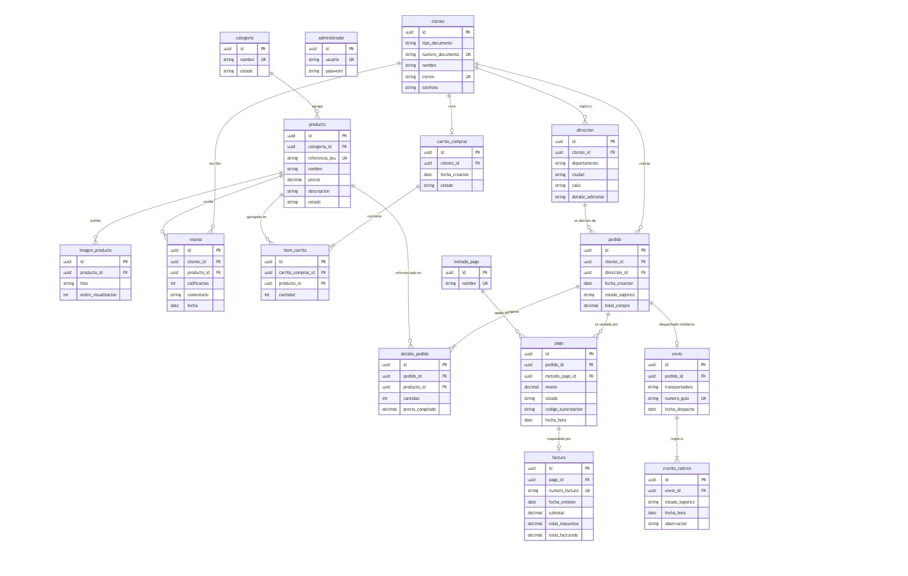

# MER_Imexcol_II_2026

Fuente: `d5aedbee-MER_Imexcol_II_2026.xlsx` · 19 hojas

## Índice de hojas

- MER
- Entidades
- Cliente
- Administrador
- Direccion
- Categoria
- Producto
- ImagenProducto
- Resena
- CarritoCompras
- ItemCarrito
- Pedido
- LineaPedido
- Pago
- MetodoPago
- Factura
- Envio
- EventoRastreo
- Valores

---

## Hoja: MER

- En esta hoja se ubica la imagen del modelo, asegurando que sea clara y legible

---

## Hoja: Entidades

| Entidad | Desripción |
|---|---|
| Cliente | Objeto de dominio que representa a cada uno de los usuarios registrados que realizan compras en la plataforma de Imexcol. |
| Administrador | Objeto de dominio que representa al personal interno encargado de gestionar el catálogo, los pedidos y la operación general del sistema. |
| Direccion | Objeto de dominio que representa la ubicación física y estructurada que registra un cliente para la entrega de sus productos o propósitos de facturación. |
| Categoria | Objeto de dominio que representa a cada una de las agrupaciones taxonómicas en las que se organizan los productos del catálogo de Imexcol. |
| Producto | Objeto de dominio que representa a cada uno de los artículos de importación (bolsos, juguetes, etc.) que están disponibles para la venta en la tienda. |
| ImagenProducto | Objeto de dominio que representa a cada uno de los recursos visuales o fotografías asociadas a un producto para su exhibición. |
| Resena | Objeto de dominio que representa a cada una de las calificaciones y comentarios dejados por un cliente sobre un producto específico que ya ha comprado. |
| CarritoCompras | Objeto de dominio que representa la sesión temporal donde un cliente agrupa los productos que tiene intención de adquirir antes de formalizar la transacción. |
| ItemCarrito | Objeto de dominio que representa a cada una de las selecciones individuales (producto específico y cantidad) dentro del carrito activo de un cliente. |
| Pedido | Objeto de dominio que representa la confirmación formal, transaccional y definitiva de una compra realizada por un cliente en Imexcol. |
| LineaPedido | Objeto de dominio que representa el detalle individual de un pedido, permitiendo registrar de forma histórica cada producto adquirido, su cantidad y su valor al momento de confirmar la compra. (Evidencia histórica de la compra) |
| Pago | Objeto de dominio que representa el registro de la transacción financiera procesada a través de la pasarela de pagos para saldar un pedido. |
| MetodoPago | Objeto de dominio que representa el instrumento financiero o forma transaccional utilizada por el cliente (tarjeta de crédito, PSE, etc.) para realizar el pago. |
| Factura | Objeto de dominio que representa el comprobante legal y contable emitido al cliente con el desglose de impuestos una vez el pago ha sido exitoso. |
| Envio | Objeto de dominio que representa el proceso logístico y de despacho de un pedido aprobado hacia la dirección de entrega del cliente. |
| EventoRastreo | Objeto de dominio que representa a cada una de las actualizaciones o hitos temporales (ej. en preparación, en tránsito, entregado) que ocurren durante el ciclo de vida de un envío. |

---

## Hoja: Cliente

| Entidad | Cliente |  |  |  |  |  |  |  |  |  |  |  |  |  |  |  |  |  |  |
|---|---|---|---|---|---|---|---|---|---|---|---|---|---|---|---|---|---|---|---|
| Desripción | Objeto de dominio que representa a cada uno de los usuarios registrados que realizan compras en la plataforma de Imexcol. |  |  |  |  |  |  |  |  |  |  |  |  |  |  |  |  |  |  |
| Atributos |  |  |  |  |  |  |  |  |  |  |  |  |  |  |  |  |  |  |  |
| Nombre | Tipo de dato | Longitud | Cantidad dígitos parte entera | Cantidad dígitos parte decimal (Precisión) | ¿Es autoincremento? | ¿Es obligatorio? | ¿Es llave primeria o es parte de ella? | Llave Foránea |  |  | Restricciones de unicidad |  | Restricciones de chequeo |  | Restricciones de índice |  |  | Alias | Descripción del campo |
|  |  |  |  |  |  |  |  | ¿Es llave foránea? | Entidad | Columna(s) | ¿Posee restricción de unicidad o es parte de ella? | Nombre restricción unicidad a la que pertenece | ¿Posee restricción de chequeo o es parte de ella? | Nombre restricción chequeo a la que pertenece | ¿Posee restricción de índice o es parte de ella? | Tipo | Nombre restricción índice a la que pertenece |  |  |
| id | UNIQUEIDENTIFIER |  |  |  | NO | SI | SI | NO |  |  | NO |  | NO |  | NO |  |  | id | Identificador único universal del cliente. |
| nombre | NVARCHAR | 100 |  |  | NO | SI | NO | NO |  |  | NO |  | NO |  | NO |  |  | nombre | Nombre o nombres del cliente. |
| apellido | NVARCHAR | 100 |  |  | NO | SI | NO | NO |  |  | NO |  | NO |  | NO |  |  | apellido | Apellido o apellidos del cliente. |
| correo_electronico | NVARCHAR | 150 |  |  | NO | SI | NO | NO |  |  | SI | uq_imex_cliente_correo | NO |  | NO |  |  | correo_electronico | Correo electrónico único de contacto y autenticación. |
| contrasena | NVARCHAR | 255 |  |  | NO | SI | NO | NO |  |  | NO |  | NO |  | NO |  |  | contrasena | Contraseña del cliente almacenada de forma segura. |
| telefono | NVARCHAR | 20 |  |  | NO | NO | NO | NO |  |  | NO |  | NO |  | NO |  |  | telefono | Número de teléfono de contacto (opcional). |
| estado | BIT |  |  |  | NO | SI | NO | NO |  |  | NO |  | NO |  | NO |  |  | estado | Indica si el cliente está activo (1) o inactivo (0). |

---

## Hoja: Administrador

| Entidad | Administrador |  |  |  |  |  |  |  |  |  |  |  |  |  |  |  |  |  |  |
|---|---|---|---|---|---|---|---|---|---|---|---|---|---|---|---|---|---|---|---|
| Desripción | Objeto de dominio que representa al personal interno encargado de gestionar el catálogo, los pedidos y la operación general del sistema. |  |  |  |  |  |  |  |  |  |  |  |  |  |  |  |  |  |  |
| Atributos |  |  |  |  |  |  |  |  |  |  |  |  |  |  |  |  |  |  |  |
| Nombre | Tipo de dato | Longitud | Cantidad dígitos parte entera | Cantidad dígitos parte decimal (Precisión) | ¿Es autoincremento? | ¿Es obligatorio? | ¿Es llave primeria o es parte de ella? | Llave Foránea |  |  | Restricciones de unicidad |  | Restricciones de chequeo |  | Restricciones de índice |  |  | Alias | Descripción del campo |
|  |  |  |  |  |  |  |  | ¿Es llave foránea? | Entidad | Columna(s) | ¿Posee restricción de unicidad o es parte de ella? | Nombre restricción unicidad a la que pertenece | ¿Posee restricción de chequeo o es parte de ella? | Nombre restricción chequeo a la que pertenece | ¿Posee restricción de índice o es parte de ella? | Tipo | Nombre restricción índice a la que pertenece |  |  |
| id | UNIQUEIDENTIFIER |  |  |  | NO | SI | SI | NO |  |  | NO |  | NO |  | NO |  |  | id | Identificador único universal del administrador. |
| nombre_usuario | NVARCHAR | 50 |  |  | NO | SI | NO | NO |  |  | SI | uq_imex_administrador_nombre_usuario | NO |  | NO |  |  | nombre_usuario | Nombre de usuario único del administrador. |
| correo_electronico | NVARCHAR | 150 |  |  | NO | SI | NO | NO |  |  | SI | uq_imex_administrador_correo | NO |  | NO |  |  | correo_electronico | Correo electrónico único del administrador. |
| contrasena | NVARCHAR | 255 |  |  | NO | SI | NO | NO |  |  | NO |  | NO |  | NO |  |  | contrasena | Contraseña del administrador almacenada de forma segura. |
| estado | BIT |  |  |  | NO | SI | NO | NO |  |  | NO |  | NO |  | NO |  |  | estado | Indica si el administrador está activo (1) o inactivo (0). |

---

## Hoja: Direccion

| Entidad | Direccion |  |  |  |  |  |  |  |  |  |  |  |  |  |  |  |  |  |  |
|---|---|---|---|---|---|---|---|---|---|---|---|---|---|---|---|---|---|---|---|
| Desripción | Objeto de dominio que representa la ubicación física y estructurada que registra un cliente para la entrega de sus productos o propósitos de facturación. |  |  |  |  |  |  |  |  |  |  |  |  |  |  |  |  |  |  |
| Atributos |  |  |  |  |  |  |  |  |  |  |  |  |  |  |  |  |  |  |  |
| Nombre | Tipo de dato | Longitud | Cantidad dígitos parte entera | Cantidad dígitos parte decimal (Precisión) | ¿Es autoincremento? | ¿Es obligatorio? | ¿Es llave primeria o es parte de ella? | Llave Foránea |  |  | Restricciones de unicidad |  | Restricciones de chequeo |  | Restricciones de índice |  |  | Alias | Descripción del campo |
|  |  |  |  |  |  |  |  | ¿Es llave foránea? | Entidad | Columna(s) | ¿Posee restricción de unicidad o es parte de ella? | Nombre restricción unicidad a la que pertenece | ¿Posee restricción de chequeo o es parte de ella? | Nombre restricción chequeo a la que pertenece | ¿Posee restricción de índice o es parte de ella? | Tipo | Nombre restricción índice a la que pertenece |  |  |
| id | UNIQUEIDENTIFIER |  |  |  | NO | SI | SI | NO |  |  | NO |  | NO |  | NO |  |  | id | Identificador único universal de la dirección. |
| cliente_id | UNIQUEIDENTIFIER |  |  |  | NO | SI | NO | SI | Cliente | id | NO |  | NO |  | NO |  |  | cliente_id | Referencia al cliente al que pertenece la dirección. |
| calle | NVARCHAR | 200 |  |  | NO | SI | NO | NO |  |  | NO |  | NO |  | NO |  |  | calle | Nomenclatura exacta de la dirección. |
| ciudad | NVARCHAR | 100 |  |  | NO | SI | NO | NO |  |  | NO |  | NO |  | NO |  |  | ciudad | Ciudad o municipio donde se ubica la dirección. |
| departamento | NVARCHAR | 100 |  |  | NO | SI | NO | NO |  |  | NO |  | NO |  | NO |  |  | departamento | Departamento o estado donde se ubica la dirección. |
| codigo_postal | NVARCHAR | 10 |  |  | NO | NO | NO | NO |  |  | NO |  | NO |  | NO |  |  | codigo_postal | Código postal de la dirección (opcional). |
| pais | NVARCHAR | 100 |  |  | NO | SI | NO | NO |  |  | NO |  | NO |  | NO |  |  | pais | País donde se ubica la dirección. |
| es_principal | BIT |  |  |  | NO | SI | NO | NO |  |  | NO |  | NO |  | NO |  |  | es_principal | Indica si es la dirección principal del cliente. |

---

## Hoja: Categoria

| Entidad | Categoria |  |  |  |  |  |  |  |  |  |  |  |  |  |  |  |  |  |  |
|---|---|---|---|---|---|---|---|---|---|---|---|---|---|---|---|---|---|---|---|
| Desripción | Objeto de dominio que representa a cada una de las agrupaciones taxonómicas en las que se organizan los productos del catálogo de Imexcol. |  |  |  |  |  |  |  |  |  |  |  |  |  |  |  |  |  |  |
| Atributos |  |  |  |  |  |  |  |  |  |  |  |  |  |  |  |  |  |  |  |
| Nombre | Tipo de dato | Longitud | Cantidad dígitos parte entera | Cantidad dígitos parte decimal (Precisión) | ¿Es autoincremento? | ¿Es obligatorio? | ¿Es llave primeria o es parte de ella? | Llave Foránea |  |  | Restricciones de unicidad |  | Restricciones de chequeo |  | Restricciones de índice |  |  | Alias | Descripción del campo |
|  |  |  |  |  |  |  |  | ¿Es llave foránea? | Entidad | Columna(s) | ¿Posee restricción de unicidad o es parte de ella? | Nombre restricción unicidad a la que pertenece | ¿Posee restricción de chequeo o es parte de ella? | Nombre restricción chequeo a la que pertenece | ¿Posee restricción de índice o es parte de ella? | Tipo | Nombre restricción índice a la que pertenece |  |  |
| id | UNIQUEIDENTIFIER |  |  |  | NO | SI | SI | NO |  |  | NO |  | NO |  | NO |  |  | id | Identificador único universal de la categoría. |
| nombre | NVARCHAR | 100 |  |  | NO | SI | NO | NO |  |  | NO |  | NO |  | NO |  |  | nombre | Nombre comercial de la categoría. |
| descripcion | NVARCHAR | 255 |  |  | NO | NO | NO | NO |  |  | NO |  | NO |  | NO |  |  | descripcion | Descripción breve de la categoría (opcional). |
| estado | BIT |  |  |  | NO | SI | NO | NO |  |  | NO |  | NO |  | NO |  |  | estado | Indica si la categoría está activa (1) o inactiva (0). |

---

## Hoja: Producto

| Entidad | Producto |  |  |  |  |  |  |  |  |  |  |  |  |  |  |  |  |  |  |
|---|---|---|---|---|---|---|---|---|---|---|---|---|---|---|---|---|---|---|---|
| Desripción | Objeto de dominio que representa a cada uno de los artículos de importación (bolsos, juguetes, etc.) que están disponibles para la venta en la tienda. |  |  |  |  |  |  |  |  |  |  |  |  |  |  |  |  |  |  |
| Atributos |  |  |  |  |  |  |  |  |  |  |  |  |  |  |  |  |  |  |  |
| Nombre | Tipo de dato | Longitud | Cantidad dígitos parte entera | Cantidad dígitos parte decimal (Precisión) | ¿Es autoincremento? | ¿Es obligatorio? | ¿Es llave primeria o es parte de ella? | Llave Foránea |  |  | Restricciones de unicidad |  | Restricciones de chequeo |  | Restricciones de índice |  |  | Alias | Descripción del campo |
|  |  |  |  |  |  |  |  | ¿Es llave foránea? | Entidad | Columna(s) | ¿Posee restricción de unicidad o es parte de ella? | Nombre restricción unicidad a la que pertenece | ¿Posee restricción de chequeo o es parte de ella? | Nombre restricción chequeo a la que pertenece | ¿Posee restricción de índice o es parte de ella? | Tipo | Nombre restricción índice a la que pertenece |  |  |
| id | UNIQUEIDENTIFIER |  |  |  | NO | SI | SI | NO |  |  | NO |  | NO |  | NO |  |  | id | Identificador único universal del producto. |
| categoria_id | UNIQUEIDENTIFIER |  |  |  | NO | SI | NO | SI | Categoria | id | NO |  | NO |  | SI | ASC | ix_imex_producto_categoria_id | categoria_id | Referencia a la categoría a la que pertenece el producto. |
| nombre | NVARCHAR | 100 |  |  | NO | SI | NO | NO |  |  | NO |  | NO |  | NO |  |  | nombre | Nombre comercial del producto. |
| descripcion | NVARCHAR | 1000 |  |  | NO | NO | NO | NO |  |  | NO |  | NO |  | NO |  |  | descripcion | Descripción detallada del producto (opcional). |
| precio | DECIMAL |  | 12 | 2 | NO | SI | NO | NO |  |  | NO |  | NO |  | NO |  |  | precio | Precio del producto en pesos colombianos (COP). |
| stock | INT |  |  |  | NO | SI | NO | NO |  |  | NO |  | NO |  | NO |  |  | stock | Cantidad de unidades disponibles en inventario. |
| imagen_url | NVARCHAR | 255 |  |  | NO | NO | NO | NO |  |  | NO |  | NO |  | NO |  |  | imagen_url | Ruta relativa o URL de la imagen del producto (opcional). |
| estado | BIT |  |  |  | NO | SI | NO | NO |  |  | NO |  | NO |  | NO |  |  | estado | Indica si el producto está activo (1) o inactivo (0). |

---

## Hoja: ImagenProducto

| Entidad | ImagenProducto |  |  |  |  |  |  |  |  |  |  |  |  |  |  |  |  |  |  |
|---|---|---|---|---|---|---|---|---|---|---|---|---|---|---|---|---|---|---|---|
| Desripción | Objeto de dominio que representa a cada uno de los recursos visuales o fotografías asociadas a un producto para su exhibición. |  |  |  |  |  |  |  |  |  |  |  |  |  |  |  |  |  |  |
| Atributos |  |  |  |  |  |  |  |  |  |  |  |  |  |  |  |  |  |  |  |
| Nombre | Tipo de dato | Longitud | Cantidad dígitos parte entera | Cantidad dígitos parte decimal (Precisión) | ¿Es autoincremento? | ¿Es obligatorio? | ¿Es llave primeria o es parte de ella? | Llave Foránea |  |  | Restricciones de unicidad |  | Restricciones de chequeo |  | Restricciones de índice |  |  | Alias | Descripción del campo |
|  |  |  |  |  |  |  |  | ¿Es llave foránea? | Entidad | Columna(s) | ¿Posee restricción de unicidad o es parte de ella? | Nombre restricción unicidad a la que pertenece | ¿Posee restricción de chequeo o es parte de ella? | Nombre restricción chequeo a la que pertenece | ¿Posee restricción de índice o es parte de ella? | Tipo | Nombre restricción índice a la que pertenece |  |  |
| idImagen | VARCHAR | 10 |  |  | NO | SI | SI | NO |  |  | NO |  | NO |  | NO |  |  | idimagen | Representa el identificador único de cada imagen generado automáticamente por el sistema. |
| idProducto | VARCHAR | 10 |  |  | NO | SI | NO | SI | Producto | idProducto | NO |  | NO |  | SI | ASC | idx_imagen_producto | idproducto | Representa el producto al cual pertenece esta imagen. |
| foto | VARCHAR | 255 |  |  | NO | SI | NO | NO |  |  | SI | uq_imagen_producto_url | NO |  | NO |  |  | foto | Representa la ruta web o enlace donde está alojada la fotografía del artículo. |
| ordenVisualizacion | INT |  | 4 |  | NO | SI | NO | NO |  |  | NO |  | SI | chk_imagen_orden | NO |  |  | ordenVisualizacion | Representa el número secuencial que define en qué orden se muestran las fotos en la galería. |

---

## Hoja: Resena

| Entidad | Resena |  |  |  |  |  |  |  |  |  |  |  |  |  |  |  |  |  |  |
|---|---|---|---|---|---|---|---|---|---|---|---|---|---|---|---|---|---|---|---|
| Desripción | Objeto de dominio que representa a cada una de las calificaciones y comentarios dejados por un cliente sobre un producto específico que ya ha comprado. |  |  |  |  |  |  |  |  |  |  |  |  |  |  |  |  |  |  |
| Atributos |  |  |  |  |  |  |  |  |  |  |  |  |  |  |  |  |  |  |  |
| Nombre | Tipo de dato | Longitud | Cantidad dígitos parte entera | Cantidad dígitos parte decimal (Precisión) | ¿Es autoincremento? | ¿Es obligatorio? | ¿Es llave primeria o es parte de ella? | Llave Foránea |  |  | Restricciones de unicidad |  | Restricciones de chequeo |  | Restricciones de índice |  |  | Alias | Descripción del campo |
|  |  |  |  |  |  |  |  | ¿Es llave foránea? | Entidad | Columna(s) | ¿Posee restricción de unicidad o es parte de ella? | Nombre restricción unicidad a la que pertenece | ¿Posee restricción de chequeo o es parte de ella? | Nombre restricción chequeo a la que pertenece | ¿Posee restricción de índice o es parte de ella? | Tipo | Nombre restricción índice a la que pertenece |  |  |
| idResena | VARCHAR | 10 |  |  | NO | SI | SI | NO |  |  | NO |  | NO |  | NO |  |  | idReseña | Representa el identificador único de cada reseña generado automáticamente por el sistema. |
| idCliente | VARCHAR | 10 |  |  | NO | SI | NO | SI | Cliente | idCliente | SI | uq_resena_cliente_producto | NO |  | SI | ASC | idx_resena_cliente | idCliente | Referencia al cliente que escribe la opinión. |
| idProducto | VARCHAR | 10 |  |  | NO | SI | NO | SI | Producto | idProducto | SI | uq_resena_cliente_producto | NO |  | SI | ASC | idx_resena_producto | idProducto | Referencia al producto que es calificado. |
| calificacion | INT |  | 1 |  | NO | SI | NO | NO |  |  | NO |  | SI | chk_resena_calificacion | NO |  |  | calificacion | Puntuación otorgada al artículo, generalmente en una escala de 1 a 5 estrellas. |
| comentario | VARCHAR | 255 |  |  | NO | NO | NO | NO |  |  | NO |  | NO |  | NO |  |  | comentario | Representa el texto opcional donde el cliente describe su experiencia de uso y calidad. |
| fecha | DATETIME |  |  |  | NO | SI | NO | NO |  |  | NO |  | NO |  | SI | ASC | idx_resena_fecha | fecha | Representa la fecha y hora en que fue creada la reseña por parte del cliente. |

---

## Hoja: CarritoCompras

| Entidad | CarritoCompras |  |  |  |  |  |  |  |  |  |  |  |  |  |  |  |  |  |  |
|---|---|---|---|---|---|---|---|---|---|---|---|---|---|---|---|---|---|---|---|
| Desripción | Objeto de dominio que representa la sesión temporal donde un cliente agrupa los productos que tiene intención de adquirir antes de formalizar la transacción. |  |  |  |  |  |  |  |  |  |  |  |  |  |  |  |  |  |  |
| Atributos |  |  |  |  |  |  |  |  |  |  |  |  |  |  |  |  |  |  |  |
| Nombre | Tipo de dato | Longitud | Cantidad dígitos parte entera | Cantidad dígitos parte decimal (Precisión) | ¿Es autoincremento? | ¿Es obligatorio? | ¿Es llave primeria o es parte de ella? | Llave Foránea |  |  | Restricciones de unicidad |  | Restricciones de chequeo |  | Restricciones de índice |  |  | Alias | Descripción del campo |
|  |  |  |  |  |  |  |  | ¿Es llave foránea? | Entidad | Columna(s) | ¿Posee restricción de unicidad o es parte de ella? | Nombre restricción unicidad a la que pertenece | ¿Posee restricción de chequeo o es parte de ella? | Nombre restricción chequeo a la que pertenece | ¿Posee restricción de índice o es parte de ella? | Tipo | Nombre restricción índice a la que pertenece |  |  |
| id | UNIQUEIDENTIFIER |  |  |  | NO | SI | SI | NO |  |  | NO |  | NO |  | NO |  |  | id | Identificador único universal del carrito. |
| cliente_id | UNIQUEIDENTIFIER |  |  |  | NO | SI | NO | SI | Cliente | id | NO |  | NO |  | NO |  |  | cliente_id | Referencia al cliente propietario del carrito. |
| fecha_creacion | DATE |  |  |  | NO | SI | NO | NO |  |  | NO |  | NO |  | NO |  |  | fecha_creacion | Fecha de creación del carrito. |
| estado | NVARCHAR | 20 |  |  | NO | SI | NO | NO |  |  | NO |  | NO |  | NO |  |  | estado | Estado del carrito (ACTIVO, ABANDONADO, FINALIZADO). |

---

## Hoja: ItemCarrito

| Entidad | ItemCarrito |  |  |  |  |  |  |  |  |  |  |  |  |  |  |  |  |  |  |
|---|---|---|---|---|---|---|---|---|---|---|---|---|---|---|---|---|---|---|---|
| Desripción | Objeto de dominio que representa a cada una de las selecciones individuales (producto específico y cantidad) dentro del carrito activo de un cliente. |  |  |  |  |  |  |  |  |  |  |  |  |  |  |  |  |  |  |
| Atributos |  |  |  |  |  |  |  |  |  |  |  |  |  |  |  |  |  |  |  |
| Nombre | Tipo de dato | Longitud | Cantidad dígitos parte entera | Cantidad dígitos parte decimal (Precisión) | ¿Es autoincremento? | ¿Es obligatorio? | ¿Es llave primeria o es parte de ella? | Llave Foránea |  |  | Restricciones de unicidad |  | Restricciones de chequeo |  | Restricciones de índice |  |  | Alias | Descripción del campo |
|  |  |  |  |  |  |  |  | ¿Es llave foránea? | Entidad | Columna(s) | ¿Posee restricción de unicidad o es parte de ella? | Nombre restricción unicidad a la que pertenece | ¿Posee restricción de chequeo o es parte de ella? | Nombre restricción chequeo a la que pertenece | ¿Posee restricción de índice o es parte de ella? | Tipo | Nombre restricción índice a la que pertenece |  |  |
| id | UNIQUEIDENTIFIER |  |  |  | NO | SI | SI | NO |  |  | NO |  | NO |  | NO |  |  | id | Identificador único universal del ítem del carrito. |
| carrito_id | UNIQUEIDENTIFIER |  |  |  | NO | SI | NO | SI | CarritoCompras | id | NO |  | NO |  | NO |  |  | carrito_id | Referencia al carrito al que pertenece el ítem. |
| producto_id | UNIQUEIDENTIFIER |  |  |  | NO | SI | NO | SI | Producto | id | NO |  | NO |  | NO |  |  | producto_id | Referencia al producto agregado al carrito. |
| cantidad | INT |  |  |  | NO | SI | NO | NO |  |  | NO |  | NO |  | NO |  |  | cantidad | Número de unidades del producto en el carrito. |
| precio_unitario | DECIMAL |  | 12 | 2 | NO | SI | NO | NO |  |  | NO |  | NO |  | NO |  |  | precio_unitario | Precio unitario congelado del producto en el carrito. |
| subtotal | DECIMAL |  | 18 | 2 | NO | SI | NO | NO |  |  | NO |  | NO |  | NO |  |  | subtotal | Subtotal de la línea del ítem del carrito (cantidad × precio_unitario). |

---

## Hoja: Pedido

| Entidad | Pedido |  |  |  |  |  |  |  |  |  |  |  |  |  |  |  |  |  |  |
|---|---|---|---|---|---|---|---|---|---|---|---|---|---|---|---|---|---|---|---|
| Desripción | Objeto de dominio que representa la confirmación formal, transaccional y definitiva de una compra realizada por un cliente en Imexcol. |  |  |  |  |  |  |  |  |  |  |  |  |  |  |  |  |  |  |
| Atributos |  |  |  |  |  |  |  |  |  |  |  |  |  |  |  |  |  |  |  |
| Nombre | Tipo de dato | Longitud | Cantidad dígitos parte entera | Cantidad dígitos parte decimal (Precisión) | ¿Es autoincremento? | ¿Es obligatorio? | ¿Es llave primeria o es parte de ella? | Llave Foránea |  |  | Restricciones de unicidad |  | Restricciones de chequeo |  | Restricciones de índice |  |  | Alias | Descripción del campo |
|  |  |  |  |  |  |  |  | ¿Es llave foránea? | Entidad | Columna(s) | ¿Posee restricción de unicidad o es parte de ella? | Nombre restricción unicidad a la que pertenece | ¿Posee restricción de chequeo o es parte de ella? | Nombre restricción chequeo a la que pertenece | ¿Posee restricción de índice o es parte de ella? | Tipo | Nombre restricción índice a la que pertenece |  |  |
| id | UNIQUEIDENTIFIER |  |  |  | NO | SI | SI | NO |  |  | NO |  | NO |  | NO |  |  | id | Identificador único universal del pedido. |
| cliente_id | UNIQUEIDENTIFIER |  |  |  | NO | SI | NO | SI | Cliente | id | NO |  | NO |  | SI | ASC | ix_imex_pedido_cliente_id | cliente_id | Referencia al cliente que realizó el pedido. |
| fecha_pedido | DATE |  |  |  | NO | SI | NO | NO |  |  | NO |  | NO |  | NO |  |  | fecha_pedido | Fecha en que se generó el pedido. |
| total | DECIMAL |  | 12 | 2 | NO | SI | NO | NO |  |  | NO |  | NO |  | NO |  |  | total | Valor total del pedido en pesos colombianos (COP). |
| estado | NVARCHAR | 50 |  |  | NO | SI | NO | NO |  |  | NO |  | NO |  | SI | ASC | ix_imex_pedido_estado | estado | Estado del pedido (PENDIENTE, CONFIRMADO, PREPARANDO, ENVIADO, ENTREGADO, CANCELADO). |
| direccion_id | UNIQUEIDENTIFIER |  |  |  | NO | NO | NO | SI | Direccion | id | NO |  | NO |  | NO |  |  | direccion_id | Referencia a la dirección de envío del pedido (opcional). |

---

## Hoja: LineaPedido

| Entidad | LineaPedido |  |  |  |  |  |  |  |  |  |  |  |  |  |  |  |  |  |  |
|---|---|---|---|---|---|---|---|---|---|---|---|---|---|---|---|---|---|---|---|
| Desripción | Objeto de dominio que representa el detalle individual de un pedido, permitiendo registrar de forma histórica cada producto adquirido, su cantidad y su valor al momento de confirmar la compra. (Evidencia histórica de la compra) |  |  |  |  |  |  |  |  |  |  |  |  |  |  |  |  |  |  |
| Atributos |  |  |  |  |  |  |  |  |  |  |  |  |  |  |  |  |  |  |  |
| Nombre | Tipo de dato | Longitud | Cantidad dígitos parte entera | Cantidad dígitos parte decimal (Precisión) | ¿Es autoincremento? | ¿Es obligatorio? | ¿Es llave primeria o es parte de ella? | Llave Foránea |  |  | Restricciones de unicidad |  | Restricciones de chequeo |  | Restricciones de índice |  |  | Alias | Descripción del campo |
|  |  |  |  |  |  |  |  | ¿Es llave foránea? | Entidad | Columna(s) | ¿Posee restricción de unicidad o es parte de ella? | Nombre restricción unicidad a la que pertenece | ¿Posee restricción de chequeo o es parte de ella? | Nombre restricción chequeo a la que pertenece | ¿Posee restricción de índice o es parte de ella? | Tipo | Nombre restricción índice a la que pertenece |  |  |
| id | UNIQUEIDENTIFIER |  |  |  | NO | SI | SI | NO |  |  | NO |  | NO |  | NO |  |  | id | Identificador único universal de la línea de pedido. |
| pedido_id | UNIQUEIDENTIFIER |  |  |  | NO | SI | NO | SI | Pedido | id | NO |  | NO |  | NO |  |  | pedido_id | Referencia al pedido al que pertenece la línea. |
| producto_id | UNIQUEIDENTIFIER |  |  |  | NO | SI | NO | SI | Producto | id | NO |  | NO |  | NO |  |  | producto_id | Referencia al producto incluido en la línea. |
| cantidad | INT |  |  |  | NO | SI | NO | NO |  |  | NO |  | NO |  | NO |  |  | cantidad | Número de unidades del producto en la línea. |
| precio_unitario | DECIMAL |  | 12 | 2 | NO | SI | NO | NO |  |  | NO |  | NO |  | NO |  |  | precio_unitario | Precio unitario congelado del producto al momento del pedido. |
| subtotal | DECIMAL |  | 12 | 2 | NO | SI | NO | NO |  |  | NO |  | NO |  | NO |  |  | subtotal | Subtotal de la línea (cantidad × precioUnitario). |

---

## Hoja: Pago

| Entidad | Pago |  |  |  |  |  |  |  |  |  |  |  |  |  |  |  |  |  |  |
|---|---|---|---|---|---|---|---|---|---|---|---|---|---|---|---|---|---|---|---|
| Desripción | Objeto de dominio que representa el registro de la transacción financiera procesada a través de la pasarela de pagos para saldar un pedido. |  |  |  |  |  |  |  |  |  |  |  |  |  |  |  |  |  |  |
| Atributos |  |  |  |  |  |  |  |  |  |  |  |  |  |  |  |  |  |  |  |
| Nombre | Tipo de dato | Longitud | Cantidad dígitos parte entera | Cantidad dígitos parte decimal (Precisión) | ¿Es autoincremento? | ¿Es obligatorio? | ¿Es llave primeria o es parte de ella? | Llave Foránea |  |  | Restricciones de unicidad |  | Restricciones de chequeo |  | Restricciones de índice |  |  | Alias | Descripción del campo |
|  |  |  |  |  |  |  |  | ¿Es llave foránea? | Entidad | Columna(s) | ¿Posee restricción de unicidad o es parte de ella? | Nombre restricción unicidad a la que pertenece | ¿Posee restricción de chequeo o es parte de ella? | Nombre restricción chequeo a la que pertenece | ¿Posee restricción de índice o es parte de ella? | Tipo | Nombre restricción índice a la que pertenece |  |  |
| id | UNIQUEIDENTIFIER |  |  |  | NO | SI | SI | NO |  |  | NO |  | NO |  | NO |  |  | id | Identificador único universal del pago. |
| pedido_id | UNIQUEIDENTIFIER |  |  |  | NO | SI | NO | SI | Pedido | id | NO |  | NO |  | NO |  |  | pedido_id | Referencia al pedido asociado al pago. |
| metodo_pago_id | UNIQUEIDENTIFIER |  |  |  | NO | SI | NO | SI | MetodoPago | id | NO |  | NO |  | NO |  |  | metodo_pago_id | Referencia al método de pago utilizado. |
| monto | DECIMAL |  | 12 | 2 | NO | SI | NO | NO |  |  | NO |  | NO |  | NO |  |  | monto | Monto del pago en pesos colombianos (COP). |
| fecha_pago | DATE |  |  |  | NO | SI | NO | NO |  |  | NO |  | NO |  | NO |  |  | fecha_pago | Fecha en que se procesó el pago. |
| estado | NVARCHAR | 50 |  |  | NO | SI | NO | NO |  |  | NO |  | NO |  | NO |  |  | estado | Estado del pago (PENDIENTE, EN_PROCESO, APROBADO, RECHAZADO, REEMBOLSADO). |

---

## Hoja: MetodoPago

| Entidad | MetodoPago |  |  |  |  |  |  |  |  |  |  |  |  |  |  |  |  |  |  |
|---|---|---|---|---|---|---|---|---|---|---|---|---|---|---|---|---|---|---|---|
| Desripción | Objeto de dominio que representa el instrumento financiero o forma transaccional utilizada por el cliente (tarjeta de crédito, PSE, etc.) para realizar el pago. |  |  |  |  |  |  |  |  |  |  |  |  |  |  |  |  |  |  |
| Atributos |  |  |  |  |  |  |  |  |  |  |  |  |  |  |  |  |  |  |  |
| Nombre | Tipo de dato | Longitud | Cantidad dígitos parte entera | Cantidad dígitos parte decimal (Precisión) | ¿Es autoincremento? | ¿Es obligatorio? | ¿Es llave primeria o es parte de ella? | Llave Foránea |  |  | Restricciones de unicidad |  | Restricciones de chequeo |  | Restricciones de índice |  |  | Alias | Descripción del campo |
|  |  |  |  |  |  |  |  | ¿Es llave foránea? | Entidad | Columna(s) | ¿Posee restricción de unicidad o es parte de ella? | Nombre restricción unicidad a la que pertenece | ¿Posee restricción de chequeo o es parte de ella? | Nombre restricción chequeo a la que pertenece | ¿Posee restricción de índice o es parte de ella? | Tipo | Nombre restricción índice a la que pertenece |  |  |
| id | UNIQUEIDENTIFIER |  |  |  | NO | SI | SI | NO |  |  | NO |  | NO |  | NO |  |  | id | Identificador único universal del método de pago. |
| nombre | NVARCHAR | 100 |  |  | NO | SI | NO | NO |  |  | NO |  | NO |  | NO |  |  | nombre | Nombre comercial del método de pago. |
| descripcion | NVARCHAR | 255 |  |  | NO | NO | NO | NO |  |  | NO |  | NO |  | NO |  |  | descripcion | Descripción del método de pago (opcional). |
| estado | BIT |  |  |  | NO | SI | NO | NO |  |  | NO |  | NO |  | NO |  |  | estado | Indica si el método de pago está activo (1) o inactivo (0). |

---

## Hoja: Factura

| Entidad | Factura |  |  |  |  |  |  |  |  |  |  |  |  |  |  |  |  |  |  |
|---|---|---|---|---|---|---|---|---|---|---|---|---|---|---|---|---|---|---|---|
| Desripción | Objeto de dominio que representa el comprobante legal y contable emitido al cliente con el desglose de impuestos una vez el pago ha sido exitoso. |  |  |  |  |  |  |  |  |  |  |  |  |  |  |  |  |  |  |
| Atributos |  |  |  |  |  |  |  |  |  |  |  |  |  |  |  |  |  |  |  |
| Nombre | Tipo de dato | Longitud | Cantidad dígitos parte entera | Cantidad dígitos parte decimal (Precisión) | ¿Es autoincremento? | ¿Es obligatorio? | ¿Es llave primeria o es parte de ella? | Llave Foránea |  |  | Restricciones de unicidad |  | Restricciones de chequeo |  | Restricciones de índice |  |  | Alias | Descripción del campo |
|  |  |  |  |  |  |  |  | ¿Es llave foránea? | Entidad | Columna(s) | ¿Posee restricción de unicidad o es parte de ella? | Nombre restricción unicidad a la que pertenece | ¿Posee restricción de chequeo o es parte de ella? | Nombre restricción chequeo a la que pertenece | ¿Posee restricción de índice o es parte de ella? | Tipo | Nombre restricción índice a la que pertenece |  |  |
| idFactura | VARCHAR | 10 |  |  | NO | SI | SI | NO |  |  | NO |  | NO |  | NO |  |  | idFactura | Identificador interno autogenerado por el sistema. |
| idPago | VARCHAR | 12 |  |  | NO | SI | NO | SI | Pago | idPago | SI | uq_factura_pago | NO |  | SI | ASC | idx_factura_pago | idPago | Referencia al pago exitoso que originó esta factura. |
| numeroFactura | VARCHAR | 20 |  |  | NO | SI | NO | NO |  |  | SI | uq_factura_numero | NO |  | NO |  |  | numeroFactura | Número de factura electrónica. |
| fechaEmision | DATETIME |  |  |  | NO | SI | NO | NO |  |  | NO |  | NO |  | NO |  |  | fechaEmision | Fecha y hora de emisión del comprobante contable. |
| subtotal | DECIMAL |  | 12 | 2 | NO | SI | NO | NO |  |  | NO |  | SI | chk_factura_subtotal | NO |  |  | subtotal | Valor base de la compra sin impuestos (COP). |
| totalImpuestos | DECIMAL |  | 12 | 2 | NO | SI | NO | NO |  |  | NO |  | SI | chk_factura_impuestos | NO |  |  | totalImpuestos | Valor correspondiente al IVA u otros tributos (COP). |
| totalFacturado | DECIMAL |  | 12 | 2 | NO | SI | NO | NO |  |  | NO |  | SI | chk_factura_total | NO |  |  | totalFacturado | Valor total legalmente facturado al cliente (COP). |

---

## Hoja: Envio

| Entidad | Envio |  |  |  |  |  |  |  |  |  |  |  |  |  |  |  |  |  |  |
|---|---|---|---|---|---|---|---|---|---|---|---|---|---|---|---|---|---|---|---|
| Desripción | Objeto de dominio que representa el proceso logístico y de despacho de un pedido aprobado hacia la dirección de entrega del cliente. |  |  |  |  |  |  |  |  |  |  |  |  |  |  |  |  |  |  |
| Atributos |  |  |  |  |  |  |  |  |  |  |  |  |  |  |  |  |  |  |  |
| Nombre | Tipo de dato | Longitud | Cantidad dígitos parte entera | Cantidad dígitos parte decimal (Precisión) | ¿Es autoincremento? | ¿Es obligatorio? | ¿Es llave primeria o es parte de ella? | Llave Foránea |  |  | Restricciones de unicidad |  | Restricciones de chequeo |  | Restricciones de índice |  |  | Alias | Descripción del campo |
|  |  |  |  |  |  |  |  | ¿Es llave foránea? | Entidad | Columna(s) | ¿Posee restricción de unicidad o es parte de ella? | Nombre restricción unicidad a la que pertenece | ¿Posee restricción de chequeo o es parte de ella? | Nombre restricción chequeo a la que pertenece | ¿Posee restricción de índice o es parte de ella? | Tipo | Nombre restricción índice a la que pertenece |  |  |
| id | UNIQUEIDENTIFIER |  |  |  | NO | SI | SI | NO |  |  | NO |  | NO |  | NO |  |  | id | Identificador único universal del envío. |
| pedido_id | UNIQUEIDENTIFIER |  |  |  | NO | SI | NO | SI | Pedido | id | NO |  | NO |  | NO |  |  | pedido_id | Referencia al pedido al que pertenece el envío. |
| fecha_envio | DATE |  |  |  | NO | SI | NO | NO |  |  | NO |  | NO |  | NO |  |  | fecha_envio | Fecha en que se despachó el envío. |
| fecha_entrega | DATE |  |  |  | NO | NO | NO | NO |  |  | NO |  | NO |  | NO |  |  | fecha_entrega | Fecha estimada o real de entrega del envío (opcional). |
| transportadora | NVARCHAR | 100 |  |  | NO | SI | NO | NO |  |  | NO |  | NO |  | NO |  |  | transportadora | Nombre de la empresa transportadora. |
| numero_guia | NVARCHAR | 100 |  |  | NO | SI | NO | NO |  |  | NO |  | NO |  | NO |  |  | numero_guia | Número de guía proporcionado por la transportadora. |
| estado | NVARCHAR | 50 |  |  | NO | SI | NO | NO |  |  | NO |  | NO |  | NO |  |  | estado | Estado del envío (PREPARANDO, EN_TRANSITO, ENTREGADO, DEVUELTO, EXTRAVIADO). |

---

## Hoja: EventoRastreo

| Entidad | EventoRastreo |  |  |  |  |  |  |  |  |  |  |  |  |  |  |  |  |  |  |
|---|---|---|---|---|---|---|---|---|---|---|---|---|---|---|---|---|---|---|---|
| Desripción | Objeto de dominio que representa a cada una de las actualizaciones o hitos temporales (ej. en preparación, en tránsito, entregado) que ocurren durante el ciclo de vida de un envío. |  |  |  |  |  |  |  |  |  |  |  |  |  |  |  |  |  |  |
| Atributos |  |  |  |  |  |  |  |  |  |  |  |  |  |  |  |  |  |  |  |
| Nombre | Tipo de dato | Longitud | Cantidad dígitos parte entera | Cantidad dígitos parte decimal (Precisión) | ¿Es autoincremento? | ¿Es obligatorio? | ¿Es llave primeria o es parte de ella? | Llave Foránea |  |  | Restricciones de unicidad |  | Restricciones de chequeo |  | Restricciones de índice |  |  | Alias | Descripción del campo |
|  |  |  |  |  |  |  |  | ¿Es llave foránea? | Entidad | Columna(s) | ¿Posee restricción de unicidad o es parte de ella? | Nombre restricción unicidad a la que pertenece | ¿Posee restricción de chequeo o es parte de ella? | Nombre restricción chequeo a la que pertenece | ¿Posee restricción de índice o es parte de ella? | Tipo | Nombre restricción índice a la que pertenece |  |  |
| idEvento | VARCHAR | 10 |  |  | NO | SI | SI | NO |  |  | NO |  | NO |  | NO |  |  | idEvento | Identificador interno autogenerado por el sistema para el evento de rastreo. |
| idEnvio | VARCHAR | 10 |  |  | NO | SI | NO | SI | Envio | idEnvio | SI | uq_evento_envio_estado_fecha | NO |  | SI | ASC | idx_evento_envio | idEnvio | Referencia al envío al que pertenece este evento. |
| estadoLogistico | VARCHAR | 30 |  |  | NO | SI | NO | NO |  |  | SI | uq_evento_envio_estado_fecha | SI | chk_evento_estado | NO |  |  | estadoLogistico | Estado logístico reportado por la transportadora. |
| fechaHora | DATETIME |  |  |  | NO | SI | NO | NO |  |  | SI | uq_evento_envio_estado_fecha | NO |  | SI | ASC | idx_evento_fecha | fechaHora | Fecha y hora exacta en la que se registró este estado. |
| observacion | VARCHAR | 255 |  |  | NO | NO | NO | NO |  |  | NO |  | NO |  | NO |  |  | observacion | Observación o detalle adicional del movimiento (ciudad, sede, novedad). |

---

## Hoja: Valores

| Relación | Tipo relación | Estado | TipoIndice |
|---|---|---|---|
| Necesita de | Asociación | SI | ASC |
| Es usada por |  | NO | DESC |
