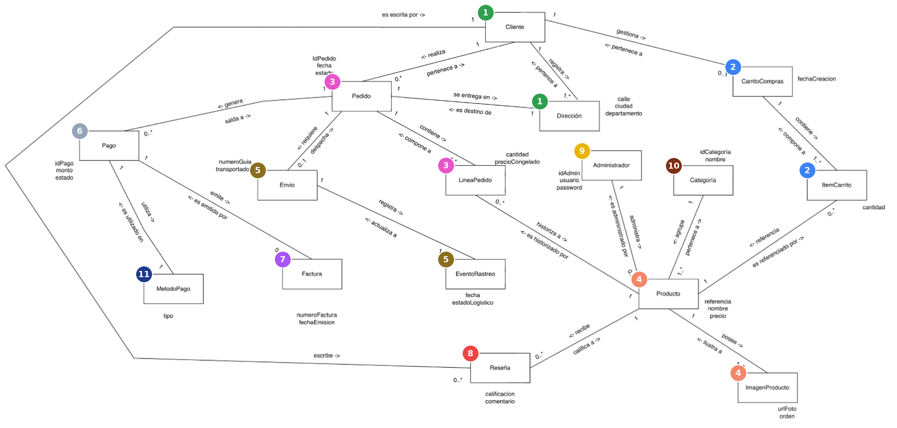
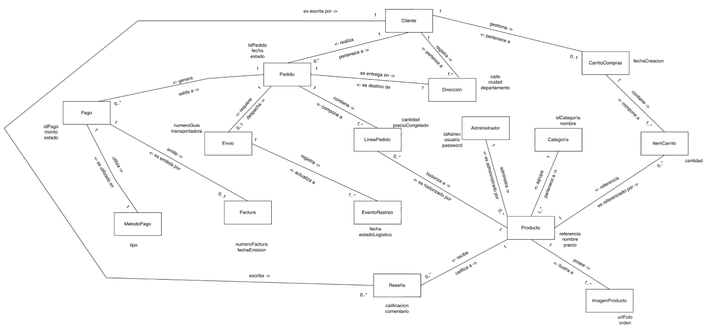
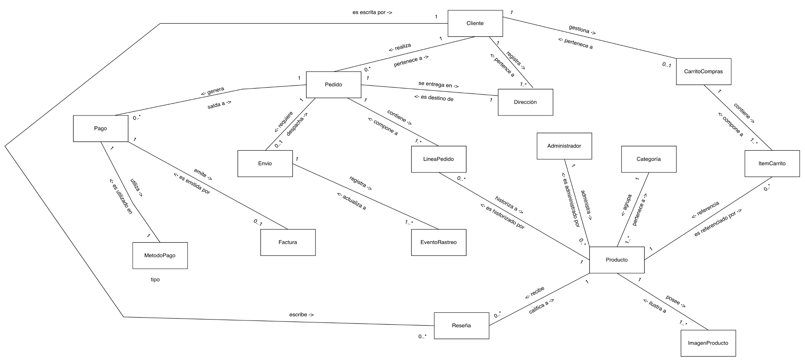

# MuestreoDatosModeloDominio_Imexcol_Sep20

Fuente: `c92f3fb9-MuestreoDatosModeloDominio_Imexcol_Sep20.xlsx` · 67 hojas

## Índice de hojas

- Modelo de dominio
- Modelo de dominio anémico
- ListadoObjetosDominio
- M-Cliente
- C-Cliente
- E-Cliente
- P-Cliente
- M-Administrador
- C-Administrador
- E-Administrador
- P-Administrador
- M-Dirección
- C-Direccion
- E-Direccion
- P-Dirección
- M-Categoria
- C-Categoria
- E-Categoria
- P-Categoría
- M-Producto
- C-Producto
- E-Producto
- P-Producto
- M-ImagenProducto
- C-ImagenProducto
- E-ImagenProducto
- P-ImagenProducto
- M-Reseña
- C-Reseña
- E-Reseña
- P-Reseña
- M-CarritoCompras
- C-CarritoCompras
- E-CarritoCompras
- P-CarritoCompras
- M-ItemCarrito
- C-ItemCarrito
- E-ItemCarrito
- P-ItemCarrito
- M-Pedido
- C-Pedido
- E-Pedido
- P-Pedido
- M-LineaPedido
- C-LineaPedido
- E-LineaPedido
- P-LineaPedido
- M-Pagos
- C-Pagos
- E-Pagos
- P-Pagos
- M-MetodoPago
- C-MetodoPago
- E-MetodoPago
- P-MetodoPago
- M-Factura
- C-Factura
- E-Factura
- P-Factura
- M-Envio
- C-Envio
- E-Envio
- P-Envío
- M-EnvioRastreo
- C-EnvioRastreo
- E-EnvioRastreo
- P-EnvioRastreo

---

## Hoja: Modelo de dominio

---

## Hoja: Modelo de dominio anémico

---

## Hoja: ListadoObjetosDominio

| Línea de vida | Nombre | Descripción | Muestreo de datos | Caracterización objeto | Event Storming | Politicas |
|---|---|---|---|---|---|---|
| 1 | Cliente | Objeto de dominio que representa a cada uno de los usuarios registrados que realizan compras en la plataforma de Imexcol. | Ir | Ir | Ir | Ir |
| 2 | Administrador | Objeto de dominio que representa al personal interno encargado de gestionar el catálogo, los pedidos y la operación general del sistema. | Ir | Ir | Ir | Ir |
| 3 | Dirección | Objeto de dominio que representa la ubicación física y estructurada que registra un cliente para la entrega de sus productos o propósitos de facturación. | Ir | Ir | Ir | Ir |
| 4 | Categoría | Objeto de dominio que representa a cada una de las agrupaciones taxonómicas en las que se organizan los productos del catálogo de Imexcol. | Ir | Ir | Ir | Ir |
| 5 | Producto | Objeto de dominio que representa a cada uno de los artículos de importación (bolsos, juguetes, etc.) que están disponibles para la venta en la tienda. | Ir | Ir | Ir | Ir |
| 6 | ImagenProducto | Objeto de dominio que representa a cada uno de los recursos visuales o fotografías asociadas a un producto para su exhibición. | Ir | Ir | Ir | Ir |
| 7 | Reseña | Objeto de dominio que representa a cada una de las calificaciones y comentarios dejados por un cliente sobre un producto específico que ya ha comprado. | Ir | Ir | Ir | Ir |
| 8 | CarritoCompras | Objeto de dominio que representa la sesión temporal donde un cliente agrupa los productos que tiene intención de adquirir antes de formalizar la transacción. | Ir | Ir | Ir | Ir |
| 9 | ItemCarrito | Objeto de dominio que representa a cada una de las selecciones individuales (producto específico y cantidad) dentro del carrito activo de un cliente. | Ir | Ir | Ir | Ir |
| 10 | Pedido | Objeto de dominio que representa la confirmación formal, transaccional y definitiva de una compra realizada por un cliente en Imexcol. | Ir | Ir | Ir | Ir |
| 11 | LineaPedido | Objeto de dominio que representa el detalle individual de un pedido, permitiendo registrar de forma histórica cada producto adquirido, su cantidad y su valor al momento de confirmar la compra. (Evidencia histórica de la compra) | Ir | Ir | Ir | Ir |
| 12 | Pago | Objeto de dominio que representa el registro de la transacción financiera procesada a través de la pasarela de pagos para saldar un pedido. | Ir | Ir | Ir | Ir |
| 13 | MetodoPago | Objeto de dominio que representa el instrumento financiero o forma transaccional utilizada por el cliente (tarjeta de crédito, PSE, etc.) para realizar el pago. | Ir | Ir | Ir | Ir |
| 14 | Factura | Objeto de dominio que representa el comprobante legal y contable emitido al cliente con el desglose de impuestos una vez el pago ha sido exitoso. | Ir | Ir | Ir | Ir |
| 15 | Envio | Objeto de dominio que representa el proceso logístico y de despacho de un pedido aprobado hacia la dirección de entrega del cliente. | Ir | Ir | Ir | Ir |
| 16 | EventoRastreo | Objeto de dominio que representa a cada una de las actualizaciones o hitos temporales (ej. en preparación, en tránsito, entregado) que ocurren durante el ciclo de vida de un envío. | Ir | Ir | Ir | Ir |

---

## Hoja: M-Cliente

| Nombre | Cliente |  |  |  |  |  |  |
|---|---|---|---|---|---|---|---|
| Descripción | Objeto de dominio que representa a cada uno de los usuarios registrados que realizan compras en la plataforma de Imexcol. |  |  |  |  |  |  |
| Representa el identificador único de cada cliente, generado automáticamente por el sistema. | Representa el tipo de documento de identidad del usuario | Número oficial del documento de identidad | Representa el nombre completo del cliente | Representa el correo electrónico principal de contacto del cliente. | Representa el número de teléfono celular de contacto del cliente. | Indica que no pueden existir dos clientes o más con el mismo correo electrónico. | Indica que no pueden existir dos clientes con el mismo id |
| id | nombre | apellido | correoElectronico | contrasena | telefono | Combinación única 1 | Combinación única 2 |
| 3F2504E0-4F89-11D3-9A0C-0305E82C3301 | Carlos | Restrepo | carlos.restrepo@imexcol.com | ******** | 3001112233 | carlos.restrepo@imexcol.com | 3F2504E0-4F89-11D3-9A0C-0305E82C3301 |
| 3F2504E0-4F89-11D3-9A0C-0305E82C3302 | María | González | maria.gonzalez@imexcol.com | ******** | 3104445566 | maria.gonzalez@imexcol.com | 3F2504E0-4F89-11D3-9A0C-0305E82C3302 |
| 3F2504E0-4F89-11D3-9A0C-0305E82C3303 | Andrés | Mejía | andres.mejia@imexcol.com | ******** | 3207778899 | andres.mejia@imexcol.com | 3F2504E0-4F89-11D3-9A0C-0305E82C3303 |
| 3F2504E0-4F89-11D3-9A0C-0305E82C3304 | Camila | Ramírez | camila.ramirez@imexcol.com | ******** | 3151231234 | camila.ramirez@imexcol.com | 3F2504E0-4F89-11D3-9A0C-0305E82C3304 |
| 3F2504E0-4F89-11D3-9A0C-0305E82C3305 | Daniel | Pérez | daniel.perez@imexcol.com | ******** | 3009998877 | daniel.perez@imexcol.com | 3F2504E0-4F89-11D3-9A0C-0305E82C3305 |
| Corresponde a los datos generales del objeto de dominio (nombre, descripción) |  |  |  |  |  |  |  |
| Corresponde a las descripciones de los atributos |  |  |  |  |  |  |  |
| Coresponde al nombre de los atributos |  |  |  |  |  |  |  |
| Corresponde a los datos que son de libre ingreso |  |  |  |  |  |  |  |
| Corresponde a los datos que se generarán automáticamente (idCliente) |  |  |  |  |  |  |  |
| Corresponde a la combinación única 1 |  |  |  |  |  |  |  |
| Corresponde a la combinación única 2 |  |  |  |  |  |  |  |

---

## Hoja: C-Cliente

| << Ir al modelo de dominio |  |  | << Ir al listado de objetos de dominio |  |  | << Ir a la caracterización del objeto de dominio |  |  |  |  |  |  |  |  |  |  |  |  |  |  |
|---|---|---|---|---|---|---|---|---|---|---|---|---|---|---|---|---|---|---|---|---|
| Nombre | Cliente |  |  |  |  |  |  |  |  |  |  |  |  |  |  |  |  |  |  |  |
| Descripción | Objeto de dominio que representa a cada uno de los usuarios registrados que realizan compras en la plataforma de Imexcol. |  |  |  |  |  |  |  |  |  |  |  |  |  |  |  |  |  |  |  |
| Nombre atributo | Descripción atributo | Identificador del objeto de dominio | Tipo de dato | Obligatorio | Longitud minima(si aplica longitud maxima(si aplica) | Longitud maxima(si aplica longitud maxima(si aplica) | Precisión (si aplica) | Redondeo(si aplica) | Rango inicial(si aplica) | Rango final (si aplica) | Formato(Si aplica) | Reglas especiales(si aplica) | Dato calculado | Aplica ajuste del dato(si aplica) | Carácter de ajuste(si aplica) | Quitar espacios en blanco al inicio(si aplica) | Quitar espacios en blanco al fin(si aplica) | Dato sensible(si aplica) | Valor por defecto(si aplica) | Auto generado |
| id | Representa el identificador único de cada cliente, generado automáticamente por el sistema. | Si | Alfanumerico | Si | 1 |  |  |  |  |  | Mayusculas |  | No | No |  | Si | Si | No |  | Si |
| nombre | Representa el tipo de documento de identidad del usuario | No | Alfanumerico | Si | 2 | 100 |  |  |  |  | Mayusculas | Solo valores: CC, CE, NIT, TI | No | Si | Espacio | Si | Si | No |  | No |
| apellido | Representa el nombre completo del cliente | No | Alfanumerico | Si | 5 | 100 |  |  |  |  |  | Solo caracteres alfanuméricos | No | No |  | Si | Si | Si |  | No |
| correoElectronico | Representa el nombre completo del cliente | No | Alfanumerico | Si | 3 | 150 |  |  |  |  | Capitalizado |  | No | No |  | Si | Si | No |  | No |
| contrasena | Representa el correo electrónico principal de contacto del cliente. | No | Alfanumerico | Si | 5 | 255 |  |  |  |  | email | Debe contener '@' y dominio válido | No | No |  | Si | Si | Si |  | No |
| telefono | Representa el número de teléfono celular de contacto del cliente. | No | Alfanumerico | No | 10 | 20 |  |  |  |  |  |  | No | No |  | No | No | Si |  | No |
| Nombre combinación unica | Descripción | Atributos involucrados |  |  |  |  |  |  |  |  |  |  |  |  |  |  |  |  |  |  |
| Combinación única 1 | Indica que no pueden existir dos clientes o más con el mismo correo electrónico. | correoElectronico |  |  |  |  |  |  |  |  |  |  |  |  |  |  |  |  |  |  |
| Combinación única 2 | Indica que no pueden existir dos clientes con el mismo id | id |  |  |  |  |  |  |  |  |  |  |  |  |  |  |  |  |  |  |
| Responsabilidad | Descripción | Entradas |  |  | Salida |  | Políticas (Reglas de Negocio) |  | Excepción |  |  |  |  |  |  |  |  |  |  |  |
|  |  | Parámetro | Tipo de dato | Descripción | Tipo de Dato | Descripción | Política | Descripción | Detalle | ¿Qué hago? |  |  |  |  |  |  |  |  |  |  |
| Registrar información del cliente | Crear una nueva cuenta de usuario en la plataforma de comercio electrónico de Imexcol para poder realizar compras. | clienteNuevo | Cliente | Contiene la información del cliente que se va a registrar. | Logico | Retorna verdadero si el cliente se registró y guardó correctamente. | CLI-POL-01 | Asegurar que los datos requeridos sean válidos a nivel de tipo de dato, formato, rango, longitud y obligatoriedad. | Generar una excepción indicando que se violó la regla: el correo y el teléfono deben ser obligatorios y tener formato válido. | Detener operación |  |  |  |  |  |  |  |  |  |  |
|  |  |  |  |  |  |  | CLI-POL-02 | El correo electrónico ingresado no debe existir previamente en el sistema (Combinación única 1). | Generar excepción indicando que el correo ingresado ya se encuentra registrado por otro usuario. | Detener operación |  |  |  |  |  |  |  |  |  |  |
|  |  |  |  |  |  |  | CLI-POL-03 | La combinación de tipo de documento y número de documento no debe existir previamente en el sistema (Combinación única 2). | Generar excepción indicando que el documento ya está registrado por otro usuario. | Detener operación |  |  |  |  |  |  |  |  |  |  |
| Modificar datos del cliente | Actualizar la información personal de contacto (teléfono o nombre) del usuario registrado en el sistema. | clienteModificado | Cliente | Contiene la nueva información del cliente a actualizar. | Logico | Retorna verdadero si la información se actualizó con éxito en la base de datos. | CLI-POL-04 | El identificador del cliente (idCliente) proporcionado debe existir obligatoriamente en el sistema. | Generar excepción indicando que el cliente que se intenta modificar no existe. | Detener operación |  |  |  |  |  |  |  |  |  |  |
| Consultar listado de clientes | Listar en el panel de control todos los usuarios registrados para gestión operativa y soporte. | filtros | Texto | Parámetros opcionales para filtrar la búsqueda de clientes. | Lista<Cliente> | Retorna una colección con los objetos de los clientes encontrados. | CLI-POL-05 | El administrador que ejecuta la acción debe tener una sesión válida y activa en el sistema. | Generar excepción indicando acceso denegado por falta de permisos administrativos | Detener operación |  |  |  |  |  |  |  |  |  |  |

---

## Hoja: E-Cliente

| << Ir al modelo de dominio |  |  |  | << Ir al listado de objetos de dominio |  |  |  | << Ir a la caracterización del objeto de dominio |  |  |
|---|---|---|---|---|---|---|---|---|---|---|
| Objeto de Dominio: | Cliente |  |  |  |  |  |  |  |  |  |
| Descripción: | Objeto de dominio que representa a cada uno de los usuarios registrados que realizan compras en la plataforma de Imexcol. |  |  |  |  |  |  |  |  |  |
| Actor | Action/Command |  | Entity/Aggregate/Object domain | Read Model |  | Business Rule/Policy |  | External System | Domain Event | Hotspot/questions/Risk |
| Actor | Acción | Descripción | Objeto de dominio | Información externa |  | Políticas |  | Sistema Externo | Evento | Aspectos por solucionar |
|  |  |  |  | Información | Descripción | Número | Descripción |  |  |  |
| Cliente | Registrar información del cliente | Crear una nueva cuenta de usuario en la plataforma de comercio electrónico de Imexcol para poder realizar compras. | Cliente | tipoDocumento, numeroDocumento, nombre, correo, telefono | Datos mínimos obligatorios requeridos por el sistema para identificar al usuario, facturar y contactarlo. | CLI-POL-01 | Asegurar que los datos requeridos sean válidos a nivel de tipo de dato, formato, rango, longitud y obligatoriedad. | Base de datos | Cliente registrado exitosamente | Riesgo de que el usuario ingrese correos electrónicos temporales o falsos que reboten las facturas. |
|  |  |  |  |  |  | CLI-POL-02 | El correo electrónico ingresado no debe existir previamente en el sistema (Combinación única 1). |  |  |  |
|  |  |  |  |  |  | CLI-POL-03 | La combinación de tipo de documento y número de documento no debe existir previamente en el sistema (Combinación única 2). |  |  |  |
| Cliente/ Administrador | Modificar datos del cliente | Actualizar la información personal de contacto (teléfono o nombre) del usuario registrado en el sistema. | Cliente | idCliente, nombre, telefono | Información editable del perfil del usuario para mantener el contacto actualizado en futuros despachos. | CLI-POL-04 | El identificador del cliente (idCliente) proporcionado debe existir obligatoriamente en el sistema. | Base de datos | Datos de cliente modificados | Un administrador podría cambiar por error el teléfono de un cliente justo antes de un despacho logístico. |
| Administrador | Consultar listado de clientes | Listar en el panel de control todos los usuarios registrados para gestión operativa y soporte. | Cliente | idCliente, tipoDocumento, numeroDocumento, nombre, correo, telefono | Visualización tabular completa de los datos del cliente para que el administrador pueda auditar el registro. | CLI-POL-05 | El administrador que ejecuta la acción debe tener una sesión válida y activa en el sistema. | Base de datos | Listado de clientes consultado | Si la base de datos crece a miles de clientes, la consulta sin paginación podría saturar la memoria del servidor (TimeOut). |

---

## Hoja: P-Cliente

| << Ir al modelo de dominio |  | << Ir al listado de objetos de dominio | << Ir a la caracterización del objeto de dominio |
|---|---|---|---|
| Objeto de Dominio: | Cliente |  |  |
| Descripción: | Objeto de dominio que representa a cada uno de los usuarios registrados que realizan compras en la plataforma de Imexcol. |  |  |
| Business Rule/Policy |  |  |  |
| Políticas |  |  |  |
| Número | Descripción |  |  |
| CLI-POL-01 | Asegurar que los datos requeridos sean válidos a nivel de tipo de dato, formato, rango, longitud y obligatoriedad. |  |  |
| CLI-POL-02 | El correo electrónico ingresado no debe existir previamente en el sistema (Combinación única 1). |  |  |
| CLI-POL-03 | La combinación de tipo de documento y número de documento no debe existir previamente en el sistema (Combinación única 2). |  |  |
| CLI-POL-04 | El identificador del cliente (idCliente) proporcionado debe existir obligatoriamente en el sistema. |  |  |
| CLI-POL-05 | El administrador que ejecuta la acción debe tener una sesión válida y activa en el sistema. |  |  |

---

## Hoja: M-Administrador

| << Ir al modelo de dominio |  |  | << Ir al listado de objetos de dominio |  | << Ir a la caracterización del objeto de dominio |
|---|---|---|---|---|---|
| Nombre | Administrador |  |  |  |  |
| Descripción | Objeto de dominio que representa al personal interno encargado de gestionar el catálogo, los pedidos y la operación general del sistema. |  |  |  |  |
| Identificador único universal (UUID) del administrador. | Nombre de usuario único del administrador para iniciar sesión. | Correo electrónico de contacto del administrador. | Contraseña del administrador almacenada de forma segura. | Indica que no pueden existir dos administradores o más con el mismo nombre de usuario. |  |
| id | nombreUsuario | correoElectronico | contrasena | combinacion unica 1 |  |
| A1B2C3D4-5566-4F77-8899-AABBCCDDEE01 | admin | admin@imexcol.com | ******** | admin |  |
| A1B2C3D4-5566-4F77-8899-AABBCCDDEE02 | lmartinez | l.martinez@imexcol.com | ******** | lmartinez |  |
| A1B2C3D4-5566-4F77-8899-AABBCCDDEE03 | sgomez | s.gomez@imexcol.com | ******** | sgomez |  |
| A1B2C3D4-5566-4F77-8899-AABBCCDDEE04 | alopez | a.lopez@imexcol.com | ******** | alopez |  |
| A1B2C3D4-5566-4F77-8899-AABBCCDDEE05 | mcastro | m.castro@imexcol.com | ******** | mcastro |  |
| Corresponde a los datos generales del objeto de dominio (nombre, descripción) |  |  |  |  |  |
| Corresponde a las descripciones de los atributos |  |  |  |  |  |
| Coresponde al nombre de los atributos |  |  |  |  |  |
| Corresponde a los datos que son de libre ingreso |  |  |  |  |  |
| Corresponde a los datos que se generarán automáticamente (IdAdmin) |  |  |  |  |  |
| Corresponde a la combinación única 1 |  |  |  |  |  |

---

## Hoja: C-Administrador

| << Ir al modelo de dominio |  |  | << Ir al listado de objetos de dominio |  |  | << Ir a la caracterización del objeto de dominio |  |  |  |  |  |  |  |  |  |  |  |  |  |  |
|---|---|---|---|---|---|---|---|---|---|---|---|---|---|---|---|---|---|---|---|---|
| Nombre | Administrador |  |  |  |  |  |  |  |  |  |  |  |  |  |  |  |  |  |  |  |
| Descripción | Objeto de dominio que representa al personal interno encargado de gestionar el catálogo, los pedidos y la operación general del sistema. |  |  |  |  |  |  |  |  |  |  |  |  |  |  |  |  |  |  |  |
| Nombre atributo | Descripción atributo | Identificador del objeto de dominio | Tipo de dato | Obligatorio | Longitud minima(si aplica longitud maxima(si aplica) | Longitud maxima(si aplica longitud maxima(si aplica) | Precisión (si aplica) | Redondeo(si aplica) | Rango inicial(si aplica) | Rango final (si aplica) | Formato(Si aplica) | Reglas especiales(si aplica) | Dato calculado | Aplica ajuste del dato(si aplica) | Carácter de ajuste(si aplica) | Quitar espacios en blanco al inicio(si aplica) | Quitar espacios en blanco al fin(si aplica) | Dato sensible(si aplica) | Valor por defecto(si aplica) | Auto generado |
| id | Identificador único universal (UUID) del administrador. | Si | Alfanumerico | Si |  |  |  |  | 1 | 999999 |  | Identificador secuencial del administrador | No |  |  |  |  | No |  | Si |
| nombreUsuario | Nombre de usuario único del administrador para iniciar sesión. | No | Alfanumerico | Si | 5 | 50 |  |  |  |  | Minusculas | No debe contener espacios ni caracteres especiales | No | No |  | Si | Si | No |  | No |
| correoElectronico | Correo electrónico de contacto del administrador. | No | Alfanumerico | Si | 8 | 150 |  |  |  |  |  | Debe almacenarse encriptada por seguridad del sistema | No | No |  | No | No | Si |  | No |
| Nombre combinación unica | Descripción | Atributos involucrados |  |  |  |  |  |  |  |  |  |  |  |  |  |  |  |  |  |  |
| combinacion unica 1 | Contraseña del administrador almacenada de forma segura. | nombreUsuario |  |  |  |  |  |  |  |  |  |  |  |  |  |  |  |  |  |  |
| Responsabilidad | Descripción | Entradas |  |  | Salida |  | Políticas (Reglas de Negocio) |  | Excepción |  |  |  |  |  |  |  |  |  |  |  |
|  |  | Parámettro | Tipo de dato | Descripci | Tipo de Dato | Descripción | Política | Descripción | Detalle | ¿Qué hago? |  |  |  |  |  |  |  |  |  |  |
| Registrar nuevo administrador | Crear un nuevo usuario con credenciales para que un empleado pueda ingresar al panel de control de Imexcol. | adminNuevo | Administrador | Contiene la información del administrador que se va a registrar. | Logico | Retorna verdadero si el administrador se registró correctamente. | ADM-POL-01 | Asegurar que los datos requeridos sean válidos a nivel de tipo de dato, formato, rango, longitud y obligatoriedad | Generar excepción indicando qué campo no cumple con el formato o es obligatorio. | Detener operación |  |  |  |  |  |  |  |  |  |  |
|  |  |  |  |  |  |  | ADM-POL-02 | El nombre de usuario ingresado no debe existir previamente en el sistema (Combinación única 1). | Generar excepción indicando que el nombre de usuario ya se encuentra en uso por otro empleado. | Detener operación |  |  |  |  |  |  |  |  |  |  |
| Modificar contraseña | Actualizar la clave de acceso de un administrador existente por motivos de seguridad o bloqueo. | adminModificado | Administrador | Contiene el identificador y la nueva credencial a actualizar. | Logico | Retorna verdadero si la contraseña se actualizó con éxito en la base de datos. | ADM-POL-03 | El idAdmin proporcionado debe existir obligatoriamente en el sistema. | Generar excepción indicando que el administrador que se intenta modificar no existe. | Detener operación |  |  |  |  |  |  |  |  |  |  |
| Eliminar administrador | Revocar el acceso de un empleado al sistema eliminando su registro de la base de datos | idAdmin | alfanumerico | Identificador exacto del administrador al que se le retirarán los privilegios. | Logico | Retorna verdadero si el administrador fue eliminado correctamente. | ADM-POL-04 | El idAdmin a eliminar debe existir previamente en la base de datos. | Generar excepción indicando que el administrador a eliminar no se encuentra registrado. | Detener operación |  |  |  |  |  |  |  |  |  |  |
|  |  |  |  |  |  |  | ADM-POL-05 | El sistema debe impedir la eliminación si el usuario a borrar es el único administrador restante en la base de datos. | Generar excepción indicando que no se puede eliminar al último administrador del sistema. | Detener operación |  |  |  |  |  |  |  |  |  |  |
| Iniciar sesión (Autenticar) | Validar las credenciales del empleado para otorgarle acceso seguro al panel de control del e-commerce | credenciales | Administrador | Contiene el usuario y la contraseña que el empleado intenta validar. | Logico | Retorna verdadero si la autenticación fue exitosa. | ADM-POL-06 | El usuario y la contraseña ingresados deben coincidir exactamente con un registro existente en la base de datos. | Generar excepción indicando que el nombre de usuario o la contraseña son incorrectos. | Detener operación |  |  |  |  |  |  |  |  |  |  |
| Consultar administradores | Listar todos los empleados que actualmente tienen acceso al panel administrativo del e-commerce. | filtros | Texto | Parámetros opcionales para filtrar la búsqueda de empleados. | Lista<Administrador> | Retorna una colección con los objetos de los administradores encontrados. | ADM-POL-07 | El administrador que ejecuta la consulta debe contar con una sesión activa en el sistema. | Generar excepción indicando acceso denegado por sesión inactiva o falta de permisos. | Detener operación |  |  |  |  |  |  |  |  |  |  |

---

## Hoja: E-Administrador

| << Ir al modelo de dominio |  |  |  | << Ir al listado de objetos de dominio |  |  |  | << Ir a la caracterización del objeto de dominio |  |  |
|---|---|---|---|---|---|---|---|---|---|---|
| Objeto de Dominio: | Administrador |  |  |  |  |  |  |  |  |  |
| Descripción: | Objeto de dominio que representa al personal interno encargado de gestionar el catálogo, los pedidos y la operación general del sistema. |  |  |  |  |  |  |  |  |  |
| Actor | Action/Command |  | Entity/Aggregate/Object domain | Read Model |  | Business Rule/Policy |  | External System | Domain Event | Hotspot/questions/Risk |
| Actor | Acción | Descripción | Objeto de dominio | Información externa |  | Políticas |  | Sistema Externo | Evento | Aspectos por solucionar |
|  |  |  |  | Información | Descripción | Número | Descripción |  |  |  |
| Administrador | Registrar nuevo administrador | Crear un nuevo usuario con credenciales para que un empleado pueda ingresar al panel de control de Imexcol. | Administrador | usuario, password | Credenciales de acceso requeridas para autenticar al nuevo empleado en el sistema. | ADM-POL-01 | Asegurar que los datos requeridos sean válidos a nivel de tipo de dato, formato, rango, longitud y obligatoriedad | Base de datos | Administrador registrado | Riesgo de que la contraseña asignada inicialmente sea muy débil o predecible (ej. 12345678). |
|  |  |  |  |  |  | ADM-POL-02 | El nombre de usuario ingresado no debe existir previamente en el sistema (Combinación única 1). |  |  |  |
| Administrador | Modificar contraseña | Actualizar la clave de acceso de un administrador existente por motivos de seguridad o bloqueo. | Administrador | idAdmin, password | Identificador del empleado y la nueva credencial de seguridad a actualizar. | ADM-POL-03 | El idAdmin proporcionado debe existir obligatoriamente en el sistema. | Base de datos | Contraseña de administrador modificada | Contraseña de administrador modificada	Si un administrador cambia la contraseña de otro sin autorización, podría generar un bloqueo operativo en la tienda. |
| Administrador | Eliminar administrador | Revocar el acceso de un empleado al sistema eliminando su registro de la base de datos | Administrador | idAdmin | Identificador exacto del empleado al que se le retirarán los privilegios de acceso. | ADM-POL-04 | El idAdmin a eliminar debe existir previamente en la base de datos. | Base de datos | Administrador eliminado | Riesgo de que el último o único administrador del sistema sea eliminado, bloqueando el acceso total a la plataforma. |
|  |  |  |  |  |  | ADM-POL-05 | El sistema debe impedir la eliminación si el usuario a borrar es el único administrador restante en la base de datos. |  |  |  |
| Administrador | Iniciar sesión (Autenticar) | Validar las credenciales del empleado para otorgarle acceso seguro al panel de control del e-commerce | Administrador | usuario, password | Formulario de login donde el empleado ingresa sus credenciales de acceso. | ADM-POL-06 | El usuario y la contraseña ingresados deben coincidir exactamente con un registro existente en la base de datos. | Sistema Auth | Sesión de administrador iniciada | Riesgo de ataques de fuerza bruta (intentar adivinar la clave repetidamente). ¿Se debería bloquear el usuario tras 3 intentos fallidos? |
| Administrador | Consultar administradores | Listar todos los empleados que actualmente tienen acceso al panel administrativo del e-commerce. | Administrador | idAdmin, usuario | Vista de auditoría para revisar quiénes tienen credenciales activas en el sistema. | ADM-POL-07 | El administrador que ejecuta la consulta debe contar con una sesión activa en el sistema. | Base de datos | Listado de administradores consultado | Exposición de nombres de usuario a empleados que no deberían tener permisos de auditoría de personal. |

---

## Hoja: P-Administrador

| << Ir al modelo de dominio |  | << Ir al listado de objetos de dominio | << Ir a la caracterización del objeto de dominio |
|---|---|---|---|
| Objeto de Dominio: | Administrador |  |  |
| Descripción: | Objeto de dominio que representa al personal interno encargado de gestionar el catálogo, los pedidos y la operación general del sistema. |  |  |
| Business Rule/Policy |  |  |  |
| Políticas |  |  |  |
| Número | Descripción |  |  |
| ADM-POL-01 | Asegurar que los datos requeridos sean válidos a nivel de tipo de dato, formato, rango, longitud y obligatoriedad |  |  |
| ADM-POL-02 | El nombre de usuario ingresado no debe existir previamente en el sistema (Combinación única 1). |  |  |
| ADM-POL-03 | El idAdmin proporcionado debe existir obligatoriamente en el sistema. |  |  |
| ADM-POL-04 | El idAdmin a eliminar debe existir previamente en la base de datos. |  |  |
| ADM-POL-05 | El sistema debe impedir la eliminación si el usuario a borrar es el único administrador restante en la base de datos. |  |  |
| ADM-POL-06 | El usuario y la contraseña ingresados deben coincidir exactamente con un registro existente en la base de datos. |  |  |
| ADM-POL-07 | El administrador que ejecuta la consulta debe contar con una sesión activa en el sistema. |  |  |

---

## Hoja: M-Dirección

| << Ir al modelo de dominio |  |  |  |  |  |  |  | << Ir al listado de objetos de dominio | << Ir a la caracterización del objeto de dominio |
|---|---|---|---|---|---|---|---|---|---|
| Nombre: | Dirección |  |  |  |  |  |  |  |  |
| Descripción: | Objeto de dominio que representa la ubicación física y estructurada que registra un cliente para la entrega de sus productos o propósitos de facturación. |  |  |  |  |  |  |  |  |
| Identificador único universal (UUID) de la dirección. | Referencia al cliente al que pertenece esta dirección. | Nomenclatura exacta de la dirección (calle, carrera, número). | Ciudad o municipio donde se ubica la dirección. | Departamento o estado donde se ubica la dirección. | País donde se ubica la dirección. | Código postal de la dirección (opcional). | Indica que un cliente no puede registrar dos veces exactamente la misma dirección física |  |  |
| id | cliente | calle | ciudad | departamento | pais | codigoPostal | Combinación Unica 1 |  |  |
| D1234567-8901-4234-5678-90123456D001 | 3F2504E0-4F89-11D3-9A0C-0305E82C3301 | Calle 10 # 43-20 | Medellín | Antioquia | Colombia | 050021 | Calle 10 # 43-20 |  |  |
| D1234567-8901-4234-5678-90123456D002 | 3F2504E0-4F89-11D3-9A0C-0305E82C3302 | Carrera 48 # 32-15 | Envigado | Antioquia | Colombia | 055422 | Carrera 48 # 32-15 |  |  |
| D1234567-8901-4234-5678-90123456D003 | 3F2504E0-4F89-11D3-9A0C-0305E82C3303 | Carrera 15 # 85-30 | Bogotá | Cundinamarca | Colombia | 110221 | Carrera 15 # 85-30 |  |  |
| D1234567-8901-4234-5678-90123456D004 | 3F2504E0-4F89-11D3-9A0C-0305E82C3304 | Avenida 6N # 24-10 | Cali | Valle del Cauca | Colombia | 760045 | Avenida 6N # 24-10 |  |  |
| D1234567-8901-4234-5678-90123456D005 | 3F2504E0-4F89-11D3-9A0C-0305E82C3305 | Calle 84 # 51B-20 | Barranquilla | Atlántico | Colombia | 080020 | Calle 84 # 51B-20 |  |  |
| Corresponde a los datos generales del objeto de dominio (nombre, descripción) |  |  |  |  |  |  |  |  |  |
| Corresponde a las descripciones de los atributos |  |  |  |  |  |  |  |  |  |
| Coresponde al nombre de los atributos |  |  |  |  |  |  |  |  |  |
| Corresponde a los datos que son de libre ingreso |  |  |  |  |  |  |  |  |  |
| Corresponde a los datos que se generarán automáticamente (IdDireccion,  idCliente) |  |  |  |  |  |  |  |  |  |
| Corresponde a la combinación única 1 |  |  |  |  |  |  |  |  |  |

---

## Hoja: C-Direccion

| << Ir al modelo de dominio |  |  | << Ir al listado de objetos de dominio |  |  | << Ir a la caracterización del objeto de dominio |  |  |  |  |  |  |  |  |  |  |  |  |  |  |  |  |  |  |  |
|---|---|---|---|---|---|---|---|---|---|---|---|---|---|---|---|---|---|---|---|---|---|---|---|---|---|
| Nombre | Dirección |  |  |  |  |  |  |  |  |  |  |  |  |  |  |  |  |  |  |  |  |  |  |  |  |
| Descripción | Objeto de dominio que representa la ubicación física y estructurada que registra un cliente para la entrega de sus productos o propósitos de facturación. |  |  |  |  |  |  |  |  |  |  |  |  |  |  |  |  |  |  |  |  |  |  |  |  |
| Nombre atributo | Descripción atributo | Identificador del objeto de dominio | Tipo de dato | Obligatorio | Longitud minima(si aplica longitud maxima(si aplica) | Longitud maxima(si aplica longitud maxima(si aplica) | Precisión (si aplica) | Redondeo(si aplica) | Rango inicial(si aplica) | Rango final (si aplica) | Formato(Si aplica) | Reglas especiales(si aplica) | Dato calculado | Aplica ajuste del dato(si aplica) | Carácter de ajuste(si aplica) | Quitar espacios en blanco al inicio(si aplica) | Quitar espacios en blanco al fin(si aplica) | Dato sensible(si aplica) | Valor por defecto(si aplica) | Auto generado | Registrar una nueva categoría | Consultar la información de las categorías | Permite listar las categorías en la página web para filtrar y buscar productos. | Actualizar el nombre de una categoría | Eliminar una categoría |
| id | Identificador único universal (UUID) de la dirección. | Si | Alfanumerico | Si | 1 |  |  |  |  |  | Mayusculas |  | No | No |  | Si | Si | No |  | Si | No requerido | No Requerido | No requerido | No requerido | No requerido |
| cliente | Referencia al cliente al que pertenece esta dirección. | No | <Cliente> | Si |  |  |  |  |  |  |  | Debe existir un cliente previamente registrado | No |  |  |  |  | No |  | No | Requerido | Requerido | Requerido | Requerido | Requerido |
| calle | Nomenclatura exacta de la dirección (calle, carrera, número). | No | Texto | Si | 4 | 200 |  |  |  |  | Capitalizado | Solo nombres válidos de divisiones territoriales | No | No |  | Si | Si | No |  | No |  |  |  |  |  |
| ciudad | Ciudad o municipio donde se ubica la dirección. | No | Texto | Si | 3 | 100 |  |  |  |  | Capitalizado | Solo nombres válidos de municipios | No | No |  | Si | Si | No |  | No |  |  |  |  |  |
| departamento | Departamento o estado donde se ubica la dirección. | No | Texto | Si | 5 | 100 |  |  |  |  |  | Formato de nomenclatura urbana estándar | No | No |  | Si | Si | No |  | No |  |  |  |  |  |
| pais | País donde se ubica la dirección. | No | Texto | Si | 0 | 100 |  |  |  |  |  | Datos complementarios para ubicación | No | No |  | Si | Si | No |  | No |  |  |  |  |  |
| Nombre combinación unica | Descripción | Atributos involucrados |  |  |  |  |  |  |  |  |  |  |  |  |  |  |  |  |  |  |  |  |  |  |  |
| codigoPostal | Código postal de la dirección (opcional). | departamento | pais |  |  |  |  |  |  |  |  |  |  |  |  |  |  |  |  |  |  |  |  |  |  |
| Responsabilidad | Descripción | Entradas |  |  | Salida |  | Políticas (Reglas de Negocio) |  | Excepción |  |  |  |  |  |  |  |  |  |  |  |  |  |  |  |  |
|  |  | Parámettro | Tipo de dato | Descripci | Tipo de Dato | Descripción | Política | Descripción | Detalle | ¿Qué hago? |  |  |  |  |  |  |  |  |  |  |  |  |  |  |  |
| Agregar dirección | Registrar una nueva ubicación física para la entrega de pedidos o facturación. | direccionNueva | Dirección | Contiene la información de la nueva dirección a registrar. | Logico | Retorna verdadero si la dirección se agregó correctamente al perfil del cliente. | DIR-POL-01 | Asegurar que los datos requeridos sean válidos a nivel de tipo de dato, formato, longitud y obligatoriedad. | Generar excepción indicando qué campo de la dirección no cumple con el formato o es obligatorio. | Detener operación |  |  |  |  |  |  |  |  |  |  |  |  |  |  |  |
|  |  |  |  |  |  |  | DIR-POL-02 | El idCliente asociado debe existir previamente | Generar excepción indicando que el cliente asociado a la dirección no existe en la base de datos. | Detener operación |  |  |  |  |  |  |  |  |  |  |  |  |  |  |  |
| Modificar dirección | Actualizar los detalles de una dirección existente (ej. corrección de calle o apartamento). | direccionModificada | Dirección | Contiene la nueva información de la ubicación a actualizar. | Logico | Retorna verdadero si la dirección se modificó exitosamente. | DIR-POL-04 | El idDireccion a modificar debe existir previamente en el sistema | Generar excepción indicando que la dirección no existe o el usuario no tiene permisos para editarla. | Detener operación |  |  |  |  |  |  |  |  |  |  |  |  |  |  |  |
| Eliminar dirección | Quitar una dirección de la libreta de direcciones del usuario para que no aparezca en futuras compras. | idDireccion | alfanumerico | Identificador exacto de la ubicación que el usuario desea borrar. | Logico | Retorna verdadero si la dirección fue eliminada o inactivada correctamente. | DIR-POL-05 | El idDireccion a eliminar debe existir previamente en el sistema | Generar excepción indicando que la dirección a borrar no existe o no es de su propiedad. | Detener operación |  |  |  |  |  |  |  |  |  |  |  |  |  |  |  |
|  |  |  |  |  |  |  | #REF! | 0 | Generar excepción indicando que la dirección está bloqueada temporalmente porque tiene un envío en curso. | Detener operación |  |  |  |  |  |  |  |  |  |  |  |  |  |  |  |
| 0 | Quitar una dirección de la libreta de direcciones del usuario para que no aparezca en futuras compras. | idCliente | alfanumerico | Identificador del cliente del cual se quieren obtener las ubicaciones guardadas. | Lista<Dirección> | Retorna una colección con los objetos de las direcciones encontradas. | 0 | 0 | Generar excepción indicando acceso denegado por intentar consultar direcciones de otro usuario sin rol de administrador. | Detener operación |  |  |  |  |  |  |  |  |  |  |  |  |  |  |  |

---

## Hoja: E-Direccion

| << Ir al modelo de dominio |  |  | << Ir al listado de objetos de dominio |  |  |  | << Ir a la caracterización del objeto de dominio |  |  |  | Ir al muestreo de datos del objeto de dominio >> |
|---|---|---|---|---|---|---|---|---|---|---|---|
| Objeto de Dominio: | Dirección |  |  |  |  |  |  |  |  |  |  |
| Descripción: | Objeto de dominio que representa la ubicación física y estructurada que registra un cliente para la entrega de sus productos o propósitos de facturación. |  |  |  |  |  |  |  |  |  |  |
| Actor | Action/Command |  | Entity/Aggregate/Object domain | Read Model |  | Business Rule/Policy |  | External System | Domain Event | Hotspot/questions/Risk |  |
| Actor | Acción | Descripción | Objeto de dominio | Información externa |  | Políticas |  | Sistema Externo | Evento | Aspectos por solucionar |  |
|  |  |  |  | Información | Descripción | Número | Descripción |  |  |  |  |
| Cliente | Agregar dirección | Registrar una nueva ubicación física para la entrega de pedidos o facturación. | Dirección | idCliente, departamento, ciudad, calle, detalleAdicional | Formulario de creación con los datos de ubicación vinculados al perfil del usuario. | DIR-POL-01 | Asegurar que los datos requeridos sean válidos a nivel de tipo de dato, formato, longitud y obligatoriedad. | Base de datos | Dirección agregada | Riesgo de que el cliente ingrese una nomenclatura errónea que la transportadora no pueda encontrar |  |
|  |  |  |  |  |  | DIR-POL-02 | El idCliente asociado debe existir previamente |  |  |  |  |
|  |  |  |  |  |  | DIR-POL-03 | Un cliente no puede registrar dos direcciones con la misma combinación de calle, ciudad, departamento |  |  |  |  |
| Cliente | Modificar dirección | Actualizar los detalles de una dirección existente (ej. corrección de calle o apartamento). | Dirección | idDireccion, departamento, ciudad, calle, detalleAdicional | Formulario pre-poblado con la información actual de la dirección a editar. | DIR-POL-04 | El idDireccion a modificar debe existir previamente en el sistema | Base de datos | Dirección modificada | ¿Qué pasa si el cliente modifica una dirección mientras un pedido en curso ya va en camino hacia la dirección anterior? |  |
| Cliente | Eliminar dirección | Quitar una dirección de la libreta de direcciones del usuario para que no aparezca en futuras compras. | Dirección | idDireccion | Identificador de la ubicación que el usuario desea borrar de su perfil. | DIR-POL-05 | El idDireccion a eliminar debe existir previamente en el sistema | Base de datos | Direccion eliminada | Si se elimina físicamente la dirección, se puede dañar el historial de facturas pasadas. |  |

---

## Hoja: P-Dirección

| << Ir al modelo de dominio |  | << Ir al listado de objetos de dominio | << Ir a la caracterización del objeto de dominio | Ir al muestreo de datos del objeto de dominio >> |
|---|---|---|---|---|
| Objeto de Dominio: | Dirección |  |  |  |
| Descripción: | Objeto de dominio que representa la ubicación física y estructurada que registra un cliente para la entrega de sus productos o propósitos de facturación. |  |  |  |
| Business Rule/Policy |  |  |  |  |
| Políticas |  |  |  |  |
| Número | Descripción |  |  |  |
| DIR-POL-01 | Asegurar que los datos requeridos sean válidos a nivel de tipo de dato, formato, longitud y obligatoriedad. |  |  |  |
| DIR-POL-02 | El idCliente asociado debe existir previamente |  |  |  |
| DIR-POL-03 | Un cliente no puede registrar dos direcciones con la misma combinación de calle, ciudad, departamento |  |  |  |
| DIR-POL-04 | El idDireccion a modificar debe existir previamente en el sistema |  |  |  |
| DIR-POL-05 | El idDireccion a eliminar debe existir previamente en el sistema |  |  |  |

---

## Hoja: M-Categoria

| << Ir al modelo de dominio |  |  |  | << Ir al listado de objetos de dominio | << Ir a la caracterización del objeto de dominio |
|---|---|---|---|---|---|
| Nombre: | Categoría |  |  |  |  |
| Descripción: | Objeto de dominio que representa a cada una de las agrupaciones taxonómicas en las que se organizan los productos del catálogo de Imexcol. |  |  |  |  |
| Identificador único universal (UUID) de la categoría. | Nombre comercial de la categoría de productos. | Descripción breve de la categoría (opcional). | Indica que no pueden existir dos categorías o más con el mismo nombre |  |  |
| id | nombre | descripcion | combinación unica 1 |  |  |
| CA111111-1111-4111-8111-111111111101 | Hogar | Productos decorativos y utilitarios para el hogar. | Hogar |  |  |
| CA111111-1111-4111-8111-111111111102 | Moda | Prendas de vestir y accesorios de moda. | Moda |  |  |
| CA111111-1111-4111-8111-111111111103 | Accesorios | Accesorios personales y complementos. | Accesorios |  |  |
| CA111111-1111-4111-8111-111111111104 | Tecnología | Dispositivos y accesorios tecnológicos. | Tecnología |  |  |
| CA111111-1111-4111-8111-111111111105 | Cocina | Utensilios y menaje de cocina. | Cocina |  |  |
| Corresponde a los datos generales del objeto de dominio (nombre, descripción) |  |  |  |  |  |
| Corresponde a las descripciones de los atributos |  |  |  |  |  |
| Coresponde al nombre de los atributos |  |  |  |  |  |
| Corresponde a los datos que son de libre ingreso (referencia, nombre, descripcion, precio y estado) |  |  |  |  |  |
| Corresponde a los datos que se generarán automáticamente (idCategoria) |  |  |  |  |  |
| Corresponde a la combinación única 1 |  |  |  |  |  |

---

## Hoja: C-Categoria

| << Ir al modelo de dominio |  |  | << Ir al listado de objetos de dominio |  |  | << Ir a la caracterización del objeto de dominio |  |  |  |  |  |  |  |  |  |  |  |  |  |  |  |  |  |  |  |
|---|---|---|---|---|---|---|---|---|---|---|---|---|---|---|---|---|---|---|---|---|---|---|---|---|---|
| Nombre | Categoría |  |  |  |  |  |  |  |  |  |  |  |  |  |  |  |  |  |  |  |  |  |  |  |  |
| Descripción | Objeto de dominio que representa a cada una de las agrupaciones taxonómicas en las que se organizan los productos del catálogo de Imexcol. |  |  |  |  |  |  |  |  |  |  |  |  |  |  |  |  |  |  |  |  |  |  |  |  |
| Nombre atributo | Descripción atributo | Identificador del objeto de dominio | Tipo de dato | Obligatorio | Longitud minima(si aplica longitud maxima(si aplica) | Longitud maxima(si aplica longitud maxima(si aplica) | Precisión (si aplica) | Redondeo(si aplica) | Rango inicial(si aplica) | Rango final (si aplica) | Formato(Si aplica) | Reglas especiales(si aplica) | Dato calculado | Aplica ajuste del dato(si aplica) | Carácter de ajuste(si aplica) | Quitar espacios en blanco al inicio(si aplica) | Quitar espacios en blanco al fin(si aplica) | Dato sensible(si aplica) | Valor por defecto(si aplica) | Auto generado | Registrar una nueva categoría | Consultar la información de las categorías | Permite listar las categorías en la página web para filtrar y buscar productos. | Actualizar el nombre de una categoría | Eliminar una categoría |
| id | Identificador único universal (UUID) de la categoría. | Si | Alfanumerico | Si | 3 |  |  |  |  |  | Mayusculas |  | No | No |  | Si | Si | No |  | Si | No requerido | No Requerido | No requerido | No requerido | No requerido |
| nombre | Nombre comercial de la categoría de productos. | No | Alfanumerico | Si | 3 | 100 |  |  |  |  | Capitalizado | Nombre comercial de la categoría | No | No |  | Si | Si | No | Activo | No | Requerido | Requerido | Requerido | Requerido | Requerido |
| descripcion | Descripción breve de la categoría (opcional). | No | Texto | No |  | 255 |  |  |  |  | N/A | Solo permite valores 'Activo' o 'Inactivo' | No | No |  | Si | Si | No | Activo | No |  |  |  |  |  |
| Nombre combinación unica | Descripción | Atributos involucrados |  |  |  |  |  |  |  |  |  |  |  |  |  |  |  |  |  |  |  |  |  |  |  |
| combinación unica 1 | Indica que no pueden existir dos categorías o más con el mismo nombre | nombre |  |  |  |  |  |  |  |  |  |  |  |  |  |  |  |  |  |  |  |  |  |  |  |
| Responsabilidad | Descripción | Entradas |  |  | Salida |  | Políticas (Reglas de Negocio) |  | Excepción |  |  |  |  |  |  |  |  |  |  |  |  |  |  |  |  |
|  |  | Parámettro | Tipo de dato | Descripci | Tipo de Dato | Descripción | Política | Descripción | Detalle | ¿Qué hago? |  |  |  |  |  |  |  |  |  |  |  |  |  |  |  |
| Crear Categoria | Permite ingresar al sistema una nueva categoría para agrupar los productos del catálogo. | categoriaNueva | Categoría | Contiene la información de la nueva categoría a registrar. | Logico | Retorna verdadero si la categoría se agregó correctamente al sistema. | CAT-POL-01 | Asegurar que los datos requeridos sean válidos a nivel de tipo de dato, formato, longitud y obligatoriedad. | Generar excepción indicando qué campo no cumple con el formato o es obligatorio. | Detener operación |  |  |  |  |  |  |  |  |  |  |  |  |  |  |  |
|  |  |  |  |  |  |  | CAT-POL-02 | El nombre de la categoría debe ser único en el sistema para evitar duplicidad. | Generar excepción indicando que ya existe otra categoría registrada con ese mismo nombre. | Detener operación |  |  |  |  |  |  |  |  |  |  |  |  |  |  |  |
| Modificar categoría | Actualizar los detalles de una categoría existente (ej. corregir ortografía o ampliar la descripción). | ategoriaModificada | Categoría | Contiene la nueva información de la categoría a actualizar. | Logico | Retorna verdadero si la categoría se modificó exitosamente. | CAT-POL-03 | El idCategoria a modificar debe existir previamente en el sistema. | Generar excepción indicando que la categoría que se intenta modificar no existe en la base de datos. | Detener operación |  |  |  |  |  |  |  |  |  |  |  |  |  |  |  |
| Eliminar categoría | Quitar una categoría del catálogo para que ya no esté disponible en la tienda. | idCategoria | alfanumerico | Identificador exacto de la categoría que se desea borrar. | Logico | Retorna verdadero si la categoría fue eliminada correctamente. | CAT-POL-04 | El idCategoria a eliminar debe existir previamente en el sistema. | Generar excepción indicando que la categoría a borrar no se encuentra registrada. | Detener operación |  |  |  |  |  |  |  |  |  |  |  |  |  |  |  |
|  |  |  |  |  |  |  | CAT-POL-05 | El sistema debe impedir la eliminación de la categoría si esta tiene uno o más productos asociados actualmente. | Generar excepción indicando que la categoría está en uso por productos existentes y no puede ser eliminada. | Detener operación |  |  |  |  |  |  |  |  |  |  |  |  |  |  |  |
| Consultar categorías | Listar las categorías disponibles para desplegarlas en el menú de navegación o panel administrativo. | filtros | Texto | Parámetros opcionales para filtrar la búsqueda de categorías. | Lista<Categoría> | Retorna una colección con los objetos de las categorías encontradas. | CAT-POL-06 | Asegurar que los datos requeridos sean válidos a nivel de tipo de dato, formato, longitud y obligatoriedad. | Generar excepción indicando que los parámetros de búsqueda tienen un formato incorrecto. | Detener operación |  |  |  |  |  |  |  |  |  |  |  |  |  |  |  |

---

## Hoja: E-Categoria

| << Ir al modelo de dominio |  |  | << Ir al listado de objetos de dominio |  |  |  | << Ir a la caracterización del objeto de dominio |  |  |  | Ir al muestreo de datos del objeto de dominio >> |
|---|---|---|---|---|---|---|---|---|---|---|---|
| Objeto de Dominio: | Categoría |  |  |  |  |  |  |  |  |  |  |
| Descripción: | Objeto de dominio que representa a cada una de las agrupaciones taxonómicas en las que se organizan los productos del catálogo de Imexcol. |  |  |  |  |  |  |  |  |  |  |
| Actor | Action/Command |  | Entity/Aggregate/Object domain | Read Model |  | Business Rule/Policy |  | External System | Domain Event | Hotspot/questions/Risk |  |
| Actor | Acción | Descripción | Objeto de dominio | Información externa |  | Políticas |  | Sistema Externo | Evento | Aspectos por solucionar |  |
|  |  |  |  | Información | Descripción | Número | Descripción |  |  |  |  |
| Administrador | Crear Categoria | Permite ingresar al sistema una nueva categoría para agrupar los productos del catálogo. | Categoría | nombre, descripcion | Formulario para ingresar el nombre y detalles de la nueva familia de productos. | CAT-POL-01 | Asegurar que los datos requeridos sean válidos a nivel de tipo de dato, formato, longitud y obligatoriedad. | Base de datos | Categoría creada | Riesgo de crear categorías duplicadas o con nombres muy similares que confundan al cliente. |  |
|  |  |  |  |  |  | CAT-POL-02 | El nombre de la categoría debe ser único en el sistema para evitar duplicidad. |  |  |  |  |
| Administrador | Modificar categoría | Actualizar los detalles de una categoría existente (ej. corregir ortografía o ampliar la descripción). | Categoría | idCategoria, nombre, descripcion | Formulario pre-poblado con la información actual de la categoría a editar. | CAT-POL-03 | El idCategoria a modificar debe existir previamente en el sistema. | Base de datos | Categoría modificada | Cambiar el nombre drásticamente podría desorientar a los clientes que buscan productos específicos. |  |
| Administrador | Eliminar categoría | Quitar una categoría del catálogo para que ya no esté disponible en la tienda. | Categoría | idCategoria | Identificador de la agrupación que el administrador desea retirar. | CAT-POL-04 | El idCategoria a eliminar debe existir previamente en el sistema. | Base de datos | Categoría eliminada | Riesgo crítico: dejar productos "huérfanos". ¿Qué pasa con los productos si se borra su categoría? |  |
|  |  |  |  |  |  | CAT-POL-05 | El sistema debe impedir la eliminación de la categoría si esta tiene uno o más productos asociados actualmente. |  |  |  |  |
| Cliente / Administrador | Consultar categorías | Listar las categorías disponibles para desplegarlas en el menú de navegación o panel administrativo. | Categoría | idCategoria, nombre, descripcion | Menú visual en la tienda web o grilla en el panel de control del administrador. | CAT-POL-06 | Asegurar que los datos requeridos sean válidos a nivel de tipo de dato, formato, longitud y obligatoriedad. | Base de datos | Categorías consultadas | Si hay demasiadas categorías cargadas al mismo tiempo, el menú principal podría volverse inmanejable. |  |

---

## Hoja: P-Categoría

| << Ir al modelo de dominio |  | << Ir al listado de objetos de dominio | << Ir a la caracterización del objeto de dominio | Ir al muestreo de datos del objeto de dominio >> |
|---|---|---|---|---|
| Objeto de Dominio: | Categoría |  |  |  |
| Descripción: | Objeto de dominio que representa a cada una de las agrupaciones taxonómicas en las que se organizan los productos del catálogo de Imexcol. |  |  |  |
| Business Rule/Policy |  |  |  |  |
| Políticas |  |  |  |  |
| Número | Descripción |  |  |  |
| CAT-POL-01 | Asegurar que los datos requeridos sean válidos a nivel de tipo de dato, formato, longitud y obligatoriedad. |  |  |  |
| CAT-POL-02 | El nombre de la categoría debe ser único en el sistema para evitar duplicidad. |  |  |  |
| CAT-POL-03 | El idCategoria a modificar debe existir previamente en el sistema. |  |  |  |
| CAT-POL-04 | El idCategoria a eliminar debe existir previamente en el sistema. |  |  |  |
| CAT-POL-05 | El sistema debe impedir la eliminación de la categoría si esta tiene uno o más productos asociados actualmente. |  |  |  |
| CAT-POL-06 | Asegurar que los datos requeridos sean válidos a nivel de tipo de dato, formato, longitud y obligatoriedad. |  |  |  |

---

## Hoja: M-Producto

| <<< Ir al modelo de dominio |  |  | << Ir al listado de objetos de dominio |  |  | << Ir a la caracterización del objeto de dominio |  |
|---|---|---|---|---|---|---|---|
| Nombre | Producto |  |  |  |  |  |  |
| Descripción | Objeto de dominio que representa a cada uno de los artículos de importación (bolsos, juguetes, etc.) que están disponibles para la venta en la tienda. |  |  |  |  |  |  |
| Identificador único universal (UUID) del producto. | Referencia a la categoría a la que pertenece el producto. | Nombre comercial del producto. | Descripción detallada de las características del producto. | Precio del producto en pesos colombianos (COP). | Cantidad de unidades disponibles en inventario. | Ruta relativa a la imagen representativa del producto (opcional). | Indica que no pueden existir dos productos o más con la misma referencia en el sistema. |
| id | categoria | nombre | descripcion | precio | stock | imagenUrl | CombinacionUnica1 |
| 4F8A0001-2222-4333-8444-555566667701 | CA111111-1111-4111-8111-111111111101 | Lámpara decorativa NP5115 | Lámpara de mesa decorativa con base metálica y pantalla en tela. | 89900 | 25 | img/Lampara_NP5115.png | 4F8A0001-2222-4333-8444-555566667701 |
| 4F8A0001-2222-4333-8444-555566667702 | CA111111-1111-4111-8111-111111111103 | Sombrilla antiviento NP4292 | Sombrilla plegable antiviento con forro reforzado y mango ergonómico. | 145000 | 40 | img/Sombrilla_antiviento_NP4292.png | 4F8A0001-2222-4333-8444-555566667702 |
| 4F8A0001-2222-4333-8444-555566667703 | CA111111-1111-4111-8111-111111111102 | Gorra para hombre NP5275 | Gorra deportiva para hombre con visera curva y ajuste trasero. | 35500 | 60 | img/Gorra_hombre_NP5275.png | 4F8A0001-2222-4333-8444-555566667703 |
| 4F8A0001-2222-4333-8444-555566667704 | CA111111-1111-4111-8111-111111111105 | Set de cucharas inoxidables x 12 | Set de 12 cucharas en acero inoxidable con diseño labrado. | 32000 | 0 | img/Set_Cucharas_NP712.png | 4F8A0001-2222-4333-8444-555566667704 |
| 4F8A0001-2222-4333-8444-555566667705 | CA111111-1111-4111-8111-111111111104 | Audífonos inalámbricos | Audífonos bluetooth con cancelación de ruido y estuche de carga. | 189900 | 15 | img/Audifonos_inalam_NP0314.png | 4F8A0001-2222-4333-8444-555566667705 |
| Corresponde a los datos generales del objeto de dominio (nombre, descripción) |  |  |  |  |  |  |  |
| Corresponde a las descripciones de los atributos |  |  |  |  |  |  |  |
| Coresponde al nombre de los atributos |  |  |  |  |  |  |  |
| Corresponde a los datos que son de libre ingreso (referencia, nombre, descripcion, precio y estado) |  |  |  |  |  |  |  |
| Corresponde a referencias a otros objetos de dominio (idCategoria) |  |  |  |  |  |  |  |
| Corresponde a los datos que se generarán automáticamente (idProducto) |  |  |  |  |  |  |  |
| Corresponde a la combinación única 1 |  |  |  |  |  |  |  |

---

## Hoja: C-Producto

| << Ir al modelo de dominio |  |  | << Ir al listado de objetos de dominio |  |  | << Ir a la caracterización del objeto de dominio |  |  |  |  |  |  |  |  |  |  |  |  |  |  |  |  |  |  |  |
|---|---|---|---|---|---|---|---|---|---|---|---|---|---|---|---|---|---|---|---|---|---|---|---|---|---|
| Nombre | Producto |  |  |  |  |  |  |  |  |  |  |  |  |  |  |  |  |  |  |  |  |  |  |  |  |
| Descripción | Objeto de dominio que representa a cada uno de los artículos de importación (bolsos, juguetes, etc.) que están disponibles para la venta en la tienda. |  |  |  |  |  |  |  |  |  |  |  |  |  |  |  |  |  |  |  |  |  |  |  |  |
| Nombre atributo | Descripción atributo | Identificador del objeto de dominio | Tipo de dato | Obligatorio | Longitud minima(si aplica longitud maxima(si aplica) | Longitud maxima(si aplica longitud maxima(si aplica) | Precisión (si aplica) | Redondeo(si aplica) | Rango inicial(si aplica) | Rango final (si aplica) | Formato(Si aplica) | Reglas especiales(si aplica) | Dato calculado | Aplica ajuste del dato(si aplica) | Carácter de ajuste(si aplica) | Quitar espacios en blanco al inicio(si aplica) | Quitar espacios en blanco al fin(si aplica) | Dato sensible(si aplica) | Valor por defecto(si aplica) | Auto generado | Registrar un nuevo producto | Consultar la información de los productos | Consultar la información de los productos | Actualizar la información de un producto | Eliminar un producto |
| id | Identificador único universal (UUID) del producto. | Si | Alfanumerico | Si | 1 |  |  |  |  |  | Mayusculas |  | No | No |  | Si | Si | No |  | Si | No requerido | No requerido | No requerido | Requerido | Requerido |
| categoria | Referencia a la categoría a la que pertenece el producto. | No | <Categoria> | Si | 1 |  |  |  |  |  |  | Debe corresponder a una categoría válida del catálogo | No | No |  |  |  | No |  | No | Requerido | No requerido | No requerido | Requerido | No requerido |
| nombre | Nombre comercial del producto. | No | Alfanumerico | Si | 1 | 100 |  |  |  |  | Mayusculas | Debe corresponder a una categoría válida del catálogo | No | No |  | Si | Si | No |  | No | Requerido | No requerido | No requerido | Requerido | No requerido |
| descripcion | Descripción detallada de las características del producto. | No | Texto | No | 5 | 1000 |  |  |  |  | Capitalizado |  | No | No |  | Si | Si | No |  | No | Requerido | No requerido | No requerido | Requerido | No requerido |
| precio | Precio del producto en pesos colombianos (COP). | No | Numerico decimal | Si |  |  | 2 | Truncamiento | 1 | 99999999 |  | El valor no puede ser menor o igual a cero | No |  |  |  |  | No |  | No | No requerido | No requerido | No requerido | No requerido | No requerido |
| stock | Cantidad de unidades disponibles en inventario. | No | Numerico entero | Si | 0 |  |  |  |  |  |  |  | No | No |  | Si | Si | No |  | No | No requerido | No requerido | No requerido | Requerido | No requerido |
| imagenUrl | Ruta relativa a la imagen representativa del producto (opcional). | No | Texto | No | 5 | 255 |  |  |  |  | Capitalizado | Solo permite los valores 'Activo' o 'Inactivo' | No | No |  | No | Si | No | Activo | No | Requerido | No requerido | No requerido | Requerido | No requerido |
| Nombre combinación unica | Descripción | Atributos involucrados |  |  |  |  |  |  |  |  |  |  |  |  |  |  |  |  |  |  |  |  |  |  |  |
| CombinacionUnica1 | Indica que no pueden existir dos productos o más con la misma referencia en el sistema. | nombre |  |  |  |  |  |  |  |  |  |  |  |  |  |  |  |  |  |  |  |  |  |  |  |
| Responsabilidad | Descripción | Entradas |  |  | Salida |  | Políticas (Reglas de Negocio) |  | Excepción |  |  |  |  |  |  |  |  |  |  |  |  |  |  |  |  |
|  |  | Parámettro | Tipo de dato | Descripci | Tipo de Dato | Descripción | Política | Descripción | Detalle | ¿Qué hago? |  |  |  |  |  |  |  |  |  |  |  |  |  |  |  |
| Registrar un nuevo producto | Añadir un nuevo artículo (ej. un portátil) al catálogo de ventas asociándolo a una categoría. | productoNuevo | Producto | Contiene la información del producto que se va a registrar. | Logico | Retorna verdadero si el producto se agregó correctamente. | PRO-POL-01 | Asegurar que los datos requeridos sean válidos a nivel de tipo, formato, rango y obligatoriedad. | Generar excepción indicando qué campo no cumple con el formato o es obligatorio. | Detener operación |  |  |  |  |  |  |  |  |  |  |  |  |  |  |  |
|  |  |  |  |  |  |  | PRO-POL-02 | El idCategoria asociado debe existir previamente en el sistema. | Generar excepción indicando que la categoría asignada al producto no existe. | Detener operación |  |  |  |  |  |  |  |  |  |  |  |  |  |  |  |
|  |  |  |  |  |  |  | PRO-POL-03 | La referencia(SKU) no debe existir previamente en el sistema (Combinación única). | Generar excepción indicando que el SKU ya está en uso por otro producto. | Detener operación |  |  |  |  |  |  |  |  |  |  |  |  |  |  |  |
| Consultar categorías | Listar las categorías disponibles para desplegarlas en el menú de navegación o panel administrativo. | productoModificado | Producto | Contiene la nueva información del producto a actualizar. | Logico | Retorna verdadero si el producto se modificó exitosamente. | PRO-POL-04 | El idProducto proporcionado debe existir obligatoriamente en el catálogo. | Generar excepción indicando que el producto a modificar no existe en la base de datos. | Detener operación |  |  |  |  |  |  |  |  |  |  |  |  |  |  |  |
|  |  |  |  |  |  |  | PRO-POL-05 | Si se modifica la referencia(SKU), la nueva no debe colisionar con otra existente. | Generar excepción indicando que el nuevo SKU ingresado ya pertenece a otro producto. | Detener operación |  |  |  |  |  |  |  |  |  |  |  |  |  |  |  |
| Eliminar producto | Retirar un producto del catálogo para que no pueda ser visualizado ni comprado por los clientes. | idProducto | alfanumerico | Identificador exacto del producto que se desea borrar o inactivar. | Logico | Retorna verdadero si el producto fue eliminado o desactivado correctamente. | PRO-POL-06 | El idProducto a eliminar debe existir previamente en el sistema. | Generar excepción indicando que el producto a eliminar no se encuentra registrado. | Detener operación |  |  |  |  |  |  |  |  |  |  |  |  |  |  |  |
|  |  |  |  |  |  |  | PRO-POL-07 | El sistema no debe permitir eliminar el producto si este ya se encuentra asociado a un pedido histórico (se recomienda desactivarlo). | Generar excepción indicando que el producto tiene historial de ventas y solo puede ser inactivado. | Detener operación |  |  |  |  |  |  |  |  |  |  |  |  |  |  |  |
| Consultar productos | Listar y visualizar los detalles de los productos disponibles en la tienda web o panel de control. | filtros | Texto | Parámetros opcionales para filtrar la búsqueda de productos. | Lista<Producto> | Retorna una colección con los objetos de los productos encontrados. | PRO-POL-08 | El Cliente solo puede ver productos en estado "Activo"; el Administrador puede ver todos los estados. | Generar excepción indicando acceso denegado por intentar consultar productos inactivos sin permisos administrativos. | Detener operación |  |  |  |  |  |  |  |  |  |  |  |  |  |  |  |

---

## Hoja: E-Producto

| << Ir al modelo de dominio |  |  |  | << Ir al listado de objetos de dominio |  |  |  | << Ir a la caracterización del objeto de dominio |  |  |
|---|---|---|---|---|---|---|---|---|---|---|
| Objeto de Dominio: | Producto |  |  |  |  |  |  |  |  |  |
| Descripción: | Objeto de dominio que representa a cada uno de los artículos de importación (bolsos, juguetes, etc.) que están disponibles para la venta en la tienda. |  |  |  |  |  |  |  |  |  |
| Actor | Action/Command |  | Entity/Aggregate/Object domain | Read Model |  | Business Rule/Policy |  | External System | Domain Event | Hotspot/questions/Risk |
| Actor | Acción | Descripción | Objeto de dominio | Información externa |  | Políticas |  | Sistema Externo | Evento | Aspectos por solucionar |
|  |  |  |  | Información | Descripción | Número | Descripción |  |  |  |
| Administrador | Registrar un nuevo producto | Añadir un nuevo artículo (ej. un portátil) al catálogo de ventas asociándolo a una categoría. | Producto | idcategoria, referencia(SKU), nombre, precio, descripcion, estado | Formulario para ingresar las características, valor y cantidad inicial del artículo. | PRO-POL-01 | Asegurar que los datos requeridos sean válidos a nivel de tipo, formato, rango y obligatoriedad. | Base de datos | Producto registrado | ¿Qué pasa si se registra un producto sin imagen? ¿El sistema debe asignar una imagen "por defecto" (placeholder)? |
|  |  |  |  |  |  | PRO-POL-02 | El idCategoria asociado debe existir previamente en el sistema. |  |  |  |
|  |  |  |  |  |  | PRO-POL-03 | La referencia(SKU) no debe existir previamente en el sistema (Combinación única). |  |  |  |
| Administrador | Modificar producto | Actualizar la información de un producto, como cambiar su precio o ajustar el inventario manualmente. | Producto | idProducto, idcategoria, referencia(SKU), nombre, precio, descripcion, estado | Formulario pre-poblado con los datos actuales del producto para ser editados. | PRO-POL-04 | El idProducto proporcionado debe existir obligatoriamente en el catálogo. | Base de datos | Producto modificado | Si se cambia el precio de un producto, ¿esto afecta automáticamente a los carritos de compras que los clientes aún no han pagado? |
|  |  |  |  |  |  | PRO-POL-05 | Si se modifica la referencia(SKU), la nueva no debe colisionar con otra existente. |  |  |  |
| Administrador | Eliminar producto | Retirar un producto del catálogo para que no pueda ser visualizado ni comprado por los clientes. | Producto | idProducto | Identificador del producto que el administrador desea eliminar. | PRO-POL-06 | El idProducto a eliminar debe existir previamente en el sistema. | Base de datos | Producto eliminado | Afectación en el SEO de la página web si se desactiva masivamente la URL de productos muy visitados. |
|  |  |  |  |  |  | PRO-POL-07 | El sistema no debe permitir eliminar el producto si este ya se encuentra asociado a un pedido histórico (se recomienda desactivarlo). |  |  |  |
| Cliente/Administrador | Consultar productos | Listar y visualizar los detalles de los productos disponibles en la tienda web o panel de control. | Producto | idProducto, idcategoria, referencia(SKU), nombre, precio, estado | Vitrina virtual (Storefront) para el cliente o tabla de gestión para el administrador. | PRO-POL-08 | El Cliente solo puede ver productos en estado "Activo"; el Administrador puede ver todos los estados. | Base de datos | Productos consultados | Si hay miles de productos, la consulta puede volver lento el sistema (se requiere paginación). |

---

## Hoja: P-Producto

| << Ir al modelo de dominio |  | << Ir al listado de objetos de dominio | << Ir a la caracterización del objeto de dominio |
|---|---|---|---|
| Objeto de Dominio: | Producto |  |  |
| Descripción: | Objeto de dominio que representa a cada uno de los artículos de importación (bolsos, juguetes, etc.) que están disponibles para la venta en la tienda. |  |  |
| Business Rule/Policy |  |  |  |
| Políticas |  |  |  |
| Número | Descripción |  |  |
| PRO-POL-01 | Asegurar que los datos requeridos sean válidos a nivel de tipo, formato, rango y obligatoriedad. |  |  |
| PRO-POL-02 | El idCategoria asociado debe existir previamente en el sistema. |  |  |
| PRO-POL-03 | La referencia(SKU) no debe existir previamente en el sistema (Combinación única). |  |  |
| PRO-POL-04 | El idProducto proporcionado debe existir obligatoriamente en el catálogo. |  |  |
| PRO-POL-05 | Si se modifica la referencia(SKU), la nueva no debe colisionar con otra existente. |  |  |
| PRO-POL-06 | El idProducto a eliminar debe existir previamente en el sistema. |  |  |
| PRO-POL-07 | El sistema no debe permitir eliminar el producto si este ya se encuentra asociado a un pedido histórico (se recomienda desactivarlo). |  |  |
| PRO-POL-08 | El Cliente solo puede ver productos en estado "Activo"; el Administrador puede ver todos los estados. |  |  |

---

## Hoja: M-ImagenProducto

| << Ir al modelo de dominio |  |  | << Ir al listado de objetos de dominio |  | << Ir a la caracterización del objeto de dominio |
|---|---|---|---|---|---|
| Nombre | ImagenProducto |  |  |  |  |
| Descripción | Objeto de dominio que representa a cada uno de los recursos visuales o fotografías asociadas a un producto para su exhibición. |  |  |  |  |
| Representa el identificador único de cada imagen generado automáticamente por el sistema. | Representa el objeto de dominio Producto al cual pertenece esta imagen. | Representa la ruta web o enlace donde está alojada la fotografía del artículo | Representa el número secuencial que define en qué orden se muestran las fotos en la galería | Indica que no pueden existir dos imágenes con la misma URL asociadas al mismo producto. |  |
| idimagen | idproducto | foto | ordenVisualizacion | Combinación única 1 |  |
| IMG-001 | 4F8A0001-2222-4333-8444-555566667701 | /assets/sombrilla-antiviento-1.jpg | 1 | /assets/sombrilla-antiviento-1.jpg |  |
| IMG-002 | 4F8A0001-2222-4333-8444-555566667701 | /assets/sombrilla-antiviento-abierta.jpg | 2 | /assets/sombrilla-antiviento-abierta.jpg |  |
| IMG-003 | 4F8A0001-2222-4333-8444-555566667702 | /assets/gorra-ninos-azul.jpg | 1 | /assets/gorra-ninos-azul.jpg |  |
| IMG-004 | P-0002 | /assets/gorra-ninos-beige.jpg | 2 | /assets/gorra-ninos-beige.jpg |  |
| IMG-005 | 4F8A0001-2222-4333-8444-555566667703 | /assets/tapete-bienvenido-verde.jpg | 1 | /assets/tapete-bienvenido-verde.jpg |  |
| Corresponde a los datos generales del objeto de dominio (nombre, descripción) |  |  |  |  |  |
| Corresponde a las descripciones de los atributos |  |  |  |  |  |
| Coresponde al nombre de los atributos |  |  |  |  |  |
| Corresponde a los datos que son de libre ingreso |  |  |  |  |  |
| Corresponde a los datos que se generarán automáticamente |  |  |  |  |  |
| Corresponde a la combinación única 1 |  |  |  |  |  |
| Corresponde a referencias a otros objetos de dominio |  |  |  |  |  |

---

## Hoja: C-ImagenProducto

| << Ir al modelo de dominio |  |  | << Ir al listado de objetos de dominio |  |  | << Ir a la caracterización del objeto de dominio |  |  |  |  |  |  |  |  |  |  |  |  |  |  |  |  |  |  |
|---|---|---|---|---|---|---|---|---|---|---|---|---|---|---|---|---|---|---|---|---|---|---|---|---|
| Nombre | ImagenProducto |  |  |  |  |  |  |  |  |  |  |  |  |  |  |  |  |  |  |  |  |  |  |  |
| Descripción | Objeto de dominio que representa a cada uno de los recursos visuales o fotografías asociadas a un producto para su exhibición. |  |  |  |  |  |  |  |  |  |  |  |  |  |  |  |  |  |  |  |  |  |  |  |
| Nombre atributo | Descripción atributo | Identificador del objeto de dominio | Tipo de dato | Obligatorio | Longitud minima(si aplica longitud maxima(si aplica) | Longitud maxima(si aplica longitud maxima(si aplica) | Precisión (si aplica) | Redondeo(si aplica) | Rango inicial(si aplica) | Rango final (si aplica) | Formato(Si aplica) | Reglas especiales(si aplica) | Dato calculado | Aplica ajuste del dato(si aplica) | Carácter de ajuste(si aplica) | Quitar espacios en blanco al inicio(si aplica) | Quitar espacios en blanco al fin(si aplica) | Dato sensible(si aplica) | Valor por defecto(si aplica) | Auto generado | #REF! | #REF! | #REF! | #REF! |
| idimagen | Representa el identificador único de cada imagen generado automáticamente por el sistema. | Si | Alfanumerico | Si | 1 | 20 |  |  |  |  |  |  | No | No |  | Si | Si | No |  | Si | Requerido | No requerido |  |  |
| idproducto | Representa el objeto de dominio Producto al cual pertenece esta imagen. | No | <Producto> | Si |  |  |  |  |  |  |  | Debe corresponder a un producto existente en el catálogo | No |  |  |  |  | No |  | No | No requerido | No requerido |  |  |
| foto | Representa la ruta web o enlace donde está alojada la fotografía del artículo | No | Texto | Si | 5 | 500 |  |  |  |  | URL / Minúsculas | Debe ser una ruta válida terminada en extensión de imagen (ej. .jpg, .png, .webp) | No | No |  | Si | Si | No |  | No | Norequerido | No requerido |  |  |
| ordenVisualizacion | Representa el número secuencial que define en qué orden se muestran las fotos en la galería | No | Numerico entero | Si |  |  |  |  | 1 | 20 |  | Determina la posición de la foto en la galería del producto (1 es la foto principal) | No |  |  |  |  | No | 1 | No |  |  |  |  |
| Nombre combinación unica | Descripción | Atributos involucrados |  |  |  |  |  |  |  |  |  |  |  |  |  |  |  |  |  |  |  |  |  |  |
| Combinación única 1 | Indica que no pueden existir dos imágenes con la misma URL asociadas al mismo producto. | idproducto |  |  |  |  |  |  |  |  |  |  |  |  |  |  |  |  |  |  |  |  |  |  |
|  |  | ordenVisualizacion |  |  |  |  |  |  |  |  |  |  |  |  |  |  |  |  |  |  |  |  |  |  |
| Responsabilidad | Descripción | Entradas |  |  | Salida |  | Políticas (Reglas de Negocio) |  | Excepción |  |  |  |  |  |  |  |  |  |  |  |  |  |  |  |
|  |  | Parámettro | Tipo de dato | Descripci | Tipo de Dato | Descripción | Política | Descripción | Detalle | ¿Qué hago? |  |  |  |  |  |  |  |  |  |  |  |  |  |  |
| Agregar imagen | Subir y asociar una nueva fotografía o render a la galería de un producto específico. | magenNueva | ImagenProducto | Contiene la información y el archivo de la nueva imagen a registrar. | Logico | Retorna verdadero si la imagen se agregó correctamente al producto. | P1 | Asegurar que los datos requeridos sean válidos a nivel de tipo, formato, longitud y obligatoriedad. | Generar excepción indicando qué campo no cumple con el formato o es obligatorio. | Detener operación |  |  |  |  |  |  |  |  |  |  |  |  |  |  |
|  |  |  |  |  |  |  | P2 | El idProducto asociado debe existir previamente en el sistema. | Generar excepción indicando que el producto asociado no existe. | Detener operación |  |  |  |  |  |  |  |  |  |  |  |  |  |  |
|  |  |  |  |  |  |  | P3 | El sistema debe validar que la extensión del archivo sea permitida (ej. .jpg, .png, .webp). | Generar excepción indicando que el formato del archivo subido no es permitido. | Detener operación |  |  |  |  |  |  |  |  |  |  |  |  |  |  |
| Modificar imagen | Listado de miniaturas del producto con inputs numéricos para definir el orden. | imagenModificada | ImagenProducto | Contiene la nueva información de la imagen y su orden de visualización. | Logico | Retorna verdadero si la imagen o su orden se modificó exitosamente. | P4 | El idImagen a modificar debe existir previamente en el sistema. | Generar excepción indicando que la imagen a modificar no existe en la base de datos. | Detener operación |  |  |  |  |  |  |  |  |  |  |  |  |  |  |
|  |  |  |  |  |  |  | P5 | No pueden existir dos imágenes con el mismo ordenVisualizacion para un mismo producto. | Generar excepción indicando que el orden de visualización ya está ocupado por otra imagen. | Detener operación |  |  |  |  |  |  |  |  |  |  |  |  |  |  |
| Eliminar imagen | Retirar una fotografía específica de la galería de un producto. | idImagen | alfanumerico | Identificador exacto de la imagen que se desea borrar. | Logico | Retorna verdadero si la imagen fue eliminada correctamente. | P6 | El idImagen a eliminar debe existir previamente en el sistema. | Generar excepción indicando que la imagen a eliminar no se encuentra registrada. | Detener operación |  |  |  |  |  |  |  |  |  |  |  |  |  |  |
|  |  |  |  |  |  |  | P7 | El sistema debe impedir borrar la última imagen si la regla de negocio exige que todo producto tenga al menos una foto. | Generar excepción indicando que no se puede eliminar porque el producto debe conservar al menos una imagen. | Detener operación |  |  |  |  |  |  |  |  |  |  |  |  |  |  |
| Consultar imágenes | Obtener la galería de fotos asociada a un producto para mostrarla en el catálogo o en el detalle del artículo. | idProducto | alfanumerico | Identificador del producto del cual se quieren obtener las fotos. | Lista<ImagenProducto> | Retorna una colección con los objetos de las imágenes encontradas. | P8 | Asegurar que los datos requeridos sean válidos a nivel de tipo, formato, longitud y obligatoriedad. | Generar excepción indicando que los parámetros de consulta tienen un formato incorrecto. | Detener operación |  |  |  |  |  |  |  |  |  |  |  |  |  |  |

---

## Hoja: E-ImagenProducto

| << Ir al modelo de dominio |  |  |  | << Ir al listado de objetos de dominio |  |  |  | << Ir a la caracterización del objeto de dominio |  |  |
|---|---|---|---|---|---|---|---|---|---|---|
| Objeto de Dominio: | ImagenProducto |  |  |  |  |  |  |  |  |  |
| Descripción: | Objeto de dominio que representa a cada uno de los recursos visuales o fotografías asociadas a un producto para su exhibición. |  |  |  |  |  |  |  |  |  |
| Actor | Action/Command |  | Entity/Aggregate/Object domain | Read Model |  | Business Rule/Policy |  | External System | Domain Event | Hotspot/questions/Risk |
| Actor | Acción | Descripción | Objeto de dominio | Información externa |  | Políticas |  | Sistema Externo | Evento | Aspectos por solucionar |
|  |  |  |  | Información | Descripción | Número | Descripción |  |  |  |
| Administrador | Agregar imagen | Subir y asociar una nueva fotografía o render a la galería de un producto específico. | ImagenProducto | idproducto, foto, ordenVisualizacion | Formulario de carga de archivos multimedia asociado a un artículo del catálogo. | P1 | Asegurar que los datos requeridos sean válidos a nivel de tipo, formato, longitud y obligatoriedad. | Cloud Storage (Almacenamiento) | Imagen registrada | Riesgo de que se suban imágenes muy pesadas (ej. 5MB) que pongan lenta la carga de la página para los clientes. |
|  |  |  |  |  |  | P2 | El idProducto asociado debe existir previamente en el sistema. |  |  |  |
|  |  |  |  |  |  | P3 | El sistema debe validar que la extensión del archivo sea permitida (ej. .jpg, .png, .webp). |  |  |  |
| Administrador | Modificar imagen | Actualizar la ruta del archivo o cambiar el estado para definir si es la foto principal (de portada) del producto. | ImagenProducto | idimagen, idproducto, foto, ordenVisualizacion | Listado de miniaturas del producto con inputs numéricos para definir el orden. | P4 | El idImagen a modificar debe existir previamente en el sistema. |  | Imagen modificada | Si dos imágenes del mismo producto quedan con el mismo número de ordenVisualizacion, la galería podría romperse o mostrarse aleatoriamente. |
|  |  |  |  |  |  | P5 | No pueden existir dos imágenes con el mismo ordenVisualizacion para un mismo producto. |  |  |  |
| Administrador | Eliminar imagen | Retirar una fotografía específica de la galería de un producto. | ImagenProducto | idImagen | Botón de eliminar sobre la miniatura de la imagen en el panel de control. | P6 | El idImagen a eliminar debe existir previamente en el sistema. | Cloud Storage (Almacenamiento) | Imagen eliminada | Si falla la conexión con el sistema externo, la imagen se borra de la base de datos pero el archivo físico queda ocupando espacio basura en la nube. |
|  |  |  |  |  |  | P7 | El sistema debe impedir borrar la última imagen si la regla de negocio exige que todo producto tenga al menos una foto. |  |  |  |
| Cliente / Administrador | Consultar imágenes | Obtener la galería de fotos asociada a un producto para mostrarla en el catálogo o en el detalle del artículo. | ImagenProducto | idimagen, idproducto, foto, ordenVisualizacion | Carrusel de fotos en la página del producto, ordenado ascendentemente por ordenVisualizacion. | P8 | Asegurar que los datos requeridos sean válidos a nivel de tipo, formato, longitud y obligatoriedad. | CDN (Content Delivery Network) | Imágenes consultadas | Si el sistema externo (CDN) se cae, los productos se mostrarán sin fotos (enlaces rotos). |

---

## Hoja: P-ImagenProducto

| << Ir al modelo de dominio |  | << Ir al listado de objetos de dominio | << Ir a la caracterización del objeto de dominio |
|---|---|---|---|
| Objeto de Dominio: | ImagenProducto |  |  |
| Descripción: | Objeto de dominio que representa a cada uno de los recursos visuales o fotografías asociadas a un producto para su exhibición. |  |  |
| Business Rule/Policy |  |  |  |
| Políticas |  |  |  |
| Número | Descripción |  |  |
| P1 | Asegurar que los datos requeridos sean válidos a nivel de tipo, formato, longitud y obligatoriedad. |  |  |
| P2 | El idProducto asociado debe existir previamente en el sistema. |  |  |
| P3 | El sistema debe validar que la extensión del archivo sea permitida (ej. .jpg, .png, .webp). |  |  |
| P4 | El idImagen a modificar debe existir previamente en el sistema. |  |  |
| P5 | No pueden existir dos imágenes con el mismo ordenVisualizacion para un mismo producto. |  |  |
| P6 | El idImagen a eliminar debe existir previamente en el sistema. |  |  |
| P7 | El sistema debe impedir borrar la última imagen si la regla de negocio exige que todo producto tenga al menos una foto. |  |  |
| P8 | Asegurar que los datos requeridos sean válidos a nivel de tipo, formato, longitud y obligatoriedad. |  |  |

---

## Hoja: M-Reseña

| << Ir al modelo de dominio |  |  |  |  |  |  | << Ir al listado de objetos de dominio | << Ir a la caracterización del objeto de dominio |
|---|---|---|---|---|---|---|---|---|
| Nombre | Reseña |  |  |  |  |  |  |  |
| Descripción | Objeto de dominio que representa a cada una de las calificaciones y comentarios dejados por un cliente sobre un producto específico que ya ha comprado. |  |  |  |  |  |  |  |
| Representa el identificador único de cada cotización generado automáticamente por el sistema. | Referencia al objeto de dominio "Cliente" que escribe la opinión | Referencia al objeto de dominio "Producto" que es calificado | Puntuación otorgada al artículo, generalmente en una escala de 1 a 5 estrellas | Representa el texto opcional donde el cliente describe su experiencia de uso y calidad | Representa la fecha y hora en que fue creada la solicitud de cotización por parte del cliente. | Indica que un mismo cliente no puede publicar más de una reseña para un mismo producto |  |  |
| idResena | idCliente | idProducto | calificacion | comentario | fecha | Combinación única 1 |  |  |
| RES-001 | 3F2504E0-4F89-11D3-9A0C-0305E82C3301 | 4F8A0001-2222-4333-8444-555566667701 | 5 | "Excelente sombrilla, resiste muy bien el viento y es de buen tamaño." | 2026-03-01 00:00:00 | RES-001 |  |  |
| RES-002 | 3F2504E0-4F89-11D3-9A0C-0305E82C3302 | 4F8A0001-2222-4333-8444-555566667702 | 4 | "El tapete es bonito, pero el color verde es un poco más oscuro que en la foto." | 2026-03-02 00:00:00 | RES-002 |  |  |
| RES-003 | 3F2504E0-4F89-11D3-9A0C-0305E82C3303 | 4F8A0001-2222-4333-8444-555566667703 | 5 | "Las cucharas son de excelente calidad, gruesas y no se doblan fácil." | 2026-03-03 00:00:00 | RES-003 |  |  |
| RES-004 | 3F2504E0-4F89-11D3-9A0C-0305E82C3304 | 4F8A0001-2222-4333-8444-555566667704 | 5 | "A mi hijo le encantó la gorra de osito, el material es muy fresco." | 2026-03-04 00:00:00 | RES-004 |  |  |
| RES-005 | 3F2504E0-4F89-11D3-9A0C-0305E82C3301 | 4F8A0001-2222-4333-8444-555566667705 | 4 | "Buena bolsa" | 2026-03-05 00:00:00 | RES-005 |  |  |
| Corresponde a los datos generales del objeto de dominio (nombre, descripción) |  |  |  |  |  |  |  |  |
| Corresponde a las descripciones de los atributos |  |  |  |  |  |  |  |  |
| Coresponde al nombre de los atributos |  |  |  |  |  |  |  |  |
| Corresponde a los datos que son de libre ingreso |  |  |  |  |  |  |  |  |
| Corresponde a los datos que se generarán automáticamente |  |  |  |  |  |  |  |  |
| Corresponde a la combinación única 1 |  |  |  |  |  |  |  |  |
| Corresponde a referencias a otros objetos de dominio |  |  |  |  |  |  |  |  |

---

## Hoja: C-Reseña

| << Ir al modelo de dominio |  |  | << Ir al listado de objetos de dominio |  |  | << Ir a la caracterización del objeto de dominio |  |  |  |  |  |  |  |  |  |  |  |  |  |  |
|---|---|---|---|---|---|---|---|---|---|---|---|---|---|---|---|---|---|---|---|---|
| Nombre | Reseña |  |  |  |  |  |  |  |  |  |  |  |  |  |  |  |  |  |  |  |
| Descripción | Objeto de dominio que representa a cada una de las calificaciones y comentarios dejados por un cliente sobre un producto específico que ya ha comprado. |  |  |  |  |  |  |  |  |  |  |  |  |  |  |  |  |  |  |  |
| Nombre atributo | Descripción atributo | Identificador del objeto de dominio | Tipo de dato | Obligatorio | Longitud minima(si aplica longitud maxima(si aplica) | Longitud maxima(si aplica longitud maxima(si aplica) | Precisión (si aplica) | Redondeo(si aplica) | Rango inicial(si aplica) | Rango final (si aplica) | Formato(Si aplica) | Reglas especiales(si aplica) | Dato calculado | Aplica ajuste del dato(si aplica) | Carácter de ajuste(si aplica) | Quitar espacios en blanco al inicio(si aplica) | Quitar espacios en blanco al fin(si aplica) | Dato sensible(si aplica) | Valor por defecto(si aplica) | Auto generado |
| idResena | Representa el identificador único de cada cotización generado automáticamente por el sistema. | Si | alfanumerico | Si | 1 | 20 |  |  |  |  | Mayusculas |  | No | No |  | Si | Si | No |  | Si |
| idCliente | Referencia al objeto de dominio "Cliente" que escribe la opinión | No | <Cliente> | Si |  |  |  |  |  |  |  | El cliente debe existir y haber comprado el producto | No |  |  |  |  | No |  | No |
| idProducto | Referencia al objeto de dominio "Producto" que es calificado | No | <Producto> | Si |  |  |  |  |  |  |  | El producto debe existir en el catálogo | No |  |  |  |  | No |  | No |
| calificacion | Puntuación otorgada al artículo, generalmente en una escala de 1 a 5 estrellas | No | Numerico entero | Si |  |  |  |  | 1 | 5 |  | La cotización debe estar asociada obligatoriamente a un cliente registrado. | No |  |  |  |  | No |  | No |
| comentario | Representa el texto opcional donde el cliente describe su experiencia de uso y calidad | No | Texto | No | 0 | 1000 |  |  |  |  |  | No debe contener lenguaje ofensivo | No | No |  | Si | Si | No |  | No |
| fecha | Representa la fecha y hora en que fue creada la solicitud de cotización por parte del cliente. | No | Fecha/Hora | Si |  |  |  |  |  |  |  | Registra el momento exacto en el que se publicó o editó la calificación | No |  |  |  |  | No |  | Si |
| Nombre combinación unica | Descripción | Atributos involucrados |  |  |  |  |  |  |  |  |  |  |  |  |  |  |  |  |  |  |
| Combinación única 1 | Indica que un mismo cliente no puede publicar más de una reseña para un mismo producto | idCliente | idProducto |  |  |  |  |  |  |  |  |  |  |  |  |  |  |  |  |  |
| Responsabilidad | Descripción | Entradas |  |  | Salida |  | Políticas (Reglas de Negocio) |  | Excepción |  |  |  |  |  |  |  |  |  |  |  |
|  |  | Parámettro | Tipo de dato | Descripci | Tipo de Dato | Descripción | Política | Descripción | Detalle | ¿Qué hago? |  |  |  |  |  |  |  |  |  |  |
| Crear reseña | Publicar una calificación y un comentario sobre un producto específico de la tienda. | resenaNueva | Reseña | Contiene la información de la reseña a registrar (calificación, comentario). | Logico | Retorna verdadero si la reseña se publicó exitosamente. | RES-POL-01 | El idProducto asociado debe existir previamente en el sistema. | Generar excepción indicando qué campo no cumple con el formato o es obligatorio. | Detener operación |  |  |  |  |  |  |  |  |  |  |
|  |  |  |  |  |  |  | RES-POL-02 | El idProducto asociado debe existir previamente en el sistema. | Generar excepción indicando que el cliente no puede calificar un producto que no ha comprado. | Detener operación |  |  |  |  |  |  |  |  |  |  |
|  |  |  |  |  |  |  | RES-POL-03 | El idImagen a modificar debe existir previamente en el sistema. | Generar excepción indicando que la calificación debe estar entre 1 y 5. | Detener operación |  |  |  |  |  |  |  |  |  |  |
| Eliminar reseña | Borrar una reseña porque incumple las normas de la comunidad (insultos) o por deseo del autor. | idResena | alfanumerico | Identificador exacto de la reseña que se desea borrar. | Logico | Retorna verdadero si la reseña fue eliminada correctamente. | RES-POL-05 | No pueden existir dos imágenes con el mismo ordenVisualizacion para un mismo producto. | Generar excepción indicando que la reseña a eliminar no se encuentra registrada. | Detener operación |  |  |  |  |  |  |  |  |  |  |
|  |  |  |  |  |  |  | RES-POL-06 | El idImagen a eliminar debe existir previamente en el sistema. | Generar excepción indicando acceso denegado por intentar borrar una reseña de otro usuario sin rol de administrador. | Detener operación |  |  |  |  |  |  |  |  |  |  |
| Consultar reseñas | Leer los comentarios y ver el promedio de calificaciones que otros han dejado sobre un producto. | idProducto | alfanumerico | Identificador del producto del cual se quieren consultar las opiniones. | Lista<Reseña> | Retorna una colección con los objetos de las reseñas encontradas. | RES-POL-07 | El sistema debe impedir borrar la última imagen si la regla de negocio exige que todo producto tenga al menos una foto. | Generar excepción indicando que los parámetros de búsqueda tienen un formato incorrecto. | Detener operación |  |  |  |  |  |  |  |  |  |  |

---

## Hoja: E-Reseña

| << Ir al modelo de dominio |  |  |  | << Ir al listado de objetos de dominio |  |  |  | << Ir a la caracterización del objeto de dominio |  |  |
|---|---|---|---|---|---|---|---|---|---|---|
| Objeto de Dominio: | Reseña |  |  |  |  |  |  |  |  |  |
| Descripción: | Objeto de dominio que representa a cada una de las calificaciones y comentarios dejados por un cliente sobre un producto específico que ya ha comprado. |  |  |  |  |  |  |  |  |  |
| Actor | Action/Command |  | Entity/Aggregate/Object domain | Read Model |  | Business Rule/Policy |  | External System | Domain Event | Hotspot/questions/Risk |
| Actor | Acción | Descripción | Objeto de dominio | Información externa |  | Políticas |  | Sistema Externo | Evento | Aspectos por solucionar |
|  |  |  |  | Información | Descripción | Número | Descripción |  |  |  |
| Cliente | Crear reseña | Publicar una calificación y un comentario sobre un producto específico de la tienda. | Reseña | idCliente, idProducto, calificacion, comentario, fecha | Formulario de valoración (estrellas y texto) en la página del producto. | RES-POL-01 | Asegurar que los datos requeridos sean válidos a nivel de tipo, formato, longitud y obligatoriedad. | API de Moderación de Texto / Filtro Antispam | Reseña creada | Riesgo de "Fake Reviews" (Spam). ¿Debería el sistema permitir reseñas de personas que no han comprado el producto? |
|  |  |  |  |  |  | RES-POL-02 | El idCliente debe haber realizado una compra exitosa del idProducto previamente (Compra Verificada). |  |  |  |
|  |  |  |  |  |  | RES-POL-03 | El valor de 'calificacion' debe estar estrictamente en el rango permitido (ej. 1 a 5). |  |  |  |
| Cliente / Administrador | Eliminar reseña | Borrar una reseña porque incumple las normas de la comunidad (insultos) o por deseo del autor. | Reseña | idResena | Botón de eliminación en el panel del administrador o en el perfil del cliente. | RES-POL-05 | El idResena a eliminar debe existir previamente en el sistema. |  | Reseña eliminada | Si un administrador elimina reseñas negativas sistemáticamente para inflar la calificación, se pierde la ética y confianza del sitio. |
|  |  |  |  |  |  | RES-POL-06 | El cliente solo puede eliminar sus propias reseñas; el administrador puede eliminar cualquiera que viole las políticas (lenguaje ofensivo). |  |  |  |
| Cliente / Administrador | Consultar reseñas | Leer los comentarios y ver el promedio de calificaciones que otros han dejado sobre un producto. | Reseña | idResena, idCliente, idProducto, calificacion, comentario, fecha | Sección de comentarios al final del detalle del producto en la tienda. | RES-POL-07 | Asegurar que los datos requeridos sean válidos a nivel de tipo, formato, longitud y obligatoriedad. |  | Reseñas consultadas | Cargar miles de reseñas al mismo tiempo al abrir un producto puede colapsar la página (se requiere paginación). |

---

## Hoja: P-Reseña

| << Ir al modelo de dominio |  | << Ir al listado de objetos de dominio | << Ir a la caracterización del objeto de dominio |
|---|---|---|---|
| Objeto de Dominio: | Reseña |  |  |
| Descripción: | Objeto de dominio que representa a cada una de las calificaciones y comentarios dejados por un cliente sobre un producto específico que ya ha comprado. |  |  |
| Business Rule/Policy |  |  |  |
| Políticas |  |  |  |
| Número | Descripción |  |  |
| RES-POL-01 | Asegurar que los datos requeridos sean válidos a nivel de tipo, formato, longitud y obligatoriedad. |  |  |
| RES-POL-02 | El idCliente debe haber realizado una compra exitosa del idProducto previamente (Compra Verificada). |  |  |
| RES-POL-03 | El valor de 'calificacion' debe estar estrictamente en el rango permitido (ej. 1 a 5). |  |  |
| RES-POL-05 | El idResena a eliminar debe existir previamente en el sistema. |  |  |
| RES-POL-06 | El cliente solo puede eliminar sus propias reseñas; el administrador puede eliminar cualquiera que viole las políticas (lenguaje ofensivo). |  |  |
| RES-POL-07 | Asegurar que los datos requeridos sean válidos a nivel de tipo, formato, longitud y obligatoriedad. |  |  |

---

## Hoja: M-CarritoCompras

| << Ir al modelo de dominio |  |  |  | << Ir al listado de objetos de dominio | << Ir a la caracterización del objeto de dominio |
|---|---|---|---|---|---|
| Nombre | CarritoCompras |  |  |  |  |
| Descripción | Objeto de dominio que representa la sesión temporal donde un cliente agrupa los productos que tiene intención de adquirir antes de formalizar la transacción. |  |  |  |  |
| Identificador único universal (UUID) del carrito de compras. | Referencia al cliente propietario del carrito. | Fecha de creación del carrito (LocalDate). | Estado del carrito (ACTIVO, ABANDONADO, FINALIZADO). | Indica que un cliente no puede tener más de un carrito “Activo” simultáneamente |  |
| id | cliente | fechaCreacion | estado | CombinacionUnica1 |  |
| CC000001-AAAA-4BBB-8CCC-DDDDEEEEFF01 | 3F2504E0-4F89-11D3-9A0C-0305E82C3301 | 2026-05-18 | ACTIVO | ACTIVO |  |
| CC000001-AAAA-4BBB-8CCC-DDDDEEEEFF02 | 3F2504E0-4F89-11D3-9A0C-0305E82C3302 | 2026-05-19 | FINALIZADO | FINALIZADO |  |
| CC000001-AAAA-4BBB-8CCC-DDDDEEEEFF03 | 3F2504E0-4F89-11D3-9A0C-0305E82C3303 | 2026-05-19 | ACTIVO | ACTIVO |  |
| CC000001-AAAA-4BBB-8CCC-DDDDEEEEFF04 | 3F2504E0-4F89-11D3-9A0C-0305E82C3304 | 2026-05-20 | ABANDONADO | ABANDONADO |  |
| CC000001-AAAA-4BBB-8CCC-DDDDEEEEFF05 | 3F2504E0-4F89-11D3-9A0C-0305E82C3305 | 2026-05-21 | ACTIVO | ACTIVO |  |
| Corresponde a los datos generales del objeto de dominio (nombre, descripción) |  |  |  |  |  |
| Corresponde a las descripciones de los atributos |  |  |  |  |  |
| Coresponde al nombre de los atributos |  |  |  |  |  |
| Corresponde a los datos que son de libre ingreso |  |  |  |  |  |
| Corresponde a los datos que se generarán automáticamente |  |  |  |  |  |
| Corresponde a la combinación única 1 |  |  |  |  |  |
| Corresponde a referencias a otros objetos de dominio |  |  |  |  |  |

---

## Hoja: C-CarritoCompras

| << Ir al modelo de dominio |  |  | << Ir al listado de objetos de dominio |  |  | << Ir a la caracterización del objeto de dominio |  |  |  |  |  |  |  |  |  |  |  |  |  |  |  |  |  |  |
|---|---|---|---|---|---|---|---|---|---|---|---|---|---|---|---|---|---|---|---|---|---|---|---|---|
| Nombre | CarritoCompras |  |  |  |  |  |  |  |  |  |  |  |  |  |  |  |  |  |  |  |  |  |  |  |
| Descripción | Objeto de dominio que representa la sesión temporal donde un cliente agrupa los productos que tiene intención de adquirir antes de formalizar la transacción. |  |  |  |  |  |  |  |  |  |  |  |  |  |  |  |  |  |  |  |  |  |  |  |
| Nombre atributo | Descripción atributo | Identificador del objeto de dominio | Tipo de dato | Obligatorio | Longitud minima(si aplica longitud maxima(si aplica) | Longitud maxima(si aplica longitud maxima(si aplica) | Precisión (si aplica) | Redondeo(si aplica) | Rango inicial(si aplica) | Rango final (si aplica) | Formato(Si aplica) | Reglas especiales(si aplica) | Dato calculado | Aplica ajuste del dato(si aplica) | Carácter de ajuste(si aplica) | Quitar espacios en blanco al inicio(si aplica) | Quitar espacios en blanco al fin(si aplica) | Dato sensible(si aplica) | Valor por defecto(si aplica) | Auto generado | #REF! | #REF! | #REF! | #REF! |
| id | Identificador único universal (UUID) del carrito de compras. | Si | Alfanumerico | Si | 1 |  |  |  |  |  | Mayúsculas |  | No | No |  | Si | Si | No |  | Si | Requerido | No requerido |  |  |
| cliente | Referencia al cliente propietario del carrito. | No | <Cliente> | Si |  |  |  |  |  |  |  | El cliente debe existir en el sistema para asignarle una sesión de carrito | No |  |  |  |  | No |  | No | No requerido | No requerido |  |  |
| fechaCreacion | Fecha de creación del carrito (LocalDate). | No | Fecha | Si |  |  |  |  |  |  |  | Registra el momento exacto en el que el cliente inició la intención de compra | No |  |  |  |  | No |  | Si | Norequerido | No requerido |  |  |
| estado | Estado del carrito (ACTIVO, ABANDONADO, FINALIZADO). | No | Texto | Si | 5 | 20 |  |  |  |  | Capitalizado | Solo permite los valores 'Activo', 'Abandonado' o 'Convertido' | No | No |  | Si | Si | No | Activo | No |  |  |  |  |
| Nombre combinación unica | Descripción | Atributos involucrados |  |  |  |  |  |  |  |  |  |  |  |  |  |  |  |  |  |  |  |  |  |  |
| CombinacionUnica1 | Indica que un cliente no puede tener más de un carrito “Activo” simultáneamente | cliente |  |  |  |  |  |  |  |  |  |  |  |  |  |  |  |  |  |  |  |  |  |  |
|  |  | estado |  |  |  |  |  |  |  |  |  |  |  |  |  |  |  |  |  |  |  |  |  |  |
| Responsabilidad | Descripción | Entradas |  |  | Salida |  | Políticas (Reglas de Negocio) |  | Excepción |  |  |  |  |  |  |  |  |  |  |  |  |  |  |  |
|  |  | Parámettro | Tipo de dato | Descripci | Tipo de Dato | Descripción | Política | Descripción | Detalle | ¿Qué hago? |  |  |  |  |  |  |  |  |  |  |  |  |  |  |
| Crear carrito | Iniciar una nueva sesión de compras asignando un contenedor vacío al usuario. | carritoNuevo | CarritoCompras | Contiene la información base del nuevo carrito a crear. | Logico | Retorna verdadero si el carrito se creó exitosamente. | CAR-POL-01 | Asegurar que los datos requeridos sean válidos a nivel de tipo, formato, longitud y obligatoriedad. | Generar excepción indicando qué campo no cumple con el formato o es obligatorio. | Detener operación |  |  |  |  |  |  |  |  |  |  |  |  |  |  |
|  |  |  |  |  |  |  | CAR-POL-02 | El idCliente asociado debe existir previamente en el sistema. | Generar excepción indicando que el cliente asociado no se encuentra registrado. | Detener operación |  |  |  |  |  |  |  |  |  |  |  |  |  |  |
|  |  |  |  |  |  |  | CAR-POL-03 | Un cliente solo puede tener un (1) carrito en estado "Activo" a la vez. | Generar excepción indicando que el usuario ya tiene un carrito de compras en curso. | Detener operación |  |  |  |  |  |  |  |  |  |  |  |  |  |  |
| Actualizar carrito (Añadir/Modificar) | Recalcular el total del carrito cuando el usuario agrega nuevos productos o cambia cantidades. | carritoModificado | CarritoCompras | Contiene el carrito con los valores actualizados. | Logico | Retorna verdadero si el carrito se actualizó correctamente. | CAR-POL-04 | El idCarrito a actualizar debe existir y pertenecer al cliente en sesión. | Generar excepción indicando que el carrito no existe o no pertenece al usuario actual. | Detener operación |  |  |  |  |  |  |  |  |  |  |  |  |  |  |
|  |  |  |  |  |  |  | CAR-POL-05 | El nuevo total calculado no puede ser un valor negativo. | Generar excepción indicando que el cálculo del total generó un valor inconsistente (negativo). | Detener operación |  |  |  |  |  |  |  |  |  |  |  |  |  |  |
| Vaciar carrito | Eliminar todos los artículos seleccionados y reiniciar el valor del carrito para empezar de cero. | idCarrito | alfanumerico | Identificador exacto del carrito que se desea vaciar. | Logico | Retorna verdadero si el carrito fue vaciado exitosamente. | CAR-POL-06 | El idCarrito a vaciar debe existir previamente en el sistema. | Generar excepción indicando que el carrito a vaciar no se encuentra en el sistema. | Detener operación |  |  |  |  |  |  |  |  |  |  |  |  |  |  |
|  |  |  |  |  |  |  | CAR-POL-07 | El sistema solo puede vaciar el carrito si no ha sido transformado ya en un "Pedido" pagado. | Generar excepción indicando que no se puede alterar un carrito que ya finalizó su proceso de compra. | Detener operación |  |  |  |  |  |  |  |  |  |  |  |  |  |  |
| Consultar carrito | Visualizar el resumen de la compra, incluyendo el monto total acumulado antes del checkout. | idCarrito | alfanumerico | Identificador del carrito que se transformará en pedido. | Logico | Retorna verdadero si el carrito cambió de estado exitosamente. | CAR-POL-08 | Asegurar que los datos requeridos sean válidos a nivel de tipo, formato, longitud y obligatoriedad. | Generar excepción indicando que no se puede procesar la compra de un carrito vacío. | Detener operación |  |  |  |  |  |  |  |  |  |  |  |  |  |  |
| Cambiar estado (Convertir a Pedido) | Actualizar el carrito para indicar que ya fue pagado y cerrado exitosamente | idCliente | alfanumerico | Identificador del cliente del cual se quiere consultar el carrito activo. | CarritoCompras | Retorna el objeto del carrito de compras activo con su estado. | CAR-POL-09 | El estado solo puede pasar a "Convertido" si el carrito tenía al menos un producto en su detalle. | Generar excepción indicando que los parámetros de consulta tienen un formato incorrecto. | Detener operación |  |  |  |  |  |  |  |  |  |  |  |  |  |  |

---

## Hoja: E-CarritoCompras

| << Ir al modelo de dominio |  |  |  | << Ir al listado de objetos de dominio |  |  |  | << Ir a la caracterización del objeto de dominio |  |  |
|---|---|---|---|---|---|---|---|---|---|---|
| Objeto de Dominio: | CarritoCompras |  |  |  |  |  |  |  |  |  |
| Descripción: | Objeto de dominio que representa la sesión temporal donde un cliente agrupa los productos que tiene intención de adquirir antes de formalizar la transacción. |  |  |  |  |  |  |  |  |  |
| Actor | Action/Command |  | Entity/Aggregate/Object domain | Read Model |  | Business Rule/Policy |  | External System | Domain Event | Hotspot/questions/Risk |
| Actor | Acción | Descripción | Objeto de dominio | Información externa |  | Políticas |  | Sistema Externo | Evento | Aspectos por solucionar |
|  |  |  |  | Información | Descripción | Número | Descripción |  |  |  |
| Cliente | Crear carrito | Iniciar una nueva sesión de compras asignando un contenedor vacío al usuario. | CarritoCompras | idCliente, fechaCreacion | Registro inicial del carrito asociado al perfil del comprador. | CAR-POL-01 | Asegurar que los datos requeridos sean válidos a nivel de tipo, formato, longitud y obligatoriedad. | Motor de Caché | Carrito creado | Riesgo de "Carritos abandonados" (usuarios que crean el carrito pero nunca pagan), ocupando espacio inútil en la BD y que saturen la memoria si el cliente nunca agrega nada. |
|  |  |  |  |  |  | CAR-POL-02 | El idCliente asociado debe existir previamente en el sistema. |  |  |  |
|  |  |  |  |  |  | CAR-POL-03 | Un cliente solo puede tener un (1) carrito en estado "Activo" a la vez. |  |  |  |
| Cliente | Actualizar carrito (Añadir/Modificar) | Recalcular el total del carrito cuando el usuario agrega nuevos productos o cambia cantidades. | CarritoCompras | idCarrito, total | Formulario interno que ajusta el valor a pagar según los productos seleccionados. | CAR-POL-04 | El idCarrito a actualizar debe existir y pertenecer al cliente en sesión. | Motor de Caché | Carrito actualizado | Dilema arquitectónico: ¿Se debe descontar (reservar) el stock del producto al meterlo al carrito, o solo al momento de pagar? |
|  |  |  |  |  |  | CAR-POL-05 | El nuevo total calculado no puede ser un valor negativo. |  |  |  |
| Cliente | Vaciar carrito | Eliminar todos los artículos seleccionados y reiniciar el valor del carrito para empezar de cero. | CarritoCompras | idCarrito,estado | Acción de limpieza del carrtio de compras. | CAR-POL-06 | El idCarrito a vaciar debe existir previamente en el sistema. | Motor de Caché | Carrito vaciado | Si el cliente presiona "Vaciar" por error, no hay forma nativa de recuperar la lista de productos que ya había seleccionado. |
|  |  |  |  |  |  | CAR-POL-07 | El sistema solo puede vaciar el carrito si no ha sido transformado ya en un "Pedido" pagado. |  |  |  |
| Cliente | Consultar carrito | Visualizar el resumen de la compra, incluyendo el monto total acumulado antes del checkout. | CarritoCompras | idCarrito, idCliente, fechaCreacion, total | Vista desplegable lateral o página de "Mi Carrito" con el resumen financiero. | CAR-POL-08 | Asegurar que los datos requeridos sean válidos a nivel de tipo, formato, longitud y obligatoriedad. | Motor de Caché | Carrito consultado | Si el administrador cambia el precio de un producto, ¿el total del carrito se actualiza automáticamente o se le respeta el precio viejo al cliente? |
| Sistema | Cambiar estado (Convertir a Pedido) | Actualizar el carrito para indicar que ya fue pagado y cerrado exitosamente | CarritoCompras | idCarrito, estado | Acción invisible al usuario, ocurre al finalizar el checkout. | CAR-POL-09 | El estado solo puede pasar a "Convertido" si el carrito tenía al menos un producto en su detalle. |  | Carrito convertido exitosamente | N/A |

---

## Hoja: P-CarritoCompras

| << Ir al modelo de dominio |  | << Ir al listado de objetos de dominio | << Ir a la caracterización del objeto de dominio |
|---|---|---|---|
| Objeto de Dominio: | CarritoCompras |  |  |
| Descripción: | Objeto de dominio que representa la sesión temporal donde un cliente agrupa los productos que tiene intención de adquirir antes de formalizar la transacción. |  |  |
| Business Rule/Policy |  |  |  |
| Políticas |  |  |  |
| Número | Descripción |  |  |
| CAR-POL-01 | Asegurar que los datos requeridos sean válidos a nivel de tipo, formato, longitud y obligatoriedad. |  |  |
| CAR-POL-02 | El idCliente asociado debe existir previamente en el sistema. |  |  |
| CAR-POL-03 | Un cliente solo puede tener un (1) carrito en estado "Activo" a la vez. |  |  |
| CAR-POL-04 | El idCarrito a actualizar debe existir y pertenecer al cliente en sesión. |  |  |
| CAR-POL-05 | El nuevo total calculado no puede ser un valor negativo. |  |  |
| CAR-POL-06 | El idCarrito a vaciar debe existir previamente en el sistema. |  |  |
| CAR-POL-07 | El sistema solo puede vaciar el carrito si no ha sido transformado ya en un "Pedido" pagado. |  |  |
| CAR-POL-08 | Asegurar que los datos requeridos sean válidos a nivel de tipo, formato, longitud y obligatoriedad. |  |  |
| CAR-POL-09 | El estado solo puede pasar a "Convertido" si el carrito tenía al menos un producto en su detalle. |  |  |

---

## Hoja: M-ItemCarrito

| << Ir al modelo de dominio |  |  |  | << Ir al listado de objetos de dominio |  | << Ir a la caracterización del objeto de dominio |
|---|---|---|---|---|---|---|
| Nombre | ItemCarrito |  |  |  |  |  |
| Descripción | Objeto de dominio que representa a cada una de las selecciones individuales (producto específico y cantidad) dentro del carrito activo de un cliente. |  |  |  |  |  |
| Identificador único universal (UUID) del ítem del carrito. | Referencia al carrito de compras al que pertenece el ítem. | Referencia al producto agregado al carrito. | Número de unidades del producto en el carrito. | Precio unitario congelado del producto al momento de agregarlo. | Subtotal del ítem (cantidad × precioUnitario). | Indica que el sistema evita productos duplicados en el carrito agrupándolos: al agregar un producto que ya está presente, se incrementa su cantidad en lugar de crear una nueva línea. |
| id | carritoCompras | producto | cantidad | precioUnitario | subtotal | Combinacion Unica 1 |
| 1C100000-AAAA-4BBB-8CCC-000000000001 | CC000001-AAAA-4BBB-8CCC-DDDDEEEEFF01 | 4F8A0001-2222-4333-8444-555566667701 | 1 | 89900 | 89900 | 4F8A0001-2222-4333-8444-555566667701 |
| 1C100000-AAAA-4BBB-8CCC-000000000002 | CC000001-AAAA-4BBB-8CCC-DDDDEEEEFF02 | 4F8A0001-2222-4333-8444-555566667702 | 2 | 145000 | 290000 | 4F8A0001-2222-4333-8444-555566667702 |
| 1C100000-AAAA-4BBB-8CCC-000000000003 | CC000001-AAAA-4BBB-8CCC-DDDDEEEEFF03 | 4F8A0001-2222-4333-8444-555566667703 | 3 | 35500 | 106500 | 4F8A0001-2222-4333-8444-555566667703 |
| 1C100000-AAAA-4BBB-8CCC-000000000004 | CC000001-AAAA-4BBB-8CCC-DDDDEEEEFF04 | 4F8A0001-2222-4333-8444-555566667705 | 1 | 189900 | 189900 | 4F8A0001-2222-4333-8444-555566667705 |
| 1C100000-AAAA-4BBB-8CCC-000000000005 | CC000001-AAAA-4BBB-8CCC-DDDDEEEEFF05 | 4F8A0001-2222-4333-8444-555566667701 | 2 | 89900 | 179800 | 4F8A0001-2222-4333-8444-555566667701 |
| Corresponde a los datos generales del objeto de dominio (nombre, descripción) |  |  |  |  |  |  |
| Corresponde a las descripciones de los atributos |  |  |  |  |  |  |
| Coresponde al nombre de los atributos |  |  |  |  |  |  |
| Corresponde a los datos que son de libre ingreso |  |  |  |  |  |  |
| Corresponde a los datos que se generarán automáticamente |  |  |  |  |  |  |
| Corresponde a la combinación única 1 |  |  |  |  |  |  |
| Corresponde a referencias a otros objetos de dominio |  |  |  |  |  |  |

---

## Hoja: C-ItemCarrito

| << Ir al modelo de dominio |  |  | << Ir al listado de objetos de dominio |  |  | << Ir a la caracterización del objeto de dominio |  |  |  |  |  |  |  |  |  |  |  |  |  |  |  |  |  |  |
|---|---|---|---|---|---|---|---|---|---|---|---|---|---|---|---|---|---|---|---|---|---|---|---|---|
| Nombre | ItemCarrito |  |  |  |  |  |  |  |  |  |  |  |  |  |  |  |  |  |  |  |  |  |  |  |
| Descripción | Objeto de dominio que representa a cada una de las selecciones individuales (producto específico y cantidad) dentro del carrito activo de un cliente. |  |  |  |  |  |  |  |  |  |  |  |  |  |  |  |  |  |  |  |  |  |  |  |
| Nombre atributo | Descripción atributo | Identificador del objeto de dominio | Tipo de dato | Obligatorio | Longitud minima(si aplica longitud maxima(si aplica) | Longitud maxima(si aplica longitud maxima(si aplica) | Precisión (si aplica) | Redondeo(si aplica) | Rango inicial(si aplica) | Rango final (si aplica) | Formato(Si aplica) | Reglas especiales(si aplica) | Dato calculado | Aplica ajuste del dato(si aplica) | Carácter de ajuste(si aplica) | Quitar espacios en blanco al inicio(si aplica) | Quitar espacios en blanco al fin(si aplica) | Dato sensible(si aplica) | Valor por defecto(si aplica) | Auto generado | #REF! | #REF! | #REF! | #REF! |
| id | Identificador único universal (UUID) del ítem del carrito. | Si | Alfanumerico | Si | 1 |  |  |  |  |  | Mayúsculas |  | No | No |  | Si | Si | No |  | Si | Requerido | No requerido |  |  |
| carritoCompras | Referencia al carrito de compras al que pertenece el ítem. | No | <CarritoCompras> | Si |  |  |  |  |  |  |  | El carrito debe existir y estar en estado Activo | No |  |  |  |  | No |  | No | No requerido | No requerido |  |  |
| producto | Referencia al producto agregado al carrito. | No | <Producto> | Si |  |  |  |  |  |  |  | El producto debe existir y estar Activo en el catálogo | No |  |  |  |  | No |  | No | Norequerido | No requerido |  |  |
| cantidad | Número de unidades del producto en el carrito. | No | Numerico entero | Si |  |  |  |  | 1 | 9999 |  | No puede ser cero o negativa. Si el cliente pone cero, el ítem se elimina del carrito | No |  |  |  |  | No | 1 | No |  |  |  |  |
| Nombre combinación unica | Descripción | Atributos involucrados |  |  |  |  |  |  |  |  |  |  |  |  |  |  |  |  |  |  |  |  |  |  |
| Combinacion Unica 1 | Indica que el sistema evita productos duplicados en el carrito agrupándolos: al agregar un producto que ya está presente, se incrementa su cantidad en lugar de crear una nueva línea. | carritoCompras |  |  |  |  |  |  |  |  |  |  |  |  |  |  |  |  |  |  |  |  |  |  |
|  |  | producto |  |  |  |  |  |  |  |  |  |  |  |  |  |  |  |  |  |  |  |  |  |  |
| Responsabilidad | Descripción | Entradas |  |  | Salida |  | Políticas (Reglas de Negocio) |  | Excepción |  |  |  |  |  |  |  |  |  |  |  |  |  |  |  |
|  |  | Parámettro | Tipo de dato | Descripci | Tipo de Dato | Descripción | Política | Descripción | Detalle | ¿Qué hago? |  |  |  |  |  |  |  |  |  |  |  |  |  |  |
| Agregar producto al carrito | Insertar un producto específico con su cantidad y precio en el carrito de compras activo. | itemNuevo | ItemCarrito | Contiene la información del producto y la cantidad a agregar. | Logico | Retorna verdadero si el producto se agregó exitosamente. | ITC-POL-01 | Asegurar que los datos requeridos sean válidos a nivel de tipo, formato, longitud y obligatoriedad. | Generar excepción indicando qué campo no cumple con el formato o es obligatorio. | Detener operación |  |  |  |  |  |  |  |  |  |  |  |  |  |  |
|  |  |  |  |  |  |  | ITC-POL-02 | El idCarrito y el idProducto deben existir; la integridad se garantiza por las llaves foráneas de la base de datos | Generar excepción indicando que el carrito o el producto no se encuentran registrados. | Detener operación |  |  |  |  |  |  |  |  |  |  |  |  |  |  |
|  |  |  |  |  |  |  | ITC-POL-03 | La cantidad ingresada debe ser estrictamente mayor a cero (0). | Generar excepción indicando que la cantidad a agregar debe ser al menos 1. | Detener operación |  |  |  |  |  |  |  |  |  |  |  |  |  |  |
| Modificar cantidad del item | Aumentar o disminuir las unidades de un producto que ya se encuentra dentro del carrito. | itemModificado | ItemCarrito | Contiene el identificador del ítem y la nueva cantidad deseada. | Logico | Retorna verdadero si la cantidad se actualizó correctamente. | ITC-POL-04 | El idItem a modificar debe existir previamente en el sistema | Generar excepción indicando que el ítem a modificar no existe en el carrito actual. | Detener operación |  |  |  |  |  |  |  |  |  |  |  |  |  |  |
|  |  |  |  |  |  |  | 0 | 0 | Generar excepción o notificación (si aplica) indicando que el producto fue removido por cantidad cero. | Detener operación |  |  |  |  |  |  |  |  |  |  |  |  |  |  |
| Eliminar producto del carrito | Retirar por completo una línea de producto del carrito de compras. | idItemCarrito | alfanumerico | Identificador exacto del ítem que se desea borrar del carrito. | Logico | Retorna verdadero si el ítem fue eliminado correctamente de la cesta. | ITC-POL-05 | El idItem a eliminar debe existir previamente en el sistema | Generar excepción indicando que el ítem a eliminar ya no se encuentra en el carrito. | Detener operación |  |  |  |  |  |  |  |  |  |  |  |  |  |  |
| #REF! | #REF! | idCarrito | alfanumerico | Identificador del carrito del cual se quieren obtener los ítems. | Lista<ItemCarrito> | Retorna una colección con los objetos de los ítems encontrados. | #REF! | #REF! | Generar excepción indicando acceso denegado por intentar consultar un carrito ajeno. | Detener operación |  |  |  |  |  |  |  |  |  |  |  |  |  |  |

---

## Hoja: E-ItemCarrito

| << Ir al modelo de dominio |  |  |  | << Ir al listado de objetos de dominio |  |  |  | << Ir a la caracterización del objeto de dominio |  |  |
|---|---|---|---|---|---|---|---|---|---|---|
| Objeto de Dominio: | ItemCarrito |  |  |  |  |  |  |  |  |  |
| Descripción: | Objeto de dominio que representa a cada una de las selecciones individuales (producto específico y cantidad) dentro del carrito activo de un cliente. |  |  |  |  |  |  |  |  |  |
| Actor | Action/Command |  | Entity/Aggregate/Object domain | Read Model |  | Business Rule/Policy |  | External System | Domain Event | Hotspot/questions/Risk |
| Actor | Acción | Descripción | Objeto de dominio | Información externa |  | Políticas |  | Sistema Externo | Evento | Aspectos por solucionar |
|  |  |  |  | Información | Descripción | Número | Descripción |  |  |  |
| Cliente | Agregar producto al carrito | Insertar un producto específico con su cantidad y precio en el carrito de compras activo. | ItemCarrito | Idcarrito, idProducto, cantidad | Detalle del producto a añadir, especificando cuántas unidades y su costo. | ITC-POL-01 | Asegurar que los datos requeridos sean válidos a nivel de tipo, formato, longitud y obligatoriedad. | Motor de Caché | Producto agregado al carrito | Si dos clientes agregan la última unidad de un producto a sus carritos al mismo tiempo, ¿a quién se le respeta la compra en el checkout? |
|  |  |  |  |  |  | ITC-POL-02 | El idCarrito y el idProducto deben existir; la integridad se garantiza por las llaves foráneas de la base de datos |  |  |  |
|  |  |  |  |  |  | ITC-POL-03 | La cantidad ingresada debe ser estrictamente mayor a cero (0). |  |  |  |
| Cliente | Modificar cantidad del item | Aumentar o disminuir las unidades de un producto que ya se encuentra dentro del carrito. | ItemCarrito | idItemCarrito, Idcarrito, idProducto, cantidad | Interfaz con botones de (+) y (-) para ajustar las unidades y recalcular el subtotal. | ITC-POL-04 | El idItem a modificar debe existir previamente en el sistema | Motor de Caché | Cantidad de item modificada | Riesgo de inconsistencia si el cliente en múltiples pestañas del navegador modifica las cantidades al mismo tiempo. |
| Cliente | Eliminar producto del carrito | Retirar por completo una línea de producto del carrito de compras. | ItemCarrito | idItem | Botón de "basurero" o "eliminar" junto al producto en el resumen de la compra. | ITC-POL-05 | El idItem a eliminar debe existir previamente en el sistema | Base de datos | Producto eliminado del carrito | Si se elimina el último y único item que había, ¿el sistema debería eliminar automáticamente también la cabecera (CarritoCompras) o dejarla vacía? |

---

## Hoja: P-ItemCarrito

| << Ir al modelo de dominio |  | << Ir al listado de objetos de dominio | << Ir a la caracterización del objeto de dominio |
|---|---|---|---|
| Objeto de Dominio: | ItemCarrito |  |  |
| Descripción: | Objeto de dominio que representa a cada una de las selecciones individuales (producto específico y cantidad) dentro del carrito activo de un cliente. |  |  |
| Business Rule/Policy |  |  |  |
| Políticas |  |  |  |
| Número | Descripción |  |  |
| ITC-POL-01 | Asegurar que los datos requeridos sean válidos a nivel de tipo, formato, longitud y obligatoriedad. |  |  |
| ITC-POL-02 | El idCarrito y el idProducto deben existir; la integridad se garantiza por las llaves foráneas de la base de datos |  |  |
| ITC-POL-03 | La cantidad ingresada debe ser estrictamente mayor a cero (0). |  |  |
| ITC-POL-04 | El idItem a modificar debe existir previamente en el sistema |  |  |
| ITC-POL-05 | El idItem a eliminar debe existir previamente en el sistema |  |  |

---

## Hoja: M-Pedido

| << Ir al modelo de dominio |  |  |  |  | << Ir al listado de objetos de dominio | << Ir a la caracterización del objeto de dominio |
|---|---|---|---|---|---|---|
| Nombre | Pedido |  |  |  |  |  |
| Descripción | Objeto de dominio que representa la sesión temporal donde un cliente agrupa los productos que tiene intención de adquirir antes de formalizar la transacción. |  |  |  |  |  |
| Identificador único universal (UUID) del pedido. | Referencia al cliente que realizó el pedido. | Fecha en que se generó el pedido (LocalDate). | Valor total del pedido en pesos colombianos (COP). | Estado del pedido (PENDIENTE, CONFIRMADO, PREPARANDO, ENVIADO, ENTREGADO, CANCELADO). | Indica que el número de pedido es un comprobante único en todo el sistema |  |
| id | cliente | fechaPedido | total | estado | CombinaciónUnica1 |  |
| PED12345-A1B2-4C3D-8E4F-000000000001 | 3F2504E0-4F89-11D3-9A0C-0305E82C3301 | 2026-05-15 | 2146-02-18 00:00:00 | PENDIENTE | PED12345-A1B2-4C3D-8E4F-000000000001 |  |
| PED12345-A1B2-4C3D-8E4F-000000000002 | 3F2504E0-4F89-11D3-9A0C-0305E82C3302 | 2026-05-16 | 2693-12-27 00:00:00 | CONFIRMADO | PED12345-A1B2-4C3D-8E4F-000000000002 |  |
| PED12345-A1B2-4C3D-8E4F-000000000003 | 3F2504E0-4F89-11D3-9A0C-0305E82C3303 | 2026-05-17 | 2191-08-01 00:00:00 | PREPARANDO | PED12345-A1B2-4C3D-8E4F-000000000003 |  |
| PED12345-A1B2-4C3D-8E4F-000000000004 | 3F2504E0-4F89-11D3-9A0C-0305E82C3304 | 2026-05-18 | 2419-12-04 00:00:00 | ENVIADO | PED12345-A1B2-4C3D-8E4F-000000000004 |  |
| PED12345-A1B2-4C3D-8E4F-000000000005 | 3F2504E0-4F89-11D3-9A0C-0305E82C3305 | 2026-05-19 | 2392-04-09 00:00:00 | ENTREGADO | PED12345-A1B2-4C3D-8E4F-000000000005 |  |
| Corresponde a los datos generales del objeto de dominio (nombre, descripción) |  |  |  |  |  |  |
| Corresponde a las descripciones de los atributos |  |  |  |  |  |  |
| Coresponde al nombre de los atributos |  |  |  |  |  |  |
| Corresponde a los datos que son de libre ingreso |  |  |  |  |  |  |
| Corresponde a los datos que se generarán automáticamente |  |  |  |  |  |  |
| Corresponde a la combinación única 1 |  |  |  |  |  |  |
| Corresponde a referencias a otros objetos de dominio |  |  |  |  |  |  |

---

## Hoja: C-Pedido

| << Ir al modelo de dominio |  |  | << Ir al listado de objetos de dominio |  |  | << Ir a la caracterización del objeto de dominio |  |  |  |  |  |  |  |  |  |  |  |  |  |  |  |  |  |  |
|---|---|---|---|---|---|---|---|---|---|---|---|---|---|---|---|---|---|---|---|---|---|---|---|---|
| Nombre | Pedido |  |  |  |  |  |  |  |  |  |  |  |  |  |  |  |  |  |  |  |  |  |  |  |
| Descripción | Objeto de dominio que representa la sesión temporal donde un cliente agrupa los productos que tiene intención de adquirir antes de formalizar la transacción. |  |  |  |  |  |  |  |  |  |  |  |  |  |  |  |  |  |  |  |  |  |  |  |
| Nombre atributo | Descripción atributo | Identificador del objeto de dominio | Tipo de dato | Obligatorio | Longitud minima(si aplica longitud maxima(si aplica) | Longitud maxima(si aplica longitud maxima(si aplica) | Precisión (si aplica) | Redondeo(si aplica) | Rango inicial(si aplica) | Rango final (si aplica) | Formato(Si aplica) | Reglas especiales(si aplica) | Dato calculado | Aplica ajuste del dato(si aplica) | Carácter de ajuste(si aplica) | Quitar espacios en blanco al inicio(si aplica) | Quitar espacios en blanco al fin(si aplica) | Dato sensible(si aplica) | Valor por defecto(si aplica) | Auto generado | #REF! | #REF! | #REF! | #REF! |
| id | Identificador único universal (UUID) del pedido. | Si | Alfanumerico | Si | 1 |  |  |  |  |  | Mayusculas | El formato suele incluir año y prefijo (Ej: PED-2026-001) | No | No |  | Si | Si | No |  | Si | Requerido | No requerido |  |  |
| cliente | Referencia al cliente que realizó el pedido. | No | <Cliente> | Si |  |  |  |  |  |  |  | El cliente debe existir y estar activo en el sistema | No |  |  |  |  | No |  | No | No requerido | No requerido |  |  |
| fechaPedido | Fecha en que se generó el pedido (LocalDate). | No | Fecha | Si |  |  |  |  |  |  |  | La dirección de entrega debe pertenecer al cliente que realiza el pedido | No |  |  |  |  | No |  | No | Norequerido | No requerido |  |  |
| total | Valor total del pedido en pesos colombianos (COP). | No | Numerico decimal | Si |  |  |  |  |  |  |  | Se captura el momento exacto en el que el cliente confirma la compra | No |  |  |  |  | No |  | Si |  |  |  |  |
| estado | Estado del pedido (PENDIENTE, CONFIRMADO, PREPARANDO, ENVIADO, ENTREGADO, CANCELADO). | No | Texto | Si | 6 | 50 |  |  |  |  | Capitalizado | Solo permite valores del flujo (PendientePago, Pagado, Despachado, Entregado) | No | No |  | Si | Si | No | PendientePago | No |  |  |  |  |
| #REF! | #REF! | No | Numerico decimal | Si |  |  | 2 | Truncamiento | 1 | 999999 |  | Debe ser la sumatoria exacta de los precios congelados en las líneas del pedido | Si |  |  |  |  | No |  | Si |  |  |  |  |
| Nombre combinación unica | Descripción | Atributos involucrados |  |  |  |  |  |  |  |  |  |  |  |  |  |  |  |  |  |  |  |  |  |  |
| CombinaciónUnica1 | Indica que el número de pedido es un comprobante único en todo el sistema | id |  |  |  |  |  |  |  |  |  |  |  |  |  |  |  |  |  |  |  |  |  |  |
| Responsabilidad | Descripción | Entradas |  |  | Salida |  | Políticas (Reglas de Negocio) |  | Excepción |  |  |  |  |  |  |  |  |  |  |  |  |  |  |  |
|  |  | Parámettro | Tipo de dato | Descripci | Tipo de Dato | Descripción | Política | Descripción | Detalle | ¿Qué hago? |  |  |  |  |  |  |  |  |  |  |  |  |  |  |
| Crear pedido (Checkout) | El usuario finaliza su compra, procesa el pago y genera la orden de despacho | pedidoNuevo | Pedido | Contiene la información base del nuevo pedido a registrar. | Logico | Retorna verdadero si el pedido se creó exitosamente. | PED-POL-01 | Asegurar que los datos requeridos sean válidos a nivel de tipo, formato, longitud y obligatoriedad. | Generar excepción indicando qué campo no cumple con el formato o es obligatorio. | Detener operación |  |  |  |  |  |  |  |  |  |  |  |  |  |  |
|  |  |  |  |  |  |  | PED-POL-02 | El total del pedido no puede ser negativo | Generar excepción indicando que el carrito no es válido o está vacío. | Detener operación |  |  |  |  |  |  |  |  |  |  |  |  |  |  |
|  |  |  |  |  |  |  | #REF! | #REF! | Generar excepción indicando inconsistencia en el valor total calculado a cobrar. | Detener operación |  |  |  |  |  |  |  |  |  |  |  |  |  |  |
| Actualizar estado del pedido | Cambiar la fase en la que se encuentra la orden (ej. de "Pagado" a "Enviado" o "Entregado") para el seguimiento logístico. | pedidoModificado | Pedido | Contiene la información del pedido con el nuevo estado actualizado. | Logico | Retorna verdadero si el estado del pedido se actualizó correctamente. | PED-POL-03 | El idPedido a modificar debe existir previamente en el sistema. | Generar excepción indicando que el pedido a actualizar no existe en la base de datos. | Detener operación |  |  |  |  |  |  |  |  |  |  |  |  |  |  |
|  |  |  |  |  |  |  | PED-POL-04 | El estado del pedido debe ser uno de los valores válidos definidos (Pendiente, Confirmado, Preparando, Enviado, Entregado, Cancelado). El administrador puede actualizar el estado del pedido | Generar excepción indicando que el cambio de estado logístico es inválido y va en reversa. | Detener operación |  |  |  |  |  |  |  |  |  |  |  |  |  |  |
| Cancelar pedido | Anular la compra antes de que el paquete sea entregado a la transportadora, procesando un reembolso. | idPedido | alfanumerico | Identificador exacto del pedido que el cliente o administrador desea cancelar. | Logico | Retorna verdadero si el pedido fue cancelado exitosamente. | PED-POL-05 | El idPedido a eliminar debe existir previamente en el sistema. | Generar excepción indicando que el pedido a cancelar no se encuentra registrado. | Detener operación |  |  |  |  |  |  |  |  |  |  |  |  |  |  |
|  |  |  |  |  |  |  | 0 | 0 | Generar excepción indicando que no se puede cancelar un pedido que ya fue despachado físicamente. | Detener operación |  |  |  |  |  |  |  |  |  |  |  |  |  |  |
| Consultar pedidos (Tracking) | Listar las órdenes realizadas en el pasado para revisar garantías, volver a comprar o hacer auditoría. | filtros | Texto | Parámetros opcionales para filtrar o buscar el historial de pedidos. | Lista<Pedido> | Retorna una colección con los objetos de los pedidos encontrados. | PED-POL-06 | El cliente solo puede ver sus propios pedidos; el administrador tiene acceso al historial global. | Generar excepción indicando acceso denegado por intentar visualizar pedidos de otro usuario. | Detener operación |  |  |  |  |  |  |  |  |  |  |  |  |  |  |

---

## Hoja: E-Pedido

| << Ir al modelo de dominio |  |  |  | << Ir al listado de objetos de dominio |  |  |  | << Ir a la caracterización del objeto de dominio |  |  |
|---|---|---|---|---|---|---|---|---|---|---|
| Objeto de Dominio: | Pedido |  |  |  |  |  |  |  |  |  |
| Descripción: | Objeto de dominio que representa la confirmación formal, transaccional y definitiva de una compra realizada por un cliente en Imexcol. |  |  |  |  |  |  |  |  |  |
| Actor | Action/Command |  | Entity/Aggregate/Object domain | Read Model |  | Business Rule/Policy |  | External System | Domain Event | Hotspot/questions/Risk |
| Actor | Acción | Descripción | Objeto de dominio | Información externa |  | Políticas |  | Sistema Externo | Evento | Aspectos por solucionar |
|  |  |  |  | Información | Descripción | Número | Descripción |  |  |  |
| Cliente | Crear pedido (Checkout) | El usuario finaliza su compra, procesa el pago y genera la orden de despacho | Pedido | idCarrito, idcliente, idDireccion, fechaCreacion, totalCompra | Pantalla final de pago (Checkout) con el resumen monetario y destino de entrega. | PED-POL-01 | Asegurar que los datos requeridos sean válidos a nivel de tipo, formato, longitud y obligatoriedad. | Pasarela de pagos | Pedido generado | Riesgo de "Timeout" (tiempo de espera agotado) si la pasarela de pagos externa tarda mucho en responder y el usuario recarga la página. |
|  |  |  |  |  |  | PED-POL-02 | El total del pedido no puede ser negativo |  |  |  |
| Administrador / Sistema | Actualizar estado del pedido | Cambiar la fase en la que se encuentra la orden (ej. de "Pagado" a "Enviado" o "Entregado") para el seguimiento logístico. | Pedido | idPedido, estadoLogsitico | Panel de control de despachos o actualización automática vía Webhook de la transportadora. | PED-POL-03 | El idPedido a modificar debe existir previamente en el sistema. | API Transportadora (Servientrega / Coordinadora) | Estado logístico de pedido actualizado | Si se marca como "Entregado" por error, el cliente no podrá abrir reclamos fácilmente si su paquete nunca llegó. |
|  |  |  |  |  |  | PED-POL-04 | El estado del pedido debe ser uno de los valores válidos definidos (Pendiente, Confirmado, Preparando, Enviado, Entregado, Cancelado). El administrador puede actualizar el estado del pedido |  |  |  |
| Cliente / Administrador | Cancelar pedido | Anular la compra antes de que el paquete sea entregado a la transportadora, procesando un reembolso. | Pedido | idPedido, estadoLogsitico | Botón de "Cancelar compra" en el historial de pedidos o en el panel de soporte. | PED-POL-05 | El idPedido a eliminar debe existir previamente en el sistema. | Pasarela de Pagos (API de Reembolsos) | Pedido cancelado | Si el pedido ya fue entregado a la transportadora externa, cancelar el pedido en el sistema no detendrá físicamente la entrega del paquete |
| Cliente / Administrador | Consultar pedidos (Tracking) | Listar las órdenes realizadas en el pasado para revisar garantías, volver a comprar o hacer auditoría. | Pedido | idPedido, idCarrito, idcliente, idDireccion, fechacreacion, estadoLogsitico, totalCompra | Vista de "Mis Pedidos" en el perfil del cliente o general de ventas para el administrador. | PED-POL-06 | El cliente solo puede ver sus propios pedidos; el administrador tiene acceso al historial global. | Base de datos | Pedidos consultados | N/A |

---

## Hoja: P-Pedido

| << Ir al modelo de dominio |  | << Ir al listado de objetos de dominio | << Ir a la caracterización del objeto de dominio |
|---|---|---|---|
| Objeto de Dominio: | Pedido |  |  |
| Descripción: | Objeto de dominio que representa la confirmación formal, transaccional y definitiva de una compra realizada por un cliente en Imexcol. |  |  |
| Business Rule/Policy |  |  |  |
| Políticas |  |  |  |
| Número | Descripción |  |  |
| PED-POL-01 | Asegurar que los datos requeridos sean válidos a nivel de tipo, formato, longitud y obligatoriedad. |  |  |
| PED-POL-02 | El total del pedido no puede ser negativo |  |  |
| PED-POL-03 | El idPedido a modificar debe existir previamente en el sistema. |  |  |
| PED-POL-04 | El estado del pedido debe ser uno de los valores válidos definidos (Pendiente, Confirmado, Preparando, Enviado, Entregado, Cancelado). El administrador puede actualizar el estado del pedido |  |  |
| PED-POL-05 | El idPedido a eliminar debe existir previamente en el sistema. |  |  |
| PED-POL-06 | El cliente solo puede ver sus propios pedidos; el administrador tiene acceso al historial global. |  |  |

---

## Hoja: M-LineaPedido

| << Ir al modelo de dominio |  |  |  |  |  | << Ir al listado de objetos de dominio | << Ir a la caracterización del objeto de dominio |
|---|---|---|---|---|---|---|---|
| Nombre | LineaPedido |  |  |  |  |  |  |
| Descripción | Objeto de dominio que representa el detalle individual de un pedido, permitiendo registrar de forma histórica cada producto adquirido, su cantidad y su valor al momento de confirmar la compra. (Evidencia histórica de la compra) |  |  |  |  |  |  |
| Identificador único universal (UUID) de la línea de pedido. | Referencia al pedido al que pertenece esta línea. | Referencia al producto incluido en esta línea. | Número de unidades del producto en la línea. | Precio unitario congelado del producto al momento del pedido. | Subtotal de la línea (cantidad × precioUnitario). | Indica que un cliente no puede tener más de un carrito “Activo” simultáneamente |  |
| id | pedido | producto | cantidad | precioUnitario | subtotal | CombinacionUnica1 |  |
| LP000000-1111-4222-8333-000000000001 | PED12345-A1B2-4C3D-8E4F-000000000001 | 4F8A0001-2222-4333-8444-555566667701 | 1 | 89900 | 89900 | PED12345-A1B2-4C3D-8E4F-000000000001 |  |
| LP000000-1111-4222-8333-000000000002 | PED12345-A1B2-4C3D-8E4F-000000000002 | 4F8A0001-2222-4333-8444-555566667702 | 2 | 145000 | 290000 | PED12345-A1B2-4C3D-8E4F-000000000002 |  |
| LP000000-1111-4222-8333-000000000003 | PED12345-A1B2-4C3D-8E4F-000000000003 | 4F8A0001-2222-4333-8444-555566667703 | 3 | 35500 | 106500 | PED12345-A1B2-4C3D-8E4F-000000000003 |  |
| LP000000-1111-4222-8333-000000000004 | PED12345-A1B2-4C3D-8E4F-000000000004 | 4F8A0001-2222-4333-8444-555566667705 | 1 | 189900 | 189900 | PED12345-A1B2-4C3D-8E4F-000000000004 |  |
| LP000000-1111-4222-8333-000000000005 | PED12345-A1B2-4C3D-8E4F-000000000005 | 4F8A0001-2222-4333-8444-555566667701 | 2 | 89900 | 179800 | PED12345-A1B2-4C3D-8E4F-000000000005 |  |
| Corresponde a los datos generales del objeto de dominio (nombre, descripción) |  |  |  |  |  |  |  |
| Corresponde a las descripciones de los atributos |  |  |  |  |  |  |  |
| Coresponde al nombre de los atributos |  |  |  |  |  |  |  |
| Corresponde a los datos que son de libre ingreso |  |  |  |  |  |  |  |
| Corresponde a los datos que se generarán automáticamente |  |  |  |  |  |  |  |
| Corresponde a la combinación única 1 |  |  |  |  |  |  |  |
| Corresponde a referencias a otros objetos de dominio |  |  |  |  |  |  |  |

---

## Hoja: C-LineaPedido

| << Ir al modelo de dominio |  |  | << Ir al listado de objetos de dominio |  |  | << Ir a la caracterización del objeto de dominio |  |  |  |  |  |  |  |  |  |  |  |  |  |  |  |  |  |  |
|---|---|---|---|---|---|---|---|---|---|---|---|---|---|---|---|---|---|---|---|---|---|---|---|---|
| Nombre | LineaPedido |  |  |  |  |  |  |  |  |  |  |  |  |  |  |  |  |  |  |  |  |  |  |  |
| Descripción | Objeto de dominio que representa el detalle individual de un pedido, permitiendo registrar de forma histórica cada producto adquirido, su cantidad y su valor al momento de confirmar la compra. (Evidencia histórica de la compra) |  |  |  |  |  |  |  |  |  |  |  |  |  |  |  |  |  |  |  |  |  |  |  |
| Nombre atributo | Descripción atributo | Identificador del objeto de dominio | Tipo de dato | Obligatorio | Longitud minima(si aplica longitud maxima(si aplica) | Longitud maxima(si aplica longitud maxima(si aplica) | Precisión (si aplica) | Redondeo(si aplica) | Rango inicial(si aplica) | Rango final (si aplica) | Formato(Si aplica) | Reglas especiales(si aplica) | Dato calculado | Aplica ajuste del dato(si aplica) | Carácter de ajuste(si aplica) | Quitar espacios en blanco al inicio(si aplica) | Quitar espacios en blanco al fin(si aplica) | Dato sensible(si aplica) | Valor por defecto(si aplica) | Auto generado | #REF! | #REF! | #REF! | #REF! |
| id | Identificador único universal (UUID) de la línea de pedido. | Si | Alfanumerico | Si | 1 |  |  |  |  |  | Mayusculas |  | No | No |  | Si | Si | No |  | Si | Requerido | No requerido |  |  |
| pedido | Referencia al pedido al que pertenece esta línea. | No | <Pedido> | Si |  |  |  |  |  |  |  | El pedido maestro debe existir y estar en proceso | No |  |  |  |  | No |  | No | No requerido | No requerido |  |  |
| producto | Referencia al producto incluido en esta línea. | No | <Producto> | Si |  |  |  |  |  |  |  | El producto debe estar Activo en el momento de crear la línea | No |  |  |  |  | No |  | No | Norequerido | No requerido |  |  |
| cantidad | Número de unidades del producto en la línea. | No | Numerico entero | Si |  |  |  |  | 1 | 9999 |  | La cantidad comprada debe ser mayor a cero | No |  |  |  |  | No | 1 | No |  |  |  |  |
| precioUnitario | Precio unitario congelado del producto al momento del pedido. | No | Numerico decimal | Si |  |  | 2 | Truncamiento | 1 | 99999 |  | Se captura el precio actual del catálogo en el instante de la venta. Este valor se vuelve inmutable. | No |  |  |  |  | No |  | Si |  |  |  |  |
| Nombre combinación unica | Descripción | Atributos involucrados |  |  |  |  |  |  |  |  |  |  |  |  |  |  |  |  |  |  |  |  |  |  |
| subtotal | Subtotal de la línea (cantidad × precioUnitario). | pedido |  |  |  |  |  |  |  |  |  |  |  |  |  |  |  |  |  |  |  |  |  |  |
|  |  | producto |  |  |  |  |  |  |  |  |  |  |  |  |  |  |  |  |  |  |  |  |  |  |
| Responsabilidad | Descripción | Entradas |  |  | Salida |  | Políticas (Reglas de Negocio) |  | Excepción |  |  |  |  |  |  |  |  |  |  |  |  |  |  |  |
|  |  | Parámettro | Tipo de dato | Descripci | Tipo de Dato | Descripción | Política | Descripción | Detalle | ¿Qué hago? |  |  |  |  |  |  |  |  |  |  |  |  |  |  |
| Registrar línea de pedido | Guardar el registro inmutable de un producto comprado, congelando su precio y cantidad exactos al momento del pago. | lineaNueva | LineaPedido | Contiene la información de la línea de pedido que se va a registrar. | Logico | Retorna verdadero si la línea de pedido se registró correctamente. | LIN-POL-01 | Asegurar que los datos requeridos sean válidos a nivel de tipo, formato, longitud y obligatoriedad. | Generar excepción indicando qué campo no cumple con el formato o es obligatorio. | Detener operación |  |  |  |  |  |  |  |  |  |  |  |  |  |  |
|  |  |  |  |  |  |  | LIN-POL-02 | El idProducto debe existir en el catálogo, pero su estado actual no importa (incluso si fue inactivado después de la compra). | Generar excepción indicando que el producto a registrar no existe en el histórico del catálogo. | Detener operación |  |  |  |  |  |  |  |  |  |  |  |  |  |  |
|  |  |  |  |  |  |  | LIN-POL-03 | El precioCongelado debe ser una copia exacta del precio que tenía el producto al momento de la compra, asegurando inmutabilidad. | Generar excepción indicando que el valor del precio congelado es inconsistente con el catálogo. | Detener operación |  |  |  |  |  |  |  |  |  |  |  |  |  |  |
| Devolver / Cancelar línea (Reembolso parcial) | Anular un ítem específico del pedido porque llegó defectuoso o el cliente pidió garantía, sin cancelar todo el pedido. | idLineaPedido | alfanumerico | Identificador exacto de la línea de pedido que se desea devolver o anular. | Logico | Retorna verdadero si la línea de pedido se devolvió o canceló exitosamente. | LIN-POL-04 | Solo se puede devolver una línea si el pedido padre (idPedido) está en estado "Entregado" o "Completado". | Generar excepción indicando que el pedido padre aún no ha sido entregado o no es válido para devoluciones. | Detener operación |  |  |  |  |  |  |  |  |  |  |  |  |  |  |
| Consultar detalle de pedido | Listar los productos exactos, cantidades y precios que el cliente compró dentro de un pedido específico. | idPedido | alfanumerico | Identificador del pedido padre del cual se quieren obtener sus líneas de detalle. | Lista<LineaPedido> | Retorna una colección con los objetos de las líneas de pedido encontradas. | LIN-POL-05 | El cliente solo puede consultar las líneas de pedido que pertenezcan a un idPedido asociado a su cuenta. | Generar excepción indicando acceso denegado por intentar visualizar el detalle de un pedido ajeno. | Detener operación |  |  |  |  |  |  |  |  |  |  |  |  |  |  |

---

## Hoja: E-LineaPedido

| << Ir al modelo de dominio |  |  |  | << Ir al listado de objetos de dominio |  |  |  | << Ir a la caracterización del objeto de dominio |  |  |
|---|---|---|---|---|---|---|---|---|---|---|
| Objeto de Dominio: | LineaPedido |  |  |  |  |  |  |  |  |  |
| Descripción: | Objeto de dominio que representa el detalle individual de un pedido, permitiendo registrar de forma histórica cada producto adquirido, su cantidad y su valor al momento de confirmar la compra. (Evidencia histórica de la compra) |  |  |  |  |  |  |  |  |  |
| Actor | Action/Command |  | Entity/Aggregate/Object domain | Read Model |  | Business Rule/Policy |  | External System | Domain Event | Hotspot/questions/Risk |
| Actor | Acción | Descripción | Objeto de dominio | Información externa |  | Políticas |  | Sistema Externo | Evento | Aspectos por solucionar |
|  |  |  |  | Información | Descripción | Número | Descripción |  |  |  |
| Sistema | Registrar línea de pedido | Guardar el registro inmutable de un producto comprado, congelando su precio y cantidad exactos al momento del pago. | LineaPedido | idPedido, idProducto, cantidad, precioCongelado | Registro histórico interno que detalla qué artículos conforman el pedido total. | LIN-POL-01 | Asegurar que los datos requeridos sean válidos a nivel de tipo, formato, longitud y obligatoriedad. | Software Contable | Línea de pedido registrada | Riesgo de que el producto se agote físicamente entre el momento en que estaba en el carrito y el milisegundo en que se crea la línea de pedido. |
|  |  |  |  |  |  | LIN-POL-02 | El idProducto debe existir en el catálogo, pero su estado actual no importa (incluso si fue inactivado después de la compra). |  |  |  |
|  |  |  |  |  |  | LIN-POL-03 | El precioCongelado debe ser una copia exacta del precio que tenía el producto al momento de la compra, asegurando inmutabilidad. |  |  |  |
| Administrador | Devolver / Cancelar línea (Reembolso parcial) | Anular un ítem específico del pedido porque llegó defectuoso o el cliente pidió garantía, sin cancelar todo el pedido. | LineaPedido | idLineaPedido, idPedido, idProducto, cantidad, precioCongelado | Panel de gestión de garantías y devoluciones en el administrador. | LIN-POL-04 | Solo se puede devolver una línea si el pedido padre (idPedido) está en estado "Entregado" o "Completado". | Pasarela de Pagos (API de Reembolsos) | Línea de pedido devuelta (reembolsada) | Si se devuelve una línea de pedido, ¿el sistema debe retornar automáticamente esa "cantidad" al stock disponible del inventario? |
| Cliente/Administrador | Consultar detalle de pedido | Listar los productos exactos, cantidades y precios que el cliente compró dentro de un pedido específico. | LineaPedido | idLineaPedido, idPedido, idProducto, cantidad, precioCongelado | Vista de "Detalle de factura" o "Ítems del pedido" en el perfil del cliente. | LIN-POL-05 | El cliente solo puede consultar las líneas de pedido que pertenezcan a un idPedido asociado a su cuenta. |  | Líneas de pedido consultadas | N/A |

---

## Hoja: P-LineaPedido

| << Ir al modelo de dominio |  | << Ir al listado de objetos de dominio | << Ir a la caracterización del objeto de dominio |
|---|---|---|---|
| Objeto de Dominio: | LineaPedido |  |  |
| Descripción: | Objeto de dominio que representa el detalle individual de un pedido, permitiendo registrar de forma histórica cada producto adquirido, su cantidad y su valor al momento de confirmar la compra. (Evidencia histórica de la compra) |  |  |
| Business Rule/Policy |  |  |  |
| Políticas |  |  |  |
| Número | Descripción |  |  |
| LIN-POL-01 | Asegurar que los datos requeridos sean válidos a nivel de tipo, formato, longitud y obligatoriedad. |  |  |
| LIN-POL-02 | El idProducto debe existir en el catálogo, pero su estado actual no importa (incluso si fue inactivado después de la compra). |  |  |
| LIN-POL-03 | El precioCongelado debe ser una copia exacta del precio que tenía el producto al momento de la compra, asegurando inmutabilidad. |  |  |
| LIN-POL-04 | Solo se puede devolver una línea si el pedido padre (idPedido) está en estado "Entregado" o "Completado". |  |  |
| LIN-POL-05 | El cliente solo puede consultar las líneas de pedido que pertenezcan a un idPedido asociado a su cuenta. |  |  |

---

## Hoja: M-Pagos

| << Ir al modelo de dominio |  |  |  |  |  |  | << Ir al listado de objetos de dominio | << Ir a la caracterización del objeto de dominio |
|---|---|---|---|---|---|---|---|---|
| Nombre | Pago |  |  |  |  |  |  |  |
| Descripción | Objeto de dominio que representa el registro de la transacción financiera procesada a través de la pasarela de pagos para saldar un pedido. |  |  |  |  |  |  |  |
| Identificador único universal (UUID) del pago. | Referencia al pedido asociado al pago. | Referencia al método de pago utilizado. | Monto del pago en pesos colombianos (COP). | Fecha en que se procesó el pago (LocalDate). | Estado del pago (PENDIENTE, EN_PROCESO, APROBADO, RECHAZADO, REEMBOLSADO). | Indica que cada intento de pago tiene un identificador único en el sistema, útil para trazabilidad y reclamos |  |  |
| id | pedido | metodoPago | monto | fechaPago | estado | CombinacionUnica1 |  |  |
| PA000000-1111-4222-8333-BBBBBB000001 | PED12345-A1B2-4C3D-8E4F-000000000001 | MP000000-1111-4222-8333-AAAAAA000001 | 89900 | 2026-05-15 | PENDIENTE | PED12345-A1B2-4C3D-8E4F-000000000001 |  |  |
| PA000000-1111-4222-8333-BBBBBB000002 | PED12345-A1B2-4C3D-8E4F-000000000002 | MP000000-1111-4222-8333-AAAAAA000002 | 290000 | 2026-05-16 | APROBADO | PED12345-A1B2-4C3D-8E4F-000000000002 |  |  |
| PA000000-1111-4222-8333-BBBBBB000003 | PED12345-A1B2-4C3D-8E4F-000000000003 | MP000000-1111-4222-8333-AAAAAA000003 | 106500 | 2026-05-17 | EN_PROCESO | PED12345-A1B2-4C3D-8E4F-000000000003 |  |  |
| PA000000-1111-4222-8333-BBBBBB000004 | PED12345-A1B2-4C3D-8E4F-000000000004 | MP000000-1111-4222-8333-AAAAAA000002 | 189900 | 2026-05-18 | APROBADO | PED12345-A1B2-4C3D-8E4F-000000000004 |  |  |
| PA000000-1111-4222-8333-BBBBBB000005 | PED12345-A1B2-4C3D-8E4F-000000000005 | MP000000-1111-4222-8333-AAAAAA000004 | 179800 | 2026-05-19 | RECHAZADO | PED12345-A1B2-4C3D-8E4F-000000000005 |  |  |
| Corresponde a los datos generales del objeto de dominio (nombre, descripción) |  |  |  |  |  |  |  |  |
| Corresponde a las descripciones de los atributos |  |  |  |  |  |  |  |  |
| Coresponde al nombre de los atributos |  |  |  |  |  |  |  |  |
| Corresponde a los datos que son de libre ingreso |  |  |  |  |  |  |  |  |
| Corresponde a los datos que se generarán automáticamente |  |  |  |  |  |  |  |  |
| Corresponde a la combinación única 1 |  |  |  |  |  |  |  |  |
| Corresponde a referencias a otros objetos de dominio |  |  |  |  |  |  |  |  |

---

## Hoja: C-Pagos

| << Ir al modelo de dominio |  |  | << Ir al listado de objetos de dominio |  |  | << Ir a la caracterización del objeto de dominio |  |  |  |  |  |  |  |  |  |  |  |  |  |  |  |  |  |  |
|---|---|---|---|---|---|---|---|---|---|---|---|---|---|---|---|---|---|---|---|---|---|---|---|---|
| Nombre | Pago |  |  |  |  |  |  |  |  |  |  |  |  |  |  |  |  |  |  |  |  |  |  |  |
| Descripción | Objeto de dominio que representa el registro de la transacción financiera procesada a través de la pasarela de pagos para saldar un pedido. |  |  |  |  |  |  |  |  |  |  |  |  |  |  |  |  |  |  |  |  |  |  |  |
| Nombre atributo | Descripción atributo | Identificador del objeto de dominio | Tipo de dato | Obligatorio | Longitud minima(si aplica longitud maxima(si aplica) | Longitud maxima(si aplica longitud maxima(si aplica) | Precisión (si aplica) | Redondeo(si aplica) | Rango inicial(si aplica) | Rango final (si aplica) | Formato(Si aplica) | Reglas especiales(si aplica) | Dato calculado | Aplica ajuste del dato(si aplica) | Carácter de ajuste(si aplica) | Quitar espacios en blanco al inicio(si aplica) | Quitar espacios en blanco al fin(si aplica) | Dato sensible(si aplica) | Valor por defecto(si aplica) | Auto generado | #REF! | #REF! | #REF! | #REF! |
| id | Identificador único universal (UUID) del pago. | Si | Alfanumerico | Si | 5 |  |  |  |  |  | Mayusculas | Código de autorización emitido por la pasarela de pagos | No | No |  | Si | Si | Si |  | Si | Requerido | No requerido |  |  |
| pedido | Referencia al pedido asociado al pago. | No | <Pedido> | Si |  |  |  |  |  |  |  | El pedido debe existir y no estar cancelado | No |  |  |  |  | No |  | No | No requerido | No requerido |  |  |
| metodoPago | Referencia al método de pago utilizado. | No | <MetodoPago> | Si |  |  | 2 | Truncamiento | 1 | 999999 |  | Debe ser igual al totalCompra liquidado en el Pedido | No |  |  |  |  | No |  | Si | Norequerido | No requerido |  |  |
| monto | Monto del pago en pesos colombianos (COP). | No | Numerico decimal | Si |  |  |  |  |  |  |  | El método seleccionado debe estar Activo en el sistema | No |  |  |  |  | No |  | No |  |  |  |  |
| fechaPago | Fecha en que se procesó el pago (LocalDate). | No | Fecha | Si | 6 |  |  |  |  |  | Capitalizado | Solo permite: 'Aprobado', 'Rechazado' o 'Pendiente' | No | No |  | Si | Si | No | Pendiente | No |  |  |  |  |
| estado | Estado del pago (PENDIENTE, EN_PROCESO, APROBADO, RECHAZADO, REEMBOLSADO). | No | Texto | Si | 5 | 50 |  |  |  |  | Mayusculas | Solo se llena si la transacción es aprobada por el banco | No | No |  | Si | Si | Si |  | Si |  |  |  |  |
| #REF! | #REF! | No | Fecha/Hora | Si |  |  |  |  |  |  |  | Registra el momento en que la pasarela emite una respuesta | No |  |  |  |  | No |  | si |  |  |  |  |
| Nombre combinación unica | Descripción | Atributos involucrados |  |  |  |  |  |  |  |  |  |  |  |  |  |  |  |  |  |  |  |  |  |  |
| CombinacionUnica1 | Indica que cada intento de pago tiene un identificador único en el sistema, útil para trazabilidad y reclamos | id |  |  |  |  |  |  |  |  |  |  |  |  |  |  |  |  |  |  |  |  |  |  |
| Responsabilidad | Descripción | Entradas |  |  | Salida |  | Políticas (Reglas de Negocio) |  | Excepción |  |  |  |  |  |  |  |  |  |  |  |  |  |  |  |
|  |  | Parámettro | Tipo de dato | Descripci | Tipo de Dato | Descripción | Política | Descripción | Detalle | ¿Qué hago? |  |  |  |  |  |  |  |  |  |  |  |  |  |  |
| Procesar pago (Iniciar) | Enviar la información de cobro a la entidad financiera y registrar la transacción inicial. | pagoNuevo | Pago | Contiene la información inicial de la transacción a registrar. | Logico | Retorna verdadero si el intento de pago se registró correctamente. | PAG-POL-01 | Asegurar que los datos requeridos sean válidos a nivel de tipo, formato, longitud y obligatoriedad. | Generar excepción indicando qué campo no cumple con el formato o es obligatorio. | Detener operación |  |  |  |  |  |  |  |  |  |  |  |  |  |  |
|  |  |  |  |  |  |  | PAG-POL-02 | El monto del pago debe ser mayor a cero | Generar excepción indicando que el monto de la transacción difiere del total del pedido. | Detener operación |  |  |  |  |  |  |  |  |  |  |  |  |  |  |
|  |  |  |  |  |  |  | PAG-POL-03 | El estado del pago debe ser uno de los valores válidos definidos (Pendiente, En proceso, Aprobado, Rechazado, Reembolsado). | Generar excepción indicando que el pago no puede iniciar en un estado distinto a Pendiente. | Detener operación |  |  |  |  |  |  |  |  |  |  |  |  |  |  |
| Actualizar estado de pago | Recibir la confirmación asíncrona del banco (aprobado o rechazado) y actualizar el sistema. | pagoActualizado | Pago | Contiene el identificador del pago y el nuevo estado reportado por el banco. | Logico | Retorna verdadero si el estado del pago se actualizó exitosamente. | PAG-POL-04 | El idPago a modificar debe existir previamente en el sistema. | Generar excepción indicando que el pago a actualizar no se encuentra registrado. | Detener operación |  |  |  |  |  |  |  |  |  |  |  |  |  |  |
|  |  |  |  |  |  |  | 0 | 0 | Generar excepción indicando que el pago ya finalizó su ciclo y su estado es inmutable. | Detener operación |  |  |  |  |  |  |  |  |  |  |  |  |  |  |
| #REF! | #REF! | idPago | alfanumerico | Identificador exacto del pago que se desea reembolsar o anular. | Logico | Retorna verdadero si el reembolso se emitió y registró correctamente. | #REF! | 0 | Generar excepción indicando que no se puede reembolsar un pago que aún no ha sido aprobado por el banco. | Detener operación |  |  |  |  |  |  |  |  |  |  |  |  |  |  |
| Consultar pagos | Revisar el comprobante, el método usado y el estado de la transacción para conciliación contable o soporte. | filtros | Texto | Parámetros opcionales para buscar o filtrar el historial de pagos. | Lista<Pago> | Retorna una colección con los objetos de los pagos encontrados. | PAG-POL-05 | El cliente solo puede ver los pagos de sus propios pedidos; el administrador tiene visión global. | Generar excepción indicando acceso denegado por intentar visualizar datos financieros de otro usuario. | Detener operación |  |  |  |  |  |  |  |  |  |  |  |  |  |  |

---

## Hoja: E-Pagos

| << Ir al modelo de dominio |  |  |  | << Ir al listado de objetos de dominio |  |  |  | << Ir a la caracterización del objeto de dominio |  |  |
|---|---|---|---|---|---|---|---|---|---|---|
| Objeto de Dominio: | Pago |  |  |  |  |  |  |  |  |  |
| Descripción: | Objeto de dominio que representa el registro de la transacción financiera procesada a través de la pasarela de pagos para saldar un pedido. |  |  |  |  |  |  |  |  |  |
| Actor | Action/Command |  | Entity/Aggregate/Object domain | Read Model |  | Business Rule/Policy |  | External System | Domain Event | Hotspot/questions/Risk |
| Actor | Acción | Descripción | Objeto de dominio | Información externa |  | Políticas |  | Sistema Externo | Evento | Aspectos por solucionar |
|  |  |  |  | Información | Descripción | Número | Descripción |  |  |  |
| Cliente / Sistema | Procesar pago (Iniciar) | Enviar la información de cobro a la entidad financiera y registrar la transacción inicial. | Pago | idPedido, metodoPago, monto, fechaPago, estado | Formulario de checkout y pantalla de redirección al banco o pasarela. | PAG-POL-01 | Asegurar que los datos requeridos sean válidos a nivel de tipo, formato, longitud y obligatoriedad. | Pasarela de Pagos | Intento de pago registrado | Riesgo de Cobro Doble: ¿Qué pasa si el cliente entra en pánico porque la página no carga y presiona el botón "Pagar" 3 veces seguidas? |
|  |  |  |  |  |  | PAG-POL-02 | El monto del pago debe ser mayor a cero |  |  |  |
|  |  |  |  |  |  | PAG-POL-03 | El estado del pago debe ser uno de los valores válidos definidos (Pendiente, En proceso, Aprobado, Rechazado, Reembolsado). |  |  |  |
| Sistema (Webhook) / Admin | Actualizar estado de pago | Recibir la confirmación asíncrona del banco (aprobado o rechazado) y actualizar el sistema. | Pago | idPago, estado, codigoAutorizacion, fechaHora | Endpoint del servidor que escucha la respuesta del banco o panel administrativo. | PAG-POL-04 | El idPago a modificar debe existir previamente en el sistema. | Pasarela de Pagos / Red Bancaria | Estado de pago actualizado (Aprobado/Rechazado) | Si el banco tarda 30 minutos en confirmar un pago por PSE, ¿el inventario del producto debe mantenerse bloqueado o se libera para otro cliente? |
| Cliente / Administrador | Consultar pagos | Revisar el comprobante, el método usado y el estado de la transacción para conciliación contable o soporte. | Pago | idPago, idPedido, monto, metodo, estado, codigoAutorizacion, fechaHora | Historial de transacciones en el perfil del cliente o reporte financiero del administrador. | PAG-POL-05 | El cliente solo puede ver los pagos de sus propios pedidos; el administrador tiene visión global. |  | Pagos consultados | Si la base de datos se vulnera, exponer métodos de pago o montos podría generar problemas de confidencialidad financiera. |

---

## Hoja: P-Pagos

| << Ir al modelo de dominio |  | << Ir al listado de objetos de dominio | << Ir a la caracterización del objeto de dominio |
|---|---|---|---|
| Objeto de Dominio: | Pago |  |  |
| Descripción: | Objeto de dominio que representa el registro de la transacción financiera procesada a través de la pasarela de pagos para saldar un pedido. |  |  |
| Business Rule/Policy |  |  |  |
| Políticas |  |  |  |
| Número | Descripción |  |  |
| PAG-POL-01 | Asegurar que los datos requeridos sean válidos a nivel de tipo, formato, longitud y obligatoriedad. |  |  |
| PAG-POL-02 | El monto del pago debe ser mayor a cero |  |  |
| PAG-POL-03 | El estado del pago debe ser uno de los valores válidos definidos (Pendiente, En proceso, Aprobado, Rechazado, Reembolsado). |  |  |
| PAG-POL-04 | El idPago a modificar debe existir previamente en el sistema. |  |  |
| PAG-POL-05 | El cliente solo puede ver los pagos de sus propios pedidos; el administrador tiene visión global. |  |  |

---

## Hoja: M-MetodoPago

| << Ir al modelo de dominio |  |  |  | << Ir al listado de objetos de dominio |  | << Ir a la caracterización del objeto de dominio |
|---|---|---|---|---|---|---|
| Nombre | MetodoPago |  |  |  |  |  |
| Descripción | Objeto de dominio que representa el instrumento financiero o forma transaccional utilizada por el cliente (tarjeta de crédito, PSE, etc.) para realizar el pago. |  |  |  |  |  |
| Identificador único universal (UUID) del método de pago. | Nombre comercial del método de pago. | Descripción del método de pago (opcional). | Indica si el método de pago está activo (true) o inactivo (false). |  | Indica que cada intento de pago tiene un identificador único en el sistema, útil para trazabilidad y reclamos |  |
| id | nombre | descripcion | estado |  | CombinacionUnica1 |  |
| MP000000-1111-4222-8333-AAAAAA000001 | Tarjeta de crédito | Visa, Mastercard, American Express. | True | ACTIVO | MP000000-1111-4222-8333-AAAAAA000001 |  |
| MP000000-1111-4222-8333-AAAAAA000002 | PSE | Pago seguro en línea débito bancos colombianos. | True | INACTIVO | MP000000-1111-4222-8333-AAAAAA000002 |  |
| MP000000-1111-4222-8333-AAAAAA000003 | Nequi | Billetera digital Bancolombia. | True | ACTIVO | MP000000-1111-4222-8333-AAAAAA000003 |  |
| MP000000-1111-4222-8333-AAAAAA000004 | Efectivo contraentrega | Pago en efectivo al recibir el pedido. | True | INACTIVO | MP000000-1111-4222-8333-AAAAAA000004 |  |
| MP000000-1111-4222-8333-AAAAAA000005 | Daviplata | Billetera digital Davivienda. | False | ACTIVO | MP000000-1111-4222-8333-AAAAAA000005 |  |
| Corresponde a los datos generales del objeto de dominio (nombre, descripción) |  |  |  |  |  |  |
| Corresponde a las descripciones de los atributos |  |  |  |  |  |  |
| Coresponde al nombre de los atributos |  |  |  |  |  |  |
| Corresponde a los datos que son de libre ingreso |  |  |  |  |  |  |
| Corresponde a los datos que se generarán automáticamente |  |  |  |  |  |  |
| Corresponde a la combinación única 1 |  |  |  |  |  |  |
| Corresponde a referencias a otros objetos de dominio |  |  |  |  |  |  |

---

## Hoja: C-MetodoPago

| << Ir al modelo de dominio |  |  | << Ir al listado de objetos de dominio |  |  | << Ir a la caracterización del objeto de dominio |  |  |  |  |  |  |  |  |  |  |  |  |  |  |  |  |  |  |
|---|---|---|---|---|---|---|---|---|---|---|---|---|---|---|---|---|---|---|---|---|---|---|---|---|
| Nombre | MetodoPago |  |  |  |  |  |  |  |  |  |  |  |  |  |  |  |  |  |  |  |  |  |  |  |
| Descripción | Objeto de dominio que representa el instrumento financiero o forma transaccional utilizada por el cliente (tarjeta de crédito, PSE, etc.) para realizar el pago. |  |  |  |  |  |  |  |  |  |  |  |  |  |  |  |  |  |  |  |  |  |  |  |
| Nombre atributo | Descripción atributo | Identificador del objeto de dominio | Tipo de dato | Obligatorio | Longitud minima(si aplica longitud maxima(si aplica) | Longitud maxima(si aplica longitud maxima(si aplica) | Precisión (si aplica) | Redondeo(si aplica) | Rango inicial(si aplica) | Rango final (si aplica) | Formato(Si aplica) | Reglas especiales(si aplica) | Dato calculado | Aplica ajuste del dato(si aplica) | Carácter de ajuste(si aplica) | Quitar espacios en blanco al inicio(si aplica) | Quitar espacios en blanco al fin(si aplica) | Dato sensible(si aplica) | Valor por defecto(si aplica) | Auto generado | #REF! | #REF! | #REF! | #REF! |
| id | Identificador único universal (UUID) del método de pago. | Si | Alfanumerico | Si | 1 |  |  |  |  |  | Mayusculas |  | No | No |  | Si | Si | No |  | Si | Requerido | No requerido |  |  |
| nombre | Nombre comercial del método de pago. | No | Alfanumerico | Si | 3 | 100 |  |  |  |  | Capitalizado | El nombre debe ser claro para el cliente en el checkout | No | No |  | Si | Si | No |  | No | No requerido | No requerido |  |  |
| Nombre combinación unica | Descripción | Atributos involucrados |  |  |  |  |  |  |  |  |  |  |  |  |  |  |  |  |  |  |  |  |  |  |
| descripcion | Descripción del método de pago (opcional). | nombre |  |  |  |  |  |  |  |  |  |  |  |  |  |  |  |  |  |  |  |  |  |  |
| Responsabilidad | Descripción | Entradas |  |  | Salida |  | Políticas (Reglas de Negocio) |  | Excepción |  |  |  |  |  |  |  |  |  |  |  |  |  |  |  |
|  |  | Parámettro | Tipo de dato | Descripci | Tipo de Dato | Descripción | Política | Descripción | Detalle | ¿Qué hago? |  |  |  |  |  |  |  |  |  |  |  |  |  |  |
| Registrar método de pago | Crear una nueva opción de pago para que quede disponible en el checkout de la tienda. | metodoNuevo | MetodoPago | Contiene la información del nuevo método de pago a registrar. | Logico | Retorna verdadero si el método se agregó exitosamente. | MET-POL-01 | Asegurar que los datos requeridos sean válidos a nivel de tipo de dato, formato, longitud y obligatoriedad. | Generar excepción indicando qué campo no cumple con el formato o es obligatorio. | Detener operación |  |  |  |  |  |  |  |  |  |  |  |  |  |  |
|  |  |  |  |  |  |  | MET-POL-02 | El nombre del método de pago no debe repetirse en el sistema. | Generar excepción indicando que ya existe un método de pago con ese mismo nombre. | Detener operación |  |  |  |  |  |  |  |  |  |  |  |  |  |  |
| Modificar método de pago | Actualizar la información de una opción de pago existente, como su nombre, descripción o disponibilidad. | metodoModificado | MetodoPago | Contiene la información actualizada del método de pago. | Logico | Retorna verdadero si el método de pago se actualizó correctamente. | MET-POL-03 | El idMetodoPago a modificar debe existir previamente en el sistema. | Generar excepción indicando que el método de pago a editar no se encuentra registrado. | Detener operación |  |  |  |  |  |  |  |  |  |  |  |  |  |  |
|  |  |  |  |  |  |  | MET-POL-04 | Si se cambia el nombre, el nuevo valor no debe coincidir con otro método ya registrado. | Generar excepción indicando que el nuevo nombre entra en conflicto con un método existente. | Detener operación |  |  |  |  |  |  |  |  |  |  |  |  |  |  |
| Desactivar método de pago | Inhabilitar una opción de cobro para que deje de aparecer en el checkout sin borrar su historial. | idMetodoPago | alfanumerico | Identificador exacto del método de pago que se desea borrar. | Logico | Retorna verdadero si el método de pago fue eliminado correctamente. | MET-POL-05 | El idMetodoPago debe existir previamente en el sistema. | Generar excepción indicando que el método a eliminar no se encuentra en la base de datos. | Detener operación |  |  |  |  |  |  |  |  |  |  |  |  |  |  |
| Consultar métodos de pago | Listar los métodos de pago disponibles para mostrarlos en el checkout o gestionarlos desde el panel administrativo. | filtros | Texto | Parámetros opcionales para filtrar la búsqueda de métodos de pago. | Lista<MetodoPago> | Retorna una colección con los objetos de los métodos de pago encontrados. | MET-POL-06 | El cliente solo debe visualizar métodos con estado "Activo"; el administrador puede ver todos. | Generar excepción indicando acceso denegado por intentar visualizar métodos inactivos sin permisos. | Detener operación |  |  |  |  |  |  |  |  |  |  |  |  |  |  |

---

## Hoja: E-MetodoPago

| << Ir al modelo de dominio |  |  |  | << Ir al listado de objetos de dominio |  |  |  | << Ir a la caracterización del objeto de dominio |  |  |
|---|---|---|---|---|---|---|---|---|---|---|
| Objeto de Dominio: | MetodoPago |  |  |  |  |  |  |  |  |  |
| Descripción: | Objeto de dominio que representa el instrumento financiero o forma transaccional utilizada por el cliente (tarjeta de crédito, PSE, etc.) para realizar el pago. |  |  |  |  |  |  |  |  |  |
| Actor | Action/Command |  | Entity/Aggregate/Object domain | Read Model |  | Business Rule/Policy |  | External System | Domain Event | Hotspot/questions/Risk |
| Actor | Acción | Descripción | Objeto de dominio | Información externa |  | Políticas |  | Sistema Externo | Evento | Aspectos por solucionar |
|  |  |  |  | Información | Descripción | Número | Descripción |  |  |  |
| Administrador | Registrar método de pago | Crear una nueva opción de pago para que quede disponible en el checkout de la tienda. | MetodoPago | nombre | Formulario simple en el panel de configuración de la tienda. | MET-POL-01 | Asegurar que los datos requeridos sean válidos a nivel de tipo de dato, formato, longitud y obligatoriedad. |  | Método de pago registrado | Riesgo de habilitar un método que realmente no esté operativo en la pasarela o en el proceso interno de cobro. |
|  |  |  |  |  |  | MET-POL-02 | El nombre del método de pago no debe repetirse en el sistema. |  |  |  |
| Administrador | Modificar método de pago | Actualizar la información de una opción de pago existente, como su nombre, descripción o disponibilidad. | MetodoPago | idMetodo, nombre | Formulario pre-cargado con la información actual del método de pago. | MET-POL-03 | El idMetodoPago a modificar debe existir previamente en el sistema. |  | Método de pago modificado | Si se cambia un método usado históricamente, puede generarse confusión en reportes o conciliaciones antiguas. |
|  |  |  |  |  |  | MET-POL-04 | Si se cambia el nombre, el nuevo valor no debe coincidir con otro método ya registrado. |  |  |  |
| Administrador | Desactivar método de pago | Inhabilitar una opción de cobro para que deje de aparecer en el checkout sin borrar su historial. | MetodoPago | idMetodo, nombre | Vista de edición rápida en la configuración del administrador. | MET-POL-05 | El idMetodoPago debe existir previamente en el sistema. |  | Método de pago desactivado | Lo correcto es desactivar y no borrar, porque pagos históricos pueden seguir apuntando a ese método. |
| Cliente / Administrador | Consultar métodos de pago | Listar los métodos de pago disponibles para mostrarlos en el checkout o gestionarlos desde el panel administrativo. | MetodoPago | idMetodo, nombre | Vista del catálogo de métodos habilitados para cobrar en la tienda. | MET-POL-06 | El cliente solo debe visualizar métodos con estado "Activo"; el administrador puede ver todos. |  | Métodos de pago consultados |  |

---

## Hoja: P-MetodoPago

| << Ir al modelo de dominio |  | << Ir al listado de objetos de dominio | << Ir a la caracterización del objeto de dominio |
|---|---|---|---|
| Objeto de Dominio: | MetodoPago |  |  |
| Descripción: | Objeto de dominio que representa el instrumento financiero o forma transaccional utilizada por el cliente (tarjeta de crédito, PSE, etc.) para realizar el pago. |  |  |
| Business Rule/Policy |  |  |  |
| Políticas |  |  |  |
| Número | Descripción |  |  |
| MET-POL-01 | Asegurar que los datos requeridos sean válidos a nivel de tipo de dato, formato, longitud y obligatoriedad. |  |  |
| MET-POL-02 | El nombre del método de pago no debe repetirse en el sistema. |  |  |
| MET-POL-03 | El idMetodoPago a modificar debe existir previamente en el sistema. |  |  |
| MET-POL-04 | Si se cambia el nombre, el nuevo valor no debe coincidir con otro método ya registrado. |  |  |
| MET-POL-05 | El idMetodoPago debe existir previamente en el sistema. |  |  |
| MET-POL-06 | El cliente solo debe visualizar métodos con estado "Activo"; el administrador puede ver todos. |  |  |

---

## Hoja: M-Factura

| << Ir al modelo de dominio |  |  |  |  |  |  |  | << Ir al listado de objetos de dominio | << Ir a la caracterización del objeto de dominio |
|---|---|---|---|---|---|---|---|---|---|
| Nombre | Factura |  |  |  |  |  |  |  |  |
| Descripción | Objeto de dominio que representa el comprobante legal y contable emitido al cliente con el desglose de impuestos una vez el pago ha sido exitoso. |  |  |  |  |  |  |  |  |
| Identificador interno autogenerado por el sistema | Referencia al objeto de dominio “Pago” exitoso que originó esta factura (Llave foránea) | Número de factura electrónica | Fecha y hora de emisión del comprobante contable | Valor base de la compra sin impuestos (COP) | Valor correspondiente al IVA (19%) u otros tributos (COP) | Valor total legalmente facturado al cliente (COP) | Indica que cada intento de pago tiene un identificador único en el sistema, útil para trazabilidad y reclamos |  |  |
| idFactura | idPago | numeroFactura | fechaEmision | subtotal | totalImpuestos | totalFacturado | Combinación única 1 |  |  |
| FAC-001 | PAG-001 | FE-10020 | 2026-03-31 00:00:00 | 12269 | 2331.11 | 14600.11 | PAG-001 |  |  |
| FAC-002 | PAG-002 | FE-10021 | 2026-04-01 00:00:00 | 12269 | 2331.11 | 14600.11 | PAG-002 |  |  |
| FAC-003 | PAG-003 | FE-10022 | 2026-04-02 00:00:00 | 12269 | 2331.11 | 14600.11 | PAG-003 |  |  |
| FAC-004 | PAG-004 | FE-10023 | 2026-04-03 00:00:00 | 12269 | 2331.11 | 14600.11 | PAG-004 |  |  |
| FAC-005 | PAG-005 | FE-10024 | 2026-04-04 00:00:00 | 12269 | 2331.11 | 14600.11 | PAG-005 |  |  |
| Corresponde a los datos generales del objeto de dominio (nombre, descripción) |  |  |  |  |  |  |  |  |  |
| Corresponde a las descripciones de los atributos |  |  |  |  |  |  |  |  |  |
| Coresponde al nombre de los atributos |  |  |  |  |  |  |  |  |  |
| Corresponde a los datos que son de libre ingreso |  |  |  |  |  |  |  |  |  |
| Corresponde a los datos que se generarán automáticamente |  |  |  |  |  |  |  |  |  |
| Corresponde a la combinación única 1 |  |  |  |  |  |  |  |  |  |
| Corresponde a referencias a otros objetos de dominio |  |  |  |  |  |  |  |  |  |

---

## Hoja: C-Factura

| << Ir al modelo de dominio |  |  | << Ir al listado de objetos de dominio |  |  | << Ir a la caracterización del objeto de dominio |  |  |  |  |  |  |  |  |  |  |  |  |  |  |  |  |  |  |
|---|---|---|---|---|---|---|---|---|---|---|---|---|---|---|---|---|---|---|---|---|---|---|---|---|
| Nombre | Factura |  |  |  |  |  |  |  |  |  |  |  |  |  |  |  |  |  |  |  |  |  |  |  |
| Descripción | Objeto de dominio que representa el comprobante legal y contable emitido al cliente con el desglose de impuestos una vez el pago ha sido exitoso. |  |  |  |  |  |  |  |  |  |  |  |  |  |  |  |  |  |  |  |  |  |  |  |
| Nombre atributo | Descripción atributo | Identificador del objeto de dominio | Tipo de dato | Obligatorio | Longitud minima(si aplica longitud maxima(si aplica) | Longitud maxima(si aplica longitud maxima(si aplica) | Precisión (si aplica) | Redondeo(si aplica) | Rango inicial(si aplica) | Rango final (si aplica) | Formato(Si aplica) | Reglas especiales(si aplica) | Dato calculado | Aplica ajuste del dato(si aplica) | Carácter de ajuste(si aplica) | Quitar espacios en blanco al inicio(si aplica) | Quitar espacios en blanco al fin(si aplica) | Dato sensible(si aplica) | Valor por defecto(si aplica) | Auto generado | #REF! | #REF! | #REF! | #REF! |
| idFactura | Identificador interno autogenerado por el sistema | Si | alfanumerico | Si | 1 | 30 |  |  |  |  | Mayusculas |  | No | No |  | Si | Si | No |  | Si | Requerido | No requerido |  |  |
| idPago | Referencia al objeto de dominio “Pago” exitoso que originó esta factura (Llave foránea) | No | <Pago> | Si |  |  |  |  |  |  |  | El pago referenciado debe estar en estado 'Aprobado' obligatoriamente | No |  |  |  |  | No |  | No | No requerido | No requerido |  |  |
| numeroFactura | Número de factura electrónica | No | alfanumerico | Si | 5 | 50 |  |  |  |  | Mayusculas | Debe cumplir con la resolución de facturación electrónica | No | No |  | Si | Si | Si |  | Si | Norequerido | No requerido |  |  |
| fechaEmision | Fecha y hora de emisión del comprobante contable | No | Fecha/Hora | Si |  |  |  |  |  |  |  | Registra la marca de tiempo exacta de la generación del comprobante | No |  |  |  |  | No |  | Si |  |  |  |  |
| subtotal | Valor base de la compra sin impuestos (COP) | No | Numerico decimal | Si |  |  | 2 | Truncamiento | 0 | 99999 |  | Base imponible sin impuestos | Si |  |  |  |  | No |  | No |  |  |  |  |
| totalImpuestos | Valor correspondiente al IVA (19%) u otros tributos (COP) | No | Numerico decimal | Si |  |  | 2 | Truncamiento | 0 | 99999 |  | Se calcula aplicando la tarifa vigente de IVA (19%) sobre el subtotal | Si |  |  |  |  | No |  | No |  |  |  |  |
| totalFacturado | Valor total legalmente facturado al cliente (COP) | No | Numerico decimal | Si |  |  | 2 | Truncamiento | 0 | 99999 |  | Es la suma matemática estricta del subtotal más el total de impuestos	Si | Si |  |  |  |  | No |  | No |  |  |  |  |
| Nombre combinación unica | Descripción | Atributos involucrados |  |  |  |  |  |  |  |  |  |  |  |  |  |  |  |  |  |  |  |  |  |  |
| Combinación única 1 | Indica que cada intento de pago tiene un identificador único en el sistema, útil para trazabilidad y reclamos | idPago |  |  |  |  |  |  |  |  |  |  |  |  |  |  |  |  |  |  |  |  |  |  |
| Responsabilidad | Descripción | Entradas |  |  | Salida |  | Políticas (Reglas de Negocio) |  | Excepción |  |  |  |  |  |  |  |  |  |  |  |  |  |  |  |
|  |  | Parámettro | Tipo de dato | Descripci | Tipo de Dato | Descripción | Política | Descripción | Detalle | ¿Qué hago? |  |  |  |  |  |  |  |  |  |  |  |  |  |  |
| Generar factura | Crear el comprobante legal y fiscal de la venta una vez que el pago ha sido aprobado exitosamente. | facturaNueva | Factura | Contiene la información de la factura que se va a emitir. | Logico | Retorna verdadero si la factura fue generada exitosamente. | FAC-POL-01 | Asegurar que los datos requeridos sean válidos a nivel de tipo, formato, longitud y obligatoriedad. | Generar excepción indicando qué campo no cumple con el formato o es obligatorio. | Detener operación |  |  |  |  |  |  |  |  |  |  |  |  |  |  |
|  |  |  |  |  |  |  | FAC-POL-02 | El idPago asociado debe existir y su estado debe ser obligatoriamente "Aprobado". | Generar excepción indicando que el pago no existe o aún no ha sido aprobado. | Detener operación |  |  |  |  |  |  |  |  |  |  |  |  |  |  |
|  |  |  |  |  |  |  | FAC-POL-03 | El totalFacturado debe ser la suma matemática exacta del subtotal más el totalImpuestos. calculados. | Generar excepción indicando que la sumatoria de los montos no coincide con el total. | Detener operación |  |  |  |  |  |  |  |  |  |  |  |  |  |  |
| Anular factura (Nota de Crédito) | Invalidar una factura previamente emitida por motivo de devolución de mercancía o error en los datos. | idFactura | alfanumerico | Identificador exacto de la factura que se desea anular. | Logico | Retorna verdadero si la factura se anuló correctamente y se generó la nota crédito. | FAC-POL-04 | El idFactura a anular debe existir previamente en el sistema. | Generar excepción indicando que la factura que se intenta anular no existe en la base de datos. | Detener operación |  |  |  |  |  |  |  |  |  |  |  |  |  |  |
|  |  |  |  |  |  |  | FAC-POL-05 | El sistema no modifica la factura original (es inmutable), sino que debe registrar su estado como "Anulada" y generar una Nota de Crédito. | Generar excepción indicando que no se puede alterar o borrar el registro original de la factura. | Detener operación |  |  |  |  |  |  |  |  |  |  |  |  |  |  |
| Consultar y descargar factura | Permitir al usuario ver el detalle fiscal de su compra o descargar la representación gráfica (PDF). | filtros | Texto | Parámetros opcionales para buscar o filtrar el historial de facturas. | Lista<Factura> | Retorna una colección con los objetos de las facturas encontradas. | FAC-POL-06 | El cliente solo puede consultar y descargar las facturas asociadas a sus propios pedidos. | Generar excepción indicando acceso denegado por intentar visualizar facturas de otro usuario. | Detener operación |  |  |  |  |  |  |  |  |  |  |  |  |  |  |

---

## Hoja: E-Factura

| << Ir al modelo de dominio |  |  |  | << Ir al listado de objetos de dominio |  |  |  | << Ir a la caracterización del objeto de dominio |  |  |
|---|---|---|---|---|---|---|---|---|---|---|
| Objeto de Dominio: | Factura |  |  |  |  |  |  |  |  |  |
| Descripción: | Objeto de dominio que representa el comprobante legal y contable emitido al cliente con el desglose de impuestos una vez el pago ha sido exitoso. |  |  |  |  |  |  |  |  |  |
| Actor | Action/Command |  | Entity/Aggregate/Object domain | Read Model |  | Business Rule/Policy |  | External System | Domain Event | Hotspot/questions/Risk |
| Actor | Acción | Descripción | Objeto de dominio | Información externa |  | Políticas |  | Sistema Externo | Evento | Aspectos por solucionar |
|  |  |  |  | Información | Descripción | Número | Descripción |  |  |  |
| Sistema / Administrador | Generar factura | Crear el comprobante legal y fiscal de la venta una vez que el pago ha sido aprobado exitosamente. | Factura | idPago, numeroFactura, fechaEmision, subtotal, totalImpuestos, totalFacturado | Registro oficial que desglosa el costo de los productos y los impuestos aplicados a la compra. | FAC-POL-01 | Asegurar que los datos requeridos sean válidos a nivel de tipo, formato, longitud y obligatoriedad. | Proveedor de Facturación Electrónica | Factura generada | Riesgo de fallo de conexión con el proveedor tecnológico al intentar timbrar la factura electrónica. |
|  |  |  |  |  |  | FAC-POL-02 | El idPago asociado debe existir y su estado debe ser obligatoriamente "Aprobado". |  |  |  |
|  |  |  |  |  |  | FAC-POL-03 | El totalFacturado debe ser la suma matemática exacta del subtotal más el totalImpuestos. calculados. |  |  |  |
| Administrador | Anular factura (Nota de Crédito) | Invalidar una factura previamente emitida por motivo de devolución de mercancía o error en los datos. | Factura | idFactura, numeroFactura, totalFacturado | Panel contable de reversiones y garantías en el administrador del e-commerce. | FAC-POL-04 | El idFactura a anular debe existir previamente en el sistema. | Proveedor de Facturación Electrónica | Factura anulada | Si un administrador anula una factura de un periodo fiscal (mes o año) que ya fue cerrado por contabilidad, se crea un descuadre legal. |
|  |  |  |  |  |  | FAC-POL-05 | El sistema no modifica la factura original (es inmutable), sino que debe registrar su estado como "Anulada" y generar una Nota de Crédito. |  |  |  |
| Cliente / Administrador | Consultar y descargar factura | Permitir al usuario ver el detalle fiscal de su compra o descargar la representación gráfica (PDF). | Factura | idFactura, idPago, numeroFactura, fechaEmision, subtotal, totalImpuestos, totalFacturado | Vista detallada del recibo o enlace para descargar la versión en PDF o XML. | FAC-POL-06 | El cliente solo puede consultar y descargar las facturas asociadas a sus propios pedidos. | Sistema de Almacenamiento | Facturas consultadas | Riesgo de rendimiento y almacenamiento si el sistema genera y guarda los PDFs de todas las facturas en lugar de generarlos "al vuelo" cuando el cliente los pide. |

---

## Hoja: P-Factura

| << Ir al modelo de dominio |  | << Ir al listado de objetos de dominio | << Ir a la caracterización del objeto de dominio |
|---|---|---|---|
| Objeto de Dominio: | Factura |  |  |
| Descripción: | Objeto de dominio que representa el comprobante legal y contable emitido al cliente con el desglose de impuestos una vez el pago ha sido exitoso. |  |  |
| Business Rule/Policy |  |  |  |
| Políticas |  |  |  |
| Número | Descripción |  |  |
| FAC-POL-01 | Asegurar que los datos requeridos sean válidos a nivel de tipo, formato, longitud y obligatoriedad. |  |  |
| FAC-POL-02 | El idPago asociado debe existir y su estado debe ser obligatoriamente "Aprobado". |  |  |
| FAC-POL-03 | El totalFacturado debe ser la suma matemática exacta del subtotal más el totalImpuestos. calculados. |  |  |
| FAC-POL-04 | El idFactura a anular debe existir previamente en el sistema. |  |  |
| FAC-POL-05 | El sistema no modifica la factura original (es inmutable), sino que debe registrar su estado como "Anulada" y generar una Nota de Crédito. |  |  |
| FAC-POL-06 | El cliente solo puede consultar y descargar las facturas asociadas a sus propios pedidos. |  |  |

---

## Hoja: M-Envio

| << Ir al modelo de dominio |  |  |  |  |  | << Ir al listado de objetos de dominio |  | << Ir a la caracterización del objeto de dominio |
|---|---|---|---|---|---|---|---|---|
| Nombre | Envio |  |  |  |  |  |  |  |
| Descripción | Objeto de dominio que representa el proceso logístico y de despacho de un pedido aprobado hacia la dirección de entrega del cliente. |  |  |  |  |  |  |  |
| Identificador único universal (UUID) del envío. | Referencia al pedido al que pertenece el envío. | Nombre de la empresa transportadora encargada del envío. | Número de guía proporcionado por la transportadora. | Fecha en que se despachó el envío (LocalDate). | Fecha estimada o real de entrega del envío (LocalDate, opcional). | Estado del envío (PREPARANDO, EN_TRANSITO, ENTREGADO, DEVUELTO, EXTRAVIADO). | Indica que cada intento de pago tiene un identificador único en el sistema, útil para trazabilidad y reclamos |  |
| id | pedido | transportadora | numeroGuia | fechaEnvio | fechaEntrega | estado | CombinacionUnica1 |  |
| EN000000-1111-4222-8333-CCCCCC000001 | PED12345-A1B2-4C3D-8E4F-000000000002 | Servientrega | SERV-30012345678 | 2026-05-17 | 2026-05-19 | EN_TRANSITO | SERV-30012345678 |  |
| EN000000-1111-4222-8333-CCCCCC000002 | PED12345-A1B2-4C3D-8E4F-000000000003 | Coordinadora | COOR-21456789012 | 2026-05-18 | 'M-MetodoPago'!B6 | PREPARANDO | COOR-21456789012 |  |
| EN000000-1111-4222-8333-CCCCCC000003 | PED12345-A1B2-4C3D-8E4F-000000000004 | Inter Rapídisimo | INTE-70009876543 | 2026-05-19 | 2026-05-20 | ENTREGADO | INTE-70009876543 |  |
| EN000000-1111-4222-8333-CCCCCC000004 | PED12345-A1B2-4C3D-8E4F-000000000005 | TCC | TCC-54321987654 | 2026-05-19 | 'M-MetodoPago'!B6 | EN_TRANSITO | TCC-54321987654 |  |
| EN000000-1111-4222-8333-CCCCCC000005 | PED12345-A1B2-4C3D-8E4F-000000000001 | Envia | ENVI-09876543210 | 2026-05-20 | 'M-MetodoPago'!B6 | PREPARANDO | ENVI-09876543210 |  |
| Corresponde a los datos generales del objeto de dominio (nombre, descripción) |  |  |  |  |  |  |  |  |
| Corresponde a las descripciones de los atributos |  |  |  |  |  |  |  |  |
| Coresponde al nombre de los atributos |  |  |  |  |  |  |  |  |
| Corresponde a los datos que son de libre ingreso |  |  |  |  |  |  |  |  |
| Corresponde a los datos que se generarán automáticamente |  |  |  |  |  |  |  |  |
| Corresponde a la combinación única 1 |  |  |  |  |  |  |  |  |
| Corresponde a referencias a otros objetos de dominio |  |  |  |  |  |  |  |  |

---

## Hoja: C-Envio

| << Ir al modelo de dominio |  |  | << Ir al listado de objetos de dominio |  |  | << Ir a la caracterización del objeto de dominio |  |  |  |  |  |  |  |  |  |  |  |  |  |  |  |  |  |  |
|---|---|---|---|---|---|---|---|---|---|---|---|---|---|---|---|---|---|---|---|---|---|---|---|---|
| Nombre | Envio |  |  |  |  |  |  |  |  |  |  |  |  |  |  |  |  |  |  |  |  |  |  |  |
| Descripción | Objeto de dominio que representa el proceso logístico y de despacho de un pedido aprobado hacia la dirección de entrega del cliente. |  |  |  |  |  |  |  |  |  |  |  |  |  |  |  |  |  |  |  |  |  |  |  |
| Nombre atributo | Descripción atributo | Identificador del objeto de dominio | Tipo de dato | Obligatorio | Longitud minima(si aplica longitud maxima(si aplica) | Longitud maxima(si aplica longitud maxima(si aplica) | Precisión (si aplica) | Redondeo(si aplica) | Rango inicial(si aplica) | Rango final (si aplica) | Formato(Si aplica) | Reglas especiales(si aplica) | Dato calculado | Aplica ajuste del dato(si aplica) | Carácter de ajuste(si aplica) | Quitar espacios en blanco al inicio(si aplica) | Quitar espacios en blanco al fin(si aplica) | Dato sensible(si aplica) | Valor por defecto(si aplica) | Auto generado | #REF! | #REF! | #REF! | #REF! |
| id | Identificador único universal (UUID) del envío. | Si | Alfanumerico | Si | 1 |  |  |  |  |  | Mayusculas |  | No | No |  | Si | Si | No |  | Si | Requerido | No requerido |  |  |
| pedido | Referencia al pedido al que pertenece el envío. | No | <Pedido> | Si |  |  |  |  |  |  |  | El pedido maestro debe existir y estar Pagado para poder despacharse | No |  |  |  |  | No |  | No | No requerido | No requerido |  |  |
| transportadora | Nombre de la empresa transportadora encargada del envío. | No | Texto | Si | 3 | 100 |  |  |  |  | Capitalizado | Debe corresponder a una empresa logística aliada (Servientrega, TCC, etc.) | No | No |  | Si | Si | No |  | No | Norequerido | No requerido |  |  |
| numeroGuia | Número de guía proporcionado por la transportadora. | No | Alfanumerico | Si | 3 | 100 |  |  |  |  | Mayusculas | No debe contener espacios en blanco intermedios | No | No |  | Si | Si | No |  | No |  |  |  |  |
| fechaEnvio | Fecha en que se despachó el envío (LocalDate). | No | Fecha | Si |  |  |  |  |  |  |  | No puede ser anterior a la fecha de creación del pedido | No |  |  |  |  | No |  | No |  |  |  |  |
| Nombre combinación unica | Descripción | Atributos involucrados |  |  |  |  |  |  |  |  |  |  |  |  |  |  |  |  |  |  |  |  |  |  |
| fechaEntrega | Fecha estimada o real de entrega del envío (LocalDate, opcional). | numeroGuia |  |  |  |  |  |  |  |  |  |  |  |  |  |  |  |  |  |  |  |  |  |  |
| Responsabilidad | Descripción | Entradas |  |  | Salida |  | Políticas (Reglas de Negocio) |  | Excepción |  |  |  |  |  |  |  |  |  |  |  |  |  |  |  |
|  |  | Parámettro | Tipo de dato | Descripci | Tipo de Dato | Descripción | Política | Descripción | Detalle | ¿Qué hago? |  |  |  |  |  |  |  |  |  |  |  |  |  |  |
| Registrar envío (Despachar) | Crear la orden de transporte físico asociando el pedido pagado con una empresa de mensajería externa. | envioNuevo | Envío | Contiene la información logística y de despacho a registrar. | Logico | Retorna verdadero si el envío se creó y despachó exitosamente. | ENV-POL-01 | Asegurar que los datos requeridos sean válidos a nivel de tipo, formato, longitud y obligatoriedad. | Generar excepción indicando qué campo no cumple con el formato o es obligatorio. | Detener operación |  |  |  |  |  |  |  |  |  |  |  |  |  |  |
|  |  |  |  |  |  |  | ENV-POL-02 | El idPedido asociado debe existir, estar pagado y no tener otro envío activo. | Generar excepción indicando que el pedido no es válido para despacho o ya fue enviado. | Detener operación |  |  |  |  |  |  |  |  |  |  |  |  |  |  |
| Modificar envío (Corregir) | Actualizar los datos de despacho si hubo un error al generar la guía o si la caja se reasignó a otra empresa de transporte. | envioModificado | Envío | Contiene la información del envío con los datos de guía actualizados. | Logico | Retorna verdadero si el envío se actualizó correctamente. | ENV-POL-03 | El idEnvio a modificar debe existir previamente en el sistema. | Generar excepción indicando que el envío a corregir no existe en la base de datos. | Detener operación |  |  |  |  |  |  |  |  |  |  |  |  |  |  |
| Consultar envío (Tracking) | Consultar la ubicación actual y el estado del paquete físico utilizando su número de guía. | idPedido | alfanumerico | Identificador del pedido del cual se quiere conocer la información de envío. | Lista<Envío> | Retorna una colección con los objetos de envío asociados a la búsqueda. | ENV-POL-04 | El cliente solo puede rastrear los envíos asociados a sus propios pedidos. | Generar excepción indicando acceso denegado por intentar rastrear el paquete de otro usuario. | Detener operación |  |  |  |  |  |  |  |  |  |  |  |  |  |  |

---

## Hoja: E-Envio

| << Ir al modelo de dominio |  |  |  | << Ir al listado de objetos de dominio |  |  |  | << Ir a la caracterización del objeto de dominio |  |  |
|---|---|---|---|---|---|---|---|---|---|---|
| Objeto de Dominio: | Envio |  |  |  |  |  |  |  |  |  |
| Descripción: | Objeto de dominio que representa el proceso logístico y de despacho de un pedido aprobado hacia la dirección de entrega del cliente. |  |  |  |  |  |  |  |  |  |
| Actor | Action/Command |  | Entity/Aggregate/Object domain | Read Model |  | Business Rule/Policy |  | External System | Domain Event | Hotspot/questions/Risk |
| Actor | Acción | Descripción | Objeto de dominio | Información externa |  | Políticas |  | Sistema Externo | Evento | Aspectos por solucionar |
|  |  |  |  | Información | Descripción | Número | Descripción |  |  |  |
| Administrador/Sistema | Registrar envío (Despachar) | Crear la orden de transporte físico asociando el pedido pagado con una empresa de mensajería externa. | Envio | idPedido, transportadora, numeroGuia, fechaDespacho | Panel logístico de generación de guías y etiquetas de despacho. | ENV-POL-01 | Asegurar que los datos requeridos sean válidos a nivel de tipo, formato, longitud y obligatoriedad. | API de Transportadora | Envío registrado | Riesgo de que la dirección del cliente (idDireccion en Pedido) esté incompleta o sea errónea y la transportadora rechace el paquete. |
|  |  |  |  |  |  | ENV-POL-02 | El idPedido asociado debe existir, estar pagado y no tener otro envío activo. |  |  |  |
| Administrador | Modificar envío (Corregir) | Actualizar los datos de despacho si hubo un error al generar la guía o si la caja se reasignó a otra empresa de transporte. | Envio | idEnvio, idPedido, transportadora, numeroGuia, fechaDespacho | Panel de control de despachos o actualización automática vía Webhook de la transportadora. | ENV-POL-03 | El idEnvio a modificar debe existir previamente en el sistema. | API de Transportadora | Estado de envío actualizado | Si se cambia el numeroGuia después de despachado, el cliente podría asustarse porque el link de rastreo original dejará de funcionar. |
| Cliente | Consultar envío (Tracking) | Consultar la ubicación actual y el estado del paquete físico utilizando su número de guía. | Envio | idEnvio, idPedido, transportadora, numeroGuia, fechaDespacho | Interfaz de "Rastrea tu pedido" en el perfil del usuario mostrando la línea de tiempo logística. | ENV-POL-04 | El cliente solo puede rastrear los envíos asociados a sus propios pedidos. | API de Transportadora (Tracking) | Envío rastreado | Experiencia de usuario: Si el sistema interno no está sincronizado en tiempo real con la transportadora, el cliente verá información desactualizada. |

---

## Hoja: P-Envío

| << Ir al modelo de dominio |  | << Ir al listado de objetos de dominio | << Ir a la caracterización del objeto de dominio |
|---|---|---|---|
| Objeto de Dominio: | Envio |  |  |
| Descripción: | Objeto de dominio que representa el proceso logístico y de despacho de un pedido aprobado hacia la dirección de entrega del cliente. |  |  |
| Business Rule/Policy |  |  |  |
| Políticas |  |  |  |
| Número | Descripción |  |  |
| ENV-POL-01 | Asegurar que los datos requeridos sean válidos a nivel de tipo, formato, longitud y obligatoriedad. |  |  |
| ENV-POL-02 | El idPedido asociado debe existir, estar pagado y no tener otro envío activo. |  |  |
| ENV-POL-03 | El idEnvio a modificar debe existir previamente en el sistema. |  |  |
| ENV-POL-04 | El cliente solo puede rastrear los envíos asociados a sus propios pedidos. |  |  |

---

## Hoja: M-EnvioRastreo

| << Ir al modelo de dominio |  |  |  |  |  | << Ir al listado de objetos de dominio | << Ir a la caracterización del objeto de dominio |
|---|---|---|---|---|---|---|---|
| Nombre | EventoRastreo |  |  |  |  |  |  |
| Descripción | Objeto de dominio que representa a cada una de las actualizaciones o hitos temporales (ej. en preparación, en tránsito, entregado) que ocurren durante el ciclo de vida de un envío. |  |  |  |  |  |  |
| Identificador interno autogenerado por el sistema para el evento | Referencia al objeto de dominio “Envío” al que pertenece este evento (Llave foránea) | Estado logístico reportado por la transportadora (Ej. En bodega, En ruta, Entregado) | Fecha y hora exacta en la que se registró este estado | Observación o detalle adicional del movimiento (ciudad, sede, novedad) | Indica que no se debe registrar más de un evento con la misma fecha y estado para el mismo envío |  |  |
| idEvento | idEnvio | estadoLogistico | fechaHora | observacion | Combinación única 1 |  |  |
| EVT-001 | ENV-001 | Recibido en bodega | 2026-03-29 00:00:00 | Llegó a bodega principal de Coordinadora en Medellín. | ENV-001-Recibido en bodega -46110 |  |  |
| EVT-002 | ENV-002 | En Ruta | 2026-03-29 00:00:00 | Llegó a bodega principal de Coordinadora en Medellín. | ENV-002-En Ruta-46110 |  |  |
| EVT-003 | ENV-003 | En Destino | 2026-03-29 00:00:00 | Llegó a bodega principal de Coordinadora en Medellín. | ENV-003-En Destino-46110 |  |  |
| EVT-004 | ENV-004 | Entregado | 2026-03-29 00:00:00 | Llegó a bodega principal de Coordinadora en Medellín. | ENV-004-Entregado -46110 |  |  |
| EVT-005 | ENV-005 | Entregado | 2026-03-29 00:00:00 | Llegó a bodega principal de Coordinadora en Medellín. | ENV-005-Entregado -46110 |  |  |
| Corresponde a los datos generales del objeto de dominio (nombre, descripción) |  |  |  |  |  |  |  |
| Corresponde a las descripciones de los atributos |  |  |  |  |  |  |  |
| Coresponde al nombre de los atributos |  |  |  |  |  |  |  |
| Corresponde a los datos que son de libre ingreso |  |  |  |  |  |  |  |
| Corresponde a los datos que se generarán automáticamente |  |  |  |  |  |  |  |
| Corresponde a la combinación única 1 |  |  |  |  |  |  |  |
| Corresponde a referencias a otros objetos de dominio |  |  |  |  |  |  |  |

---

## Hoja: C-EnvioRastreo

| << Ir al modelo de dominio |  |  | << Ir al listado de objetos de dominio |  |  | << Ir a la caracterización del objeto de dominio |  |  |  |  |  |  |  |  |  |  |  |  |  |  |  |  |  |  |
|---|---|---|---|---|---|---|---|---|---|---|---|---|---|---|---|---|---|---|---|---|---|---|---|---|
| Nombre | EventoRastreo |  |  |  |  |  |  |  |  |  |  |  |  |  |  |  |  |  |  |  |  |  |  |  |
| Descripción | Objeto de dominio que representa a cada una de las actualizaciones o hitos temporales (ej. en preparación, en tránsito, entregado) que ocurren durante el ciclo de vida de un envío. |  |  |  |  |  |  |  |  |  |  |  |  |  |  |  |  |  |  |  |  |  |  |  |
| Nombre atributo | Descripción atributo | Identificador del objeto de dominio | Tipo de dato | Obligatorio | Longitud minima(si aplica longitud maxima(si aplica) | Longitud maxima(si aplica longitud maxima(si aplica) | Precisión (si aplica) | Redondeo(si aplica) | Rango inicial(si aplica) | Rango final (si aplica) | Formato(Si aplica) | Reglas especiales(si aplica) | Dato calculado | Aplica ajuste del dato(si aplica) | Carácter de ajuste(si aplica) | Quitar espacios en blanco al inicio(si aplica) | Quitar espacios en blanco al fin(si aplica) | Dato sensible(si aplica) | Valor por defecto(si aplica) | Auto generado | #REF! | #REF! | #REF! | #REF! |
| idEvento | Identificador interno autogenerado por el sistema para el evento | Si | alfanumerico | Si | 1 | 30 |  |  |  |  | Mayusculas | Identificador único del hito de rastreo | No | No |  | Si | Si | No |  | Si | Requerido | No requerido |  |  |
| idEnvio | Referencia al objeto de dominio “Envío” al que pertenece este evento (Llave foránea) | No | <Envio> | Si |  |  |  |  |  |  |  | El despacho físico debe existir y poseer un número de guía válido | No |  |  |  |  | No |  | No | No requerido | No requerido |  |  |
| estadoLogistico | Estado logístico reportado por la transportadora (Ej. En bodega, En ruta, Entregado) | No | Texto | Si | 5 | 50 |  |  |  |  | Capitalizado | Solo permite: 'Recibido', 'En transito', 'En reparto', 'Entregado' o 'Novedad' | No | No |  | Si | si | No |  | No | Norequerido | No requerido |  |  |
| fechaHora | Fecha y hora exacta en la que se registró este estado | No | Fecha/Hora | Si |  |  |  |  |  |  |  | Se captura el momento exacto en que la transportadora reporta la actualización | No |  |  |  |  | No |  | Si |  |  |  |  |
| observacion | Observación o detalle adicional del movimiento (ciudad, sede, novedad) | No | Texto | No | 0 | 255 |  |  |  |  |  | Se usa para ampliar el detalle del evento; es obligatoria cuando estadoLogistico sea Novedad | No | No |  | Si | Si | No |  | No |  |  |  |  |
| Nombre combinación unica | Descripción | Atributos involucrados |  |  |  |  |  |  |  |  |  |  |  |  |  |  |  |  |  |  |  |  |  |  |
| Combinación única 1 | Indica que no se debe registrar más de un evento con la misma fecha y estado para el mismo envío | id |  |  |  |  |  |  |  |  |  |  |  |  |  |  |  |  |  |  |  |  |  |  |
| Responsabilidad | Descripción | Entradas |  |  | Salida |  | Políticas (Reglas de Negocio) |  | Excepción |  |  |  |  |  |  |  |  |  |  |  |  |  |  |  |
|  |  | Parámettro | Tipo de dato | Descripci | Tipo de Dato | Descripción | Política | Descripción | Detalle | ¿Qué hago? |  |  |  |  |  |  |  |  |  |  |  |  |  |  |
| Registrar novedad de rastreo | Agregar un nuevo hito o punto de control físico a la línea de tiempo del paquete. | eventoNuevo | EnvioRastreo | Contiene la información del nuevo evento logístico a registrar. | Logico | Retorna verdadero si el evento de rastreo se registró exitosamente. | RAST-POL-01 | Asegurar que los datos requeridos sean válidos a nivel de tipo, formato, longitud y obligatoriedad. | Generar excepción indicando qué campo no cumple con el formato o es obligatorio. | Detener operación |  |  |  |  |  |  |  |  |  |  |  |  |  |  |
|  |  |  |  |  |  |  | RAST-POL-02 | El idEnvio asociado debe existir previamente en el sistema. | Generar excepción indicando que el envío asociado no se encuentra registrado. | Detener operación |  |  |  |  |  |  |  |  |  |  |  |  |  |  |
|  |  |  |  |  |  |  | RAST-POL-03 | La fechaHora no puede ser inferior a la fecha de despacho original del envío. | Generar excepción indicando inconsistencia cronológica en la fecha del evento. | Detener operación |  |  |  |  |  |  |  |  |  |  |  |  |  |  |
| Consultar historial de rastreo | Línea de tiempo (Timeline) visual en la interfaz del cliente para monitorear su compra. | idEnvio | alfanumerico | Identificador del envío del cual se requiere el historial de eventos. | Lista<EnvioRastreo> | Retorna una colección con los objetos de los eventos de rastreo encontrados. | RAST-POL-04 | El monto del pago debe ser mayor a cero | Generar excepción indicando acceso denegado por intentar visualizar el rastreo de un paquete ajeno. | Detener operación |  |  |  |  |  |  |  |  |  |  |  |  |  |  |

---

## Hoja: E-EnvioRastreo

| << Ir al modelo de dominio |  |  |  | << Ir al listado de objetos de dominio |  |  |  | << Ir a la caracterización del objeto de dominio |  |  |
|---|---|---|---|---|---|---|---|---|---|---|
| Objeto de Dominio: | EventoRastreo |  |  |  |  |  |  |  |  |  |
| Descripción: | Objeto de dominio que representa a cada una de las actualizaciones o hitos temporales (ej. en preparación, en tránsito, entregado) que ocurren durante el ciclo de vida de un envío. |  |  |  |  |  |  |  |  |  |
| Actor | Action/Command |  | Entity/Aggregate/Object domain | Read Model |  | Business Rule/Policy |  | External System | Domain Event | Hotspot/questions/Risk |
| Actor | Acción | Descripción | Objeto de dominio | Información externa |  | Políticas |  | Sistema Externo | Evento | Aspectos por solucionar |
|  |  |  |  | Información | Descripción | Número | Descripción |  |  |  |
| Sistema  / Administrador | Registrar novedad de rastreo | Agregar un nuevo hito o punto de control físico a la línea de tiempo del paquete. | EventoRastreo | idEnvio, estadoLogistico, fechaHora, observacion | Formulario manual o endpoint automático que recibe la ubicación actual del paquete. | RAST-POL-01 | Asegurar que los datos requeridos sean válidos a nivel de tipo, formato, longitud y obligatoriedad. | API de Transportadora | Novedad de rastreo registrada | Eventos desordenados (Out-of-order): ¿Qué pasa si por un retraso de red llega primero el evento "Entregado" y 5 minutos después llega el evento "En reparto"? |
|  |  |  |  |  |  | RAST-POL-02 | El idEnvio asociado debe existir previamente en el sistema. |  |  |  |
|  |  |  |  |  |  | RAST-POL-03 | La fechaHora no puede ser inferior a la fecha de despacho original del envío. |  |  |  |
| Cliente / Administrador | Consultar historial de rastreo | Listar cronológicamente todas las novedades y ubicaciones por las que ha pasado el paquete. | EventoRastreo | idEvento, idEnvio, estadoLogistico, fechaHora, observacion | Línea de tiempo (Timeline) visual en la interfaz del cliente para monitorear su compra. | RAST-POL-04 | El cliente solo puede ver el historial de rastreo de los envíos que le pertenecen. |  | Historial de rastreo consultado | N/A |

---

## Hoja: P-EnvioRastreo

| << Ir al modelo de dominio |  | << Ir al listado de objetos de dominio | << Ir a la caracterización del objeto de dominio |
|---|---|---|---|
| Objeto de Dominio: | EventoRastreo |  |  |
| Descripción: | Objeto de dominio que representa a cada una de las actualizaciones o hitos temporales (ej. en preparación, en tránsito, entregado) que ocurren durante el ciclo de vida de un envío. |  |  |
| Business Rule/Policy |  |  |  |
| Políticas |  |  |  |
| Número | Descripción |  |  |
| RAST-POL-01 | Asegurar que los datos requeridos sean válidos a nivel de tipo, formato, longitud y obligatoriedad. |  |  |
| RAST-POL-02 | El idEnvio asociado debe existir previamente en el sistema. |  |  |
| RAST-POL-03 | La fechaHora no puede ser inferior a la fecha de despacho original del envío. |  |  |
| RAST-POL-04 | El cliente solo puede ver el historial de rastreo de los envíos que le pertenecen. |  |  |
