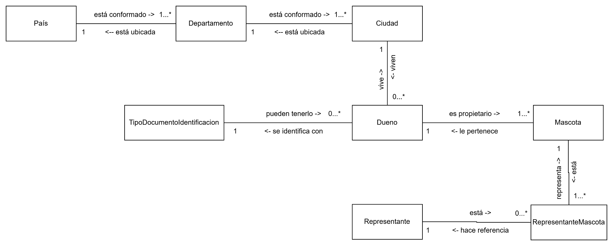

# ModeloDominioEnriquecido

Fuente: `09db90da-ModeloDominioEnriquecido.xlsx` · 13 hojas

## Índice de hojas

- ModeloDominio
- ListadoObjetosDominio
- C-Ciudad
- M-Ciudad
- C-Departamento
- M-Departamento
- C-Dueno
- M-Dueno
- C-Pais
- E-Pais
- M-Pais
- C-TipoDocumentoIdentificacion
- M-TipoDocumentoIdentificacion

---

## Hoja: ModeloDominio

---

## Hoja: ListadoObjetosDominio

| Línea de vida | Nombre | Descripción | Muestreo de datos | Caracterización objeto |
|---|---|---|---|---|
| 1 | Pais | Objeto de dominio que representa a cada uno de los países a los que pertenecen los departamentos y ciudades donde están ubicadas las sedes de la veterinaria y donde también pueden vivir los dueños | Ir | Ir |
| 1 | Representante | Objeto de dominio que representa a la persona autorizada para llevar mascotas a la veterinaria en nombre su respectivo dueño. |  |  |
| 1 | TipoDocumentoIdentificacion | Objeto de dominio que representa a cada uno de los tipos de identificación que pueden tener los dueños de las mascotas | Ir | Ir |
| 2 | Departamento | Objeto de dominio que representa a cada uno de los departamentos de un país, donde se encuentran las ciudades donde están ubicadas las sedes de la veterinaria y donde también pueden vivir los dueños | Ir | Ir |
| 3 | Ciudad | Objeto de dominio que representa a cada una de las ciudades de los departamentos de un país, donde se encuentran  las sedes de la veterinaria y donde también pueden vivir los dueños | Ir | Ir |
| 4 | Dueno | Objeto de dominio que representa a cada uno de los dueños que tienen mascotas, que pueden ser representadas por un tercero, para visitar a la veterinaria. | Ir | Ir |
| 5 | Mascota | Objeto de dominio que representa a cada una de las mascotas que pueden ser representadas por un tercero en nombre de su dueño para visitar a la veterinaria. |  |  |
| 6 | RepresentanteMascota | Objeto de dominio que representa a cada una de las mascotas con los respectivos representantes autorizados para representar al dueño ante la veterinaria. |  |  |

---

## Hoja: C-Ciudad

| << Ir al modelo de dominio | << Ir al listado de objetos de dominio | Ir al muestreo de datos del objeto de dominio >> |
|---|---|---|

---

## Hoja: M-Ciudad

| << Ir al modelo de dominio |  |  | << Ir al listado de objetos de dominio | << Ir a la caracterización del objeto de dominio |
|---|---|---|---|---|
| Nombre: | Ciudad |  |  |  |
| Descripción: | Objeto de dominio que representa a cada una de las ciudades de los departamentos de un país, donde se encuentran  las sedes de la veterinaria y donde también pueden vivir los dueños |  |  |  |
| Representa el identificador único de cada objeto de dominio. | Representa el nombre de cada una de las ciudades pertenecientes a los despartamentos de los países en los cuales pueden estar presentes los dueños y la veterinaria | Representa el objeto de dominio Departamento de los países al que pertenece una ciudad donde pueden estar ubicados los dueños y la veterinaria | Indica que no pueden existir dos ciudades o más con el mismo nombre dentro de un mismo departamento |  |
| id | nombre | departamento | Combinación única 1 |  |
| 1 | Rionegro | Antioquia-Colombia | Rionegro-Antioquia-Colombia |  |
| 2 | Riohacha | Guajira-Colombia | Riohacha-Guajira-Colombia |  |
| 3 | Bogotá | Cundinamarca-Colombia | Bogotá-Cundinamarca-Colombia |  |
| 4 | El Retiro | Antioquia-Colombia | El Retiro-Antioquia-Colombia |  |
| 5 | La Ceja | Antioquia-Colombia | La Ceja-Antioquia-Colombia |  |
|  | Corresponde a los datos generales del objeto de dominio (nombre, descripción) |  |  |  |
|  | Corresponde a las descripciones de los atributos |  |  |  |
|  | Coresponde al nombre de los atributos |  |  |  |
|  | Corresponde a los datos que son de libre ingreso |  |  |  |
|  | Corresponde a los datos que se generarán automáticamente |  |  |  |
|  | Corresponde a la combinación única 1 |  |  |  |
|  | Corresponde a referencias a otros objetos de dominio |  |  |  |

---

## Hoja: C-Departamento

| << Ir al modelo de dominio |  | << Ir al listado de objetos de dominio |  |  | Ir al muestreo de datos del objeto de dominio >> |  |  |  |  |  |  |  |  |  |  |  |  |  |  |  |
|---|---|---|---|---|---|---|---|---|---|---|---|---|---|---|---|---|---|---|---|---|
| Nombre | Departamento |  |  |  |  |  |  |  |  |  |  |  |  |  |  |  |  |  |  |  |
| Descripción | Objeto de dominio que representa a cada uno de los departamentos de un país, donde se encuentran las ciudades donde están ubicadas las sedes de la veterinaria y donde también pueden vivir los dueños |  |  |  |  |  |  |  |  |  |  |  |  |  |  |  |  |  |  |  |
| Nombre atributo | Descripción atributo | Identificador del objeto de dominio | Tipo de dato | Obligatorio | Longitud mínima (si aplica) | Longitud máxima (si aplica) | Precisión (si aplica) | Rendondeo (si aplica) | Rango inicial (si aplica) | Rango final (si aplica) | Formato (si aplica) | Reglas especiales (si aplica) | Dato calculado | Aplica ajuste del dato (si aplica) | Carácter de ajuste (si aplica) | Quitar espacios en blanco al inicio (si aplica) | Quitar espacios en blanco al fin (si aplica) | Dato sensible (si aplica) | Valor por defecto (si aplica) | Auto generado |
| id | Representa el identificador único de cada objeto de dominio. | Si | Identificador único universal | Si |  |  |  |  |  |  |  |  | No | No |  | No | No | No |  | Si |
| nombre | Representa el nombre de cada uno de los departamentos pertenecientes a los países en los cuales pueden estar presentes los dueños y la veterinaria | No | Alfanumérico | Si | 1 | 50 |  |  |  |  |  | Se debe asegurar una sanitización del dato, para garantizar que dentro de su contenido no tenga cualquier tipo de intento de ataque o instrucción maliciosa. | No | No |  | Si | Si | No |  | No |
| pais | Representa el objeto de dominio Pais al que pertenece un departamento donde pueden estar ubicados los dueños y la veterinaria | No | Pais | Si |  |  |  |  |  |  |  | Aplican las reglas del objeto referenciado. | No | No |  | No | No | No |  | No |
| Nombre combinación única | Descripción | Atributos involucrados |  |  |  |  |  |  |  |  |  |  |  |  |  |  |  |  |  |  |
| Combinación única 1 | Indica que no pueden existir dos departamentos o más con el mismo nombre dentro de un mismo país | nombre |  |  |  |  |  |  |  |  |  |  |  |  |  |  |  |  |  |  |
|  |  | pais |  |  |  |  |  |  |  |  |  |  |  |  |  |  |  |  |  |  |

---

## Hoja: M-Departamento

| << Ir al modelo de dominio |  |  | << Ir al listado de objetos de dominio | << Ir a la caracterización del objeto de dominio |
|---|---|---|---|---|
| Nombre: | Departamento |  |  |  |
| Descripción: | Objeto de dominio que representa a cada uno de los departamentos de un país, donde se encuentran las ciudades donde están ubicadas las sedes de la veterinaria y donde también pueden vivir los dueños |  |  |  |
| Representa el identificador único de cada objeto de dominio. | Representa el nombre de cada uno de los departamentos pertenecientes a los países en los cuales pueden estar presentes los dueños y la veterinaria | Representa el objeto de dominio Pais al que pertenece un departamento donde pueden estar ubicados los dueños y la veterinaria | Indica que no pueden existir dos departamentos o más con el mismo nombre dentro de un mismo país |  |
| id | nombre | pais | Combinación única 1 |  |
| 1 | Antioquia | Colombia | Antioquia-Colombia |  |
| 2 | Guajira | Colombia | Guajira-Colombia |  |
| 3 | Cundinamarca | Colombia | Cundinamarca-Colombia |  |
| 4 | Andalgalá | Argentina | Andalgalá-Argentina |  |
| 5 | Angaco | Argentina | Angaco-Argentina |  |
|  | Corresponde a los datos generales del objeto de dominio (nombre, descripción) |  |  |  |
|  | Corresponde a las descripciones de los atributos |  |  |  |
|  | Coresponde al nombre de los atributos |  |  |  |
|  | Corresponde a los datos que son de libre ingreso |  |  |  |
|  | Corresponde a los datos que se generarán automáticamente |  |  |  |
|  | Corresponde a la combinación única 1 |  |  |  |
|  | Corresponde a referencias a otros objetos de dominio |  |  |  |

---

## Hoja: C-Dueno

| << Ir al modelo de dominio | << Ir al listado de objetos de dominio | Ir al muestreo de datos del objeto de dominio >> |
|---|---|---|

---

## Hoja: M-Dueno

| << Ir al modelo de dominio |  |  |  |  |  |  |  |  |  |  |  |  | << Ir al listado de objetos de dominio |  |  | << Ir a la caracterización del objeto de dominio |
|---|---|---|---|---|---|---|---|---|---|---|---|---|---|---|---|---|
| Nombre: | Ciudad |  |  |  |  |  |  |  |  |  |  |  |  |  |  |  |
| Descripción: | Objeto de dominio que representa a cada una de las ciudades de los departamentos de un país, donde se encuentran  las sedes de la veterinaria y donde también pueden vivir los dueños |  |  |  |  |  |  |  |  |  |  |  |  |  |  |  |
| Representa el identificador único de cada objeto de dominio. | Representa el objeto de dominio TipoDOcumentoIdentificacion donde se encuentra el tipo de identificación que tiene asociado un dueño |  |  |  |  |  |  | Representa el correo electrónico de un dueño. Se debe asegurar que al momento del registro se garantice que cumpla con un formato de correo electrónico válido. |  | Representa el objeto de dominio Ciudad donde vive un dueño |  | Representa la edad actual de una persona, la cual se calcula con base a la fecha de nacimiento y la fecha actual | Indica que no pueden existir dos dueños o más con el mismo tipo de identificación y número de identificación |  |  |  |
| id | tipoDocumentoIdentificacion | numeroIdentificacion | primerNombre | segundoNombre | primerApellido | segundoApellido | numeroTelefono | correoElectronico | direccionResidencia | ciudadResidencia | fechaNacimiento | edad | Combinación única 1 | Combinación única 2 | Combinación única 3 |  |
| 1 | Cédula | 123456 | Sofía | Antonia | Escobar |  | 3056789065 | sofia@gmail.com | Calle 56 # 45-76 | Rionegro-Antioquia-Colombia | 1980-01-30 00:00:00 | 46 | Cédula-123456 | 3056789065 | sofia@gmail.com |  |
| 2 | Cédula | 9876543 | Carlos |  | Mejía | Vallejo | 3008765432 | c@hotmail.com | Calle 78 #45-98 | Rionegro-Antioquia-Colombia | 2000-02-26 00:00:00 | 26 | Cédula-9876543 | 3008765432 | c@hotmail.com |  |
| 3 | Tarjeta de Identidad | 6452376 | Rodrigo | Hernán | Peñaloza | García | 3076543897 | peñita@gmail.co | Avenida 56 con circunvalar 4 | Rionegro-Antioquia-Colombia | 2015-12-31 00:00:00 | 11 | Tarjeta de Identidad-6452376 | 3076543897 | peñita@gmail.co |  |
| 4 | Tarjeta de Identidad | 8423798 | Clara | María | Grisales | Berrío | 3004567890 | clarita@gmail.com | Carrera 76a #56-87 | Rionegro-Antioquia-Colombia | 2010-12-31 00:00:00 | 16 | Tarjeta de Identidad-8423798 | 3004567890 | clarita@gmail.com |  |
|  | Corresponde a los datos generales del objeto de dominio (nombre, descripción) |  |  |  |  |  |  |  |  |  |  |  |  |  |  |  |
|  | Corresponde a las descripciones de los atributos |  |  |  |  |  |  |  |  |  |  |  |  |  |  |  |
|  | Coresponde al nombre de los atributos |  |  |  |  |  |  |  |  |  |  |  |  |  |  |  |
|  | Corresponde a los datos que son de libre ingreso |  |  |  |  |  |  |  |  |  |  |  |  |  |  |  |
|  | Corresponde a los datos que se generarán automáticamente |  |  |  |  |  |  |  |  |  |  |  |  |  |  |  |
|  | Corresponde a la combinación única 1 |  |  |  |  |  |  |  |  |  |  |  |  |  |  |  |
|  | Corresponde a la combinación única 2 |  |  |  |  |  |  |  |  |  |  |  |  |  |  |  |
|  | Corresponde a la combinación única 3 |  |  |  |  |  |  |  |  |  |  |  |  |  |  |  |
|  | Corresponde a referencias a otros objetos de dominio |  |  |  |  |  |  |  |  |  |  |  |  |  |  |  |
|  | Corresponden a datos calculados o cumputados (se calculan con base en otros y de forma automática) |  |  |  |  |  |  |  |  |  |  |  |  |  |  |  |

---

## Hoja: C-Pais

| << Ir al modelo de dominio |  |  | << Ir al listado de objetos de dominio |  |  | Ir al muestreo de datos del objeto de dominio >> |  |  |  |  |  |  |  |  |  |  |  |  |  |  |
|---|---|---|---|---|---|---|---|---|---|---|---|---|---|---|---|---|---|---|---|---|
| Nombre | Pais |  |  |  |  |  |  |  |  |  |  |  |  |  |  |  |  |  |  |  |
| Descripción | Objeto de dominio que representa a cada uno de los países a los que pertenecen los departamentos y ciudades donde están ubicadas las sedes de la veterinaria y donde también pueden vivir los dueños |  |  |  |  |  |  |  |  |  |  |  |  |  |  |  |  |  |  |  |
| Nombre atributo | Descripción atributo | Identificador del objeto de dominio | Tipo de dato | Obligatorio | Longitud mínima (si aplica) | Longitud máxima (si aplica) | Precisión (si aplica) | Rendondeo (si aplica) | Rango inicial (si aplica) | Rango final (si aplica) | Formato (si aplica) | Reglas especiales (si aplica) | Dato calculado | Aplica ajuste del dato (si aplica) | Carácter de ajuste (si aplica) | Quitar espacios en blanco al inicio (si aplica) | Quitar espacios en blanco al fin (si aplica) | Dato sensible (si aplica) | Valor por defecto (si aplica) | Auto generado |
| id | Representa el identificador único de cada objeto de dominio. | Si | Identificador único universal | Si |  |  |  |  |  |  |  |  | No | No |  | No | No | No |  | Si |
| nombre | Representa el nombre de cada uno de los países en los cuales pueden estar presentes los dueños y la veterinaria | No | Alfanumérico | Si | 1 | 50 |  |  |  |  |  | Se debe asegurar una sanitización del dato, para garantizar que dentro de su contenido no tenga cualquier tipo de intento de ataque o instrucción maliciosa. | No | No |  | Si | Si | No |  | No |
| Nombre combinación única | Descripción | Atributos involucrados |  |  |  |  |  |  |  |  |  |  |  |  |  |  |  |  |  |  |
| Combinación única 1 | Indica que no pueden existir dos países o más con el mismo nombre | nombre |  |  |  |  |  |  |  |  |  |  |  |  |  |  |  |  |  |  |
| Responsabilidad |  | Descripción |  |  |  | Entradas |  |  | Salida |  |  |  |  | Políticas (Reglas de Negocio) |  | Excepción |  |  |  |  |
|  |  |  |  |  |  | Parámetro | Tipo de dato | Descripción | Tipo de Dato | Descripción |  |  |  | Política | Descripción | Detalle | ¿Qué hago? |  |  |  |
| Registrar información de una nuevo País |  | Acción que permite llevar a cabo el registro de la información de uno país. |  |  |  | datos | Pais | Contiene la información requerida para llevar a cabo el registro de uno país |  |  |  |  |  | P1 | No puede existir otro país con el mismo identificador. | Generar un nuevo identificador hasta garantizar que no exista. | Continuar operación |  |  |  |
|  |  |  |  |  |  |  |  |  |  |  |  |  |  | P2 | No puede existir otro país con el mismo nombre. | Generar una excepción indicándole al usuario que ya existe un país con el nombre deseado. | Detener operación |  |  |  |
|  |  |  |  |  |  |  |  |  |  |  |  |  |  | P3 | Asegurar que los datos requeridos para llevar a cabo la acción sean válidos a nivel de tipo de dato, longitud, obligatoriedad, formato y rango. | Generar una excepción indicándole al usuario que existen problemas con los datos y de ser posible indicarle cómo solucionarlos. | Detener operación |  |  |  |
| Eliminar de forma definitiva la información de un nuevo País |  | Definición del event storming |  |  |  | id | Alfanumérico | Contiene la información del identificador del pais que se va a eliminar de forma definitiva |  |  |  |  |  | P4 | Asegurar que el país no esté siendo utilizado dentro de ningún otro objeto de dominio | Generar una excepción indicando que el país está relacionado con otro objeto de dominio, indicando cuál y por tanto no puede ser eliminada. | Detener operación |  |  |  |
| Consultar información de un País por su identificador |  | Definición del event storming |  |  |  | id | Alfanumérico | Contiene la información del identificador del país que se va a consultar | Pais | Contiene la información del País consultada por su id |  |  |  | P3 | Asegurar que los datos requeridos para llevar a cabo la acción sean válidos a nivel de tipo de dato, longitud, obligatoriedad, formato y rango. | Generar una excepción indicándole al usuario que existen problemas con los datos y de ser posible indicarle cómo solucionarlos. | Detener operación |  |  |  |
| Consultar información de los Países |  | Definición del event storming |  |  |  | filtro | Pais | Contiene la información de los filtros que servirán como base para llevar a cabo la consulta de la información | Lista<Pais> | Contiene la información de todos los países que cumplen con el filtro de consulta |  |  |  | P5 | Asegurar que los datos que fueron enviados como filtro para llevar a cabo la acción sean válidos a nivel de tipo de dato, longitud, obligatoriedad, formato y rango. | Generar una excepción indicándole al usuario que existen problemas con los datos y de ser posible indicarle cómo solucionarlos. | Detener operación |  |  |  |
| Modificar información de un País |  | Definición del event storming |  |  |  | id | Alfanumérico | Contiene la información del identificador del país para la cual se va a modificar la información |  |  |  |  |  | P3 | Asegurar que los datos requeridos para llevar a cabo la acción sean válidos a nivel de tipo de dato, longitud, obligatoriedad, formato y rango. | Generar una excepción indicándole al usuario que existen problemas con los datos y de ser posible indicarle cómo solucionarlos. | Detener operación |  |  |  |
|  |  |  |  |  |  | datos | Pais | Contiene los datos que se van a modificar dentro del país |  |  |  |  |  |  |  |  |  |  |  |  |

---

## Hoja: E-Pais

| << Ir al modelo de dominio |  | << Ir al listado de objetos de dominio |  |  | << Ir a la caracterización del objeto de dominio |  |  |  | Ir al muestreo de datos del objeto de dominio >> |  |
|---|---|---|---|---|---|---|---|---|---|---|
| Objeto de Dominio: | Pais |  |  |  |  |  |  |  |  |  |
| Descripción: | Objeto de dominio que representa a cada uno de los países a los que pertenecen los departamentos y ciudades donde están ubicadas las sedes de la veterinaria y donde también pueden vivir los dueños |  |  |  |  |  |  |  |  |  |
| Actor | Action/Command |  | Entity/Aggregate/Object domain | Read Model |  | Business Rule/Policy |  | External System | Domain Event | Hotspot/questions/Risk |
| Actor | Acción | Descripción | Objeto de dominio | Información externa |  | Políticas |  | Sistema Externo | Evento | Aspectos por solucionar |
|  |  |  |  | Información | Descripción | Número | Descripción |  |  |  |
| Veterinaria | Consultar la información de los países | Permite consultar la información de los países que cumplan un criterio de búsqueda específico | Pais |  |  |  |  |  | Países consultados |  |
| Cliente | Consultar la información de los países | Permite consultar la información de los países que cumplan un criterio de búsqueda específico | Pais |  |  |  |  |  | Países consultados |  |
| Representante | Consultar la información de los países | Permite consultar la información de los países que cumplan un criterio de búsqueda específico | Pais |  |  |  |  |  | Países consultados |  |

---

## Hoja: M-Pais

| << Ir al modelo de dominio |  | << Ir al listado de objetos de dominio | << Ir a la caracterización del objeto de dominio |
|---|---|---|---|
| Nombre: | Pais |  |  |
| Descripción: | Objeto de dominio que representa a cada uno de los países a los que pertenecen los departamentos y ciudades donde están ubicadas las sedes de la veterinaria y donde también pueden vivir los dueños |  |  |
| Representa el identificador único de cada objeto de dominio. | Representa el nombre de cada uno de los países en los cuales pueden estar presentes los dueños y la veterinaria | Indica que no pueden existir dos países o más con el mismo nombre |  |
| id | nombre | Combinación única 1 |  |
| 1 | Colombia | Colombia |  |
| 2 | Ecuador | Ecuador |  |
| 3 | Brasil | Brasil |  |
| 4 | Chile | Chile |  |
| 5 | Argentina | Argentina |  |
|  | Corresponde a los datos generales del objeto de dominio (nombre, descripción) |  |  |
|  | Corresponde a las descripciones de los atributos |  |  |
|  | Coresponde al nombre de los atributos |  |  |
|  | Corresponde a los datos que son de libre ingreso |  |  |
|  | Corresponde a los datos que se generarán automáticamente |  |  |
|  | Corresponde a la combinación única 1 |  |  |

---

## Hoja: C-TipoDocumentoIdentificacion

| << Ir al modelo de dominio | << Ir al listado de objetos de dominio | Ir al muestreo de datos del objeto de dominio >> |
|---|---|---|

---

## Hoja: M-TipoDocumentoIdentificacion

| << Ir al modelo de dominio |  | << Ir al listado de objetos de dominio | << Ir a la caracterización del objeto de dominio |
|---|---|---|---|
| Nombre: | TipoDocumentoIdentificacion |  |  |
| Descripción: | Objeto de dominio que representa a cada uno de los tipos de identificación que pueden tener los dueños de las mascotas |  |  |
| Representa el identificador único de cada objeto de dominio. | Representa el nombre de cada uno de los tipos de documento de identificación que pueden tener los dueños | Indica que no pueden existir dos tipos de documento de identificación o más con el mismo nombre |  |
| id | nombre | Combinación única 1 |  |
| 1 | Cédula | Cédula |  |
| 2 | Tarjeta de Identidad | Tarjeta de Identidad |  |
| 3 | Registro Civil | Registro Civil |  |
| 4 | Pasaporte | Pasaporte |  |
| 5 | Cédula Extranjería | Cédula Extranjería |  |
|  | Corresponde a los datos generales del objeto de dominio (nombre, descripción) |  |  |
|  | Corresponde a las descripciones de los atributos |  |  |
|  | Coresponde al nombre de los atributos |  |  |
|  | Corresponde a los datos que son de libre ingreso |  |  |
|  | Corresponde a los datos que se generarán automáticamente |  |  |
|  | Corresponde a la combinación única 1 |  |  |
